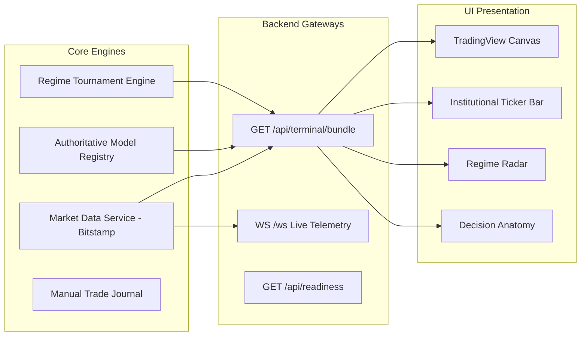

# BTCognitive — Product Requirements Document (PRD)
## Quantitative Market Risk Intelligence & Probabilistic Excursion Engine for BTC/USD

**Document Status:** Production / Canonical  
**Version:** 2.0.0 (Post-V35.4 Institutional Alignment)  
**Classification:** Quantitative Financial Intelligence / Non-Execution Analysis  
**Repository:** `https://github.com/ashishlabs-23/bitcoin-prediction-lab`  

---

## 1. Executive Summary & Product Vision

### 1.1 Vision Statement
BTCognitive is an institutional-grade **Market Risk Intelligence Application** specifically engineered for Bitcoin (BTC/USD). It replaces naive, uncalibrated price-prediction heuristics with rigorous, peer-reviewed financial econometrics, causal point-in-time feature extraction, continuous jump-diffusion microstructure analysis, and distribution-free conformal risk bounds.

Unlike retail "signal bots" or black-box trading algorithms, BTCognitive is fundamentally an **ANALYSIS-ONLY, zero-execution risk copilot**. It delivers probabilistic risk cones, volatility term structures, and counterfactual scenario modeling to quantitative researchers, institutional risk managers, and professional discretionary traders.

```mermaid
graph TD
    A[Bitstamp Real-Time WebSocket & REST Feed] --> B[Decoupled Observational Data Engine]
    B --> C[Causal Point-in-Time Feature Pipeline]
    C --> D[Heterogeneous Autoregressive Volatility Suite / HAR-RV]
    C --> E[Hawkes Self-Exciting Jump Microstructure Engine]
    D --> F[Conformal Uncertainty Calibration / C2 Delayed Resolution]
    E --> F
    F --> G[Unified Risk Terminal / GET /api/terminal/bundle]
    G --> H[TradingView Canvas & 3D WebGL Workstation]
    
    style A fill:#0f172a,stroke:#38bdf8,stroke-width:2px
    style G fill:#1e293b,stroke:#10b981,stroke-width:2px
    style H fill:#020617,stroke:#a855f7,stroke-width:2px
```

### 1.2 Core Value Proposition
1. **Mathematical Honesty Over False Precision:** Rejects unconditional directional return forecasts (e.g. 90% directional accuracy claims that violate the Efficient Market Hypothesis) in favor of strictly calibrated volatility density forecasts evaluated via QLIKE loss functions.
2. **Causal Point-in-Time Integrity:** Strict mathematical temporal isolation ($t_{\text{feature}} \le t_{\text{issue}} < t_{\text{maturity}}$), guaranteeing zero lookahead leakage into predictive features.
3. **Fail-Closed Architecture:** If primary market feeds or feature stores experience data starvation, corruption, or excessive latency, the system fails closed with explicit `DATA_UNAVAILABLE` states. It never fabricates synthetic prices or silent fallback fallacies.
4. **Permanent Non-Execution Boundary:** Order placement, broker APIs, exchange routing, and automated capital deployment are permanently disabled at the architecture and security middleware levels.

---

## 2. Target Personas & User Journeys

### 2.1 Persona Matrix

| Persona | Role & Context | Primary Need | BTCognitive Solution |
| :--- | :--- | :--- | :--- |
| **Institutional Risk Manager** | Digital asset hedge fund or family office managing treasury exposure. | Tail-risk quantification, excursion boundaries (MAE/MFE), and volatility regime shifts. | 24h & 7d Conformal Risk Envelopes, Parkinson & Garman-Klass volatility surfaces, regime transition matrices. |
| **Quantitative Researcher** | Systematic strategist designing statistical arbitrage or delta-neutral strategies. | Replicable benchmarks, auditable walk-forward bake-offs, Diebold-Mariano tests. | Complete model registry, QLIKE loss scorecards, 100-block prospective audit ledgers, freeze manifests. |
| **Discretionary Macro Trader** | Professional trader executing manual hedges on major spot/derivative venues. | Real-time order book imbalance, Hawkes event clustering, counterfactual "what-if" setups. | Live Bitstamp order book pressure HUD, multi-horizon excursion bands, observational trade journal. |

---

## 3. Mathematical & Econometric Foundations

BTCognitive is built upon established econometrics literature and empirical finance methods:

### 3.1 Heterogeneous Autoregressive Realized Volatility (HAR-RV)
The foundational volatility engine implements Corsi (2009) and Patton & Sheppard (2015) Realized Semivariance extensions:

$$\text{RV}_{t+1:t+h} = \beta_0 + \beta_d \text{RV}_t^{(d)} + \beta_w \text{RV}_t^{(w)} + \beta_m \text{RV}_t^{(m)} + \beta_{RS}^+ \text{RS}_t^+ + \beta_{RS}^- \text{RS}_t^- + \sum_{k=1}^5 \gamma_k D_{k,t} + \varepsilon_{t+h}$$

- **Primary Target Horizon:** 168-hour (7 calendar days) forward annualized realized variance (`rv7d_var_ann`):
  $$\text{RV}_{7d,t}^2 = \left(\frac{8760}{168}\right) \sum_{i=1}^{168} r_{t+i}^2$$
- **Evaluation Metric:** Quasi-Likelihood (QLIKE) loss function, immune to Jensen's inequality distortions:
  $$L_{\text{QLIKE}}(h_t, \hat{h}_t) = \frac{h_t}{\hat{h}_t} - \ln\left(\frac{h_t}{\hat{h}_t}\right) - 1$$
- **Comparative Testing:** Diebold-Mariano test with Harvey-Leybourne-Newbold (1997) finite-sample correction against Student's $t_{T-1}$.

### 3.2 High-Frequency Hawkes Jump Microstructure
For sub-hourly horizons (5m), order flow arrival intensity is modeled as a mutually exciting multivariate Hawkes process:

$$\lambda_m(t) = \mu_m + \sum_{m'=1}^M \int_0^t \alpha_{m,m'} e^{-\beta_{m,m'}(t - s)} dN_{m'}(s)$$

Tracking buy-aggressor and sell-aggressor cluster bursts to assess immediate liquidity dry-ups and spread widening risk.

### 3.3 Conformal Prediction Envelopes (C2 Conformal)
Rather than assuming Gaussian or Student-$t$ error distributions, prediction intervals are generated via distribution-free Conformal Prediction with causal delayed outcome resolution:
- **Nominal Coverage:** 90% ($\alpha = 0.10$).
- **Non-Crossing Guarantee:** Lower bound $\hat{q}_{\alpha/2}$ and upper bound $\hat{q}_{1 - \alpha/2}$ are enforced via isotonic monotonic projection.

---

## 4. Product Functional Modules

### Module 1: Institutional Market Telemetry
- Real-time connection to Bitstamp Spot BTC/USD.
- UTC-aligned candle bucket aggregation (1m, 5m, 15m, 1h, 4h, 1d).
- Monotonic clock synchronization and receive-latency HUD (`market_latency_ms`, `ws_latency_ms`).

### Module 2: Authoritative Volatility Forecasting
- Authoritative baseline: `Standard-HAR-v1.0`.
- Active research challenger: `HAR-RS-DOW-v1.0`.
- Continuous tracking of out-of-sample QLIKE and RMSE.
- Formal promotion lock: Challenger models require 100 non-overlapping prospective blocks before promotion consideration.

### Module 3: Conformal Risk Envelopes & Excursion Intelligence
- Multi-horizon risk bands rendered directly on the candle chart.
- Maximum Favorable Excursion (MFE) and Maximum Adverse Excursion (MAE) percentile distributions ($p_{10}, p_{50}, p_{90}$).
- Volatility cone visualization projecting expected price dispersion across 1h, 4h, 24h, and 168h windows.

### Module 4: Adaptive Regime Classification
- Continuous estimation of Hurst exponent ($H < 0.45 \implies$ Mean-Reverting, $H > 0.55 \implies$ Trending).
- Parkinson High-Low realized volatility calculation scaled by $\sqrt{8760}$.
- EMA-20/50/200 trend slope analysis with a required 200-bar warmup period.

### Module 5: Observational Journal & Counterfactual Simulator
- Zero-execution manual trade journaling interface.
- Automatic recording of entry timestamp, exit timestamp, fee assumptions, and MFE/MAE capture ratios.
- Strict database isolation using SQLite WAL mode.

---

## 5. Non-Functional Requirements (NFRs)

- **NFR-01 Security & Execution Lockdown:** The server rejects all mutating trading verbs (`POST /order`, `POST /execute`). All broker SDKs are completely absent from dependency trees.
- **NFR-02 API Rate Limiting & Performance Budget:**
  - Non-loopback client IPs are restricted to 60 requests per minute.
  - Client-side steady-state polling must consume $\le 30$ req/min (currently measured at 29.5 req/min).
  - Consolidated gateway `GET /api/terminal/bundle` response latency must remain $< 50\text{ ms}$ at $p_{95}$.
- **NFR-03 Client Crash Resilience:** The React application must be encapsulated by an `AppErrorBoundary` ensuring zero blank-screen crashes on presentation exceptions.
- **NFR-04 Content Security Policy:** Strict CSP headers prohibiting external script injections, inline unsafe evals, and unauthorized outbound telemetry.

---

## 6. Success Metrics & Key Performance Indicators (KPIs)

1. **Econometric Reliability:** Volatility forecast QLIKE loss within 5% of theoretical OOS bounds; zero negative variance projections.
2. **Conformal Coverage Accuracy:** Empirical coverage between $88.0\%$ and $92.0\%$ on the nominal $90\%$ confidence band.
3. **Data Availability & Uptime:** $99.9\%$ uptime during active exchange trading; $< 1\text{s}$ detection of stale or interrupted market data.
4. **Test Suite Integrity:** 100% pass rate across the full 306-test regression suite with zero protected dataset hash modifications.
