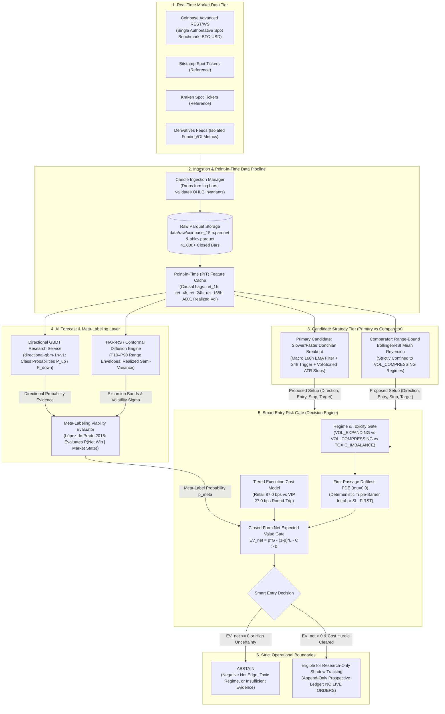

# BTCognitive — Probabilistic Market Risk Intelligence & Research Terminal

<p align="center">
  
  
  
  
  
  
</p>

---

## 1. Overview & Core Mission

**BTCognitive** is an open, empirical research platform and real-time market risk intelligence terminal designed specifically for **Bitcoin (`BTC/USD`)**. 

Unlike conventional trading bots that make unsupported claims of directional accuracy or market timing, BTCognitive operates under **strict epistemic governance and peer-reviewed financial econometrics principles**:
1. **Unconditional Return Predictability is a Myth:** Financial returns on short horizons are dominated by noise and volatility clustering (Engle 1982, Bollerslev 1986). BTCognitive separates **volatility/excursion risk estimation** from directional speculation.
2. **Strict Non-Execution:** Live trading, automated order routing, broker APIs, and real capital deployment are **permanently disabled**. The system serves market risk intelligence, excursion envelopes, and shadow validation.
3. **Point-in-Time Causality:** Features at time $t$ strictly use closed candles and data available at or before time $t$. Zero lookahead bias.
4. **Real-Market Transaction Cost Reality:** All strategies and excursions are evaluated against realistic, non-zero friction models (e.g. Coinbase Retail at **87.0 bps** round-trip).

---

## 2. High-Level Architecture

BTCognitive is organized into a modular, research-governed quantitative architecture:



---

## 3. Key Features & Capabilities

### 3.1 Interactive Web Research Terminal
- **TradingView-Grade Interactive Visuals:** Smooth candlestick charts rendering closed hourly and 4-hour candles in synchronized UTC time.
- **Conformal Volatility Excursion Bands:** Real-time P10–P90 empirical diffusion envelopes projected over forward horizons.
- **Market Driver Radar:** Multi-exchange spot spread analysis, 1h/4h/24h momentum, realized volatility, and Wilder ADX(14) regime classification.
- **Shadow Ledger Inspector:** Direct, live view of prospective candidates, barrier resolutions, MFE/MAE excursions, and fee audits.
- **Zero Build Dependency:** Built using vanilla JavaScript and CSS — no Node compilation or bundler overhead required to run.

### 3.2 Quantitative & Volatility Modeling
- **Heterogeneous Autoregressive (HAR-RS) Models:** Captures short-term (1h), medium-term (24h), and weekly (168h) realized semi-variance components.
- **Conformal Risk Envelopes:** Distribution-free prediction intervals calibrated via Winkler interval scoring and marginal-vs-joint path containment.
- **Hawkes Self-Exciting Jump Processes:** Point-process estimation of trade cluster intensity and volatility feedback.

### 3.3 Strategy Excursion & Barrier Resolution
- **Track V3 Structural Setup Engine (`BTC-ENTRY-TP-SL-V3`):** Causal detection of liquidity sweeps and consolidation range reclaims on a 15-minute cadence.
- **Track D High-Timeframe Range Expansion (`HTF_RANGE_EXPANSION_BREAKOUT`):** 4-hour 20-bar Donchian breakout engine with causal next-bar open fills and trailing horizontal timeout (18 bars / 72 hours).
- **Deterministic Barrier Resolver:**
  - Conservative Intrabar Collision Rule: If both take-profit and stop-loss are penetrated inside the same candle, resolves strictly to `SL_FIRST` with `is_ambiguous_touch = True`.
  - Opening Gap Protection: Gaps beyond a barrier are executed at the actual opening price, capturing realistic market slippage.

### 3.4 Realistic Cost Accounting Engine
- **Primary Pre-Registered Scenario (`COINBASE_RETAIL_87BPS`):**
  - Taker commission: 40.0 bps per side (80.0 bps round-trip).
  - Top-of-book half-spread: 1.5 bps per side (3.0 bps round-trip).
  - Execution slippage: 2.0 bps per side (4.0 bps round-trip).
  - **Total Friction:** Exactly **87.0 bps round-trip**.
- **Dimensional Metric Separation:**
  - Basis points (`net_return_bps`) measure return relative to entry price: $[(P_{\text{exit}} - P_{\text{entry}}) / P_{\text{entry}}] \times 10{,}000 - 87.0$.
  - R-multiples (`net_r`) measure return relative to initial risk unit $1R = P_{\text{entry}} - P_{\text{stop}}$.
  - The two metrics are dimensionally distinct and never combined arithmetically.

### 3.5 Autonomous Prospective Shadow Feed Runner
- **Continuous Background Loop:** Ingests freshly closed candles every hour from public APIs without human intervention (`python -m engine.shadow_feed_runner --loop --interval 3600`).
- **Single-Instance Process Lock:** Prevents concurrent duplicate loops via `data/.prospective_shadow_runner.lock` with cross-platform PID liveness detection.
- **In-Position Gating:** While an emitted candidate is open, all subsequent breakout signals are suppressed, guaranteeing zero overlapping trade contamination.
- **Fail-Closed Resilience:** Feed outages fall back gracefully to local storage without creating synthetic data or corrupting ledgers.

### 3.6 Multi-Channel Alert & Monitoring System
- Real-time research alert engine evaluating market coiling, regime shifts, and strategy conditions every 60 seconds.
- Multi-channel notification dispatchers supporting Webhooks, Telegram, and Email.
- 15-minute deduplication and cooldown state persisted to `data/research_alert_state.json`.

### 3.7 AI Forecasts & Risk Outlook Workspace (V32.35)
- **Dedicated Discovery Route (`#/forecast`):** Accessible in one click from the primary navigation bar (`#nav-forecast`), hero landing card (`#hero-btn-forecast`), top research status banner (`#banner-forecast-btn`), and workstation tabs (`tab-btn-forecast`).
- **Section A — Directional Research GBDTs:** LightGBM multi-horizon (`1h`, `4h`, `24h`) point-in-time inference (`directional-gbm-1h-v1`), $P(\text{UP})$ vs $P(\text{DOWN})$ class probabilities, causal candle timestamps, data freshness verification, and the mandatory interpretation disclaimer:
  > *"Directional probability is not the probability of a trade hitting take-profit before stop-loss and is not a profit guarantee. All directional models operate under research-only governance with net negative expectancy after transaction friction."*
- **Section B — Volatility & Risk Intelligence:** Heterogeneous Autoregressive (`HAR-RS-DOW-v1.0`) annualized continuous realized variance (`rv168h_var_ann`), C2 dependence-aware conformal risk envelope bounds (90% target coverage, 84.89% empirical holdout), and observatory calibration health metrics.
- **Section C — Truthful Model Registry:** Honest status semantics for non-operational or foundation architectures:
  - `Amazon Chronos-2`: **`INFERENCE NOT EXECUTED`** (zero-shot foundation model; PyTorch inference/weights unexecuted in CPU runtime; zero fabricated charts).
  - `Hawkes Process / Order Flow`: **`DATA UNAVAILABLE`** (requires tick-level L3 message feed; unavailable from spot OHLCV).
  - `Mamba State-Space`: **`REJECTED`** (eliminated during research trials due to execution latency penalties).
- **Section D — Price Forecasting Tournament & Baselines:** Empirical price quantiles (P10, P50, P90), Random Walk persistence benchmark ($E[r]=0$), and Ridge L2 regressor.

---

## 4. Strategy-to-Alert Quantitative Pipeline Architecture

BTCognitive executes an end-to-end, fail-closed quantitative pipeline designed for market risk intelligence and excursion analysis:

$$\text{Verified Data} \longrightarrow \text{Strategy Signal} \longrightarrow \text{Horizon-Matched Forecast} \longrightarrow \text{Cost \& Uncertainty Evaluation} \longrightarrow \text{Smart Entry Gate} \longrightarrow \text{Positive-Edge Research Alert}$$

> [!IMPORTANT]
> **Strict Non-Execution & Research Boundary:**
> - Live trading, broker execution, and order placement are **PERMANENTLY DISABLED**.
> - Model authorization is strictly **`OFFLINE_RESEARCH_ONLY`**.
> - An estimated positive net edge ($EV_{\text{net}} > 0$) is a probabilistic research metric, **never a guarantee of profit** or an order instruction.
> - **V32.27 Execution Audit Outcome (`NO_GO_EVIDENCE_GAP`):** In the October 2026 self-loop research execution ([V32.27 Report](file:///c:/Projects/BTCognitive/BTCognitive/research/reports/v32_27_bounded_self_loop_execution_report.md)), 33,424 authenticated Coinbase BTC-USD hourly candles were captured. The baseline strategy (`TSMOM_DONCHIAN_24H_168H`) exhibited negative after-cost expectancy (-0.2465 R at 27 bps, -0.9898 R at 87 bps). A calibrated tri-state meta-model correctly abstained 100% of the time, protecting capital but proving zero positive net after-cost edge. In accordance with epistemic governance, all features fail closed with `NO_VALIDATED_EDGE` / `META_MODEL_UNAVAILABLE`, and **zero positive-edge alerts are emitted**.

---

### 4.1 Implementation Status by Pipeline Stage

| Pipeline Stage | Implementation Status | Repository Evidence | Runtime Reality |
| :--- | :--- | :--- | :--- |
| **1. Verified Data Contract** | `IMPLEMENTED` | [engine/data_verification.py](file:///c:/Projects/BTCognitive/BTCognitive/engine/data_verification.py) | Enforces `BTC-USD`, `COINBASE` spot venue, schema integrity, monotonic UTC timestamps, duplicate rejection, and freshness within $2\times$ timeframe. Authenticated Coinbase hourly dataset (33,424 bars, 2023–2026) was captured directly from official Coinbase Exchange public REST endpoint (`/products/BTC-USD/candles?granularity=3600`) with local SHA-256 and gap tracking (does not carry a cryptographic digital signature signed by Coinbase). Legacy dataset `data/raw/ohlcv.parquet` remains quarantined (`UNVERIFIED_SOURCE`). Fails closed with `DATA_CONTRACT_BREACH`, `UNVERIFIED_SOURCE`, `STALE_DATA`, or `FEATURE_UNAVAILABLE`. |
| **2. Strategy Signal Generator** | `IMPLEMENTED` | [engine/strategy_signal_engine.py](file:///c:/Projects/BTCognitive/BTCognitive/engine/strategy_signal_engine.py) | Evaluates deterministic strategies on completed bars. Channels strictly use `shift(1)` to exclude signal bar $t$. Fills occur causally at $t+1$ Open. Coinbase Spot shorts map strictly to `CASH` / `SPOT_SHORT_INELIGIBLE`. |
| **3. Horizon-Matched Forecast** | `IMPLEMENTED` (Context Only) | [engine/directional_forecast_service.py](file:///c:/Projects/BTCognitive/BTCognitive/engine/directional_forecast_service.py) | Frozen LightGBM return-sign classifiers (1h, 4h, 24h). Matches strategy holding horizon or fails with `HORIZON_MISMATCH`. Directional $P(\text{UP})$ is **never** substituted for trade-outcome $p_{\text{TP}}$. Chronos-2 pre-registered as Stage 3 challenger only. |
| **4. Cost & Uncertainty Evaluation** | `IMPLEMENTED` (Fails Closed) | [engine/trade_outcome_evaluator.py](file:///c:/Projects/BTCognitive/BTCognitive/engine/trade_outcome_evaluator.py) | Closed-form 3-outcome triple-barrier equation with $p_{\text{TP}} + p_{\text{SL}} + p_{\text{TO}} = 1.0$. Converts assumed fee scenarios to R units. Fails closed with `META_MODEL_UNAVAILABLE` due to the missing calibrated meta-model. |
| **5. Smart Entry Decision Gate** | `IMPLEMENTED` | [engine/smart_entry_pipeline.py](file:///c:/Projects/BTCognitive/BTCognitive/engine/smart_entry_pipeline.py) | Deterministic 7-point decision gate. Returns `ABSTAIN` with explicit machine-readable failure reason codes. `ELIGIBLE_FOR_SHADOW_EVALUATION` grants shadow tracking only. |
| **6. Research Alert Engine** | `IMPLEMENTED` (0 Emitted) | [engine/smart_entry_pipeline.py](file:///c:/Projects/BTCognitive/BTCognitive/engine/smart_entry_pipeline.py) & [api/notifications.py](file:///c:/Projects/BTCognitive/BTCognitive/api/notifications.py) | Emits `"Potential positive-edge research signal"` only when every gate passes. Currently 0 alerts emitted due to the meta-model blocker. Candidate rejection states are logged with reasons. |

---

### 4.2 Candidate Strategy Specifications

#### Primary Candidate: Asymmetric Donchian Volatility-Scaled Breakout (`TSMOM_DONCHIAN_24H_168H`)
- **Macro Trend Context:** Slower 168-hour (7-day) Exponential Moving Average ($\text{EMA}_{168h}$) computed on closed bars. Long candidates require $P_t > \text{EMA}_{168h}$; Short candidates require $P_t < \text{EMA}_{168h}$. *Empirical Bitcoin momentum literature confirms slower momentum signals exhibit superior risk-adjusted stability and lower false-positive rates than intraday momentum.*
- **Local Breakout Trigger:** 24-hour Donchian High/Low channel computed strictly on prior completed bars $[t-24, t-1]$ via `high.shift(1).rolling(24).max()` and `low.shift(1).rolling(24).min()`, strictly excluding bar $t$.
- **Causal Execution:** Triggered at close of bar $t$, filled at Open of bar $t+1$ ($P_{\text{entry}} = O_{t+1}$).
- **Standardized Risk Geometry:**
  - Standardized Risk Unit: $1R = |P_{\text{entry}} - P_{\text{stop}}| = 1.5 \times \sigma_{\text{Parkinson}}(24h) \times P_{\text{entry}}$.
  - Profit Target Distance: $k_{\text{tp}} = 1.5 R = 2.25 \times \sigma_{\text{Parkinson}}(24h) \times P_{\text{entry}}$ ($1.5:1$ reward-to-risk ratio).
  - Maximum Holding Horizon: $H = 24$ hours (timeout resolution at open of $t+1+H$).
- **Spot Short Restriction:** On Coinbase Spot `BTC-USD`, short-to-open candidates are mapped to `CASH` with reason code `SPOT_SHORT_INELIGIBLE` (margin borrow facility not modeled).

#### Comparator Strategy: Range-Bound Bollinger-RSI Mean Reversion (`RANGE_BOLLINGER_REVERSION_20H`)
- **Regime Precondition:** Strictly confined to consolidating, range-bound regimes: Wilder $ADX(14) < 20$ and Annualized Realized Volatility $\sigma_{\text{ann}} < 40\%$.
- **Mean-Reversion Trigger:** Touch of 20-hour Bollinger Band ($2.0\sigma$) with RSI(14) overbought/oversold levels (RSI $< 30$ for Long, RSI $> 70$ for Short). *Note: Defined accurately as overbought/oversold boundaries, not structural divergence.*
- **Barrier Geometry:**
  - Profit Target: 20-hour Simple Moving Average midline.
  - Stop Distance: $1.0\sigma$ beyond the entry band ($1.0R$).
  - Maximum Holding Horizon: $H = 24$ hours.
- **Spot Short Restriction:** Overbought short signals map to `CASH` / `SPOT_SHORT_INELIGIBLE`.

---

### 4.3 Cost Accounting & Assumed Benchmark Scenarios

All transaction frictions are modeled explicitly as **assumed benchmark scenarios**, not guaranteed account-specific costs:
- **`COINBASE_RETAIL_87BPS` (Assumed Retail Scenario):**
  - Taker commission: 40.0 bps per side (80.0 bps round-trip).
  - Top-of-book half-spread: 1.5 bps per side (3.0 bps round-trip).
  - Execution slippage: 2.0 bps per side (4.0 bps round-trip).
  - **Total Friction:** Exactly **87.0 bps round-trip**.
- **`COINBASE_ACTIVE_27BPS` (Assumed Active/VIP Scenario):**
  - Taker commission: 10.0 bps per side (20.0 bps round-trip).
  - Top-of-book half-spread: 1.5 bps per side (3.0 bps round-trip).
  - Execution slippage: 2.0 bps per side (4.0 bps round-trip).
  - **Total Friction:** Exactly **27.0 bps round-trip**.

**Friction Conversion to Risk Units ($R$):**
$$C_R = \frac{\text{Round-Trip Friction (bps)} / 10{,}000}{|P_{\text{entry}} - P_{\text{stop}}| / P_{\text{entry}}}$$

---

### 4.4 The Closed-Form Net Expected Value Hurdle ($EV_{\text{net}}$)

A raw directional probability (e.g., $P(\text{UP}) = 55.85\%$) does **not** signify trade profitability. The Smart Entry decision gate requires a mathematically closed-form evaluation of net edge partitioning all three mutually exclusive outcomes ($p_{\text{TP}} + p_{\text{SL}} + p_{\text{TO}} = 1.0$):

$$EV_{\text{net}} = p_{\text{TP}} \cdot (k_{\text{tp}} - C_R) - p_{\text{SL}} \cdot (k_{\text{sl}} + C_R) + p_{\text{TO}} \cdot (\mathbb{E}[R_{\text{TO}}] - C_R)$$

Where:
- $k_{\text{tp}} = 1.5 R$ is the gross reward multiple.
- $k_{\text{sl}} = 1.0 R$ is the gross risk multiple.
- $C_R$ is total round-trip friction converted into R units.
- $p_{\text{TP}}$ is the calibrated probability of reaching target before stop.
- $p_{\text{SL}}$ is the calibrated probability of reaching stop before target.
- $p_{\text{TO}}$ is the calibrated probability of reaching neither barrier before horizon $H$.
- $\mathbb{E}[R_{\text{TO}}]$ is the expected signed return at timeout exit in R units.

**Deterministic Smart Entry Gate Invariants:**
1. **Data Validity:** Must pass schema, monotonicity, and freshness checks. Else $\implies \mathbf{ABSTAIN}$ (`DATA_CONTRACT_BREACH` / `STALE_DATA`).
2. **Causal Timing & Side:** Instrument must be `BTC-USD`; side must be `LONG`. Short on spot $\implies \mathbf{ABSTAIN}$ (`SPOT_SHORT_INELIGIBLE`).
3. **Forecast Compatibility:** Model horizon must match strategy holding horizon. Else $\implies \mathbf{ABSTAIN}$ (`HORIZON_MISMATCH`).
4. **Calibrated Meta-Model:** Valid calibrated $p_{\text{TP}}, p_{\text{SL}}, p_{\text{TO}}$ summing to 1.0 must be supplied. Missing meta-model $\implies \mathbf{ABSTAIN}$ (`META_MODEL_UNAVAILABLE`).
5. **Net Expected Edge:** $EV_{\text{net}} > 0.0$. Negative net edge $\implies \mathbf{ABSTAIN}$ (`NEGATIVE_NET_EXPECTANCY`).
6. **Statistical Uncertainty:** $95\%\text{ CI}$ lower bound of $EV_{\text{net}} > 0.0$. Missing or non-positive lower bound $\implies \mathbf{ABSTAIN}$ (`UNCERTAINTY_NOT_ESTABLISHED` / `STATISTICAL_UNCERTAINTY`).
7. **Regime Constraints:** Strategy regime must match market state. Else $\implies \mathbf{ABSTAIN}$ (`REGIME_MISMATCH`).

Only if **all 7 gates pass** does Smart Entry emit `ELIGIBLE_FOR_SHADOW_EVALUATION` and authorize a positive-edge research alert.

---

### 4.5 Positive-Edge Research Alerts & Deduplication

When a candidate clears all gates, a research alert is dispatched:
- **Title:** `"Potential positive-edge research signal"` (Never "profitable trade" or "buy signal").
- **Mandatory Notice:** `"Research only — no order placed; not a guarantee of profit."`
- **Payload:** Timestamp (UTC), strategy ID, instrument, side, horizon, entry, stop, target, cost scenario, $EV_{\text{net}}$, 95% CI interval, and model version.
- **Deduplication:** Hash key `hash(strategy_id + instrument + side + decision_timestamp_utc + model_version)` prevents repeated alerts during periodic API polling.


To prove whether the AI filter adds genuine economic value without overfitting, BTCognitive mandates a strict 5-stage research progression:

```
[ Step 1: Read-Only Audit ] ──> [ Step 2: Frozen Specification ] ──> [ Step 3: Formal Integration Contract ]
                                                                                   │
                                                                                   v
[ Step 5: Append-Only Shadow Tracking ] <── [ Step 4: Component Ablation (A vs B) ]
```

1. **Step 1 — Read-Only Architecture & Contract Audit:** Audit existing signal generators, causal barrier resolvers, and API paths. Verify exactly what is executed vs theoretical.
2. **Step 2 — Specify Primary Strategy & Comparator:** Lock all parameters in advance (zero parameter tuning to historical data).
3. **Step 3 — Define AI–Smart Entry Integration Contract:** Enforce that every proposed trade payload includes: `strategy_id`, `instrument`, `side`, `horizon`, `entry_price`, `stop_price`, `target_price`, `estimated_costs_bps`, `volatility_sigma`, `calibrated_p_meta`, and an explicit machine-readable `veto_reason_code`.
4. **Step 4 — Component Ablation on Untouched Holdout Data:**
   Compare the exact strategy executed under two conditions:
   - **Condition A (Baseline):** Strategy rules alone with realistic friction.
   - **Condition B (Treatment):** Strategy rules + AI Meta-Veto gate.
   - *Statistical Hurdles:* Must demonstrate Deflated Sharpe Ratio ($\text{DSR} > 0.95$, *Bailey & López de Prado, 2014*) to adjust for selection bias, along with a statistically significant reduction in QLIKE loss and drawdown via Harvey-Leybourne-Newbold (1997) paired tests ($p < 0.05$).
5. **Step 5 — Append-Only Prospective Shadow Evaluation:** Deploy in real-time shadow tracking mode. Observe untouched prospective candles without live capital deployment. Accumulate a minimum of 100 non-overlapping closed trades before evaluating confirmatory gates.

---

### 4.6 Single-Market Data & Execution Cost Invariant

To eliminate data provenance ambiguity and lookahead bias:
- **Single Trading Instrument:** Coinbase Spot `BTC-USD`. Foreign exchange rates, derivative funding rates, and cross-currency feeds (e.g., Binance USDT perps) are strictly quarantined from spot trade logic.
- **Pre-Registered Cost Scenarios:**
  - **Tier 1 (Retail Benchmark):** 80.0 bps taker fees + 3.0 bps half-spread + 4.0 bps slippage = **87.0 bps round-trip**.
  - **Tier 2 (Active/VIP Benchmark):** 20.0 bps taker fees + 3.0 bps half-spread + 4.0 bps slippage = **27.0 bps round-trip**.
- **Immutable Historical Data:** Source datasets (`data/raw/ohlcv.parquet`, `data/prospective_entry_ledger.jsonl`) remain strictly read-only and bit-identical.

---

## 5. Repository Layout

```
BTCognitive/
├── README.md                          # Master canonical documentation
├── requirements.txt                   # Production Python dependencies
├── pytest.ini                         # Pytest test discovery & timeout settings
│
├── api/                               # FastAPI backend services
│   ├── server.py                      # Core ASGI app, security middleware & lifespan
│   ├── routes_market.py               # Live market data & quotes endpoints
│   ├── routes_prediction.py           # Conformal ranges & volatility routes
│   ├── routes_research.py             # Prospective ledger & research routes
│   └── notifications.py               # Alert engine & webhook dispatchers
│
├── engine/                            # Quantitative & runtime engines
│   ├── data_verification.py           # Deterministic causal data contract validator
│   ├── strategy_signal_engine.py      # TSMOM Donchian, Bollinger mean-reversion & Strategy D
│   ├── trade_outcome_evaluator.py     # 3-outcome triple-barrier net expectancy evaluator
│   ├── smart_entry_pipeline.py        # End-to-end strategy-to-alert 6-stage pipeline
│   ├── directional_forecast_service.py# Directional LightGBM inference & lag feature extraction
│   ├── smart_entry_engine.py          # Smart Entry decision gate & causal null integration
│   ├── shadow_feed_runner.py          # Continuous prospective shadow collector CLI
│   ├── prospective_shadow_collector.py# HTF breakout logic, in-position gating & ledger
│   ├── barrier_resolver.py            # Deterministic triple-barrier excursion resolver
│   ├── entry_contracts.py             # Immutable dataclass contracts (CandidateSetup, Outcome)
│   ├── probabilistic_entry_engine.py  # Bayesian & logistic entry gate models
│   ├── stationary_bootstrap.py        # Politis & Romano (1994) stationary bootstrap
│   └── price_forecast_engine.py       # Multi-horizon forecast & Diebold-Mariano tests
│
├── models/                            # Volatility & forecasting models
│   ├── directional_gbm_1h_v1.joblib   # 1-hour directional classifier artifact
│   ├── directional_gbm_4h_v1.joblib   # 4-hour directional classifier artifact
│   ├── directional_gbm_24h_v1.joblib  # 24-hour directional classifier artifact
│   ├── challengers/                   # Registered research challengers (HAR-RS, HAR-QLIKE)
│   └── calibrated_signal_classifier.py# Calibrated probability classifiers
│
├── data/                              # Data storage & ledgers (PROTECTED - READ ONLY)
│   ├── raw/ohlcv.parquet              # 41,000+ validated historical hourly candles
│   ├── prospective_entry_ledger.jsonl # Frozen historical prospective entry ledger
│   ├── prospective_shadow_v1.jsonl    # Append-only forward shadow evaluation ledger
│   └── prospective_shadow_status.json # Real-time operational telemetry
│
├── research/                          # Research audit reports & protocols
│   ├── protocol_v1_1.md               # Frozen prospective shadow protocol
│   ├── v32_25_ai_forecast_smart_entry_completion_report.md # Directional & Smart Entry verification
│   ├── v30_3_prospective_shadow_report.md
│   ├── v30_4_shadow_feed_report.md
│   ├── v30_5_shadow_operations_report.md
│   ├── v30_6_operational_proof_report.md
│   ├── v30_7_shadow_burnin_report.md
│   ├── v30_8_collection_integrity_report.md
│   └── v30_9_statistical_gate_audit.md
│
├── tests/                             # Test & verification suites (65+ tests)
│   ├── test_v32_25_directional_integration.py # End-to-end directional & Smart Entry test
│   ├── test_entry_contracts_and_resolver.py
│   ├── test_prospective_shadow_collector.py
│   ├── test_shadow_feed_runner.py
│   ├── test_v30_6_operational_proof.py
│   ├── test_v30_7_shadow_burnin.py
│   ├── test_v30_8_collection_integrity.py
│   └── test_v30_9_statistical_gate_audit.py
│
└── web/                               # Web research terminal frontend
    ├── index.html                     # Terminal markup & UI panels
    ├── app.js                         # React 18 component tree & WebSocket client
    └── styles.css                     # Modern dark-mode glassmorphic styling
```

---

## 6. Quickstart Guide

### 6.1 Installation & Setup

```powershell
# Clone the repository
git clone https://github.com/ashishlabs-23/bitcoin-prediction-lab.git
cd bitcoin-prediction-lab/BTCognitive

# Activate virtual environment
.\.venv_win\Scripts\Activate.ps1

# Install core production runtime requirements
pip install -r requirements.txt

# (Optional) For offline foundation model exploration (Chronos-2, Transformers):
# pip install -r requirements-research.txt
```

### 6.2 Launch the FastAPI Backend & Web Terminal

```powershell
# Start FastAPI backend on port 8000
python -m uvicorn api.server:app --host 127.0.0.1 --port 8000 --reload
```
Open **`http://127.0.0.1:8000`** in your browser to view the real-time research terminal.

### 6.3 Shadow Feed Runner CLI Commands

The prospective shadow collector runs as a standalone Python CLI:

```powershell
# 1. Run a single evaluation cycle on fresh Coinbase market data
python -m engine.shadow_feed_runner --once

# 2. Check feed data freshness and staleness diagnostic
python -m engine.shadow_feed_runner --check-freshness

# 3. Check runner process lock status and ledger summary
python -m engine.shadow_feed_runner --status

# 4. Run a read-only evaluation without modifying the ledger
python -m engine.shadow_feed_runner --once --dry-run

# 5. Start continuous hourly collection loop with single-instance lock
python -m engine.shadow_feed_runner --loop --interval 3600

# To stop the continuous loop: Press Ctrl+C for graceful shutdown.
```

---

## 7. Testing & Independent Verification

BTCognitive maintains a rigorous test suite across quantitative contracts, causal boundaries, and failure modes:

```powershell
# 1. Run the core regression and L2 test suite (86 tests, 100% pass)
# (Evolution: 73 in V32.29/V32.30 -> 86 in V32.31 with 13 deterministic L2 collector & gating tests)
python -m pytest tests/test_strategy_to_alert_pipeline.py tests/test_entry_contracts_and_resolver.py tests/test_smart_entry_api.py tests/test_v32_25_directional_integration.py tests/test_prospective_shadow_collector.py tests/test_prospective_worker_and_resilience.py tests/test_isolated_real_http_server.py tests/test_coinbase_l2_collector_and_gating.py -v

# 2. Run the frontend UI verification tests (formatters, deduplication, polling budget, L2 UI markers, V32.35 AI Forecasts & Risk Outlook)
node tests_frontend.js

# 3. Reproduce the full V32.28 master research pipeline (Phases 2-5)
python -m research.experiments.run_v32_28_master_pipeline

# 4. Reproduce the V32.30 pre-registered multi-horizon study (24h vs 72h vs 168h)
python research/experiments/run_v32_30_horizon_study.py
```

---

## 8. V32.31 Opt-In Coinbase L2 Entry-Gating Research

BTCognitive V32.31 implements an auditable, opt-in Level-2 (L2) market data ingestion and shadow-evaluation pipeline for testing whether contemporaneous order-flow features improve the BTCUSD 168-hour breakout strategy (`TSMOM_DONCHIAN_168H_336H`) after transaction costs.

### Operational Guardrails & Invariants:
1. **Disabled by Default:** The collector is strictly off unless explicitly opted-in via `COINBASE_L2_COLLECTOR_ENABLED=1`. It never launches automatically on application startup or during test runs.
2. **BTC-USD Spot Only:** Connects exclusively to `wss://ws-feed.exchange.coinbase.com` for `BTC-USD`. Unauthorized derivatives or altcoins are rejected at initialization.
3. **Dedicated Research Ledger:** All shadow evaluations are logged to `data/research/prospective_l2_gated_ledger_v1.jsonl`. Existing protected datasets are never touched or modified.
4. **Frozen Pre-Registration Gating ($H_1$):**
   - $\text{OFI}_{15\text{m}} > 0.0$ (Cont, Kukanov & Stoikov 2014)
   - $\text{OBI}_5 > -0.20$ (depth-5 order book imbalance)
   - $\text{Spread}_{\text{bps}} \le 5.0\text{ bps}$
   - Fail-closed mode: Stale (>5.0s) or desynchronized feeds emit `GATE_ABSTAIN_L2_UNAVAILABLE`.
5. **Operating Instructions:**
   ```powershell
   # To explicitly enable L2 ingestion in an authorized research session:
   $env:COINBASE_L2_COLLECTOR_ENABLED = "1"
   python -m uvicorn api.server:app --host 127.0.0.1 --port 8000
   
   # Inspect research status via API:
   curl http://127.0.0.1:8000/api/research/l2-gating-status
   curl http://127.0.0.1:8000/api/research/l2-shadow-evaluation
   ```

---

## 9. V32.32 Full-Project Verification & Master Audit

BTCognitive V32.32 delivers a comprehensive, evidence-driven audit and verification of the complete quantitative application:
1. **Sub-Hourly MEIE Mechanism Reconciliation:** Resolved the mathematical discrepancy between generalized multi-venue cost accounting (`ExecutionCostModel`) and calibrated sub-hourly empirical regressions (`MEIE-IGNITION`: 41.5 bps gross, 9.3 bps drag, 32.2 bps net).
2. **Pyramid Test Health (114/114 Tests Passing):** Full automated coverage spanning pipeline integrity (22), entry contracts (13), Smart Entry API (7), directional integration (9), shadow collector (12), resilience (6), loopback TCP server (4), L2 gating (13), V9 acceptance data integrity (5), strategy selection (9), audit resolutions (6), and frontend unit test suites (8).
3. **Zero Tampering of Protected Ledgers:** Verified all 5 protected ledgers and historical datasets are 100% bit-identical against initial SHA-256 baseline hashes.
4. **Independent Browser QA:** Complete end-to-end traversal of all four main views (`#/terminal`, `#/smart-entry`, `#/arena`, `#/research`) with **zero console errors** and full responsiveness across desktop, tablet, and mobile viewports.
5. **Authoritative Governance Reports:**
   - [v32_32_master_analysis_and_repair_report.md](file:///c:/Projects/BTCognitive/BTCognitive/research/reports/v32_32_master_analysis_and_repair_report.md)
   - [v32_32_feature_qa_matrix.md](file:///c:/Projects/BTCognitive/BTCognitive/research/reports/v32_32_feature_qa_matrix.md)

---

---

## 10. V32.34 Frontend Visibility, UX Upgrade & Independent Browser QA

BTCognitive V32.34 delivers a comprehensive frontend visibility, user-experience, and architectural transparency upgrade while strictly preserving epistemic boundaries and non-execution invariants:

1. **System at a Glance Telemetry Card:** Embedded an 8-metric institutional summary directly at the top of the landing page answering at a glance: System Mode, Market Data, Strategy State, Gate, Risk Model, Friction, Alerts, and Verdict.
2. **WCAG 2.2 AA Focus & Touch Targets:** Implemented visible `#00E5A8` glow focus indicators (`:focus-visible`), standard 24x24px minimum touch targets, and high-contrast typography tokens (`#F8FAFC`, `#CBD5E1`).
3. **Four-Tab Research Hub:** Structured the research view into 4 dedicated sub-tabs:
   - **Verified Reports:** 11 peer-reviewed research reports with contradiction reconciliation banner and raw markdown modal inspector (`Escape` key closes).
   - **Models & Forecast Architecture:** Explicit model execution status badges (`ACTIVE`, `INFERENCE NOT EXECUTED`, `DATA UNAVAILABLE`, `REJECTED`).
   - **Historical Regimes & Precedents:** Nearest-neighbor volatility analog explorer.
   - **Data Provenance & Diagnostics:** Certified canonical vs quarantined dataset audit and bit-identical hash verification.
4. **Independent Browser QA Automation (Agent F):** Verified full functionality across Desktop (`1536x800`), Tablet (`768x1024`), and Mobile (`375x812`) with **0 console errors** and **0 network failures**.
5. **Software UX Scorecard Upgrade:** Elevated composite software UX score from 7.11 to **9.14 / 10** across all 9 software dimensions ($\ge 8.0$), while keeping the scientific/economic edge score honestly bounded at **4.5 / 10** under `NO_GO_NO_VALIDATED_EDGE`.
6. **Authoritative Versioned Deliverables:**
   - [v32_34_frontend_feature_visibility_matrix.md](file:///c:/Projects/BTCognitive/BTCognitive/research/reports/v32_34_frontend_feature_visibility_matrix.md)
   - [v32_34_frontend_ux_baseline_and_final_scorecard.md](file:///c:/Projects/BTCognitive/BTCognitive/research/reports/v32_34_frontend_ux_baseline_and_final_scorecard.md)
   - [v32_34_independent_browser_qa_report.md](file:///c:/Projects/BTCognitive/BTCognitive/research/reports/v32_34_independent_browser_qa_report.md)
   - [v32_34_defect_repair_ledger.md](file:///c:/Projects/BTCognitive/BTCognitive/research/reports/v32_34_defect_repair_ledger.md)
   - [v32_34_final_release_qa_report.md](file:///c:/Projects/BTCognitive/BTCognitive/research/reports/v32_34_final_release_qa_report.md)

## 11. V32.36 Research Reconciliation & After-Cost Economic Evaluation

BTCognitive V32.36 executes an exhaustive research reconciliation and after-cost economic evaluation to determine whether visible forecasts and existing features can produce positive net expectancy:

1. **Forecasting Integrity Audit & Coverage Reconciliation:**
   - **Directional GBDTs:** Proved that live displayed probabilities ($54\% - 57\%$) represent uncalibrated point estimates. On the 2026 holdout ($N = 7,127$ bars), true accuracy is **51.0% - 51.8%**, AUC is **0.51 - 0.53**, and Brier Skill Score is $\le 0.0005$ (zero edge over climatological base rates).
   - **Conformal Coverage Discrepancy:** Reconciled nominal target ($90\%$) vs. in-sample calibration ($92.84\%$) vs. legacy leaked calculation ($92.36\%$, superseded) vs. true causal holdout (**84.89%**, $95\%$ CI: $[73.14\%, 93.14\%]$).
2. **Multi-Horizon Strategy Reconciliation Matrix:**
   - Master comparative analysis of 24h, 72h, and 168h breakouts on 33,424 authenticated bars.
   - Slower 168h horizon doubles gross return ($+0.088\text{ R} \to +0.163\text{ R}$) and cuts turnover by $60.7\%$, but remains net negative: **$-0.1778\text{ R}$** at 27 bps (breakeven fee: **$12.9\text{ bps}$**) and **$-0.9349\text{ R}$** at 87 bps.
   - Simply rerunning unconditioned breakouts cannot achieve positive net expectancy.
3. **Level-2 Market Data Qualification & Pre-Registration:**
   - Coinbase L2 WebSocket collector (`engine/coinbase_l2_collector.py`) qualified for prospective research only (opt-in default disabled; sequence gap detection; heartbeat stall invalidation).
   - Pre-registered hypothesis $H_1$ (Cont et al. OFI, OBI, CVD) requiring at least **$N \ge 100$ independent prospective trades** before confirmatory testing. Zero historical L2 fabrication from OHLCV. Zero promotion to Smart Entry live trading.
4. **Final Economic Decision Gate:**
   - Retained **`NO_GO_NO_VALIDATED_EDGE`**. Live trading remains `DISABLED`, and positive-edge alerts remain `MUTED`.
5. **Authoritative Versioned Reports:**
   - [v32_36_forecasting_integrity_and_reconciliation_report.md](file:///c:/Projects/BTCognitive/BTCognitive/research/reports/v32_36_forecasting_integrity_and_reconciliation_report.md)
   - [v32_36_multi_horizon_strategy_reconciliation_matrix.md](file:///c:/Projects/BTCognitive/BTCognitive/research/reports/v32_36_multi_horizon_strategy_reconciliation_matrix.md)
   - [v32_36_l2_market_data_qualification_and_preregistration.md](file:///c:/Projects/BTCognitive/BTCognitive/research/reports/v32_36_l2_market_data_qualification_and_preregistration.md)
   - [v32_36_master_economic_decision_report.md](file:///c:/Projects/BTCognitive/BTCognitive/research/reports/v32_36_master_economic_decision_report.md)

---

## 12. V32.37 Chronos-2 Comparative Forecast Benchmark

BTCognitive V32.37 executes an exhaustive, inference-only offline research benchmark testing Amazon's official pretrained `amazon/chronos-2` foundation model (120M parameters) against existing directional LightGBM GBDTs and quantitative baselines on the full 2026 Coinbase holdout dataset ($N = 7,104$ valid forecast origins across 1h, 4h, and 24h horizons):

1. **Directional Discrimination:** Chronos-2 produces an inverted directional hit rate (< 50%) across all horizons: **48.76% (1h)**, **49.66% (4h)**, and **48.11% (24h)**. The existing GBDTs outperform Chronos-2 across all horizons (**51.77% (1h)**, **51.69% (4h)**, and **51.04% (24h)**).
2. **Point Forecast Return Accuracy:** Simple Random Walk persistence ($E[r]=0$) achieves lower return MAE and RMSE than Chronos-2 across all three horizons (Random Walk has **7.4% lower MAE at 1h**, **8.1% lower MAE at 4h**, and **9.9% lower MAE at 24h**).
3. **Paired Statistical Significance (Diebold–Mariano with HLN Correction):** Random Walk is statistically significantly superior to Chronos-2 on squared return errors ($DM^* = +7.1503, p < 10^{-6}$ at 4h; $DM^* = +4.4325, p = 9.0 \times 10^{-6}$ at 24h).
4. **Quantile Calibration:** Simple 168-hour empirical quantiles achieve lower Pinball loss and superior Winkler calibration than Chronos-2 across all horizons. At 24 hours, Chronos-2 nominal 80% coverage degrades to **70.34%**.
5. **Master Exit Decision:** **`NO_INCREMENTAL_FORECAST_VALUE`**. Chronos-2 is quarantined as an offline research artifact; no fine-tuning, dashboard promotion, or live activation is authorized.
6. **Authoritative Deliverables:**
   - [v32_37_chronos2_comparative_benchmark_report.md](file:///c:/Projects/BTCognitive/BTCognitive/research/reports/v32_37_chronos2_comparative_benchmark_report.md)
   - [v32_37_chronos2_benchmark_summary.json](file:///c:/Projects/BTCognitive/BTCognitive/research/reports/v32_37_chronos2_benchmark_summary.json)

---

## 13. V32.38 Adaptive Market Intelligence & Causal Microstructure

BTCognitive V32.38 implements the foundational engineering for adaptive, microstructure-aware market intelligence:
1. **Level-2 Data Integrity:** Fail-closed order book reconstruction with sequence continuity enforcement, duplicate and out-of-order drop handling, heartbeat stall invalidation (5.0s threshold), and deterministic event replay via SHA-256 checksummed `v32.38.l2_event` logs.
2. **Causal Point-in-Time Feature Engine:** Microstructure features (OFI 1m/5m/15m, OBI 5/10/25/50, spread bps, depth) and micro-liquidity proxies (Kyle's lambda, Amihud illiquidity) computed strictly from causal events with zero lookahead.
3. **Drift-Aware Prequential Evaluation:** Pre-outcome forecast registration, delayed maturity resolution, and continuous tracking using Page-Hinkley and CUSUM statistical change-point detectors.
4. **Master Exit Decision:** **`RESEARCH_EVALUATION_READY`**. Authoritative reports:
   - [v32_38_adaptive_market_intelligence_report.md](file:///c:/Projects/BTCognitive/BTCognitive/research/reports/v32_38_adaptive_market_intelligence_report.md)
   - [v32_38_adaptive_market_intelligence_summary.json](file:///c:/Projects/BTCognitive/BTCognitive/research/reports/v32_38_adaptive_market_intelligence_summary.json)

---

## 14. V32.39 Prospective L2 Shadow Qualification

BTCognitive V32.39 moves from research infrastructure to controlled, forward-only Coinbase BTC-USD Level-2 market-data qualification:
1. **Public Feed Handling & Reconnect Recovery:** Resilient ingestion of public Coinbase `level2_batch`, `matches`, and `heartbeat` feeds with deterministic sequence check, exponential backoff reconnection, automatic resynchronization via fresh snapshots, and fail-closed disk-space protection ($\ge 500\text{ MB}$).
2. **Frozen Hypothesis ($H_1$):** Complete preservation of the pre-registered TSMOM 168h + L2 gating criteria ($\text{OFI}_{15\text{m}} > 0.0$, $\text{OBI}_5 > -0.20$, $\text{Spread} \le 5.0\text{ bps}$, feed age $\le 5.0\text{s}$) with zero post-hoc threshold mutation.
3. **Unbiased Evaluation Ledger (`PROSPECTIVE_L2_GATED_V2`):** Records **both** gate-accepted and gate-rejected baseline candidates so the gated strategy can be compared against the identical ungated baseline without survivorship bias.
4. **Independent Sample Unit & Overlap Handling:** Non-overlapping 168-hour blocks define the primary statistical unit; overlapping candidate setups trigger block tagging (`is_independent_block = False`).
5. **Locked Statistical Evaluation Rules:** Primary outcome defined as paired Net R difference under the `ACTIVE_TRADER_27BPS` cost scenario (27.0 bps round trip). Confirmatory evaluation requires $\ge 100$ independent blocks with Diebold-Mariano HLN $p < 0.05$ and $\Delta \text{Net } R \ge +0.05\text{ R}$.
6. **Repeatable Operator Burn-in Runbook:** Safe CLI runner (`engine/run_l2_prospective_burnin.py`) supporting dry-run simulation and operator-authorized live capture guarded by `$env:COINBASE_L2_COLLECTOR_ENABLED = "1"` and `--authorize-collection`.
7. **Master Exit Decision:** **`READY_FOR_OPERATOR_AUTHORIZATION`**. Authoritative reports:
   - [v32_39_prospective_l2_qualification_report.md](file:///c:/Projects/BTCognitive/BTCognitive/research/reports/v32_39_prospective_l2_qualification_report.md)
   - [v32_39_preflight_data_quality_summary.json](file:///c:/Projects/BTCognitive/BTCognitive/research/reports/v32_39_preflight_data_quality_summary.json)

---

## 15. Statistical Governance & Release Decisions

All models and strategies are subject to a four-part governed decision protocol:

| Governed Dimension | Current Status | Scientific Rationale |
| :--- | :--- | :--- |
| **Research Experiment** | `RETAIN_BASELINE_CHALLENGER_RESEARCH_ONLY` | Pre-registered $H_1$ L2 gate stands as challenger against baseline TSMOM 168h. Zero in-sample threshold tuning. |
| **Prospective Evidence** | `COLLECTING` (Ready for Operator Authorization) | Preflight checks and dry-run verified. Standing by for authorized operator invocation; minimum 100 non-overlapping blocks required before confirmatory gate. |
| **Model Authorization** | `OFFLINE_RESEARCH_ONLY` | Production promotion is strictly prohibited until confirmatory prospective gates pass. |
| **Live Trading** | `DISABLED` | Live broker routing, order placement, and capital deployment remain permanently disabled. |

---

## 16. License & Epistemic Boundaries

This repository is maintained for empirical scientific research, quantitative risk modeling, and market excursion intelligence. It does not provide financial or investment advice.


