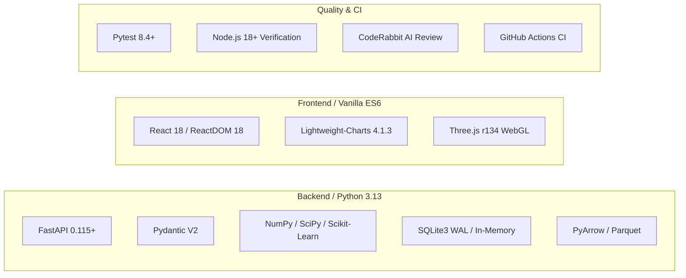

# BTCognitive — Technical Rules & Architecture Standards (TECH_RULES)
## Technology Stack Definition, Mathematical Conventions & Non-Negotiable Invariants

**Document Status:** Production / Canonical  
**Version:** 2.0.0  
**Scope:** Engineering, Quantitative Research, Testing & Code Review  
**Repository:** `https://github.com/ashishlabs-23/bitcoin-prediction-lab`  

---

## 1. Core Technology Stack

### 1.1 Backend Runtime & Libraries
- **Language & Interpreter:** Python 3.13+ (Windows & Linux compatible).
- **Web Framework:** FastAPI (ASGI) powered by Uvicorn.
- **Data Validation & Schemas:** Pydantic V2 (`BaseModel` with strict type annotations; class-based `Config` deprecated in favor of `ConfigDict`).
- **Mathematics & Statistics:** NumPy, SciPy, Scikit-learn, Pandas.
- **Persistence:** SQLite3 (WAL mode in production; in-memory `_FIXTURE_DB_URI` in automated tests).
- **Columnar Storage:** PyArrow / Parquet for historical trade and candle archives.

### 1.2 Frontend Runtime & Libraries
- **Language & Standards:** Modern Vanilla ECMAScript (ES2022+), zero compilation / zero transpilation requirement.
- **Component Model:** React 18 & ReactDOM 18 consuming `React.createElement` (aliased as `h`).
- **Financial Visualization:** TradingView Lightweight Charts 4.1.3 (HTML5 Canvas).
- **3D Graphics:** Three.js r134 (WebGL particle topology).
- **Styles:** Vanilla CSS with custom property tokens (`web/styles.css`), flexbox, and CSS grid.

### 1.3 Testing & Quality Pipeline
- **Unit & Integration:** Pytest 8.4+, pytest-asyncio, hypothesis.
- **Contract & Asset Tests:** Node.js 18+ (`build_frontend.js`, `tests_frontend.js`).
- **AI Automated Review:** CodeRabbit via `.coderabbit.yaml`.
- **CI Orchestrator:** GitHub Actions (`.github/workflows/ci.yml`).

---

## 2. The Six Non-Negotiable Engineering Invariants

Every pull request, commit, and code modification MUST strictly adhere to these six invariants:

### Invariant 1: Epistemic & Causal Boundary
No feature calculation may access information timestamped at or after the forecast issue time:
$$t_{\text{feature}} \le t_{\text{issue}} < t_{\text{maturity}}$$
- Any use of unshifted future returns, unlagged indicators, or retroactive data revisions is considered a critical defect.
- Target calculation must enforce strict forward horizons (e.g. 168 hours for `rv7d_var_ann`).

### Invariant 2: Strict Non-Execution (`ANALYSIS_ONLY`)
BTCognitive is an observational research application.
- Live trading, automated order placement, exchange execution adapters, and broker SDKs are permanently and strictly `DISABLED`.
- Endpoints and services must never emit direct buy/sell market orders.

### Invariant 3: Fail-Closed Data Policy
If market feeds or historical data stores are missing, unconfigured, or degraded:
- The system MUST return an explicit typed error or fail-closed state (`DATA_UNAVAILABLE`, `BLOCKED`, `FROZEN_INPUT_MISSING`).
- **Never substitute synthetic data, random noise, or outdated prices disguised as live observations.**

### Invariant 4: Research Production Lock
All models and strategies remain `OFFLINE_RESEARCH_ONLY`:
- Baseline volatility model: `Standard-HAR-v1.0`.
- Research challenger: `HAR-RS-DOW-v1.0` (unpromoted).
- Promotion to production serving requires satisfying the pre-registered prospective hurdle: **100 consecutive, non-overlapping clean blocks** with statistically significant QLIKE superiority ($p < 0.05$).

### Invariant 5: Test Isolation & Write Protection
Automated tests must never contaminate canonical production datasets or historical audit records:
- The `tests/conftest.py` test harness installs a Python audit hook (`sys.addaudithook`) guarding `data/`, `results/`, `experiments/results/`, `research/reports/`, and `models/`.
- Attempted test writes to protected paths are automatically redirected to disposable session directories.
- `PROTECTED_FILE_HASH_GUARD` verifies that all 1,849 protected files have unchanged SHA-256 digests before and after test execution.

### Invariant 6: Network Budget & Rate-Limit Compliance
- Client requests from non-loopback IP addresses are rate-limited to **60 requests per minute**.
- Client applications must poll the consolidated gateway endpoint `GET /api/terminal/bundle` rather than multiple granular endpoints.
- Client-side steady-state polling budget must remain below 30 requests per minute.

---

## 3. Mathematical & Econometric Conventions

To prevent dimensional and scaling errors across services, all mathematical routines must conform to these canonical standards:

1. **Parkinson Volatility Scaling:**
   $$\sigma_P = \sqrt{\frac{1}{4 \ln 2 \cdot N} \sum_{i=1}^N \left(\ln \frac{H_i}{L_i}\right)^2} \times \sqrt{8760} \quad \text{(when annualized)}$$
   Functions must accept `annualize: bool = False, periods_per_year: float = 8760.0`.

2. **Risk Metric Annualization:**
   - Hourly data (`freq="1h"`): Scale ratios by $\sqrt{8760}$.
   - Daily data (`freq="1d"`): Scale ratios by $\sqrt{365}$.
   - Annualized return must compound linearly or geometrically based on explicitly documented frequency.

3. **Loss Function Specification:**
   - Volatility density comparison must report QLIKE loss alongside RMSE.
   - Paired tests must execute Diebold-Mariano with Harvey-Leybourne-Newbold (1997) sample size correction.
