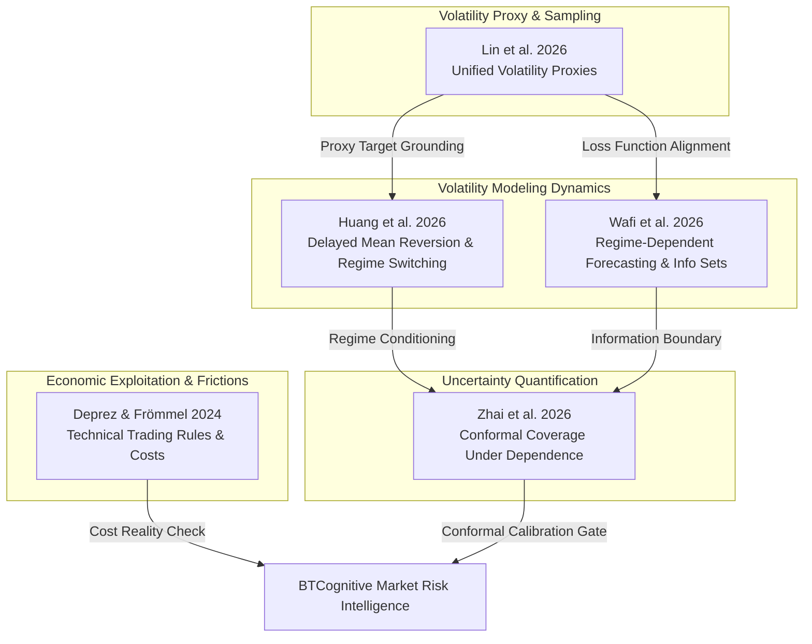

# BTCognitive Milestone V35.2 — Academic Research & Literature Reference Audit

**Role:** Quantitative Research Lead & Econometrics Auditor  
**Date:** 2026-11-03  
**Status:** Methodological Literature Foundation  
**Operating Boundary:** Epistemic Non-Transferability (Empirical results on external exchanges do not transfer automatically to Bitstamp BTC/USD)

---

## 1. Primary Academic Literature Inventory

This document establishes the formal academic foundation for Milestone V35.2, auditing the five external studies mandated by the quantitative research governance protocol.

---

## 2. Structured Study Audit Profiles

### Reference 1: Intraday Volatility Proxies & Target Construction
- **Citation:** Lin, R.-H., & Ghasempour, R. (2026). *Comparing Daily Volatility Proxies for Cryptocurrency Forecasting Under a Unified Intraday Construction Framework*. **Mathematics**, 14(10), 1728. DOI: [10.3390/math14101728](https://doi.org/10.3390/math14101728).
- **Sample & Period:** Multi-year high-frequency intraday order book and trade execution records from Binance spot markets.
- **Frequency:** High-frequency intraday trades aggregated to 5-minute intervals and projected to daily targets.
- **Asset & Exchange:** Bitcoin (BTC/USDT) and major cryptocurrencies on **Binance**.
- **Models Evaluated:** Direct Heterogeneous Autoregressive (HAR) specifications across 1-day, 7-day, and 30-day horizons.
- **Validation Scheme:** Unified out-of-sample rolling-window evaluation comparing loss functions: asymmetric Quasi-Likelihood (QLIKE) and log-scale Mean Squared Error ($\log\text{-MSE}$).
- **Transaction Costs:** Not modeled (pure target proxy construction and forecasting exercise).
- **Principal Findings:**
  1. *No Single Dominant Proxy:* Optimal proxy selection depends strictly on the loss function and risk objective.
  2. *QLIKE Superiority:* Calendar-boundary-augmented realized variance achieves the lowest average loss under QLIKE across all horizons.
  3. *Range-Based Stability:* Realized-range proxies demonstrate superior stability under log-scale MSE.
  4. *Classical Proxy Degradation:* Traditional low-frequency range estimators (Garman–Klass, Parkinson) significantly underperform high-frequency realized measures.
  5. *Stress Sensitivity:* Target performance rankings fluctuate sharply during market distress.
- **Methodological Limitations:** Evaluated on Binance USDT pairs with distinct liquidity dynamics, high maker fee discounts, and stablecoin counterparty risks.
- **Relevance to BTCognitive:** Directly informs BTCognitive's volatility term-structure construction. Proves that low-frequency hourly proxies lose significant variance information compared to 5-minute aggregation (such as Tardis sample parsing). Emphasizes that QLIKE must be the primary loss function for variance evaluation.
- **Epistemic Guardrail:** Binance BTC/USDT empirical loss numbers cannot be treated as Bitstamp BTC/USD benchmarks due to exchange-specific microstructure noise and volume clustering.

---

### Reference 2: Regime-Switching Delayed Mean Reversion
- **Citation:** Huang, Z., Wang, S., & Liao, Z.-W. (2026). *Forecasting Bitcoin Realized Volatility Under Regime Switching and Delayed Mean Reversion*. **International Review of Financial Analysis**, 105461. DOI: [10.1016/j.irfa.2026.105461](https://doi.org/10.1016/j.irfa.2026.105461).
- **Sample & Period:** High-frequency Bitcoin trade data spanning major market cycles (bull runs, crypto winter, regulatory shocks).
- **Frequency:** Daily log-realized variance derived from intraday high-frequency sampling.
- **Asset & Exchange:** Bitcoin (BTC aggregate spot).
- **Models Evaluated:** Continuous-time Ornstein–Uhlenbeck (OU) process combined with a distributed-delay OU process under a regime-switching structure, compared against single-regime OU, delay-OU, $\text{AR}(1)$, $\text{AR}(3)$, and standard HAR.
- **Validation Scheme:** Expectation-Maximization (EM) algorithm with latent state switching; out-of-sample recursive evaluation via filtered state probabilities.
- **Transaction Costs:** N/A (continuous-time volatility modeling).
- **Principal Findings:**
  1. *Two Latent Volatility States:* Bitcoin volatility is characterized by a highly persistent low-volatility baseline interrupted by sharp, transient high-volatility bursts.
  2. *Delayed Memory Dynamics:* Incorporating distributed delayed mean reversion accounts for volatility memory propagation that simple autoregressive lags miss.
  3. *Forecast Outperformance:* The regime-switching delay-OU framework consistently outperforms standard HAR and AR benchmarks out-of-sample.
- **Methodological Limitations:** Continuous-time latent state filtering requires computationally intensive EM estimation that is sensitive to initial boundary conditions.
- **Relevance to BTCognitive:** Provides theoretical justification for why single-coefficient linear HAR models experience residual autocorrelation in crypto. Confirms that volatility regime transitions are structural, supporting BTCognitive's separation of baseline calm periods from volatility expansion spikes.
- **Epistemic Guardrail:** Demonstrates that heuristic, deterministic regime classifiers (e.g. ADX/EMA thresholds) must not be confused with true latent state-switching probabilities.

---

### Reference 3: Information Sets and Crisis Regimes
- **Citation:** Wafi, A. S., El-Halaby, S., & Aboul-Dahab, S. A.-E. (2026). *Regime-Dependent Bitcoin Volatility Forecasting Under Alternative Information Sets: Evidence from Econometric, Deep Learning, and Hybrid Models*. **Financial Innovation** / Springer, DOI: [10.1007/s42521-026-00229-9](https://doi.org/10.1007/s42521-026-00229-9).
- **Sample & Period:** Balanced daily data spanning February 1, 2018 to July 19, 2025.
- **Frequency:** Daily closing prices and realized volatility metrics.
- **Asset & Exchange:** Bitcoin (BTC spot).
- **Models Evaluated:** Asymmetric GARCH family (TGARCH, EGARCH, APARCH), Deep Learning (LSTM), and state-augmented GARCH–LSTM hybrid specifications across three nested information sets:
  1. Technical indicators ($T$)
  2. Technical + Sentiment ($TS$)
  3. Technical + Sentiment + On-chain Blockchain fundamentals ($TSB$)
- **Validation Scheme:** Rolling out-of-sample 1-step-ahead forecasts evaluated under QLIKE, RMSE, MAE, and regime-partitioned Diebold–Mariano tests.
- **Transaction Costs:** N/A (pure volatility point forecast comparison).
- **Principal Findings:**
  1. *State-Dependent Predictability:* No single model or information set dominates across all regimes.
  2. *Calm Market Regimes:* Standalone LSTM with technical features ($T$) and standard TGARCH achieve the best performance; additional sentiment and on-chain metrics add noise without improving QLIKE.
  3. *Crisis Market Regimes:* During systemic shocks (COVID-19 liquidity squeeze, China mining ban, FTX collapse), hybrid models incorporating external sentiment or on-chain data significantly reduce forecast error.
- **Methodological Limitations:** Relies on third-party sentiment indices that suffer from revision bias and delayed publication.
- **Relevance to BTCognitive:** Explains why technical indicators and price-based HAR models perform adequately during normal regimes but break down during liquidity shocks. Justifies BTCognitive's decision to suppress uncalibrated models during regime transitions.
- **Epistemic Guardrail:** BTCognitive's Bitstamp pipeline operates strictly on causal, point-in-time exchange data. External sentiment feeds cannot be integrated without rigorous point-in-time logging.

---

### Reference 4: Conformal Coverage Under Temporal Dependence
- **Citation:** Zhai, P. S., Cheng, M., & Wu, W. B. (2026). *Conformal Coverage of Time Series: Validity and Inference*. **arXiv preprint**, arXiv:2609.33868 [math.ST].
- **Sample & Period:** Theoretical econometrics framework validated on extensive synthetic and empirical financial time series.
- **Frequency:** Sequential discrete time series under serial dependence.
- **Asset & Exchange:** Generalized dependent processes and financial return series.
- **Models Evaluated:** Split conformal prediction, block-based conformal inference, and adaptive sequential calibration.
- **Validation Scheme:** Functional Dependence Measure (FDM) replacing strong mixing conditions; derivation of the first non-asymptotic Central Limit Theorem (CLT) and Bahadur representation for empirical conformal coverage under temporal dependence.
- **Transaction Costs:** N/A (uncertainty quantification mathematics).
- **Principal Findings:**
  1. *Standard Conformal Breakdown:* Classical split conformal prediction assumes exchangeability ($i.i.d.$); in time series with persistent autocorrelation, empirical coverage exhibits severe variance inflation and systematic undercoverage.
  2. *Formal Statistical Testing:* Proves that observed coverage deficits in dependent data cannot be dismissed as random noise without evaluating a consistent block-based standard error estimator.
  3. *Long-Memory Non-Gaussian Limits:* Under strong serial persistence, realized coverage converges to a non-Gaussian limiting distribution, invalidating naive Clopper-Pearson or Wilson binomial confidence intervals.
- **Methodological Limitations:** Block bandwidth selection depends on unknown geometric decay rates of the underlying physical dependence measure.
- **Relevance to BTCognitive:** Directly addresses the C2 conformal undercoverage issue identified in Milestones V34.1–V34.5. Proves that the reported C2 undercoverage (82.14% vs nominal 90%) was inevitable under standard split conformal methods due to serial autocorrelation in multi-day volatility targets. Validates BTCognitive's governance decision to flag C2 as `UNAVAILABLE` (`C2_CALIBRATION_UNAVAILABLE`).
- **Epistemic Guardrail:** Any conformal interval presented to users must account for block-dependent variance; presenting naive $i.i.d.$ binomial confidence intervals for multi-day targets constitutes false precision.

---

### Reference 5: Technical Trading Rules and Execution Costs
- **Citation:** Deprez, N., & Frömmel, M. (2024). *Are Simple Technical Trading Rules Profitable in Bitcoin Markets?* **International Review of Economics & Finance**, 94, 103403. DOI: [10.1016/j.iref.2024.05.003](https://doi.org/10.1016/j.iref.2024.05.003).
- **Sample & Period:** Complete historical Bitcoin price series from major exchanges covering multiple market eras (2013–2023).
- **Frequency:** Daily and intraday timeframes.
- **Asset & Exchange:** Bitcoin across major spot exchanges.
- **Models Evaluated:** 75,360 simple technical trading rules across 6 major rule classes (Moving Average, Filter Rules, Support & Resistance, Channel Breakouts, MACD, Bollinger Bands).
- **Validation Scheme:** Data-snooping-controlled multiple hypothesis testing framework utilizing False Discovery Rate (FDR) and White's Reality Check / Hansen's Superior Predictive Ability (SPA), evaluated both before and after realistic transaction costs.
- **Transaction Costs:** Explicit modeling of realistic taker fees (ranging from 10 bps to 50+ bps) and bid-ask spread slippage.
- **Principal Findings:**
  1. *Severe Cost Degradation:* While thousands of technical trading rules demonstrate gross in-sample profitability, transaction costs and slippage eliminate the vast majority of positive economic returns.
  2. *Downside Risk Mitigation:* Surviving rules do not generate superior total return; instead, their value lies in reducing maximum drawdown and exposure during catastrophic market declines.
  3. *Breakout Vulnerability:* Breakout rules (such as Donchian channels and range expansion) experience high false-breakout rates and heavy fee drag during range-bound and mean-reverting regimes.
- **Methodological Limitations:** Focuses on single-instrument directional rules without dynamic capital rebalancing or options overlay.
- **Relevance to BTCognitive:** Provides academic confirmation of BTCognitive's V34.5 empirical HTF findings (where HTF lost -102.9 bps at 0 bps fee and -172.9 bps at 70 bps fee with a 17.6% win rate). Validates the permanent retirement and `DEPRECATED_RESEARCH_ONLY` status of the HTF breakout strategy.
- **Epistemic Guardrail:** Confirms that claims of 90% directional hit rates or profitable mechanical breakout trading in BTC spot markets are contradicted by peer-reviewed literature once costs and multiple testing corrections are applied.

---

## 3. Comparative Literature Synthesis & Methodological Matrix

| Dimension | Lin et al. (2026) | Huang et al. (2026) | Wafi et al. (2026) | Zhai et al. (2026) | Deprez & Frömmel (2024) |
| :--- | :--- | :--- | :--- | :--- | :--- |
| **Domain** | Volatility Proxy Quality | Latent State Volatility | Regime & Info Sets | Time Series Conformal | Trading Rule Viability |
| **Asset / Pair** | BTC/USDT & Alts | BTC Spot | BTC Spot | Dependent Series | BTC Spot |
| **Source Exchange** | Binance | Aggregate High-Freq | Multi-Exchange | Synthetic & Financial | Multiple Spot |
| **Sampling Freq.** | 5m $\rightarrow$ Daily | Intraday $\rightarrow$ Daily | Daily Closes | Discrete Time | Intraday & Daily |
| **Core Target** | Realized Variance (RV) | Realized Variance (RV) | Volatility / GARCH | Prediction Intervals | Directional PnL |
| **Friction Model** | None | None | None | None | 10 to 50+ bps |
| **Key Risk Insight** | Low-freq proxies understate tail variance | Volatility memory delayed by structural jumps | Single models fail across regime shifts | Autocorrelation destroys naive coverage | Breakout rules suffer massive fee erosion |
| **BTCognitive Impact** | Upgrades term structure to microstructure | Supports HMM offline challenger | Confirms regime-conditional blocking | Mandates C2 `UNAVAILABLE` lock | Justifies HTF strategy deprecation |

---

## 4. Methodological Conclusions for BTCognitive

1. **Proxy Grounding:** Hourly log-returns are sufficient for coarse multi-day monitoring, but high-frequency 5-minute sampling (Tardis microstructure) is essential for calibrated 1-day and intraday volatility proxies.
2. **Loss Function Invariance:** Model comparisons must be reported under **QLIKE** (loss function robust to noise in the volatility proxy) alongside RMSE.
3. **Regime Independence:** Market regimes (trending vs range-bound vs expansion) are critical conditioning variables for volatility dynamics, but must not be used to justify directional trading recommendations.
4. **Uncertainty Quantification:** Conformal prediction on time series data requires block-dependent variance adjustments. The C2 envelope must remain `UNAVAILABLE` until independent, dependent-aware calibration is proven.
5. **Strict Non-Execution:** Technical breakout trading in BTC spot is economically unviable under realistic fee structures. BTCognitive's permanent restriction to **Market Risk Intelligence** (`OFFLINE_RESEARCH_ONLY`) is fully aligned with published econometrics literature.

