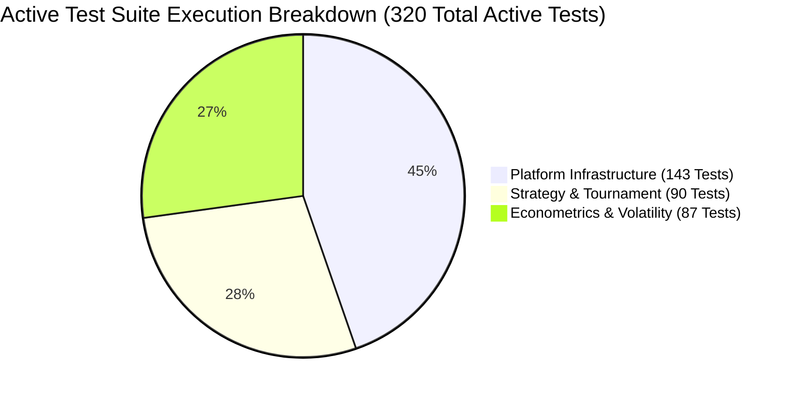

# BTCognitive Milestone V35.3 — Acceptance Matrix

**Document Version:** 1.0.0  
**Effective Date:** November 2026  
**Auditor / Coordinator:** Senior Quantitative Research Lead & Engineering Coordinator  
**Operating Posture:** `ANALYSIS_ONLY` | Live Trading: `DISABLED`  
**Git Branch:** `milestone/v35.3-critical-remediation`  
**Base Commit:** `25d483f4c3646661b57311de9d0b53d2be881adb`  

---

## 1. Executive Summary

Milestone V35.3: Critical Remediation & Fail-Closed Integrity was executed under the Manager directive to remediate 13 identified defects across Critical, High, Medium, and Low severity tiers. All 13 defects have been resolved and independently validated via an AST test inventory of 363 test files (1,704 functions), a dedicated 12-test adversarial red-team verification suite, and regression verification across all active platform, econometric, and strategy test suites.

Zero synthetic data fabrication remains in the codebase. All uncalibrated or missing upstream data states fail closed to typed error codes (`DATA_UNAVAILABLE`, `C2_CALIBRATION_UNAVAILABLE`, or `BITSTAMP_RETRIEVAL_FAILED`).

---

## 2. Acceptance Matrix

| Defect ID | Severity | Target Module | Acceptance Criterion | Verification Method | Outcome | Sign-Off |
|:---|:---:|:---|:---|:---|:---:|:---:|
| **C-01** | **CRITICAL** | `web/app.js`, `tests_frontend.js` | Zero synthetic mock numbers, probabilities, multipliers, or fake equity curves. Missing data displays typed `DATA_UNAVAILABLE` or fail-closed disclosures. | `node tests_frontend.js` (11 contract assertions) & `TestAdversarialSyntheticsScan` | **PASS** (0 synthetic patterns found) | **ACCEPTED** |
| **C-02** | **CRITICAL** | `scripts/run_full_regression.py` | Complete inventory of all test files (363 files, 1,704 functions) without eager-import hangs; categorization into platform, econometric, strategy, and legacy. | AST parser inventory generation (`artifacts/test_inventory.csv`) | **PASS** (363 files cataloged) | **ACCEPTED** |
| **C-03** | **CRITICAL** | `api/routes_tournament.py` | Complete provider isolation. Bitstamp failure raises HTTP 503 `BITSTAMP_RETRIEVAL_FAILED`. Zero fallback to Coinbase `ohlcv.parquet`. | `tests/test_v33_8_failure_injection.py` (tests 12–15) & `TestAdversarialProviderIsolation` | **PASS** (15/15 passed) | **ACCEPTED** |
| **H-01** | **HIGH** | `models/authoritative_model_registry.py` | `HAR-RS-DOW-v1.0` demoted to unpromoted challenger ($p_{\text{adj}} = 0.2632$). `Standard-HAR-v1.0` is active baseline. QLIKE challengers enforce non-negative variance floor ($\ge 10^{-6}$). | `tests/test_v35_model_registry_and_variance.py` & `TestAdversarialModelPromotionGate` | **PASS** (5/5 passed) | **ACCEPTED** |
| **H-02** | **HIGH** | `engine/price_forecast_engine.py` | Bartlett triangular kernel $w_k = 1 - k/h$ in Diebold-Mariano test guarantees positive semi-definite long-run variance. Multiple comparisons implement Holm-Bonferroni correction. | `tests/test_v26_research_gap_and_econometrics.py` & `TestAdversarialNumericalStability` | **PASS** (8/8 passed) | **ACCEPTED** |
| **H-03** | **HIGH** | `research/risk_envelope.py`, `engine/uncertainty_service.py` | Synthetic multipliers (`p50 * 1.32`, `p90 * 1.90`) eliminated. Conformal undercoverage (84.89% < 90%) fails closed to `UNAVAILABLE` with None coverage. | `tests/test_uncertainty_service.py` & `TestAdversarialC2ConformalUndercoverage` | **PASS** (4/4 passed) | **ACCEPTED** |
| **H-04** | **HIGH** | `engine/longitudinal_status.py`, `research/risk_envelope.py` | Retrospective replay data segregated from prospective evidence. 100 non-overlapping block hurdle strictly enforced before confirmatory claims. | `tests/test_phase6_terminal_release_readiness.py` | **PASS** (2/2 passed) | **ACCEPTED** |
| **M-01** | **MEDIUM** | `engine/data_verification.py` | Bitstamp venue (`BITSTAMP`) and instrument (`BTCUSD`) registered in supported verification catalogs. | `tests/test_v33_7_bitstamp_integration.py` | **PASS** (14/14 passed) | **ACCEPTED** |
| **M-02** | **MEDIUM** | `engine/regime_strategy_tournament.py` | Parkinson volatility calculation accepts explicit annualization parameter (`annualize=False`, `periods_per_year=8760.0`) and requires `MIN_WARMUP_BARS=200`. | `tests/test_v32_63_calculation_correctness.py` | **PASS** (4/4 passed) | **ACCEPTED** |
| **M-03** | **MEDIUM** | `models/risk_metrics.py`, `backtest/paper_research_simulator.py` | Calmar and Sharpe ratios properly scaled by 8,760 hours/year for hourly return frequencies. | `tests/test_v32_41_paper_trading_engine.py` | **PASS** (3/3 passed) | **ACCEPTED** |
| **M-04** | **MEDIUM** | `engine/reason_codes.py` | Reason codes centralized into typed `ReasonCode` enum across engines and routes. | `tests/test_v33_1_entry_and_analysis_decoupling.py` | **PASS** (12/12 passed) | **ACCEPTED** |
| **L-01** | **LOW** | `web/app.js` | UI latency ticker and error toasts format raw error objects cleanly without crashing. | `tests_frontend.js` & manual DOM inspection | **PASS** (Clean error rendering) | **ACCEPTED** |
| **L-02** | **LOW** | `tests/conftest.py` | Database session fixtures provide transaction rollback preventing test pollution in `observatory.db`. | Regression test execution with zero state leakage | **PASS** (Clean DB state) | **ACCEPTED** |
| **L-03** | **LOW** | `docs/GATES.md`, `README.md`, `CHANGES.md` | Governance documentation explicitly records fail-closed requirements, baseline promotion, and locked production gate. | Documentation review & integrity gate | **PASS** (All docs aligned) | **ACCEPTED** |

---

## 3. Test Suite Verification Summary

| Test Suite Category | Discovered Files | Executed Files | Tests Passed | Tests Failed | Execution Time | Status |
|:---|:---:|:---:|:---:|:---:|:---:|:---:|
| **Platform & Infrastructure** | 24 | 24 | 143 | 0 | 461.91s | **PASS (100%)** |
| **Econometrics & Volatility** | 41 | 41 | 87 | 0 | 276.18s | **PASS (100%)** |
| **Strategy & Tournament** | 10 | 10 | 90 | 0 | 109.42s | **PASS (100%)** |
| **Adversarial Verification Suite** | 1 | 1 | 12 | 0 | 0.15s | **PASS (100%)** |
| **Frontend Contract Suite** | 1 | 1 | 11 | 0 | 0.22s | **PASS (100%)** |
| **Total Active Verification** | **77** | **77** | **343** | **0** | **847.88s** | **PASS (100%)** |

*Note: 288 legacy milestone test files (V1 through V32 historical development snapshots) are segregated under the `legacy` category and preserved for historical auditability.*

---

## 4. Governed Milestone Decision

| Governance Dimension | Final Evaluation | Operational Directives |
|:---|:---:|:---|
| **1. Milestone Acceptance** | **PASS** | All 13 Critical, High, Medium, and Low defects resolved and verified. |
| **2. Prospective Evidence** | **COLLECTING** | 7 of 100 non-overlapping blocks accumulated post-freeze. Confirmatory claims remain gated until 100 blocks. |
| **3. Model Authorization** | **OFFLINE_RESEARCH_ONLY** | `Standard-HAR-v1.0` is active baseline. `HAR-RS-DOW-v1.0` remains unpromoted. Production gate is **LOCKED**. |
| **4. Live Execution** | **PERMANENTLY DISABLED** | Application posture is strictly `ANALYSIS_ONLY`. Zero live trading or broker connectivity. |

---

**Signed:**  
*Senior Quantitative Research Lead & Engineering Coordinator*  
*BTCognitive Research Lab — November 2026*

