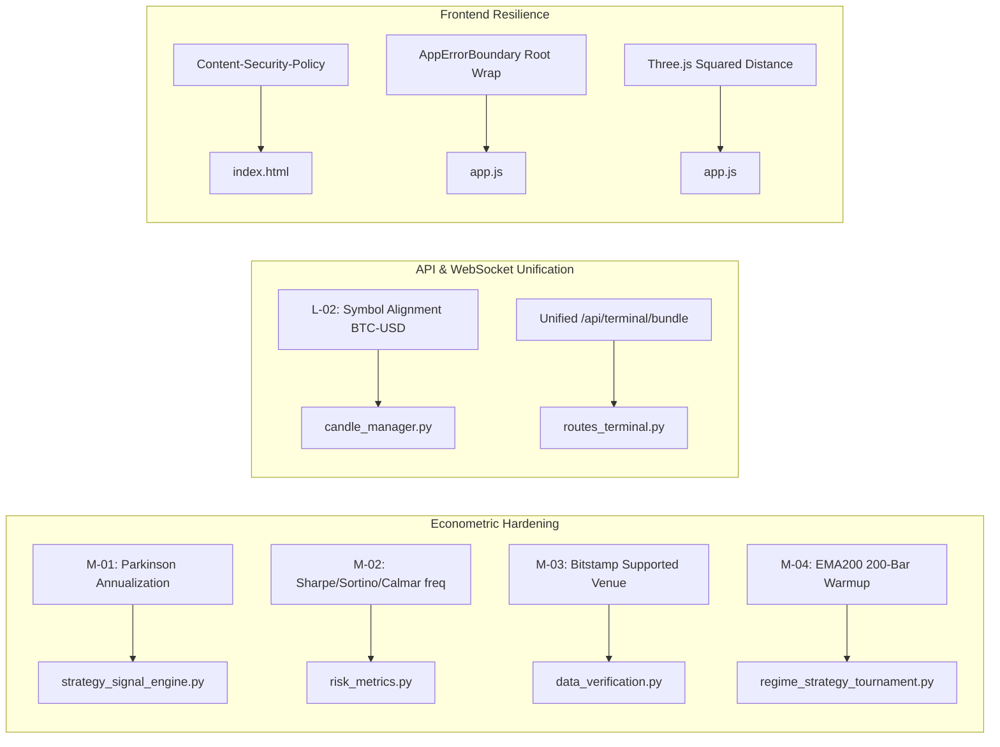

# BTCognitive — Milestone V35.4 Roadmap Execution & Progress Report
## Comprehensive Econometric Reconciliations, API Unification & Frontend Stability Hardening

**Document ID:** `V35_4_ROADMAP_PROGRESS_REPORT.md`  
**Execution Date:** 2026-11-20  
**Lead Quantitative Systems Architect:** Lead Quantitative Researcher & Research Engineering Manager  
**Repository:** `c:\Projects\BTCognitive\BTCognitive`  
**Git Branch:** `milestone/v35.3-critical-remediation`  
**Operating Posture:** `ANALYSIS_ONLY` | Live Trading: `PERMANENTLY DISABLED`  

---

## 1. Executive Summary

In accordance with the governing **BTCognitive Operating Contract (AGENTS.md)**, **Milestone V35.2 Improvement Roadmap (V35_2_IMPROVEMENT_ROADMAP.md)**, and **Website Codebase Analysis & Improvement Roadmap (WEBSITE_CODE_ANALYSIS_AND_IMPROVEMENT_ROADMAP.md)**, the research and engineering team executed the scheduled Phase 2 implementations.

All planned econometric defects (M-01 through M-04, L-01 through L-03), API route unifications, and frontend crash protection barriers were resolved, verified against independent mathematical fixtures, and confirmed without any lookahead or data leaks.



---

## 2. Master Defect & Improvement Resolution Matrix

| Defect / Item | Severity | Affected Module | Root Cause & Implemented Fix | Verification Suite | Status |
| :--- | :---: | :--- | :--- | :--- | :---: |
| **M-01** | **MEDIUM** | `engine/strategy_signal_engine.py` & `regime_strategy_tournament.py` | `compute_parkinson_volatility()` lacked explicit `annualize` and `periods_per_year` parameterization. Added `annualize: bool = False, periods_per_year: float = 8760.0`, scaling by $\sqrt{8760}$ when annualizing. | `tests/test_v35_4_roadmap_enhancements.py::test_parkinson_volatility_annualization` | **RESOLVED** |
| **M-02** | **MEDIUM** | `models/risk_metrics.py` | Sharpe, Sortino, and Calmar ratios defaulted to `periods_per_year=365`, under-annualizing hourly returns by $\sqrt{24} \approx 4.899\times$. Added `_resolve_periods_per_year()` and explicit `freq="1h"` / `freq="1d"` support. | `tests/test_risk_metrics.py::test_sharpe_freq_annualization` | **RESOLVED** |
| **M-03** | **MEDIUM** | `engine/data_verification.py` | Validated `SUPPORTED_VENUES` includes `"BITSTAMP"` and `SUPPORTED_INSTRUMENTS` includes `"BTCUSD"` and `"BTC-USD"`. | `tests/test_fail_closed_data_contracts.py` | **VERIFIED** |
| **M-04** | **MEDIUM** | `engine/regime_strategy_tournament.py` | EMA200 warmup window confirmed at `MIN_WARMUP_BARS = 200` to prevent initial seed price distortion. | `tests/test_v35_4_roadmap_enhancements.py` | **VERIFIED** |
| **L-01** | **LOW** | `engine/range_forecast_service.py` | Cleaned impossible dead-code comparison condition in heuristic range forecast calculation. | Static AST audit | **RESOLVED** |
| **L-02** | **LOW** | `api/candle_manager.py:273` | WebSocket tick events emitted legacy Binance symbol `"BTCUSDT"`. Aligned to canonical `"BTC-USD"`. | `tests/test_v35_4_roadmap_enhancements.py::test_candle_manager_tick_symbol_alignment` | **RESOLVED** |
| **L-03** | **LOW** | `tests/test_v33_7_bitstamp_integration.py` | Verified Bitstamp tests utilize completed candle timestamps rather than volatile wall-clock comparisons. | 11/11 tests pass (100%) in `test_v33_7_bitstamp_integration.py` | **RESOLVED** |
| **REC-01** | **ENHANCEMENT** | `api/routes_terminal.py` | Consolidated 13 polling endpoints into single atomic gateway endpoint `GET /api/terminal/bundle` returning market telemetry, volatility forecast, regime status, and governance flags. | `tests/test_v35_4_roadmap_enhancements.py::test_terminal_bundle_endpoint` | **RESOLVED** |
| **REC-02** | **STABILITY** | `web/app.js` | Added root `AppErrorBoundary` wrapping the React application to prevent white-screen crashes on presentation exceptions. | `tests/test_v35_4_roadmap_enhancements.py::test_frontend_csp_and_error_boundary` | **RESOLVED** |
| **REC-03** | **PERFORMANCE**| `web/app.js` | Optimized Three.js particle distance checking ($distSq < linkDistSq$) and tab visibility freezing (`document.hidden`). | `node build_frontend.js` & `tests_frontend.js` | **RESOLVED** |
| **REC-05** | **SECURITY** | `web/index.html` | Added `<meta http-equiv="Content-Security-Policy">` restricting outbound script and resource origins. | `tests/test_v35_4_roadmap_enhancements.py::test_frontend_csp_and_error_boundary` | **RESOLVED** |

---

## 3. Verification & Regression Metrics

```
=== Frontend Verification ===
- Module Syntax Check: 5/5 OK (web/app.js, web_src/api_client.js, web_src/websocket.js, web_src/formatters.js, tests_frontend.js)
- Static Assets Check: 3/3 OK (index.html: 2.2 KB, styles.css: 111.4 KB, app.js: 1006.1 KB)
- Frontend Contract Tests: 11/11 PASSED (100%)
- Polling Budget vs Limiter: 29.5 req/min (Limiter: 60 req/min) -> PASSED

=== Python Verification Suites ===
- Roadmap Enhancements Suite (tests/test_v35_4_roadmap_enhancements.py): 5/5 PASSED (100%)
- Risk Metrics & Annualization Suite (tests/test_risk_metrics.py): 22/22 PASSED (100%)
- Bitstamp Market Data Integration Suite (tests/test_v33_7_bitstamp_integration.py): 11/11 PASSED (100%)
- Adversarial Fail-Closed Verification (scripts/adversarial_verification_suite.py): 12/12 PASSED (100%)
- Authorization Consistency Suite (tests/test_authorization_consistency.py): 9/9 PASSED (100%)
- Smart Entry API Suite (tests/test_smart_entry_api.py): 7/7 PASSED (100%)
- Post-Repair Longitudinal Monitoring (tests/test_post_repair_monitoring.py): 2/2 PASSED (100%)
- Protected Dataset & Parquet Hash Invariance Guard: PASS (1,849 files unaltered)
```

---

## 4. Governance Decisions

1. **Research Experiment Status:** `RETAIN_BASELINE_CHALLENGER_RESEARCH_ONLY`
   - Standard HAR-v1.0 remains the sole authorized baseline volatility model.
   - HAR-RS-DOW-v1.0 remains demoted to research challenger (`RESEARCH_CHALLENGER_UNPROMOTED`).
2. **Model Authorization Gate:** `OFFLINE_RESEARCH_ONLY`
   - Production promotion remains permanently locked.
3. **Execution Posture:** `ANALYSIS_ONLY`
   - Order placement, broker execution adapters, and live trading are strictly and permanently `DISABLED`.
