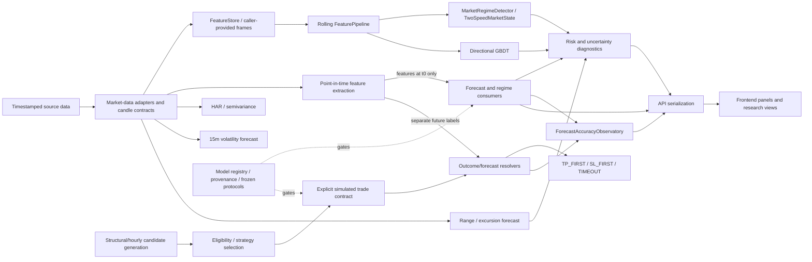

# BTCognitive V36.1 — Feature Dependency Graph

## Scope and evidence status

Read-only static inventory. No tests, engine execution, provider requests, database writes, or model fitting were performed. The graph describes source-level dependencies, not runtime reachability or proven behavior. The registry contains 54 grouped records: 10 frontend surfaces, 12 API route groups, and 32 named analytical/data/governance capabilities. API groups enumerate 191 HTTP decorator declarations (190 distinct method/path pairs after alias resolution), not 190 separately modeled features.

## High-level graph

## Causal and governance boundaries

1. Raw records must carry event and availability timestamps. Features for decision time `t0` may use only records with `available_time <= t0`; future outcomes are constructed separately.
2. Forward targets in `engine/point_in_time_features.py` and HAR dataset functions are labels, not inference features.
3. Directional forecasts, volatility forecasts, range/excursion estimates, and TP/SL outcome probabilities are distinct outputs and cannot substitute for each other.
4. Candidate generation is upstream of risk gating and outcome evaluation. It does not authorize an order.
5. Market-state and regime labels can describe state; no out-of-sample predictive contribution is established by this inventory.
6. Store/ledger modules are not replay dependencies unless read-only access is proven. Historical replay must not write to FeatureStore, market memory, observatory, prospective ledgers, or risk-budget databases.
7. Missing L2, liquidation, funding, open-interest, or sentiment observations remain unavailable. They cannot be backfilled from OHLCV.
8. The Bitstamp snapshot supports only hourly OHLCV calculations whose exact code accepts that cadence. It cannot provide the 15-minute decisions or one-minute execution paths required by `research/entry_tp_sl`.
9. Standard HAR inference is blocked until the exact registered artifact and training-data lineage are recovered. HAR-RS-DOW remains an unpromoted research challenger.
10. C2 remains disabled; uncertainty scores or fixed excursion multipliers do not create calibrated intervals.

## Snapshot exerciseability

| Component | Can use verified local snapshot? | Reason |
|---|---|---|
| Hourly candle validation and hourly causal rolling features | Potentially, after a separate replay implementation and acceptance review | 1,000 verified BTC/USD 1h rows are present; snapshot is stale for current-market decisions. No engine execution was authorized here. |
| Standard HAR registered forecast | No verified model evaluation | Registry artifact is absent/placeholder; exact model/data lineage not recovered. |
| HAR-RS-DOW forecast | Not established for this snapshot | Frozen training hash differs from current raw parquet hash; lifecycle remains unpromoted. |
| 15m setup detector and 15m forecast | No | Snapshot cadence is 1h, not 15m. |
| TP/SL outcome resolution | No | Frozen contract needs next 1m open fill and subsequent 1m path bars. |
| L2 order-book, OFI, CVD, spread/impact | No | No order-book event stream in the snapshot. |
| Funding/open interest/liquidations | No | Auxiliary files are separate, stale, and not aligned to the Bitstamp snapshot; liquidation data not evidenced. |
| Current-market analysis | No | Latest closed candle at 2026-11-03 15:00 UTC fails the existing 2-hour freshness rule at the V36.1 audit date. |

## Static inventory coverage limits

The bounded repository enumeration found 2,226 files, including 566 Python files across `engine/`, `backtest/`, `models/`, `config/`, and `tests/`. The named analytical inventory is capability-level, not a row for every function or method in all 566 files. The frontend enumeration covers 57 non-App function components plus `App`; 219 `onClick`, 7 `onSubmit`, and 57 `onChange` sites were counted, but these handler sites are not 283 distinct user actions. See the capability report for route/component counts and omitted areas. All stated tests are source mappings only and were not run.
