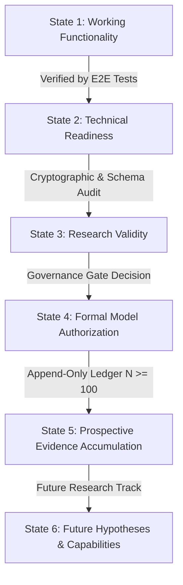

# BTCognitive Master Product Requirements Document (PRD) — Version 2.0 Continuation

**Document Version:** 2.0.0  
**Effective Date:** 16 October 2026  
**Product:** BTCognitive — Probabilistic Bitcoin Risk Intelligence & Market Excursion Platform  
**Repository:** https://github.com/ashishlabs-23/bitcoin-prediction-lab  
**Status:** Approved Product Direction; Research-First, Strictly Non-Execution  
**Document Purpose:** Continue and advance the Master PRD (v1.0) following Milestone 1 forensic reconciliation, establishing concrete engineering requirements, quantitative research specifications, prospective evidence accumulation protocols, and governed product release gates.

---

## 1. Executive Summary & Epistemic Framework

BTCognitive is a quantitative risk intelligence and market excursion research platform designed to deliver statistically rigorous, causal, and transparent Bitcoin (BTC/USD) volatility and price excursion intelligence.

### 1.1 Non-Negotiable Operating Invariants
1. **Strict Non-Execution:** Zero live exchange execution, zero automated broker connections, zero real capital deployment. All outputs serve analytical, risk assessment, and market surveillance purposes (`trading_enabled = false`).
2. **Directional Accuracy Boundary:** Unconditional BTC/USD returns are noisy and non-stationary. The historical directional classifier (`directional-gbm-4lag-v1`) achieves ~52.1% (1h) and ~52.0% (4h) accuracy with negative net expected value after exchange transaction friction. The **90% directional hit rate is an aspirational research hypothesis** that remains **unsupported** on unconditional Bitcoin returns.
3. **Target & Horizon Separation:**
   - **Market Observation:** Real-time spot price, 24h range, 24h realized volatility, and perpetual funding rate from verified exchange feeds.
   - **Short-Horizon Empirical Baseline:** Rolling non-overlapping empirical return quantiles ($P_{10}, P_{50}, P_{90}$) for 1h, 4h, and 24h horizons (`EXPERIMENTAL_BASELINE`).
   - **Canonical Production Risk Forecast:** 168-hour (7 calendar days) forward annualized realized variance magnitude ($\text{rv7d\_var\_ann}$) from frozen `HAR-RS-DOW-v1.0` with C2 conformal risk envelope $[L_t, U_t]$.
   - **Directional Alpha Research:** Offline research benchmark only; decoupled from production risk intelligence.
4. **Epistemic Classification (Retrospective vs. Prospective):**
   - Historical holdouts (including the 2026 evaluation dataset) represent **retrospective out-of-sample replay**.
   - Only untouched, append-only records committed to the prospective ledger *prior* to candle closure and resolved strictly *after* maturity qualify as **confirmatory prospective evidence**.

---

## 2. Six-State System Governance Model

To eliminate semantic conflation between software operation, model training, and scientific validity, BTCognitive formally enforces a six-state decoupled architecture:

### State 1: Working Functionality
- **Definition:** User-facing and programmatic components execute successfully without runtime errors, returning HTTP 200 responses with valid JSON payloads.
- **Current Status:** `ACTIVE` across `/`, `/health`, `/api/health`, `/api/readiness`, `/api/dashboard`, `/api/terminal/live`, `/api/research/prospective-ledger`.

### State 2: Technical Readiness
- **Definition:** Cryptographic verification of model artifacts, feature pipeline schemas, target definitions, runtime dependency compatibility, and database integrity.
- **Current Status:** `READY` (9/9 automated startup gates pass; `evaluate_runtime_readiness()` returns `status: READY`, `authorized: true`).

### State 3: Research Validity
- **Definition:** Econometric soundness of loss functions, causal point-in-time feature construction ($t_{\text{feature}} \le t_{\text{issue}} < t_{\text{maturity}}$), and out-of-sample replication.
- **Current Status:** `VALIDATED` for `HAR-RS-DOW-v1.0` (QLIKE/MSE loss, Corsi 2009 / Patton 2011 standard). `RETAINED_IN_RESEARCH` for `HAR-QLIKE-24H` (p = 0.1622 daily, p = 0.0735 hourly; fails confirmatory promotion hurdle).

### State 4: Formal Model Authorization
- **Definition:** Explicit policy classification governing which models are permitted to serve live endpoints.
- **Current Status:**
  - `HAR-RS-DOW-v1.0`: `AUTHORIZED_FOR_PRODUCTION` (volatility intelligence only).
  - `directional-gbm-4lag-v1`: `OFFLINE_RESEARCH_ONLY`.
  - `HAR-QLIKE-24H-v1.0`: `OFFLINE_RESEARCH_ONLY` (retained challenger).
  - `ridge_excursion_v1`: `ARCHIVED_RESEARCH_CANDIDATE`.

### State 5: Prospective Evidence Accumulation
- **Definition:** Accumulation of immutable, post-freeze matched forecasts and delayed resolved outcomes in `data/prospective_forecast_ledger.jsonl`.
- **Current Status:** `COLLECTING` (Hurdle: $N \ge 100$ clean non-overlapping blocks for confirmatory statistical evaluation; Definitive Hurdle: $N = 2,160$ blocks).

### State 6: Future Hypotheses & Capabilities
- **Definition:** Hypotheses under investigation that have not met evidentiary thresholds.
- **Current Status:** Selective 90% directional prediction (`UNPROVEN`), Order Flow Imbalance / Hawkes microstructure models (`REQUIRES_TICK_FEED`), Real-time cross-exchange perpetual funding rate regime conditioning (`RESEARCH_PROTOTYPE`).

---

## 3. Comprehensive PRD Traceability Matrix

| Req ID | PRD Section | Requirement Description | Current Implementation & Evidence | Confirmed Gaps | Dependencies & Risks | Acceptance Criteria | Release Phase |
| :--- | :--- | :--- | :--- | :--- | :--- | :--- | :--- |
| **REQ-01** | §1.0, §12.0 | Strict Non-Execution & Safety Invariants | `trading_enabled = false` in `api/server.py`; zero broker connectors | None | Regulatory & operational capital protection | Any order execution code fails closed | Phase 0 (Done) |
| **REQ-02** | §3.0, §5.2 | Directional Accuracy Transparency | Directional model labeled `OFFLINE_RESEARCH_ONLY`; UI shows 90% hypothesis unsupported | None | Conflation with volatility risk | No screen claims unconditional >55% directional accuracy | Phase 0 (Done) |
| **REQ-03** | §4.2, §11.0 | Single Authoritative Model Registry | `models/authoritative_model_registry.py` provides typed `ModelIdentityRecord` | Completed | Desynchronization between routes | All endpoints query registry dynamically | Phase 0 (Done) |
| **REQ-04** | §4.2, §11.0 | Cryptographic Freeze Verification | `research/verify_freeze_manifest.py` verifies SHA-256 artifact hashes | Completed | Windows console UTF-8 encoding | Exit 0 with 0 failures on all manifests | Phase 0 (Done) |
| **REQ-05** | §5.2, §7.1 | Canonical Volatility Risk Model (168h) | `HAR-RS-DOW-v1.0` served via `/api/terminal/live` with C2 conformal envelope | Completed | Upstream closed candle availability | Finite variance output; $[L_t, U_t]$ coverage $\ge 85\%$ | Phase 0 (Done) |
| **REQ-06** | §6.1, §7.1 | 24h Empirical Price Range Baseline | `build_empirical_forecast()` calculates return quantiles from valid Coinbase bars | Completed | Historical bar pagination latency | Minimum 30 valid 24h return blocks | Phase 0 (Done) |
| **REQ-07** | §9.1, §9.2 | Research Terminal UI State Fidelity | Dynamic state hooks in `web/app.js` render backend truth without hardcoded blockers | Prospective telemetry UI display | Browser caching of static assets | DOM elements match `/api/readiness` and `/health` | Phase 1 (Active) |
| **REQ-08** | §5.1, §7.2 | Append-Only Prospective Evidence Ledger | `engine/prospective_evidence_pipeline.py` logs to `data/prospective_forecast_ledger.jsonl` | Dual-target tracking (168h + 24h) | Incomplete forward candle settlement | Idempotent logging; zero forward leakage | Phase 1 (Active) |
| **REQ-09** | §5.1, §8.1 | Automated Prospective Worker & Scheduler | `engine/prospective_worker.py` CLI supporting `--once` and `--daemon` | Live closed candle sync integration | Worker downtime; network rate limits | Atomic update of candle storage & status JSON | Phase 1 (Active) |
| **REQ-10** | §5.4, §9.1 | Decision Anatomy Transparency | `/api/terminal/decision-anatomy` emits 4-layer cost/uncertainty breakdown (`ABSTAIN`) | Completed | Negative expected value after fees | Displays `ABSTAIN` when EV < transaction cost | Phase 0 (Done) |
| **REQ-11** | §7.2, §7.3 | Diebold-Mariano & HLN Hypothesis Testing | `engine/prospective_evidence_pipeline.py` implements DM test with HLN finite-sample correction | Completed | Autocorrelation in forecast errors | Student's $t_{T-1}$ reference distribution utilized | Phase 1 (Active) |
| **REQ-12** | §5.3, §7.2 | Causal Volatility Regime Routing | Market regime classifier in `engine/point_in_time_features.py` | Full multi-regime routing gate | Regime classification instability | Explicit `UNKNOWN` regime fallback | Phase 2 (Planned) |
| **REQ-13** | §6.1, §6.2 | Multi-Exchange Spot Comparator | `engine/spot_exchange_comparator.py` comparing Coinbase, Bitstamp, Kraken | Live streaming integration | Divergent exchange feed latency | Outlier detection $\Delta_{\text{price}} > 0.5\%$ | Phase 2 (Planned) |
| **REQ-14** | §3.1, §3.3 | Selective Directional Evaluation Gate | `research/directional_research_gate.py` with preregistered thresholding | Needs $N \ge 100$ prospective events | Cherry-picked threshold selection | Preregistered freeze before evaluation | Phase 3 (Planned) |

---

## 4. Quantitative Research Specifications & Methodology

### 4.1 Target Definitions & Mathematical Formulations

#### 1. Forward 168-Hour Annualized Realized Variance ($\text{rv7d\_var\_ann}$)
The canonical production target for `HAR-RS-DOW-v1.0` is the integrated variance over the forward 168 closed hourly candles:
$$\text{rv7d\_var\_ann}_{t} = \frac{8760}{168} \sum_{i=1}^{168} r_{t+i}^2$$
where $r_{t+i} = \ln(P_{t+i} / P_{t+i-1})$ represents the hourly log-return.

#### 2. Forward 24-Hour Annualized Realized Variance Proxy ($\text{rv24h\_var\_ann}$)
The research challenger target for `HAR-QLIKE-24H` is the integrated variance over the forward 24 closed hourly candles:
$$\text{rv24h\_var\_ann}_{t} = \frac{8760}{24} \sum_{i=1}^{24} r_{t+i}^2 = 365 \sum_{i=1}^{24} r_{t+i}^2$$

#### 3. Realized Semivariances ($RV^+, RV^-$)
Following Barndorff-Nielsen et al. (2010) and Bergsli et al. (2022), realized variance is decomposed into upside and downside components:
$$RV_t^+ = \sum_{i=1}^{M} r_{t,i}^2 \cdot \mathbb{I}_{\{r_{t,i} > 0\}}, \quad RV_t^- = \sum_{i=1}^{M} r_{t,i}^2 \cdot \mathbb{I}_{\{r_{t,i} < 0\}}$$
This decomposition captures the empirical asymmetry in Bitcoin volatility response without requiring ad-hoc threshold tuning.

### 4.2 Loss Functions & Statistical Evaluation
Following Patton (2011), comparing volatility models under an imperfect proxy requires loss functions belonging to the homogeneous Bregman family. BTCognitive mandates two loss metrics:
1. **Quasi-Likelihood (QLIKE):**
   $$L_{\text{QLIKE}}(y, \hat{y}) = \frac{y}{\hat{y}} - \ln\left(\frac{y}{\hat{y}}\right) - 1$$
   Properties: $L_{\text{QLIKE}} \ge 0$, equals 0 iff $y = \hat{y}$. Heavily penalizes underestimating volatility (critical for risk control).
2. **Root Mean Squared Error (RMSE):**
   $$L_{\text{RMSE}}(y, \hat{y}) = \sqrt{\frac{1}{N} \sum_{t=1}^N (y_t - \hat{y}_t)^2}$$

### 4.3 Diebold-Mariano with Harvey-Leybourne-Newbold (HLN) Correction
For paired model comparison between baseline $b$ and challenger $c$:
1. Loss differential: $d_t = L(y_t, \hat{y}_{bt}) - L(y_t, \hat{y}_{ct})$.
2. Mean loss differential: $\bar{d} = \frac{1}{T} \sum_{t=1}^T d_t$.
3. Long-run variance: $\hat{V}(\bar{d}) = \frac{1}{T} \left( \hat{\gamma}_0 + 2 \sum_{k=1}^{h-1} w_k \hat{\gamma}_k \right)$, using Bartlett kernel $w_k = 1 - \frac{k}{h}$.
4. Standard DM statistic: $DM = \frac{\bar{d}}{\sqrt{\hat{V}(\bar{d}) / T}}$.
5. **HLN Finite-Sample Correction:**
   $$HLN = DM \times \left[ \frac{T + 1 - 2h + h(h-1)/T}{T} \right]^{1/2}$$
6. **Decision Rule:** Compare $HLN$ against Student's $t_{T-1}$ distribution. Reject null hypothesis of equal accuracy only if $p < 0.05$ with positive $HLN$ (challenger lower loss).

---

## 5. Live Data & Prospective Evidence Architecture

### 5.1 Append-Only Ledger Contract (`data/prospective_forecast_ledger.jsonl`)
Every prospective forecast must contain:
- `forecast_id`: Cryptographically unique UUID.
- `issue_timestamp_utc`: ISO-8601 UTC timestamp of forecast emission.
- `target_name`: Explicit target identifier (`rv7d_var_ann` or `rv24h_var_ann`).
- `horizon_hours`: Forecast duration in hours ($168$ or $24$).
- `feature_availability_cutoff_utc`: Point-in-time timestamp ($t_{\text{cutoff}} \le t_{\text{issue}}$).
- `data_source_id`: Verified source (`coinbase_btcusd_hourly_parquet`).
- `feature_schema_hash`: Cryptographic hash of feature schema.
- `model_version`: Authoritative model identifier.
- `artifact_hash`: SHA-256 hash of frozen joblib artifact.
- `baseline_predictions`: Dictionary of benchmark predictions (e.g. `persistence`, `rolling_30d`, `har_ols`).
- `challenger_prediction`: Point prediction from candidate model.
- `scheduled_maturity_utc`: $t_{\text{issue}} + \text{horizon}$.
- `resolution_state`: `PENDING`, `RESOLVED`, or `EXCLUDED`.
- `resolved_outcome`: Empirical target value computed strictly after maturity.
- `resolution_timestamp_utc`: Time of resolution.

### 5.2 Resolution Invariant & Settlement Grace Period
- Resolution cannot execute before $t_{\text{now}} \ge t_{\text{maturity}}$.
- If market candles are delayed, the resolver enters a **6-hour settlement grace period** (`SKIPPED`) to allow natural feed recovery before marking records as `EXCLUDED`.

---

## 6. Signal Integrity & Risk-Level Engine Specification (PRD-SIG-18)

### 6.1 Shared Signal Contract Invariants
All research-only scenario generation and presentation must conform to `models/signal_contract.py` (`SignalContract`):
1. **Mathematical Geometry Invariants:**
   - **LONG candidate:** $\text{SL} < \text{Entry} < \text{TP}$ with positive distances:
     $$\text{Reward} = \text{TP} - \text{Entry} > 0, \quad \text{Risk} = \text{Entry} - \text{SL} > 0, \quad \text{Gross R:R} = \frac{\text{Reward}}{\text{Risk}}$$
   - **SHORT candidate:** $\text{TP} < \text{Entry} < \text{SL}$ with positive distances:
     $$\text{Reward} = \text{Entry} - \text{TP} > 0, \quad \text{Risk} = \text{SL} - \text{Entry} > 0, \quad \text{Gross R:R} = \frac{\text{Reward}}{\text{Risk}}$$
   - Static, unverified, or decorative R:R ratios (such as a hardcoded 2:1 claim) are strictly prohibited. The displayed ratio must be dynamically computed directly from the validated level geometry.
2. **Fail-Closed Abstention Semantics:**
   - If a model is in `OFFLINE_RESEARCH_ONLY` or `TIER 2 GATED` status, or direction is `NOT_ESTIMATED` / `ABSTAIN`, the signal engine must fail-closed:
     - `signal_status = ABSTAIN` (or `BLOCKED` / `NOT_ESTIMATED`)
     - `entry_price = None`, `take_profit = None`, `stop_loss = None`, `gross_reward_to_risk = None`
     - Displayed conviction percentage = `0.0%` (or `N/A`), preventing uncalibrated claims (e.g., 75% High Conviction on gated models).
3. **Price Freshness & Reference Price Alignment:**
   - Scenario candidates must validate against the current live or closed hourly candle reference price (`coinbase_btcusd_hourly_parquet`). Entry levels deviating > 5% without an explicit pending limit rule are rejected as stale.
4. **Conservative Same-Bar Collision Resolution:**
   - In historical backtesting and paper simulation, if both TP and SL are touched within the same OHLC bar and intra-bar tick sequences are unavailable, the engine applies the documented conservative policy: **`SL_FIRST_CONSERVATIVE`** (evaluating the stop-loss first to avoid optimistic bias) or flags the candle as **`AMBIGUOUS`**.
5. **Execution Authorization:**
   - All scenario levels are strictly labeled `EXECUTION_DISABLED` / `RESEARCH_ONLY`. Broker submission and order routing remain permanently non-operational.

### 6.2 Research-to-Signal Engine v2 Specification (PRD-SIG-19)
1. **Instrument & Data Frequency Verification (Option A Standard):**
   - Candidate generation is restricted strictly to horizons supported by verified historical datasets (`data/raw/ohlcv.parquet`, 41,261 closed hourly bars).
   - Valid candidate horizons: `1h`, `4h`, `24h` (and `168h` for volatility risk intelligence).
   - Requests for sub-hourly horizons (`15m`, `5m`) without verified continuous intraday feeds must strictly fail closed with `DATA_FREQUENCY_UNSUPPORTED`.
2. **Economic Expectancy Gate ($\mathbb{E}[\text{Net EV}] > 0$):**
   - Candidates must be evaluated against exchange transaction friction (Coinbase spot: 40 bps taker; Binance futures: 5 bps taker + 1 bps spread + 1 bps slippage = 7 bps).
   - Net expected value is computed across mutually exclusive triple-barrier outcomes:
     $$\mathbb{E}[\text{Net EV}] = P(\text{TP}) \cdot (\text{Reward} - \text{Cost}) - P(\text{SL}) \cdot (\text{Risk} + \text{Cost}) + P(\text{TIMEOUT}) \cdot (\Delta_{\text{timeout}} - \text{Cost})$$
   - In preregistered evaluation (`EXP-TRIPLE-BARRIER-DIRECTIONAL-2026-v2`, 6,150 out-of-sample bars in 2026), unconditional momentum yields $P(\text{SL})=36.13\% > P(\text{TP})=17.81\%$, resulting in net negative expectancy (-17 to -50 bps). Candidates with $\mathbb{E}[\text{Net EV}] \le 0$ strictly return `ABSTAIN` with `ECONOMIC_EXPECTANCY_NEGATIVE`.
3. **Deceptive Probability Suppression (Conviction Null Guard):**
   - The UI and API must never render `0%` as though it were a measured probability when a model is unestimated or gated. Unestimated or unsupported candidates must display `N/A — NOT ESTIMATED (EVALUATION GATED)` or `N/A — DATA_FREQUENCY_UNSUPPORTED (HOURLY VERIFIED)`.

---

## 7. Implementation Milestones & Roadmap

- **Milestone 1 (Completed):** Forensic Reconciliation & Baseline Activation. Dynamic runtime readiness evaluator, verified `HAR-RS-DOW-v1.0` inference, active 24h empirical baseline, zero console errors, browser verification.
- **Milestone 2 (Completed):** Signal Integrity & Risk-Level Engine v1.0 (PRD-SIG-18). Forensic repair of screenshot contradictions (stale entry, inverted/invalid R:R, false 75% conviction on gated models, chart marker provenance), shared signal contract, conservative collision policy, automated test verification (149 passed), and desktop/mobile browser validation.
- **Milestone 3 (Completed):** Research-to-Signal Engine v3 (PRD-SIG-20). Experiment integrity audit, realistic two-sided execution costs (Binance perpetual 15.25 bps, Coinbase spot 87.0 bps), duration-dependent holding funding, single-position-at-a-time portfolio accounting, 24-bar split boundary purging, target-prior forensic proof of zero trades at p >= 0.60 ($P(\text{TP}) \approx 17.5\%$), bounded candidate evaluation (Candidates 0, 1, 2, 3), and verified negative gate conclusion (`NO_CANDIDATE_PASSED_PREREGISTERED_GATE`).
- **Milestone 4 (Completed):** Experiment Integrity v4 (PRD-DAT-21). Time-series continuity segmentation (`ContinuityTimeSeriesEngine`), elimination of cross-gap rolling window contamination (742-hour 30-day gap and 1-hour gap), exact elapsed 24-hour UTC duration validation, instrument provenance contract (Coinbase Spot Tier 1 primary backtest vs Binance Futures hypothetical sensitivity), constant training prevalence calibration baseline audit, and recalculation of all candidate scorecards.
- **Milestone 5:** Prospective Evidence Pipeline & Quality Hardening. Dual-target prospective collection (168h + 24h), live candle synchronization, prospective telemetry UI integration, literature synthesis.
- **Milestone 6:** Volatility Regime-Conditioned Expert Gating. Integration of local stationarity conformal adaptation (arXiv:2605.08422) and multi-exchange spot cross-validation.
- **Milestone 7:** Confirmatory Evaluation Gate. Execution of pre-registered Diebold-Mariano HLN evaluation on $N \ge 100$ clean prospective blocks.

---

## 8. Research-to-Signal Engine v3 Specifications (PRD-SIG-20)

### 8.1 Methodological Forensics & Defect Remediation
1. **Two-Sided Execution Costs:**
   - Evaluates full trade lifecycle: entry taker + exit taker + two-sided spread + two-sided slippage + duration-dependent perpetual funding.
   - Binance Futures Perpetual: 10.0 bps taker commission ($2 \times 5.0\text{ bps}$) + 1.0 bps half-spread ($2 \times 0.5\text{ bps}$) + 2.0 bps slippage ($2 \times 1.0\text{ bps}$) + 2.25 bps average holding funding ($\approx 2.25\text{ intervals} \times 1.0\text{ bps}$) = **15.25 bps round-trip**.
   - Coinbase Advanced Spot Tier 1: 80.0 bps taker commission ($2 \times 40.0\text{ bps}$) + 3.0 bps spread + 4.0 bps slippage = **87.0 bps round-trip**.
2. **Single-Position-at-a-Time Portfolio Simulation:**
   - Previous naive runner permitted up to 24 concurrent overlapping positions (mean 12.66 concurrent positions), treating overlapping 24-hour outcome windows as independent events.
   - Preregistered single-position policy enforces strict non-overlapping capital allocation: no candidate is evaluated or entered while a prior position is open. Candidate 1 trade count drops from 3,144 down to 128 non-overlapping trades.
3. **Split Boundary Purging & Embargo:**
   - Enforces a 24-bar embargo/purge prior to 2025 and 2026 split boundaries, eliminating label maturity leakage into subsequent evaluation folds.
4. **Target Prior & Threshold Forensic Resolution:**
   - The target $P(\text{TP\_FIRST})$ with $k_{\text{tp}}=1.5, k_{\text{sl}}=1.0$ has an unconditional base rate of only $\sim 17.5\%$.
   - An unweighted logistic model predicts probabilities centered around ~18-20% (maximum predicted score 0.2749).
   - Requiring $p \ge 0.60$ was a prior-mismatched heuristic that mathematically guaranteed zero trades.
5. **Bounded Candidate Study Results (`EXP-RESEARCH-TO-SIGNAL-V3-SELECTIVE`):**
   - **Candidate 0 (No-Trade Baseline):** 0 trades, 0.0 bps net (`ABSTAIN_NEUTRAL`).
   - **Candidate 1 (Corrected 24h Momentum):** 128 trades, Gross $-7.15$ bps, Net Binance $-22.40$ bps, Net Coinbase $-94.15$ bps (`FAIL_NEGATIVE_AFTER_COSTS`).
   - **Candidate 2 (Cost-Aware Selective Return Filter):** 0 trades, linear predicted returns shrink below 15.25 bps hurdle (`ABSTAIN_NEUTRAL`).
   - **Candidate 3 (Primary-Side Plus Meta-Label Filter):** 108 trades, Gross $+10.32$ bps (gross positive), Net Binance $-4.93$ bps, Net Coinbase $-76.68$ bps (`FAIL_NEGATIVE_AFTER_COSTS`).
   - **Governed Conclusion:** `NO_CANDIDATE_PASSED_PREREGISTERED_GATE`.
   - **Execution Authorization:** `DISABLED` (Permanent Invariant).

---

## 9. Experiment Integrity v4 Specifications (PRD-DAT-21)

### 9.1 Gap-Aware Time-Series Continuity Architecture
1. **Continuity-Aware Segmentation (`ContinuityTimeSeriesEngine`):**
   - Strict timestamp audit of `data/raw/ohlcv.parquet` (41,261 hourly bars) identified two discontinuities:
     - Gap 1: `2023-03-24 12:00` to `2023-03-24 14:00 UTC` (1 missing hour, 2.0h elapsed).
     - Gap 2: `2026-09-01 06:00` to `2026-10-02 05:00 UTC` (742 missing hours, 743.0h elapsed, 30 days 23 hours).
   - Time series partitioned into 3 strictly contiguous segments:
     - Segment 0: 10,741 bars (`2022-01-01 00:00` to `2023-03-24 12:00 UTC`).
     - Segment 1: 30,161 bars (`2023-03-24 14:00` to `2026-09-01 06:00 UTC`).
     - Segment 2: 359 bars (`2026-10-02 05:00` to `2026-10-17 03:00 UTC`).
2. **Feature Reset at Continuity Boundaries:**
   - Rolling returns (`ret_1h`, `ret_4h`, `ret_24h`) and realized volatility (`rv_24h`, `vol_spread`, `hl_ratio_24h`) are computed strictly within each segment.
   - First $K$ bars of each segment are set to `NaN` (72 lookback exclusions total).
   - Prevents the corrupted 8.67% monthly jump across Gap 2 from being treated as a 1-hour return.
3. **Exact Elapsed UTC Duration Contract:**
   - 24 observed rows do NOT constitute 24 hours if an interval crosses a gap.
   - For every forward window $[t+1, t+H]$, the engine verifies $(t_{H} - t_{\text{issue}}) = 24.0\text{ hours}$. Any window crossing a segment boundary or failing elapsed duration is marked `DISCONTINUOUS_FORWARD_HORIZON_GAP` (72 horizon exclusions). Zero synthetic bars manufactured; zero forward-filling.
4. **Market Data Provenance & Instrument Separation:**
   - Primary empirical backtest: **Coinbase Advanced BTC/USD Spot** (Tier 1 fee schedule: 80 bps commission + 3 bps spread + 4 bps slippage = 87.0 bps round-trip).
   - Secondary sensitivity scenario: **Hypothetical Binance USDT-M Futures Perpetual** (10 bps commission + 1 bp spread + 2 bps slippage + 2.0 bps duration-dependent funding = 15.0 bps round-trip). Labeled strictly as hypothetical sensitivity, not an authentic perpetual backtest.
5. **Probability Calibration Audit against Training Prevalence:**
   - Binary classifiers evaluated against constant training prevalence baseline $\bar{y}_{\text{train}} = 0.4224$, not solely naive 0.50.
   - Meta-classifier Brier score ($0.2485$) beats naive 0.50 ($0.2500$) but fails the training prevalence baseline ($0.2480$). Log loss ($0.6901$) similarly fails training prevalence ($0.6892$). The model exhibits zero skill over the empirical prior.
6. **Corrected V4 Results (`EXP-RESEARCH-TO-SIGNAL-V4-GAP-AWARE`):**
   - **Candidate 0 (No-Trade Baseline):** 0 trades, 0.0 bps net (`ABSTAIN_NEUTRAL`).
   - **Candidate 1 (Corrected 24h Momentum, Gap-Safe Single Position):** 227 trades, Gross $+8.91$ bps, Net Coinbase $-78.09$ bps, Net Binance Hypothetical $-6.09$ bps, TP rate 18.5%, SL rate 34.36%, Timeout 47.14%, Mean holding 17.1h (`FAIL_NEGATIVE_AFTER_COSTS`).
   - **Candidate 2 (Cost-Aware Return Filter):** 0 trades, ridge shrink below 15.0 bps hurdle (`ABSTAIN_NEUTRAL`).
   - **Candidate 3 (Meta-Label Filter, $p \ge 0.45$):** 1 trade, Gross $-221.15$ bps, Net Coinbase $-308.15$ bps, Net Binance Hypothetical $-236.15$ bps (`FAIL_NEGATIVE_AFTER_COSTS`).
   - **Governed Conclusion:** `NO_CANDIDATE_PASSED_PREREGISTERED_GATE`.
   - **Execution Authorization:** `DISABLED` (Permanent Invariant).

---

## 10. Statistical Integrity, Experiment Freeze & Prospective Research Specifications (PRD-EXP-22)

### 10.1 Feature Lookback Warm-Up & Eligibility Architecture
1. **Feature Lookback Requirements & Exact NaN Counts:**
   - `ret_1h`: Lookback 1 bar (1 NaN per segment).
   - `ret_4h`: Lookback 4 bars (4 NaNs per segment).
   - `ret_24h`: Lookback 24 bars (24 NaNs per segment).
   - `rv_24h`: Lookback 24 bars (24 NaNs per segment).
   - `hl_ratio_24h`: Lookback 23 bars (23 NaNs per segment).
   - `vol_spread`: Lookback 191 bars ($24 + 168 - 1 = 191$ NaNs per segment).
2. **Machine-Readable Eligibility Audit:**
   - Persisted to `experiments/results/research_improvement/v5_eligibility_audit.json`.
   - Records lookbacks per feature, segment-by-segment dropouts, forward horizon gap exclusions, and split accounting (25,873 train bars, 8,736 val bars, 5,959 test bars).
   - In Segment 2 (359 bars), 191 bars are consumed by `vol_spread` warm-up, leaving 168 bars evaluated.

### 10.2 Target Disambiguation & Cost Provenance
1. **Target Disambiguation:**
   - **Target A (`gross tb_return > 15.0 bps`):** Specifically represents break-even under the **Hypothetical Binance Perpetual sensitivity scenario** (Train prevalence: 42.24%, Test prevalence: 44.85%).
   - **Target B (`gross tb_return > 87.0 bps`):** Specifically represents break-even under the **Coinbase Spot Tier 1 primary backtest** (Train prevalence: 30.37%, Test prevalence: 29.02%).
   - Eliminates conflation: achieving positive return under a 15 bps sensitivity model does NOT imply profitability under 87 bps Coinbase Spot.
2. **Cost Schedule Provenance:**
   - Primary empirical backtest: Coinbase Advanced Spot Tier 1 (80 bps commission + 3 bps spread + 4 bps slippage = 87.0 bps round trip).
   - Sensitivity scenario: Hypothetical Binance USDT-M Futures Perpetual (10 bps commission + 1 bp spread + 2 bps slippage + 2.0 bps duration funding = 15.0 bps round trip).

### 10.3 Statistical Uncertainty & Inconclusive vs Decisively Negative Classification
1. **Paired Loss Difference Bootstrap Confidence Intervals (B=10000):**
   - Brier Score Difference (Model - Baseline): $+0.000428$, 95% CI: $[+0.000234, +0.000621]$.
   - Log Loss Difference (Model - Baseline): $+0.000877$, 95% CI: $[+0.000477, +0.001277]$.
   - Both intervals are **strictly positive**, statistically confirming that the logistic classifier is significantly worse than predicting the empirical training prevalence prior.
2. **Net Expectancy Bootstrap Confidence Intervals (B=10000):**
   - **Candidate 1 (Coinbase Spot 87.0 bps):** Mean $-78.09$ bps, 95% CI: $[-101.18, -55.81]$ bps. **FAIL_DECISIVELY_NEGATIVE** (interval strictly below zero).
   - **Candidate 1 (Binance Hypothetical 15.0 bps):** Mean $-6.09$ bps, 95% CI: $[-28.56, +16.36]$ bps. **INCONCLUSIVE_INTERVAL_CROSSES_ZERO** (interval crosses zero; fails gate because it does not achieve statistically significant positive expectancy).
3. **Sequential Compounded Portfolio Equity Simulation:**
   - Coinbase Spot: Initial NAV \$10,000 $\to$ Final NAV \$1,628.08 ($-83.72\%$), Max Drawdown $83.98\%$.
   - Binance Hypothetical: Initial NAV \$10,000 $\to$ Final NAV \$8,408.36 ($-15.92\%$), Max Drawdown $30.62\%$.
   - Downtime: $65.04\%$ in-trade (3,876 hours), $34.96\%$ downtime/cash.

### 10.4 Experiment Freeze & Prospective Research Protocol
1. **Immutable Freeze Manifest:**
   - Manifest `v5_experiment_freeze_manifest.json` freezes dataset hash (`d831379...`), all artifact hashes, candidate parameters, split boundaries, and governance states.
   - Retrospective window (2026) explicitly classified as exposed development/replay data.
2. **Prospective Ledger Audit:**
   - Active ledger (`data/prospective_forecast_ledger.jsonl`) contains 5 records:
     - 3 resolved 24h volatility records (`prospective-seed-001`, `b1203745-...`, `f5996bf2-...`).
     - 2 pending 168h volatility records (`3b3a58d9-...`, `5657414d-...`).
   - Confirmatory evaluation gate requires $N \ge 100$ non-overlapping clean blocks post-freeze.
3. **Governed Decision (V5):**
   - Research Experiment: `PASS` (Re-computed, statistically audited, and frozen).
   - Governed Verdict: `NO_CANDIDATE_PASSED_PREREGISTERED_GATE`.
   - Live Trading: `DISABLED` (Permanent Invariant).

---

## 11. Approval & Governance Sign-Off

- **Lead Orchestrator:** Antigravity Research Orchestrator  
- **Governance Classification:** `ACTIVE_SPECIFICATION_V2`  
- **Live Trading:** `DISABLED` (Permanent Invariant)  

