# BTCognitive — Authoritative System Gates & Enforcement Specification

**Version:** 1.0.0  
**Effective Date:** October 2026  
**Scope:** Specification, threat model, and test verification matrix for all authorization, readiness, data-integrity, and execution gates in BTCognitive.

---

## 1. Prime Directive & Epistemic Boundaries

BTCognitive is an open-source probabilistic volatility risk intelligence system for BTC/USD. It is governed by a permanent operating contract that strictly separates three functional domains:

```mermaid
graph TD
    subgraph Volatility Domain [1. Volatility Risk Intelligence]
        V1[HAR-RS-DOW-v1.0] --> V2[Annualized 7-Day Realized Variance rv7d_var_ann]
        V2 --> V3[Conformal C2 Dependence-Aware Risk Envelopes]
        V3 --> V4[Status: AUTHORIZED_FOR_PRODUCTION]
    end

    subgraph Directional Domain [2. Directional Return Forecasting]
        D1[Unconditional Directional Signal] --> D2[Aspirational Hypothesis: 90% Win Rate]
        D2 --> D3[Empirical Reality: Unsupported by Out-of-Sample Evidence]
        D3 --> D4[Status: DISABLED / NOT_ESTIMATED]
    end

    subgraph Execution Domain [3. Live Order Execution]
        E1[Broker APIs / Order Placement] --> E2[Private Keys / Wallet Signing]
        E2 --> E3[Prohibited by Operating Contract Section 2.1]
        E3 --> E4[Status: PERMANENTLY DISABLED]
    end
```

### Invariant Rules
1. **Strict Non-Execution:** Zero live trading, broker execution, or order placement pathways exist (`live_capital_authorized: False`, `trading_enabled: False`).
2. **Target Decoupling:** Authorization of the canonical volatility model (`HAR-RS-DOW-v1.0` on `rv7d_var_ann` 168h) does NOT authorize directional trading or live capital.
3. **Fail-Closed Default:** Any missing artifact, hash mismatch, data discontinuity, unverified prospective ledger, or unhandled exception must immediately revert the system to fail-closed state (`BLOCKED`, `DATA_UNAVAILABLE`, or startup abort).
4. **No Health Tautology:** An HTTP 200 on `/health` or `/api/health` indicates solely that the HTTP service is operational and monitoring market feeds. It does **not** imply that production forecasting is authorized or that directional signals exist.

---

## 2. Gate Taxonomy & Enforcement Points

### Gate 1: Scientific Startup Gate (`verify_scientific_contract`)
- **Location:** `validation/startup_gate.py:verify_scientific_contract()`
- **Invocation Point:** FastAPI `lifespan` in `api/server.py`
- **Purpose:** Strict pre-flight physical verification of model artifact, training manifest, coefficient hashes, and runtime dependencies.
- **Fail-Closed Behavior:** Raises `RuntimeError` immediately aborting server startup.

### Gate 2: Runtime Readiness Evaluator (`evaluate_runtime_readiness`)
- **Location:** `validation/startup_gate.py:evaluate_runtime_readiness()`
- **Invocation Point:** Startup lifespan & `/api/readiness`, `/api/terminal/readiness`
- **Purpose:** Generates structured diagnostic state with standardized machine-readable reason codes.
- **Structured Reason Codes:**
  - `NONE`: All 8 checks passed; authorized for volatility intelligence.
  - `FROZEN_INPUT_MISSING`: Manifest or artifact missing on disk.
  - `FROZEN_INPUT_HASH_MISMATCH`: SHA-256 of artifact or manifest altered.
  - `FROZEN_RUNTIME_MISMATCH`: Environment or dependency drift.
  - `MODEL_ARTIFACT_INVALID`: Joblib unpickling error or corrupt pipeline.
  - `FEATURE_CONTRACT_MISMATCH`: Incompatible feature schema.
  - `TARGET_CONTRACT_MISMATCH`: Target variable or horizon altered.
  - `CALIBRATION_UNAVAILABLE`: Insufficient or corrupt calibration parameters.
  - `DATA_STALE`: Market feed exceeding latency threshold.
  - `INSUFFICIENT_HISTORY`: Fewer than required lookback bars.
  - `MODEL_UNAUTHORIZED`: Model lacks production authorization.

### Gate 3: API Request Gate (`_gate`)
- **Location:** `api/market_monitor_routes.py:_gate()`
- **Invocation Point:** Every endpoint in `market_monitor_routes.py` (`/prediction/latest`, `/market/latest`, etc.)
- **Purpose:** Safely reads `request.app.state.research_gate`. If uninitialized or invalid, falls back to safe fail-closed dictionary (`authorized: False`, `status: "BLOCKED_PROVENANCE_UNVERIFIED"`).

### Gate 4: Research Trade Entry / TP / SL Gate (`research_entry_tp_sl`)
- **Location:** `api/market_monitor_routes.py:research_entry_tp_sl()`
- **Invocation Point:** `GET /api/research/entry-tp-sl`
- **Purpose:** Ensures entry prices, take-profit, and stop-loss levels are never emitted as tradeable signals.
- **Enforcement:** Always returns `status: "BLOCKED"`, `claim_level: "UNVALIDATED"`, `hypothetical_signal: null`, `live_capital_authorized: false`, `trading_enabled: false`.

### Gate 5: Prospective Evidence & Longitudinal Gate (`get_prediction_intelligence_health`)
- **Location:** `api/routes_prediction.py:get_prediction_intelligence_health()`
- **Invocation Point:** `GET /prediction/intelligence/health`
- **Purpose:** Prevents premature validation claims. Evaluates resolved post-repair outcomes against empirical hurdle ($N_{\text{eff}} \ge 30$, target 90 blocks).
- **Enforcement:** If `observed_blocks == 0`, strictly returns `production_status: "INSUFFICIENT_EVIDENCE"` and `overall_reliability: "INSUFFICIENT_EVIDENCE"`. Transitions to `"VERY_HIGH"` only when post-repair evidence threshold is satisfied.

### Gate 6: Time-Series Continuity & Segmentation Gate (`ContinuityTimeSeriesEngine`)
- **Location:** `engine/continuity_time_series.py:audit_and_segment()`
- **Invocation Point:** Data ingestion, feature calculation, and backtest pipelines.
- **Purpose:** Detects temporal gaps (e.g. 1h gap on 2023-03-24, 742h gap on 2026-09-01).
- **Enforcement:** Features spanning across gaps evaluate strictly to `NaN`. Forward windows crossing gaps are excluded (`DISCONTINUOUS_FORWARD_HORIZON_GAP`).

---

## 3. Allowed vs. Denied Test Verification Matrix

| Gate | Enforcement Function | Allowed / Passing Condition | Expected Result (Allowed) | Denied / Failing Condition | Expected Result (Denied) | Test Coverage |
| :--- | :--- | :--- | :--- | :--- | :--- | :--- |
| **Startup Freeze** | `verify_scientific_contract` | Uncorrupted artifact & manifest with matching SHA-256 | Returns `True`; server continues initialization | Corrupted artifact byte or missing manifest | Raises `RuntimeError("SCIENTIFIC STARTUP GATE FAILED...")` | `test_phase_01_1_adversarial_integrity.py` |
| **Runtime Readiness** | `evaluate_runtime_readiness` | Clean artifact & valid features | `authorized: True`, `status: "READY"`, `reason_code: "NONE"` | Missing `ohlcv.parquet` or altered hash | `authorized: False`, `status: "BLOCKED"`, `reason_code: "FROZEN_INPUT_MISSING"` | `test_forecast_activation_and_readiness.py` |
| **Prediction Route** | `/prediction/latest` | Gate authorized in `app.state.research_gate` | `research.authorized: True`, `production_forecast_available: True`, `trading_enabled: False` | Gate blocked or uninitialized | `research.authorized: False`, `production_forecast_available: False`, `trading_enabled: False` | `test_frontend_contracts.py` |
| **Trade Execution** | App Route Table | Read-only research routes | HTTP 200 with `execution_mode: READ_ONLY_RESEARCH` | Attempt to call `/api/order/buy`, `/api/broker/execute` | Route does not exist (HTTP 404 / route table assertion) | `test_frontend_contracts.py` |
| **Directional Entry** | `/api/research/entry-tp-sl` | Volatility gate authorized | `status: "BLOCKED"`, `hypothetical_signal: null`, `live_capital_authorized: False` | Volatility gate blocked | `status: "BLOCKED"`, `hypothetical_signal: null`, `live_capital_authorized: False` | `test_frontend_contracts.py` |
| **Prospective Evidence** | `/prediction/intelligence/health` | Resolved post-repair blocks $\ge 5$ | `production_status: "VALIDATED_PRODUCTION_RANGE_SYSTEM"`, `overall_reliability: "VERY_HIGH"` | Zero resolved post-repair blocks ($N=0$) | `production_status: "INSUFFICIENT_EVIDENCE"`, `overall_reliability: "INSUFFICIENT_EVIDENCE"` | `test_forecast_intelligence.py` |
| **Time Continuity** | `build_continuity_features` | Lookback inside contiguous segment | Numeric feature values (`ret_1h`, `rv_24h`) | Lookback crossing temporal gap | `NaN` (no lookahead or cross-gap contamination) | `test_experiment_integrity_v4.py` |

---

## 4. Cross-Endpoint Consistency Invariants

1. **`/health` & `/api/health` vs. Prediction Endpoints**:
   - `/health` returning HTTP 200 with `"status": "ok"` means the FastAPI server and data monitors are running.
   - It **explicitly publishes**:
     - `"directional_recommendation_status": "DISABLED"`
     - `"live_trading_enabled": false`
     - `"order_submission_enabled": false`
     - `"product_mode": "ANALYSIS_ONLY"`
     - `"execution_status": "DISABLED_ANALYSIS_ONLY"`
   - If `research_gate["authorized"]` is False, `/health` sets `"mode": "MARKET_MONITOR_ONLY"`, `"production_forecast_available": false`, and `"models_loaded": false`.
   - If `research_gate["authorized"]` is True, `/health` sets `"mode": "PRODUCTION_VOLATILITY_INTELLIGENCE"`, `"production_forecast_available": true`, and `"models_loaded": true`.

2. **`/api/readiness` vs. `/prediction/latest`**:
   - Both derive authority from `validation.startup_gate.evaluate_runtime_readiness`.
   - Neither emits directional probabilities or trading orders under any circumstances.

3. **Frontend Dashboard (`/` and `web/app.js`)**:
   - Subscribes to `/prediction/latest` and `/api/health`.
   - Displays empirical quantile envelopes with explicit disclaimers: `"Forecast unavailable · frozen inputs unverified"` or `"Historical distribution baseline only"`.
   - Zero trade execution buttons, zero order submission forms, and zero "beat a coin flip" claims exist in the UI code.
