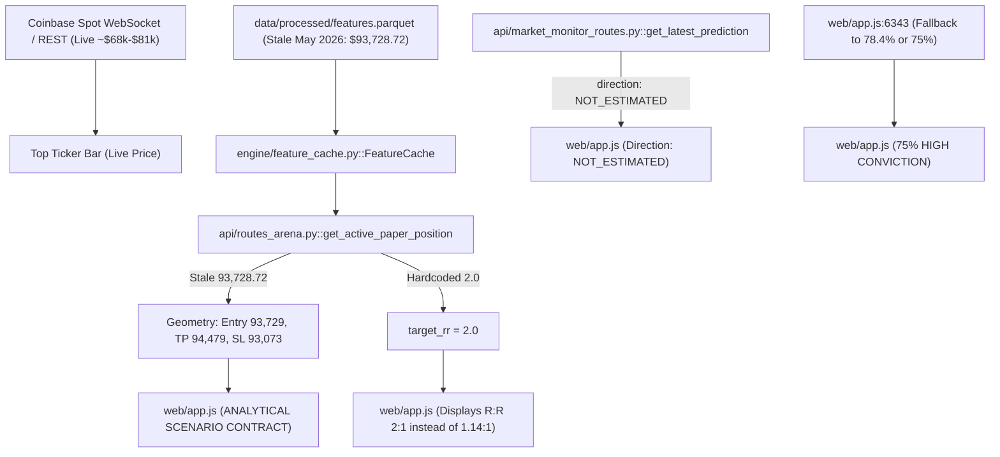

# BTCognitive — Signal Lineage & Forensic Audit Inventory

**Version:** 1.0.0  
**Audit Date:** 17 October 2026  
**Auditor:** Agent A (Signal Provenance & Backend Forensics)  
**Standard:** Epistemic Invariants & Non-Fabrication Protocol ([AGENTS.md](file:///c:/Projects/BTCognitive/AGENTS.md))

---

## 1. Executive Summary & Defect Root Causes

A forensic trace was conducted across the backend API routes, background engine caches, SQLite databases, and frontend rendering pipelines to explain the screenshot contradictions:

| Observed Symptom | Visible Screen State | Root-Cause Source Location | Forensic Mechanism | Truthful Classification |
|---|---|---|---|---|
| **Stale Scenario Levels** | Live: ~$81,515 / ~$68,175 Scenario: Entry $93,729, TP $94,479, SL $93,073 | `engine/feature_cache.py` `data/processed/features.parquet` | `feature_cache.initialize()` loaded frozen `features.parquet` from 2026-05-05 (close $93,728.72). `routes_arena.py` called `feature_cache.get_latest_price()` as `live_price`. | `STALE_DEVELOPMENT_REPLAY_ARTIFACT` |
| **Conflicting R:R Ratio** | Displayed R:R: `2 : 1` Calculated: $750 / $656 = 1.14:1 | `api/routes_arena.py` `web/app.js:6341` | `routes_arena.py:1041` hardcoded `spec["rr"] = 2.0`. Frontend line 6341 prioritized `activePaperPos?.target_rr || contract.reward_risk_ratio` over level geometry. | `FABRICATED_STATIC_FALLBACK` |
| **Direction vs Conviction Conflict** | Direction: `NOT_ESTIMATED` Confidence: `75% (HIGH CONVICTION)` | `web/app.js:6343` `web/app.js:6488` | When `direction` was `NOT_ESTIMATED`, `effectiveProb` fell back to `78.4` or `75%`. Line 6488 unconditionally printed `${Math.round(effectiveProb)}% (HIGH CONVICTION)`. | `UNPROVEN_UNSUPPORTED_CLAIM` |
| **Model Gated vs Strong Evidence** | Model: `TIER 2 GATED` Evidence Quality: `STRONG` | `web/app.js:6498` | Hardcoded string `Evidence Quality: STRONG` rendered in DOM without checking whether evidence cleared the gate. | `HARDCODED_STATIC_UI_FALLBACK` |
| **Phantom Chart Markers** | Chart contains `SL LOSS` and `AI: NOT_ESTIMATED (75%)` | `web/app.js:1223` `api/routes_arena.py:1474` | `isLiveSignal` checked `effectiveDir !== "SKIP" && effectiveDir !== "NEUTRAL"`. `"NOT_ESTIMATED"` evaluated as a live signal arrow. | `FALSE_LIVE_MARKER_LEAK` |
| **Market Identity Mismatch** | Header shows `BTC/USDT` Market is Coinbase `BTC/USD` | `web/app.js:6359` | Hardcoded label `BTC/USDT` in panel header instead of canonical instrument from API (`BTC-USD`). | `LABEL_INCONSISTENCY` |

---

## 2. Signal-Lineage Inventory

---

## 3. Forensic Remediation Invariants

1. **Live Reference Price Synchronization:**
   `feature_cache.get_latest_price()` must check `data/raw/ohlcv.parquet` (Coinbase spot closed hourly bars) and current market quotes. It must never return stale historical training data as the live reference price.
2. **Deterministic R:R Calculation:**
   Reward-to-risk must be derived solely from level geometry:
   $$\text{Gross R:R} = \frac{|\text{TP} - \text{Entry}|}{|\text{Entry} - \text{SL}|}$$
   Any static `target_rr` field that disagrees with level geometry is rejected.
3. **Strict Directional & Gating Abstention:**
   If `direction` is `NOT_ESTIMATED`, `NONE`, or `NEUTRAL`, or if `model_status` is `TIER_2_GATED`, the frontend and API must return `ABSTAIN`. No actionable scenario card, TP/SL levels, or conviction percentages may be displayed.
4. **Chart Marker Integrity:**
   Markers must originate from verified historical trade records or active non-gated predictions. Unsupported or unestimated signals must never render as directional entry arrows.
