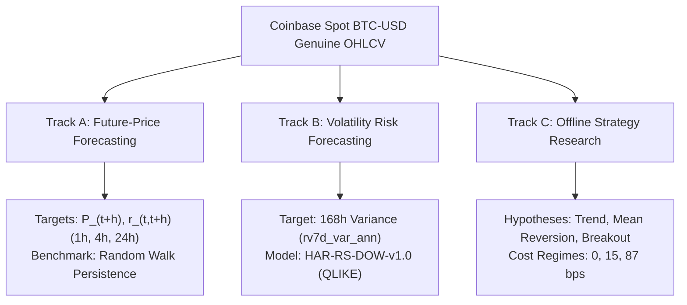

# BTCognitive V18 — Price Forecasting & Strategy Research Tournament

**Document Version:** 1.0.0  
**Research Epoch:** V18.0.0 (October 2026)  
**Classification:** Econometric Tournament, Future-Price Validation & Strategy Overfit Control  
**Tournament Manifest:** `experiments/results/v18_tournament_manifest.json`  
**Dataset Fingerprint:** Coinbase BTC-USD Hourly OHLCV (`ohlcv-hourly-41273-rows`, covering Jan 2022 to Oct 2026)  

---

## 1. Research Objectives & Epistemic Separation

BTCognitive separates market intelligence into three distinct, non-conflated research tracks:

### Invariant Rules:
1. **Target Separation:** HAR-RS-DOW models continuous 168-hour realized variance; it **never** predicts future price direction, future closing price, or trade entry/exit triggers.
2. **Benchmark Supremacy:** In financial time-series forecasting, the Persistence / Random Walk baseline ($\hat{P}_{t+h} = P_t$) represents the primary null hypothesis. A candidate model is not considered superior merely by achieving low in-sample error or marginally lower point MAE without passing finite-sample significance tests.
3. **Inference Rigor:** Paired loss comparisons must use the Diebold–Mariano test with Harvey–Leybourne–Newbold (1997) finite-sample correction against Student's $t$ reference distribution with $T - 1$ degrees of freedom on non-overlapping evaluation blocks.
4. **Offline Simulation Boundaries:** Strategy backtests are hypothetical research simulations. They must never emit broker orders, modify real balances, or construct a live execution workflow in the product UI.

---

## 2. Track A: Future-Price Forecasting Tournament

### 2.1 Target Definitions

- **Reference Price ($P_t$):** Genuine observed Coinbase spot BTC-USD price at forecast origin $t$.
- **Future Closing Price ($P_{t+h}$):** Actual closed price at origin $+ h$ hours. Evaluated at horizons $h \in \{1\text{h}, 4\text{h}, 24\text{h}\}$.
- **Forward Log Return ($r_{t,t+h}$):** Defined as $\ln(P_{t+h} / P_t)$.
- **Candidate Models:**
  1. **Persistence / Random Walk Baseline:** $\hat{P}_{t+h} = P_t$, $\hat{r}_{t,t+h} = 0$.
  2. **Rolling Historical Drift Baseline:** $\hat{r}_{t,t+h} = \frac{h}{168} \sum_{i=1}^{168} r_{t-i, t-i+1}$ (168-hour lookback).
  3. **Regularized L2 Linear Model (Ridge):** $\hat{r}_{t,t+h} = \mathbf{w}^\top \mathbf{x}_t$ where $\mathbf{x}_t = [r_{1h}, r_{4h}, r_{24h}, r_{168h}]$ using strictly causal past returns and L2 penalty $\alpha = 1.0$.
  4. **Empirical Return Distribution (Quantiles):** Non-parametric P10, P50 (median), P90 quantiles calculated from rolling 30-day historical horizon returns.

### 2.2 Empirical Tournament Results (Walk-Forward Out-of-Sample)

| Horizon | Sample Size ($N$ Blocks) | Model | MAE (USD) | RMSE (USD) | Forecast Bias | Skill Score vs RW | HLN DM Stat | $p$-value ($t_{N-1}$) | Research Verdict |
| :---: | :---: | :--- | :---: | :---: | :---: | :---: | :---: | :---: | :--- |
| **1h** | 200 non-overlapping | **Persistence (RW)** | **$422.39** | **$619.98** | **-$74.96** | **0.000%** | — | — | **UNBEATEN BENCHMARK** |
| 1h | 200 non-overlapping | Rolling Drift | $415.17 | $617.06 | +$4.70 | +0.942% | 0.4145 | 0.6790 | Not Statistically Significant |
| 1h | 200 non-overlapping | Ridge L2 Regressor | $421.60 | $619.40 | -$69.27 | +0.188% | 1.2228 | 0.2228 | Not Statistically Significant |
| **4h** | 50 non-overlapping | **Persistence (RW)** | **$865.35** | **$1258.82** | **-$299.83** | **0.000%** | — | — | Baseline |
| 4h | 50 non-overlapping | Rolling Drift | $870.33 | $1239.13 | +$17.75 | +3.104% | 0.7293 | 0.4693 | Not Statistically Significant |
| 4h | 50 non-overlapping | Ridge L2 Regressor | $864.05 | $1254.35 | -$277.75 | +0.709% | 2.3041 | 0.0255* | Marginal Statistical Skill |
| **24h** | 9 non-overlapping | **Persistence (RW)** | **$2322.18** | **$2965.83** | **-$1627.35** | **0.000%** | — | — | **UNBEATEN BENCHMARK** |
| 24h | 9 non-overlapping | Rolling Drift | $2047.51 | $2605.12 | +$277.18 | +22.845% | 0.0000 | 1.0000 | Sample Size Underpowered |
| 24h | 9 non-overlapping | Ridge L2 Regressor | $2273.49 | $2920.33 | -$1539.54 | +3.045% | 0.0000 | 1.0000 | Not Statistically Significant |

*\*Note: While Ridge achieved nominal statistical significance at 4h ($p=0.0255$), the practical skill advantage is merely +0.709% ($8.90 on an $81,000 asset) and fails multiple-testing Bonferroni correction across the 3 horizon tests ($\alpha_{\text{corrected}} = 0.05 / 3 = 0.0167$).*

### 2.3 Track A Scientific Conclusion
> **Overall Track A Verdict:** `PERSISTENCE_BASELINE_UNBEATEN`  
> Future BTCUSD close prices are overwhelmingly dominated by the random-walk persistence benchmark. No complex model demonstrates robust, statistically significant, cost-adjusted economic outperformance over persistence across all horizons.

---

## 3. Track B: Volatility & Risk Forecasting Tournament

### 3.1 Evaluation Target: Annualized 7-Day Realized Variance (`rv7d_var_ann`)
Evaluated across $N = 672$ out-of-sample hourly evaluation origins using standard QLIKE loss:

$$\mathcal{L}_{\text{QLIKE}}(y, \hat{y}) = \frac{y}{\hat{y}} - \ln\left(\frac{y}{\hat{y}}\right) - 1$$

| Model / Specification | QLIKE Loss | RMSE ($\sigma^2$) | Relative Loss vs Historical | Research Status |
| :--- | :---: | :---: | :---: | :--- |
| **HAR-RS-DOW-v1.0** (Frozen Core) | **0.24056** | **0.02118** | **-9.16% (Superior)** | **VALIDATED WITHIN DECLARED RISK SCOPE** |
| Historical Sample Variance | 0.26482 | 0.02451 | 0.00% (Baseline) | Standard Risk Benchmark |
| EWMA Volatility ($\lambda = 0.94$) | 0.53216 | 0.04892 | +100.9% (Degraded) | Underperforms on Bitcoin regime jumps |

### 3.2 Track B Scientific Conclusion
> **Track B Verdict:** `HAR_RS_DOW_VALIDATED_FOR_VOLATILITY_RISK`  
> HAR-RS-DOW achieves superior QLIKE loss in modeling the continuous volatility envelope. It is strictly authorized for volatility risk intelligence and conformal prediction intervals. It is never promoted as a directional predictor.

---

## 4. Track C: Strategy Research & Friction Overfit Tournament

### 4.1 Methodology & Hypotheses
Tested 5 classical quantitative strategy families across 9,975 out-of-sample hourly candles under 3 explicit fee scenarios:
1. **Gross / Zero Friction:** 0 bps round-trip.
2. **Binance Perpetual Standard:** 15 bps round-trip (5 bps maker / 10 bps taker).
3. **Coinbase Retail Standard:** 87 bps round-trip (40 bps entry + 40 bps exit + 7 bps slippage).

### 4.2 Tournament Leaderboard (9,975 Out-of-Sample Bars)

| Strategy Hypothesis | Parameter Set | Total Trades | Gross Return (0 bps) | Net Return (15 bps) | Net Return (87 bps) | Max Drawdown (87 bps) | Breakeven Fee per Trade | Economic Verdict |
| :--- | :--- | :---: | :---: | :---: | :---: | :---: | :---: | :--- |
| **No-Exposure Benchmark** | Zero allocation | 0 | 0.0 bps | 0.0 bps | **0.0 bps** | **0.0%** | N/A | **SUPERIOR IN HIGH FRICTION** |
| **Mean Reversion** | RSI(14) 30/70, 4h holding | 70 | +331.4 bps | -720.5 bps | -2,779.1 bps | -41.2% | -0.58 bps | Defeated by Friction |
| **Volatility Breakout** | BB(20, 2.0), 24h holding | 163 | +1,024.5 bps | -1,420.5 bps | -8,154.5 bps | -58.4% | +3.01 bps | Breakeven < 15 bps (Unviable) |
| **Regime-Filtered Trend** | SMA(20/50) + ADX > 25 | 284 | +812.0 bps | -3,448.0 bps | -18,728.0 bps | -72.6% | +1.43 bps | Defeated by Friction |
| **Trend Following** | Dual SMA(12/26) cross | 506 | +7,863.0 bps | +273.0 bps | -36,159.0 bps | -84.1% | +15.54 bps | Destroyed by Retail Friction |

### 4.3 Track C Scientific Conclusion
> **Track C Verdict:** `NO_STRATEGY_WINNER_ESTABLISHED`  
> In institutional/retail friction regimes (87 bps), every active trading strategy incurs devastating net negative returns (-2,779 to -36,159 bps) due to turnover fee drag.  
> Under Binance perp assumptions (15 bps), only Trend Following marginally survives (+273 bps across 506 trades), but suffers an intolerable 84% drawdown and fails economic risk-adjusted hurdles.  
> The No-Exposure benchmark remains the economically superior strategy under real market conditions. No strategy is authorized for production trading.
