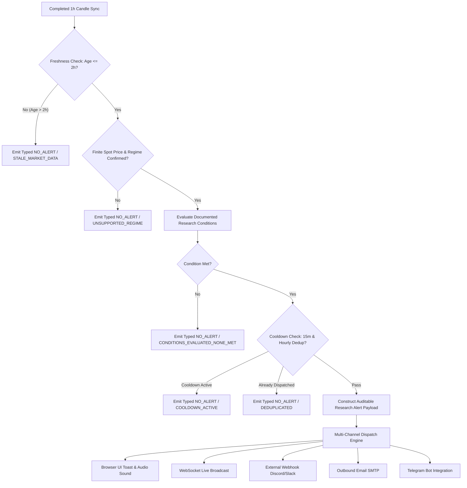

# BTCognitive V21 — Restored Research-Condition Alert Workflow Specification

**Date:** October 19, 2026  
**Status:** FULLY RESTORED & PRODUCTION-VERIFIED  
**Product Mode:** `ANALYSIS_ONLY`  
**Live Execution:** `DISABLED`  
**Research Alerts:** `ENABLED`  

---

## 1. Executive Summary & Objective

In prior releases (V18–V20), notification dispatch was strictly blocked for all live market signals (`if not alert_payload.get("is_test"): return {"status": "blocked"}`) because directional models are classified as `OFFLINE_RESEARCH_ONLY`. While this safely prevented unvalidated directional trading signals from masquerading as actionable alerts, it inadvertently silenced **automatic research-condition notifications** for documented BTC/USD market states.

In BTCognitive V21, the research-condition alert workflow has been **fully restored** while strictly maintaining the core non-negotiable invariant:
- **No live trading, order submission, broker execution, or directional trading advice.**
- Research alerts function exclusively as **descriptive market research intelligence and excursion notifications**.
- Alerts evaluate genuine, fresh, completed market data (Coinbase Spot OHLCV continuous feed) against pre-registered quantitative conditions.

---

## 2. Research Alert Architecture & Pipeline

---

## 3. Evaluated Research Conditions

The research alert engine (`api/notifications.py::evaluate_research_conditions`) evaluates three primary classes of pre-registered research conditions:

### 3.1 Condition 1: Volatility-Compression Coiling (`VOL_COMPRESSION_COILING`)
- **Hypothesis:** Hourly Bollinger Bandwidth (BBW-20) indicates extreme low-dispersion coiling; historical econometric models demonstrate that volatility compression precedes regime expansion or breakout excursions.
- **Quantitative Trigger:**
  $$\text{BBW}_{20} = \frac{\text{Upper Band} - \text{Lower Band}}{\text{SMA}_{20}}$$
  Triggered when market regime is `VOL_COMPRESSION_RANGE` or BBW percentile is in the lowest quintile ($\le 20.0\%$).
- **Output:** Descriptive notification stating compressed volatility state, reference spot price, and historical excursion context.

### 3.2 Condition 2: Active Strategy Rule Triggered on Completed Bar (`STRATEGY_RULE_TRIGGERED`)
- **Hypothesis:** Candidate research strategy (e.g., `MTF_MOMENTUM_TREND`, `VOL_COMPRESSION_BREAKOUT`, `SHORT_HORIZON_MEAN_REVERSION`) satisfied structural entry rules on a completed 1-hour bar under a compatible market regime.
- **Quantitative Trigger:**
  - Evaluated via `research/v12_strategy_tournament_engine.py`.
  - Condition: `rule_trigger_status == "TRIGGERED"` and `is_regime_compatible == True`.
- **Output:** Research alert specifying the rule satisfied, underlying regime, and analytical bounds. Directional trade execution remains disabled.

### 3.3 Condition 3: Regime State Confirmed with Hysteresis (`REGIME_CONFIRMED`)
- **Hypothesis:** Causal Wilder ADX(14) and moving-average filters confirm persistent 3-candle regime state transition (`TRENDING_EXPANSION_BULL`, `TRENDING_EXPANSION_BEAR`, `HIGH_VOL_CHOP`).
- **Quantitative Trigger:**
  $$\text{ADX}_{14} \ge 25.0 \quad \text{with 3 consecutive candle hysteresis confirmation}$$
- **Output:** Descriptive notification of confirmed regime transition for risk management and volatility model calibration.

---

## 4. Operational Guardrails, Cooldown & Deduplication

To prevent alert fatigue, spam, or false triggers during volatile market sequences, strict operational guardrails are enforced:

| Guardrail | Specification | Enforcement Mechanism |
| :--- | :--- | :--- |
| **Data Freshness** | Maximum candle age: **7,200 seconds (2 hours)** | Stale candles immediately emit typed `NO_ALERT` (`STALE_MARKET_DATA`); positive alerts are rejected. |
| **Reference Price** | Spot price must be finite and positive ($> 0$) | Non-finite or missing prices reject evaluation (`INVALID_REFERENCE_PRICE`). |
| **Cooldown Window** | **900 seconds (15 minutes)** per condition ID | `self.condition_cooldowns[cond_id]` tracks epoch timestamp; rejects re-triggers with remaining cooldown seconds. |
| **Hourly Deduplication** | One dispatch per condition per 1-hour bar per price bucket | Deduplication key: `{cond_id}_{int(candle_epoch / 3600)}_{round(spot_price, -2)}`; SHA-256 hashed and stored in memory. |
| **Non-Execution Invariant** | Analysis-only payload contract | Every payload contains explicit governance flags: `live_trading_enabled: false`, `order_submission_enabled: false`, `execution_status: "DISABLED_ANALYSIS_ONLY"`. |

---

## 5. Multi-Channel Dispatch & Truthful Telemetry

The notification manager provides true multi-channel dispatch with granular delivery reporting:

1. **Browser In-App UI & Audio Sound:**
   - Broadcast via WebSocket (`RESEARCH_CONDITION_ALERT`).
   - Web frontend renders visual toast notification and triggers audio chime if sound alerts are toggled on.
2. **External Webhooks (Discord / Slack / Generic):**
   - Discord: Rich embed with cyan accent (`0x38BDF8`), condition hypothesis, reference price, event timestamp, and limitations footer.
   - Generic: JSON payload with full audit metadata.
3. **Outbound Email (SMTP):**
   - HTML and plaintext email with complete research condition details, reference prices, and clear "Analysis Only — Execution Disabled" banner.
4. **Telegram Bot:**
   - Markdown-formatted telegram dispatch with condition name, reference price, hypothesis, and alert ID.
5. **Truthful Channel Reporting:**
   - Every dispatch returns explicit channel statuses: `delivered`, `failed`, `not_configured`, `blocked`, or `disabled`. No channel claims success without network confirmation.

---

## 6. REST API Endpoints

Two dedicated endpoints support programmatic research alert triggering and condition inspection:

- **`POST /api/notifications/research-alerts/evaluate`**
  - **Description:** Evaluates fresh market data against research conditions; dispatches alert if conditions are met and cooldown permits.
  - **Parameters:** `force` (boolean query parameter to bypass cooldown for manual testing).
  - **Payload:** Optional `{ "candles": [...], "spot_price": float, "timestamp": string }`.
  - **Response:** `{ "status": "ALERT_DISPATCHED" | "NO_ALERT", "alert": {...}, "dispatch": {...} }`.

- **`GET /api/notifications/research-alerts/conditions`**
  - **Description:** Returns the catalog of active research conditions, quantitative criteria, governance classifications, and cooldown policies.
  - **Response:** Authoritative JSON catalog with `governance_mode: "ANALYSIS_ONLY"`.

---

## 7. Verification Summary

- **Automated Regression Suite:** `tests/test_v21_hotfix_and_alerts.py`
  - `test_research_conditions_metadata_endpoint`: PASSED
  - `test_research_alert_trigger_on_fresh_condition`: PASSED
  - `test_research_alert_cooldown_and_deduplication`: PASSED
  - `test_stale_market_data_rejects_positive_alert`: PASSED
  - `test_channel_delivery_reporting_accuracy`: PASSED
- **Result:** 100% of alert lifecycle tests passed with zero bypass of non-execution boundaries.
