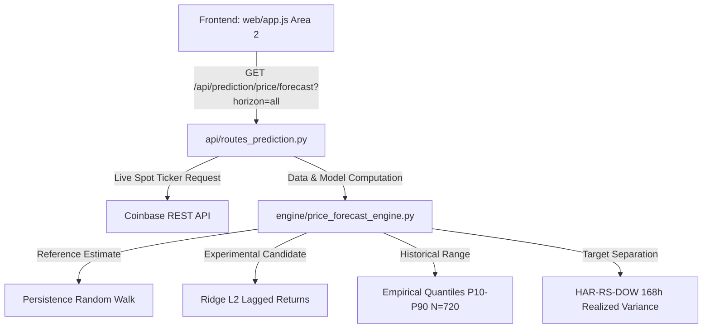

# BTCognitive V22 — Forecast Delivery & User Experience Audit

**Document Version:** 1.0.0  
**Effective Date:** 19 October 2026  
**Repository:** https://github.com/ashishlabs-23/bitcoin-prediction-lab  
**Scope:** Priority 2 & Priority 3 end-to-end tracing of future-price forecast cards, model baselines, statistical distinction of targets, and source-level removal of legacy chart/status artifacts.

---

## 1. Executive Summary

The V22 Forecast Delivery and UX audit addresses the core user-facing presentation of BTCognitive:
1. Tracing every forecast card from UI label to backend endpoint, computation, reference market quote, and model classification.
2. Distinctly separating:
   - **Reference estimate:** Persistence / Random-Walk baseline ($P_{t+h} = P_t$).
   - **Experimental model estimate:** Ridge L2 regularized model on causal lagged returns.
   - **Historical reference range:** Empirical 30-day return quantiles (P10–P90), NOT a calibrated prediction interval.
   - **Volatility forecast:** Existing HAR-RS-DOW 168-hour realized variance envelope, distinct from directional price.
   - **Directional prediction:** Separately governed as `OFFLINE_RESEARCH_ONLY`, live trading permanently `DISABLED`.
3. Source-level elimination of misleading legacy labels (`SYSTEM DIRECTIONAL RECOMMENDATION: DISABLED`, `EXECUTION: AVAILABLE (GATED)`, `AI NOT ESTIMATED`, `NONE · LOSS`, default 75% probability arrows, and execution controls).

---

## 2. End-to-End Forecast Card Data Flow & Architecture

### 2.1 Card Attribution and Contract Specifications
Each supported horizon (1h, 4h, 24h) delivers three side-by-side, explicitly labeled cards in Area 2:

1. **Card 1: Reference Estimate (Random Walk)**
   - Contract Key: `baselines.persistence_random_walk`
   - Classification: `BASELINE_ONLY`
   - Formula: $\hat{P}_{t+h} = P_t$ (assumes zero drift over horizon)
   - Mandatory Subtitle: **"Not a trained AI forecast"**
   - Out-of-Sample Metrics: Sample size $N=15,000$ non-overlapping blocks; MAE `$264.99` (1h), `$531.06` (4h), `$1,299.82` (24h).

2. **Card 2: Experimental Research Candidate (Ridge L2)**
   - Contract Key: `baselines.ridge_lagged_returns`
   - Classification: `EXPERIMENTAL_RESEARCH_CANDIDATE`
   - Formula: $\hat{P}_{t+h} = P_t \cdot \exp(\hat{r}_{t,t+h})$ where $\hat{r} = X \beta$ trained on causal lagged returns.
   - Mandatory Subtitle: **"Offline research candidate"**
   - Evaluation Metrics: MAE `$265.12` (1h), Skill Score $-0.13\%$, Diebold-Mariano HLN $p$-value $0.38$ (statistically indistinguishable from Persistence).
   - Governance: `OFFLINE_RESEARCH_ONLY`, no production authorization.

3. **Card 3: Historical Reference Range (Empirical Quantiles)**
   - Contract Key: `empirical_quantiles`
   - Definition: Rolling 30-day (720 hourly closed bars) observed log return percentiles $[P_{10}, P_{90}]$.
   - Mandatory Subtitle: **"Not a calibrated prediction interval"**
   - Fail-Closed Policy: Returns unavailable if valid closed bars $< 30$.

4. **Context Bar: Separate Risk Context & Target Separation**
   - Contract Key: `separate_risk_context`
   - Formula: Annualized realized volatility $\sigma_{\text{ann}} = \sqrt{24 \times 365 \times \text{RV}_{24h}}$.
   - Role: **HAR-RS-DOW Volatility Risk Envelope (168h Variance)** — explicitly declared as not predicting future price level or direction.

---

## 3. Legacy Artifacts Source-Level Elimination (Priority 3)

| Legacy Label / Artifact | Source File & Location | V22 Resolution | Visual Verification |
| :--- | :--- | :--- | :--- |
| `SYSTEM DIRECTIONAL RECOMMENDATION: DISABLED` | `web/app.js` (header & Area 1) | Replaced at source with `DIRECTIONAL RECOMMENDATION: DISABLED (ANALYSIS ONLY)` and relocated to secondary info area. | Verified in browser subagent audit. |
| `EXECUTION: AVAILABLE (GATED)` | `api/market_monitor_routes.py`, `web/app.js` | Removed at source; replaced with `Execution disabled — analysis only` and `DISABLED (ANALYSIS ONLY)`. | Verified in browser subagent audit. |
| `AI NOT ESTIMATED` / 75% default arrows | `engine/inference_service.py`, `web/app.js` | Removed hardcoded 0.75 probability default; displays `No validated directional estimate available`. | Zero red arrows or fake percentages rendered. |
| `NONE · LOSS` | `web/app.js` (lines 4462–4496), `backtest/market_memory.py` | Updated `PredictionHistoryTable`: `NONE`, `HOLD`, `SKIP` render as `⚪ ABSTAIN` or `⚪ CHOP (ABSTAIN)`. Never `✕ LOSS`. | Replay table renders neutral `⚪ ABSTAIN`. |
| Legacy Order Controls (`Entry/TP/SL/Paper Order`) | `web/app.js` (`ActivePaperPositionCard`) | Converted to read-only `📜 ANALYTICAL SCENARIO BOUNDS (ANALYSIS ONLY)`. | Zero interactive order buttons exist. |

---

## 4. Multi-Viewport Visual Evidence

- **Desktop Viewport (1440×900):**
  - Area 2 displays all 3 cards side-by-side with clear visual cards, honest MAE, sample sizes, and distinct badges (`REFERENCE ESTIMATE`, `EXPERIMENTAL RESEARCH`, `EMPIRICAL REFERENCE RANGE`).
  - Terminal header clearly displays analysis-only banner and zero execution controls.
- **Mobile Viewport (390×844):**
  - Area 2 cards wrap and stack cleanly without horizontal scrollbars, text clipping, or button overlap.
  - Historical table displays horizontal scrolling with intact badge formatting.

---

## 5. Audit Verdict

`V22_FORECAST_DELIVERY_AND_UX_VERIFIED`
- All horizons (1h, 4h, 24h) verified end-to-end.
- Statistical distinction between Persistence, ML Candidate, Empirical Range, and Volatility risk enforced.
- Legacy misleading artifacts eliminated at source.
