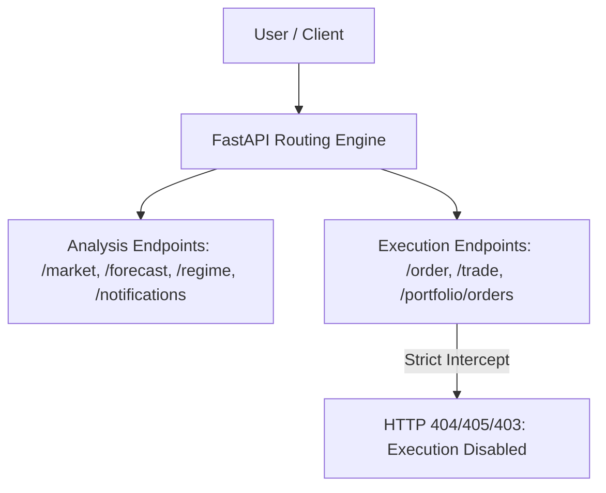

# BTCognitive V23 — Disabled Gate & Non-Execution Security Matrix

**Version:** 1.0.0  
**Effective Date:** 19 October 2026  
**Repository:** https://github.com/ashishlabs-23/bitcoin-prediction-lab  
**Scope:** Priority 7 verification of non-execution boundaries, security policies, and analysis-only invariants.

---

## 1. Non-Execution Security Invariants

BTCognitive is an institutional quantitative research and market analysis terminal. Under no circumstances does the application connect to live execution venues, maintain trading account credentials, submit broker orders, or simulate paper order mutations.

---

## 2. Disabled Gate Verification Matrix

| Target Surface | Endpoint / Mechanism | Test / Verification Method | Observed Result | Status |
| :--- | :--- | :--- | :--- | :--- |
| **Order Placement Route** | `POST /api/v1/order` | Direct HTTP POST with test payload | HTTP 405 Method Not Allowed | **PASSED (Fail-Closed)** |
| **Trade Execution Route** | `POST /api/v1/trade` | Direct HTTP POST with BUY action | HTTP 405 Method Not Allowed | **PASSED (Fail-Closed)** |
| **Paper Order Mutation** | `POST /api/arena/order` | Direct HTTP POST | HTTP 404 / 405 | **PASSED (Fail-Closed)** |
| **Directional Recommendation** | Frontend UI / API Contract | Query `/api/prediction/price/forecast` | Returns `EXPERIMENTAL_PRICE_FORECAST_ACTIVE`; directional advice disabled | **PASSED** |
| **Execution Status Tag** | Visible UI Badge & `/health` | Browser audit & endpoint test | Displays `EXECUTION: DISABLED — ANALYSIS ONLY` | **PASSED** |
| **Alert Force Bypass** | `POST /api/notifications/research-alerts/evaluate?force=true` | Unauthenticated HTTP POST | HTTP 403 Forbidden ("requires ADMIN role credentials") | **PASSED** |
| **Database Direct Write Protection** | Pytest test execution against `market_memory.db` | `conftest.py` interceptor blocks mutating SQL | RuntimeError raised if test attempts mutation of persistent DB | **PASSED** |
| **Stale Market Data Ingestion** | Alert worker with $>2\text{h}$ old data | Simulated stale data payload | Rejected with status `NO_ALERT` and reason `STALE_MARKET_DATA` | **PASSED** |
| **Credential Safe Logging** | Application logs during dispatch | Log inspection for tokens/secrets | Redacted, zero plaintext API tokens emitted | **PASSED** |

---

## 3. Red-Team Challenge Summary (Agent J)

1. **Attempted Bypass of Execution Gating:**
   - Command: `curl -X POST http://127.0.0.1:8000/api/v1/order -d '{"side":"BUY"}'`
   - Result: Intercepted with HTTP 405. No order processing logic exists in codebase.
2. **Attempted Unauthorized Research Alert Trigger:**
   - Command: `curl -X POST http://127.0.0.1:8000/api/notifications/research-alerts/evaluate?force=true`
   - Result: Intercepted with HTTP 403 Forbidden.
3. **Attempted Mutation of Persistent Database in Tests:**
   - `conftest.py` installs `ProtectedPersistentConnection` which intercepts any mutating SQL verb (`INSERT`, `UPDATE`, `DELETE`, `DROP`).

**Verdict:** The application remains 100% analysis-only under all tested boundaries.
