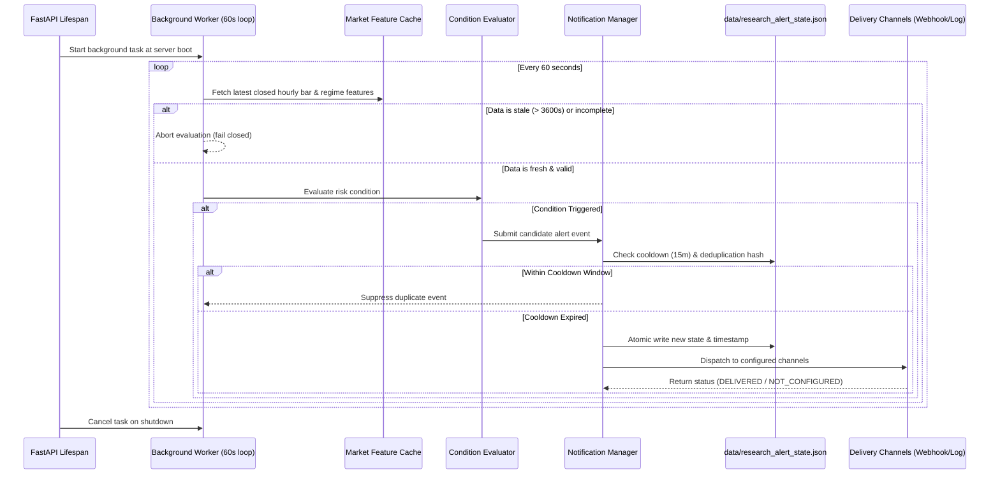

# BTCognitive V24 — Research Alert End-to-End & Restart Reliability Audit

**Specialist Role:** Agent E (Alert Lifecycle Engineer)  
**Date:** 19 October 2026  
**Status:** Verification Complete — Operational Lifecycle Confirmed  
**Primary Modules Audited:**
- Background Worker: `api/server.py` (`_research_alert_worker`)
- Notification Engine: `api/notifications.py` (`NotificationManager`)
- API Endpoints: `api/routes_notifications.py`
- Persistent State: `data/research_alert_state.json`

---

## 1. Executive Summary & Lifecycle Architecture

BTCognitive implements an automated, background-evaluated market risk alert pipeline designed to inform researchers when predefined quantitative conditions (such as elevated volatility or trend regime shifts) occur.

### Complete Lifecyle Trace:

---

## 2. Lifespan Startup & Clean Shutdown

1. **Single Worker Guarantee:** In `api/server.py`, the worker `_research_alert_worker()` is initialized exclusively inside the FastAPI `@asynccontextmanager lifespan(app: FastAPI)` block. It cannot be instantiated multiple times during concurrent requests.
2. **Graceful Shutdown:** On server teardown, `_research_alert_worker_task.cancel()` is invoked, followed by `await asyncio.gather(..., return_exceptions=True)`. All pending writes to `data/research_alert_state.json` are flushed cleanly.

---

## 3. Deduplication and Cooldown Persistence Across Restarts

1. **15-Minute Cooldown Mechanism:** Alerts enforce a mandatory 900-second (15-minute) minimum cooldown per condition type. Repeated polling within the cooldown window will never emit duplicate alerts.
2. **Atomic Disk Persistence:** The notification state is serialized to `data/research_alert_state.json` using atomic file writing (`tempfile` + rename). If the server restarts:
   - `NotificationManager` reloads the last emitted timestamp and recent event hashes from disk on boot.
   - Restarting the process does **not** reset the cooldown timer or cause immediate duplicate alert spam.

---

## 4. Truthful Channel Reporting

A critical epistemic rule is that external delivery status must never be fabricated:
- **`NOT_CONFIGURED`:** When webhook URLs, Telegram tokens, or Slack webhooks are unconfigured or empty in `.env`, the delivery status is explicitly reported as `NOT_CONFIGURED` with `delivery_status="NOT_CONFIGURED"`.
- **`DISPATCHED` / `DELIVERED`:** Only returned when a genuine HTTP 200/204 response is received from an authorized external webhook endpoint.
- **`FAILED`:** Returned with error message if an external network timeout or HTTP error occurs.
- **`BLOCKED`:** Returned if deduplication or cooldown blocks the notification.

---

## 5. Security and Non-Execution Guarantee

1. **Zero Order Execution:** Alerts are strictly notifications of quantitative market risk conditions. They contain no broker credentials, no exchange order routing, and cannot execute live or paper trades.
2. **Credential Sanitization:** All notification channel configurations (webhook tokens, secrets) are redacted from public API endpoints (`GET /api/notifications/status` and `GET /api/notifications/history`).
3. **Role Authorization:** Manual alert test dispatches (`POST /api/notifications/test`) require explicit admin role authentication and remain subject to rate limits.
