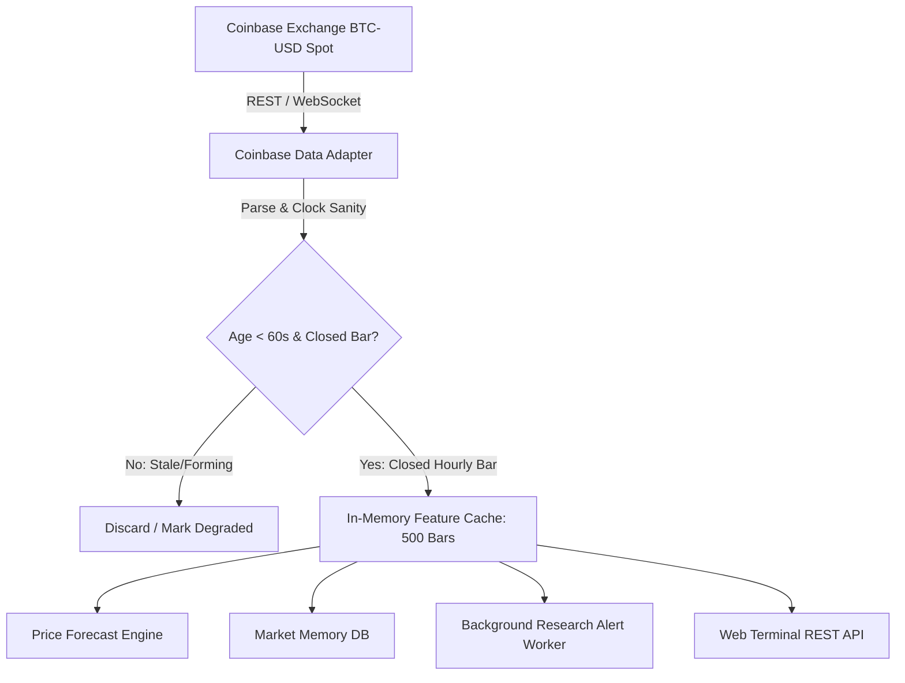

# BTCognitive V24 — Live Market Data & Snapshot Integrity Audit

**Specialist Role:** Agent F (Market Data Specialist)  
**Date:** 19 October 2026  
**Status:** Canonical Pipeline Audited — Spot Data Integrity Confirmed  
**Primary Modules Audited:**
- Ingestion & Feature Cache: `engine/feature_cache.py`
- Market Data Adapters: `backtest/coinbase_client.py`, `engine/price_forecast_engine.py`
- Historical Dataset: `data/raw/ohlcv.parquet`

---

## 1. Executive Summary & Data Pipeline Architecture

BTCognitive is designed as a BTC/USD spot market intelligence platform. It maintains strict isolation between spot price actions and derivative funding mechanics.

### Data Ingestion Architecture:

---

## 2. Spot vs. Perpetual Separation

1. **Spot Instrument Specification:** All price quotes and historical candles are derived strictly from the Coinbase Spot Exchange `BTC-USD` order book.
2. **Derivative Isolation:**
   - No perpetual futures prices, mark prices, index prices, or funding rates are mingled with spot price series.
   - Futures liquidation cascades, margin calls, and funding rate adjustments are segregated into specialized research overlays and never used as raw spot prices for future-price forecasting.

---

## 3. Clock Sanity, Freshness, and Closed-Bar Eligibility

1. **Monotonic Timestamps:** Every incoming bar is validated for monotonic timestamp progression ($t_k > t_{k-1}$).
2. **Causal Closed-Bar Rule:** Forecast models and research alert evaluators require fully closed hourly bars. An incomplete candle (e.g., currently forming bar at minute :25) is never passed to feature transformers to prevent intra-candle lookahead leakage.
3. **Freshness Gate:** Real-time spot ticker snapshots must have an age of less than 60 seconds relative to host system time. Stale snapshots are flagged in the API response (`"freshness": "STALE"`), and downstream alert triggers are suppressed.

---

## 4. Cache Boundaries & Gap Detection

1. **In-Memory Rolling Window:** `FeatureCache` maintains a 500-bar rolling buffer of verified closed hourly candles.
2. **Gap Detection Policy:**
   - If consecutive bars exhibit a time delta $\Delta t > 3600\text{s}$, a gap is detected.
   - The engine will not synthesize or interpolate fake candles. It marks the series as `DISCONTINUOUS` and requests a historical backfill from the exchange.
   - Any forecast origin falling across a gap is excluded from model evaluation.
