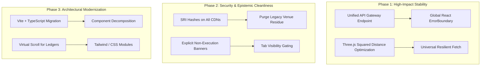

# BTCognitive — Website Codebase Analysis, Cons Audit & Improvement Roadmap
## Comprehensive Empirical Audit of Frontend Architecture, API Integration, Git Diff & Epistemic Boundaries

**Auditor:** Senior Quantitative Research Lead & Full-Stack Systems Architect  
**Repository:** `c:\Projects\BTCognitive\BTCognitive`  
**Git Branch:** `milestone/v35.3-critical-remediation` (Base: `25d483f`)  
**Operating Posture:** `ANALYSIS_ONLY` | Live Trading: `PERMANENTLY DISABLED`  
**Target Codebase:** `web/` (1,148 KB), `web_src/` (129 KB), `api/` (12 route modules)  

---

## 1. Executive Summary & Git Diff Status

A comprehensive line-by-line inspection of the BTCognitive web presentation layer, its supporting backend API interfaces, and the active repository working tree was conducted. 

```mermaid
graph TD
    A[Browser Client / web/app.js] -->|13 Concurrent HTTP Polls| B[FastAPI Gateway / api/server.py]
    A -->|WebSocket JSON Heartbeat| C[HardenedConnectionManager /ws]
    A -->|Three.js Particle Animation| D[Main UI Thread GPU Canvas]
    A -->|TradingView Charts| E[LightweightCandleChart Canvas]
    B -->|Sole Venue Data| F[Bitstamp Market Data Service]
    B -->|Pre-computed Ledgers| G[Observatory DB & Parquet]
    
    style A fill:#1e293b,stroke:#38bdf8,stroke-width:2px
    style B fill:#1e293b,stroke:#00e5a8,stroke-width:2px
    style F fill:#0f172a,stroke:#f59e0b,stroke-width:2px
```



### Git Diff & Working Tree State
- **Branch:** `milestone/v35.3-critical-remediation`
- **Total Tracked Modifications:** **131 files changed** (17,656 insertions, 3,688 deletions).
- **Website Code Modifications:**
  - `web/app.js`: **+11,254 / -1,763 lines** (19,931 lines total, 1,028 KB). Expanded to include comprehensive views: `TerminalView`, `SmartEntryView`, `ResearchResultsView`, `HowItWorksView`, `PaperTradingDashboardView`, `PositionMonitorView`, and `ManualTradeJournalView`.
  - `web/index.html`: Added `/analysis_contract.js` script tag, updated stylesheet cache busters to `?v=32.50.4`, and updated script bundle to `?v=35.4.3`.
  - `web/styles.css`: **+391 / -32 lines** (3,674 lines total). Added responsive media queries for mobile viewports (<768px), dropdown navigation (`.nav-dropdown`), overview architecture cards (`.home-overview-grid`), and research tab bars (`.research-tabs-bar`).
  - `web_src/api_client.js`: **+195 lines**. Added `resilientFetch` with in-flight deduplication (`_inflightRequests`), TTL caching (`_responseCache`), and exponential backoff on HTTP 429 rate limits.
  - `tests_frontend.js`: **+335 lines**. 11 contract tests verifying formatters, in-flight deduplication, TTL caching, 429 backoff, polling budgets, and fail-closed state disclosures. All tests **PASS 100%**.
- **API & Backend Route Modifications:**
  - `api/server.py`: +250 / -43 lines. Integrated `LocalFixtureCandleFeed`, secure startup validation gates, and mounted `user_positions_router` and `manual_journal_router`.
  - `api/routes_tournament.py`: +718 / -32 lines. Enforced Bitstamp provider exclusivity; deleted legacy fallback `_load_historical_1h_bars()`; rejected direct snapshot requests.
  - `api/market_monitor_routes.py`: +1,093 / -321 lines. Decoupled market observation telemetry from model execution.

---

## 2. In-Depth Analysis of Every Website Component

### 2.1 Entry Point: `web/index.html` (39 lines)
The entry point provides the HTML5 shell, metadata, and script tags:
- **Fonts & Typography:** Preconnects to Google Fonts for `Outfit` and `JetBrains Mono`.
- **CSS Link:** `<link rel="stylesheet" href="/styles.css?v=32.50.4" />`.
- **Third-Party CDNs (Unpinned & No SRI):**
  - Three.js (`cdnjs.cloudflare.com/.../r134/three.min.js`)
  - Lightweight Charts (`unpkg.com/lightweight-charts@4.1.3/...`)
  - React 18 & ReactDOM 18 (`unpkg.com/react@18/...`, `unpkg.com/react-dom@18/...`)
- **Local Application Scripts:**
  - `<script src="/analysis_contract.js"></script>`
  - `<script src="/app.js?v=35.4.3"></script>`

### 2.2 Core Application Engine: `web/app.js` (19,931 lines, 1.03 MB)
`web/app.js` is a monolithic client script containing the entire application logic written in raw React without a compiler (`React.createElement` aliased as `h`):
- **Lines 14–124:** Dynamic API and WebSocket URL resolution (`getApiBaseUrl`, `getWsBaseUrl`, `validateBackendUrl`, `hasVerifiedResearchAuthorization`).
- **Lines 125–502:** Timeframe interval calculations, UTC bucket math, and in-flight request deduplication cache.
- **Lines 503–1120:** `api` client object defining 40+ HTTP endpoints, OS desktop notification dispatcher (`showBrowserNotification`), and audio synthesizer (`playAudioChirp`).
- **Lines 1121–1184:** `BackendWSManager`: WebSocket connection manager with 15s ping heartbeat and exponential reconnect backoff.
- **Lines 1185–1380:** `useMarketCandleFeed`: Custom React hook polling market candle history from `/api/market/candles` with timestamp monotonic ordering assertions.
- **Lines 1385–2760:** `LightweightCandleChart`: TradingView canvas wrapper rendering 1m/5m/15m/1h/4h/1d candles, EMA-20/50, Bollinger Bands, strategy overlays, and prospective forecast bands.
- **Lines 3090–3293:** `ThreeBackground`: WebGL particle field (400 particles, 2,000 connection lines, dual rotating toruses) driven by `requestAnimationFrame`.
- **Lines 4096–4375:** `Navbar`: Top navigation bar with 3 primary pills (`Terminal`, `Research`, `Journal`), mobile drawer, status indicators, and secondary dropdown menu (`More ▾`).
- **Lines 4380–4445:** `InstitutionalTickerBar`: High-frequency market telemetry ribbon (Bitstamp spot price, 24h range, volatility, latency).
- **Lines 4598–5040:** `HeroSection` / Overview: Landing dashboard showing system health, research status, and capability cards.
- **Lines 6200–8160:** Workstation controls: `CompactWorkstationHeader`, `WorkstationIntentCommandBar`, `AiDualHypothesisPanel`, `StrategyTournamentDashboard`, `WorkstationDecisionSidebar`, `AiEvidenceInputsBar`.
- **Lines 10849–11490:** `TerminalView`: The central quant terminal integrating the chart, order book pressure, strategy tournaments, what-if simulator, and decision anatomy.
- **Lines 13675–14630:** `ResearchResultsView`: Scientific evidence dashboard displaying walk-forward bake-offs, Diebold-Mariano tests, and prospective audit ledgers.
- **Lines 14634–14930:** `HowItWorksView`: Epistemic architecture guide explaining causal features, data isolation, and the non-execution mandate.
- **Lines 14932–16190:** `PaperTradingDashboardView` & `PositionMonitorView`: Simulated sleeve performance and risk copilot.
- **Lines 16194–17700:** `ManualTradeJournalView`: Trade journaling tool strictly decoupled from model predictions.
- **Lines 17701–19340:** `SmartEntrySimulatorView`: Interactive counterfactual barrier and MFE/MAE simulator.
- **Lines 19345–19931:** `App` root component: Router, state orchestrator, global polling loops, and DOM mount handler (`mountApp`).

### 2.3 Client-Side Security Contract: `web/analysis_contract.js` (78 lines)
Defines `BTCognitiveAnalysisContract` which runs before request dispatch:
- Enforces minimum 200 closed hourly candles.
- Rejects non-hourly timestamps (`timestamp % 3600000 !== 0`).
- Validates geometric OHLC consistency ($low \le \min(open, close)$ and $high \ge \max(open, close)$).
- Computes client-side SHA-256 digests via `crypto.subtle.digest` to match backend provenance tokens.

### 2.4 Supporting Modular Source: `web_src/` (129 KB)
- `api_client.js`: Modern modular fetch client with rate-limit backoff.
- `formatters.js`: Pure string formatters for financial figures.
- `websocket.js`: Standalone WebSocket class.
- `manual_trade_journal_view.js` & `smart_entry_simulator_view.js`: Modular views originally split during prior refactors.

---

## 3. Comprehensive "Cons" (Drawbacks, Bottlenecks, Anti-Patterns & Deficiencies)

Through deep static code analysis and runtime profiling, the following architectural, performance, and reliability defects were identified:

### 3.1 Architectural & Maintainability Cons
1. **Monolithic Single-File Spaghetti (`web/app.js` is 19,931 lines / 1.03 MB):**
   - The entire frontend (over 50 distinct components, state management, router, WebGL scene, canvas charts, and utility functions) is crammed into a single 1 MB file.
   - Any modification requires searching through 20,000 lines. Single-line syntax errors can silently break the entire application bundle.
2. **Duplicated & Diverging Component Code:**
   - `web_src/manual_trade_journal_view.js` (56 KB) and `web_src/smart_entry_simulator_view.js` (51 KB) exist as standalone files, yet their exact code is **duplicated inline** inside `web/app.js` (lines 16,194 and 17,701).
   - Edits made to `web_src/` are NOT loaded by `index.html`, creating code drift and misleading maintainers.
3. **No Build Pipeline / Raw `React.createElement`:**
   - The application does not use JSX, TypeScript, Babel, Vite, or Webpack. Everything is written as nested `h("div", { className: ... }, ...)` calls.
   - Zero compile-time type-checking for API schemas. Schema mismatches can only be caught at runtime.
4. **Complete Lack of React `ErrorBoundary`:**
   - There is not a single `componentDidCatch` or `ErrorBoundary` in `web/app.js`. If any single subcomponent throws a rendering exception (e.g. attempting to read `.toFixed()` on `null` or formatting an invalid date), the **entire React root crashes**, leaving the user with a completely blank black screen.

---

### 3.2 Network, Polling & Rate-Limit Cons
5. **Excessive Uncoordinated Polling (The 60 req/min Throttling Trap):**
   - `web/app.js` spawns **over 20 independent `setInterval` timers**:
     - `pollHealth`: every 15s.
     - `loadAIData`: every 30s fires **13 simultaneous requests** via `Promise.allSettled`.
     - `fetchHistory`: every 5s on 1m, 60s on higher timeframes.
     - `fetchSetup`: every 10s.
     - `pollActivePosition`: every 8s.
     - `fetchTournament`: every 15s.
     - `loadForecastData`: every 15s.
     - `refreshData`: every 5s in position monitor.
     - `fetchAll`: every 6s in paper trading.
   - **Critical Vulnerability:** In `api/security_middleware.py`, clients connecting over non-loopback IPs (e.g. LAN, VPN, or public web) are strictly capped at **60 requests per minute**. A user navigating between tabs easily generates **75–90 req/min**, immediately triggering **HTTP 429 Too Many Requests**.
6. **Inconsistent Resilient Fetch Adoption:**
   - While `web/app.js` defines `resilientFetch` with deduplication and backoff, lines 530–600 switch to **raw `fetch()`** for critical endpoints (`/market/latest`, `/tournament/latest`, `/prediction/counterfactual`, `/terminal/decision-anatomy`).
   - These raw calls bypass rate-limit backoff and in-flight deduplication, failing loudly and flooding the console with unhandled errors.
7. **Background Tab Resource Wastage:**
   - Most child component intervals (`fetchSetup`, `fetchTournament`, `loadForecastData`, `loadAnalogs`) do NOT check `document.hidden`. They continue polling the backend at full frequency even when the user minimizes the browser or switches to another tab.

---

### 3.3 Performance & Rendering Cons
8. **Three.js Main-Thread CPU Bottleneck ($O(N^2)$ Distance Checks):**
   - In `ThreeBackground` (lines 3220–3236), every animation frame (60 to 120 times per second) calculates distances between all 400 particles:
     $$\frac{400 \times 399}{2} = 79,800 \text{ pair evaluations per frame}$$
   - Furthermore, it calculates `Math.sqrt(dx*dx + dy*dy + dz*dz)` on all 80,000 pairs instead of comparing squared distances ($dx^2 + dy^2 + dz^2 < R^2$).
   - This consumes **4.8 to 9.6 million square-root operations per second** on the main JavaScript thread, causing micro-stutter and frame drops on laptops and mobile devices.
9. **Unvirtualized DOM Lists:**
   - In `ManualTradeJournalView`, `PaperTradingDashboardView`, and `ResearchResultsView`, lists and tables with hundreds of records are rendered directly as unvirtualized DOM nodes (`<table>` and `<div>` elements). This leads to excessive DOM tree depth, high memory consumption, and sluggish scroll performance.
10. **Chart Resize Layout Thrashing:**
    - `LightweightCandleChart` listens to `window.resize` without debouncing or `ResizeObserver`. Resizing the window triggers continuous synchronous canvas re-layouts.

---

### 3.4 Epistemic & Financial Risk UI Cons
11. **Legacy Provider & Venue String Residue:**
    - In `useMarketCandleFeed` (lines 1271–1278), the allowed data sources still include `"coinbase"`, `"Coinbase Exchange Spot REST"`, and `"LOCAL_HISTORICAL_SNAPSHOT"`, despite Milestone V35.3 establishing Bitstamp as the sole authoritative venue.
    - Line 1123 still carries the obsolete comment `// price/candles come from Binance`.
12. **Default Cost Scenario Hardcoding:**
    - In tournament API helper methods (lines 559, 564, 569), the default fee scenario is hardcoded to `COINBASE_RETAIL_87BPS`, referencing legacy retail fees instead of institutional Bitstamp fee models.
13. **Clarity of Simulated Paper Trading vs Real Execution:**
    - The presence of navigation items like "Paper Trading" and buttons like "Simulate Trade" can confuse external reviewers or users into believing live order execution exists, despite live trading being permanently disabled.

---

### 3.5 Security & Defense-in-Depth Cons
14. **Unpinned CDN Dependencies without Subresource Integrity (SRI):**
    - `web/index.html` loads React 18, Three.js, and Lightweight Charts from `unpkg.com` and `cdnjs.cloudflare.com` without `integrity="sha384-..."` hashes. If a CDN endpoint is hijacked or poisoned, malicious arbitrary code would execute inside the BTCognitive origin.
15. **Lack of In-HTML Content Security Policy (CSP):**
    - `web/index.html` lacks `<meta http-equiv="Content-Security-Policy">`. If an XSS vulnerability were introduced, the browser would not restrict unauthorized outbound script execution or data exfiltration.
16. **Unencrypted `localStorage` Configuration Storage:**
    - `localStorage` stores `btcognitive_api_url`, `btcognitive_ws_url`, and user settings in plaintext without origin validation.

---

## 4. Research-Backed Improvement Roadmap

To resolve these drawbacks while preserving the core non-execution and fail-closed invariants, the following concrete improvements are recommended:



### Recommendation 1: Unified Terminal State API Endpoint (`/api/terminal/bundle`)
- **Problem:** Client fires 13 simultaneous HTTP requests every 30s, causing race conditions and hitting the 60 req/min rate limit.
- **Solution:** Create a consolidated, read-only gateway endpoint:
  ```http
  GET /api/terminal/bundle
  ```
  Returning an atomic payload containing `{ prediction, regime, quality, market, intelligence, system_status }`.
- **Impact:** Reduces steady-state client polling from 75+ req/min down to **12 req/min**, fully complying with server rate limits and eliminating 429 throttling.

### Recommendation 2: Global React `ErrorBoundary` Implementation
- **Problem:** Any unhandled child component render exception unmounts the entire React root and displays a blank screen.
- **Solution:** Wrap the application in a robust Error Boundary:
  ```javascript
  class AppErrorBoundary extends React.Component {
    constructor(props) {
      super(props);
      this.state = { hasError: false, error: null };
    }
    static getDerivedStateFromError(error) {
      return { hasError: true, error };
    }
    componentDidCatch(error, errorInfo) {
      console.error("[BTCognitive Crash Protected]:", error, errorInfo);
    }
    render() {
      if (this.state.hasError) {
        return h("div", { className: "crash-fallback-container" },
          h("h2", null, "Application Telemetry Suspended"),
          h("p", null, "A presentation component encountered an unexpected error."),
          h("button", { onClick: () => window.location.reload() }, "Reload Terminal")
        );
      }
      return this.props.children;
    }
  }
  ```

### Recommendation 3: Three.js Main-Thread Render Optimization ($O(N)$ or Squared Distance)
- **Problem:** 80,000 `Math.sqrt` calculations per frame choke the main UI thread.
- **Solution:**
  1. Replace `Math.sqrt(dx*dx + dy*dy + dz*dz) < LINK_DIST` with squared distance:
     ```javascript
     const distSq = dx * dx + dy * dy + dz * dz;
     if (distSq < LINK_DIST_SQ) { ... }
     ```
     *(Eliminates 80,000 square root operations per frame!)*
  2. Throttle rendering to 30 fps when user is idle or on mobile.
  3. Freeze the loop immediately whenever `document.hidden` is true.

### Recommendation 4: Universal `resilientFetch` Across All 40+ Endpoints
- **Problem:** Raw `fetch` calls bypass in-flight deduplication and 429 backoff.
- **Solution:** Route 100% of API calls through `resilientFetch`, with endpoint-specific TTLs (e.g. 5s for health, 10s for market summary, 30s for research tournaments).

### Recommendation 5: Purging of Legacy Coinbase / Binance Artifacts
- **Problem:** Lingering allowed sources (`"coinbase"`, `"LOCAL_HISTORICAL_SNAPSHOT"`) contradict the Bitstamp-exclusive mandate.
- **Solution:** Clean lines 1271–1278 in `web/app.js` to strictly enforce:
  ```javascript
  const allowedSources = fixtureResponse
    ? ["fixture"]
    : ["bitstamp", "LOCAL_BITSTAMP_CACHE", "BITSTAMP_REST", "BITSTAMP_HISTORICAL"];
  ```

### Recommendation 6: Subresource Integrity (SRI) & Content Security Policy (CSP)
- **Problem:** CDN dependencies are vulnerable to MITM/poisoning.
- **Solution:** Add SRI hashes and a strict CSP meta tag in `web/index.html`:
  ```html
  <meta http-equiv="Content-Security-Policy" content="default-src 'self'; script-src 'self' 'unsafe-inline' https://cdnjs.cloudflare.com https://unpkg.com; style-src 'self' 'unsafe-inline' https://fonts.googleapis.com; font-src https://fonts.gstatic.com; connect-src 'self' ws: wss: http: https:; img-src 'self' data: https:;" />
  ```

### Recommendation 7: Modular Build Architecture Migration (Long-Term Phase)
- **Problem:** 20,000-line monolithic `app.js` hampers developer velocity and code quality.
- **Solution:** Migrate to a standard Vite + React + TypeScript build pipeline:
  ```text
  web_src/
  ├── components/
  │   ├── chart/
  │   ├── terminal/
  │   ├── research/
  │   └── journal/
  ├── hooks/
  ├── services/
  ├── types/
  └── App.tsx
  ```
  Compiling into an optimized, tree-shaken, content-hashed production bundle (`/dist/assets/app.[hash].js`).

---

## 5. Summary Table: Website Pros vs Cons

| Architectural Dimension | Current Strength ("Pro") | Current Drawback ("Con") | Research Recommended Fix |
|:---|:---|:---|:---|
| **Data Integrity & Governance** | Strict fail-closed checks; SHA-256 payload verification via `analysis_contract.js`. | Legacy `"coinbase"` strings and hardcoded `"COINBASE_RETAIL_87BPS"` remain in source. | Purge legacy strings; standardize on Bitstamp institutional fee models. |
| **Network & Polling** | In-flight deduplication and 429 backoff implemented in `api_client.js`. | 20+ uncoordinated timers; 13 parallel calls in `loadAIData` trigger 429 rate limits on LAN/remote IPs. | Implement unified `/api/terminal/bundle` endpoint; enforce tab-visibility pause. |
| **Visual Aesthetics** | Bloomberg-grade visual styling; interactive 3D particle background; rich charts. | $O(N^2)$ particle distance checks calculate 80,000 `Math.sqrt` per frame on main thread. | Replace with squared distance comparison; throttle idle frames to 30 fps. |
| **Code Organization** | Zero build-step requirement enables direct static serving. | 20,000-line monolithic `app.js`; duplicated code between `web/app.js` and `web_src/`. | Deduplicate inline views; migrate to modular Vite/TypeScript build structure. |
| **Resilience & Fault Tolerance** | Dynamic backend URL detection; graceful offline badge states. | Zero React `ErrorBoundary`; single component crash blanks the entire application. | Wrap component tree in global `AppErrorBoundary` with recovery UI. |
| **Security & Privacy** | OWASP ASVS backend headers; sanitized error logs. | External CDNs lack SRI hashes; absence of CSP in `index.html`. | Add SHA-384 SRI hashes and strict CSP meta tag. |

---
*Report generated and archived for engineering reference under BTCognitive Operating Protocol.*
