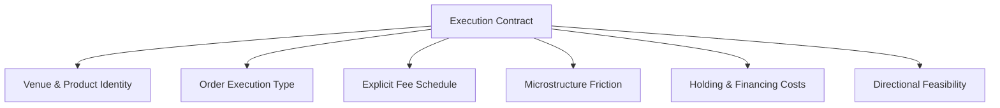

# BTCognitive Research Protocol — Execution-Cost Eligibility Contract

**Version:** 1.0.0  
**Effective Date:** October 2026  
**Status:** MANDATORY GATE — ACTIVE  
**Repository:** https://github.com/ashishlabs-23/bitcoin-prediction-lab  
**Scope:** Universal execution-cost specification required before any research artifact, backtest, simulation, or live terminal telemetry can report net expectancy ($E[R_{\text{net}}]$) or break-even win rates.

---

## 1. Prime Directive of Execution Accounting

1. **Strict Non-Execution Context:** BTCognitive is a risk intelligence and market analysis research laboratory. It does not execute live trades, place broker orders, or deploy capital.
2. **Net Expectancy Precondition:** Any metric reporting "Net $R$", "Net Expectancy", "Break-Even Win Rate", or "Realized P&L" is **unverified and disqualified from scientific promotion** unless it adheres to the formal metadata contract defined herein.
3. **Prohibition of Synthetic Cost Subsitutions:** A cost assumption cannot be borrowed from another exchange, product, tier, or metric (e.g. substituting futures fees for spot trading, or substituting forecasting error metrics like MAE for transaction friction).
4. **Venue-Instrument Coherence:** Cost models must match the exact exchange venue, product type, and settlement asset of the price series being analyzed.

---

## 2. Core Execution Dimensions & Typology

Every execution cost evaluation must explicitly classify the trade across six mandatory dimensions:



### 2.1 Venue & Product Typology
- **Spot Market:** Immediate delivery of the underlying asset (`BTC-USD`, `BTC-EUR`). Requires 100% balance capitalization. Short positions are **strictly unavailable** unless accompanied by an explicit margin borrowing facility.
- **Margin Spot Market:** Spot trading with collateralized asset borrowing. Incurs daily/hourly borrow interest (`borrow_apr_pct`) on the borrowed asset.
- **Perpetual Futures Market:** Cash-settled derivative (`BTCUSDT`, `BTC-PERP`) with no expiry date. Supports native symmetric long and short positions. Subject to regular 8-hour funding rate payments/receipts, basis divergence against spot, and exchange maintenance margin / liquidation boundaries.

### 2.2 Order Type & Liquidity Classification
- **Taker (Aggressive / Market Order):** Crosses the bid-ask spread immediately, removing resting liquidity. Incurs taker fee tier + full half-spread + market impact/slippage.
- **Maker (Passive / Post-Only Limit Order):** Posts resting liquidity to the order book. Incurs maker fee tier (or rebate), zero immediate half-spread, but carries adverse selection risk and non-fill risk at barrier boundaries.
- **Barrier Touch Asymmetry:** In barrier hit simulations (Take-Profit and Stop-Loss), market stops execute as **Taker** orders. Assuming maker fees on stop-loss fills is strictly prohibited.

---

## 3. Mandatory Cost Metadata Specification

Before an evaluation or terminal telemetry can report net expectancy, it must supply the following machine-readable metadata manifest:

```json
{
  "execution_contract_version": "1.0.0",
  "venue": {
    "exchange_name": "Coinbase Exchange",
    "product_type": "SPOT",
    "symbol": "BTC-USD",
    "quote_currency": "USD",
    "settlement_currency": "USD"
  },
  "fee_schedule": {
    "account_tier": "Advanced Tier 1 (<$10k 30-day volume)",
    "effective_date": "2026-09-16",
    "source_url": "https://help.coinbase.com/en-in/coinbase/trading-and-funding/advanced-trade/advanced-trade-fees",
    "retrieval_date": "2026-10-24",
    "maker_fee_bps_per_side": 25.0,
    "taker_fee_bps_per_side": 40.0
  },
  "microstructure_friction": {
    "half_spread_bps_per_side": 1.5,
    "slippage_bps_per_side": 2.0,
    "market_impact_model": "LINEAR_OR_SQUARE_ROOT",
    "reference_order_size_btc": 0.1
  },
  "financing_and_holding": {
    "funding_applicable": false,
    "funding_interval_hours": null,
    "borrow_interest_applicable": false,
    "daily_borrow_rate_bps": null
  },
  "round_trip_totals": {
    "assumed_entry_order_type": "TAKER",
    "assumed_exit_order_type": "TAKER",
    "round_trip_commission_bps": 80.0,
    "round_trip_spread_bps": 3.0,
    "round_trip_slippage_bps": 4.0,
    "total_round_trip_friction_bps": 87.0
  },
  "directional_feasibility": {
    "long_allowed": true,
    "short_allowed": false,
    "short_restriction_reason": "Coinbase Spot retail accounts cannot borrow or short spot BTC. Shorting requires a perpetual futures venue or margin facility."
  },
  "validation_status": "PROVISIONAL_AUDITED"
}
```

---

## 4. Friction Arithmetic & R-Multiple Normalization

### 4.1 Conversion between Basis Points and Price Units
- Basis points are defined relative to the entry notional:
  $$\text{Friction}_{\text{USD}} = \text{Entry Price} \times \text{Size}_{\text{BTC}} \times \left( \frac{\text{Total Round-Trip Friction (bps)}}{10,000} \right)$$

### 4.2 Conversion to $R$-Multiples
- In BTCognitive risk geometry, $1R$ is defined by the stop-loss distance:
  $$1R = \text{Entry Price} \times (k_{\text{SL}} \times \sigma_H)$$
  where $\sigma_H = \sigma_{\text{1h}} \times \sqrt{H}$ is the horizon-scaled volatility across $H$ bars.
- Therefore, friction in $R$-multiples is strictly:
  $$\text{Friction}_R = \frac{\text{Total Round-Trip Friction (bps)} / 10,000}{k_{\text{SL}} \times \sigma_H}$$
- **Mathematical Invariant:** When volatility $\sigma_H$ is low (e.g. compressed regime $\sigma_{24\text{h}} \approx 0.8\% = 80 \text{ bps}$), a fixed 87 bps round-trip friction consumes **$> 1.0R$** of the trade risk, rendering any positive expected return mathematically impossible regardless of win rate!

### 4.3 Break-Even Win Rate Formula
For a trade setup with Take-Profit barrier $k_{\text{TP}}$, Stop-Loss barrier $k_{\text{SL}}$, and friction in $R$ ($\text{Friction}_R$):
$$E[R_{\text{net}}] = P(\text{TP}) \times \left( \frac{k_{\text{TP}}}{k_{\text{SL}}} \right) - P(\text{SL}) \times 1.0 - \text{Friction}_R = 0$$
Assuming conditional resolution ($P(\text{TP}) + P(\text{SL}) = 1.0$, ignoring timeouts):
$$P_{\text{breakeven}} = \frac{1.0 + \text{Friction}_R}{\left( \frac{k_{\text{TP}}}{k_{\text{SL}}} \right) + 1.0}$$

---

## 5. Formal Disqualification Rules (Gating Invariants)

An evaluation is **strictly disqualified (BLOCKED)** if it commits any of the following:

1. **The Regional Mislabeled Rate Error:** Mislabelling low-fee perpetual futures schedules (e.g. Binance Futures VIP 0 taker ~9.3–12 bps) as retail spot costs for US or European traders.
2. **The Spot-Short Phantom Error:** Modeling short trade executions on spot price feeds (`BTC-USD`) without accounting for borrow constraints, borrow fees, or liquidation mechanisms.
3. **The Zero-Friction Null Fallback:** Applying zero or unverified generic constants when exchange tier metadata is absent.
4. **The Forecast Error Conflation Error:** Treating forecast model residuals (e.g., Hawkes point-process MAE of 9.30 bps) as transaction costs.
5. **The Unconditional / Conditional Win-Rate Confusion:** Conflating the conditional TP rate among resolved trades with the unconditional hit rate that includes timeouts.

---

## 6. Governed Gate Checklist

| Checklist Item | Requirement | Pass Condition |
|:---|:---|:---:|
| **G1: Venue Alignment** | Dataset instrument matches execution venue product type exactly. | `MATCHED` |
| **G2: Published Schedule** | Official primary-source exchange fee URL, retrieval date, and tier documented. | `VERIFIED` |
| **G3: Order Type Separation** | Entry and exit order types explicitly designated (Maker vs Taker). | `EXPLICIT` |
| **G4: Directional Feasibility** | Spot shorting disallowed or restricted; perpetual shorting models funding. | `VERIFIED` |
| **G5: Microstructure Spread/Slip**| Empirical spread and slippage modeled separately from exchange commission. | `AUDITED` |
| **G6: Volatility Scaling** | Friction in $R$ computed against actual horizon volatility $\sigma_H$, not 1h $\sigma$. | `VERIFIED` |
