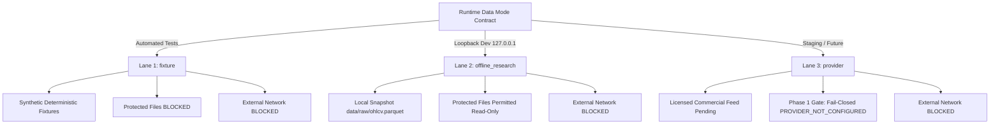

# BTCognitive — Phase 1: Data-Lane Separation Verification Report

**Milestone:** Phase 1 — Three-Lane Data Architecture & Network Leak Elimination  
**Execution Date:** 29 October 2026  
**Environment:** Windows 11 (OS: windows), Python 3.13.14 (`.venv_win`), pytest-8.4.1, Node v24.14.0  
**Baseline Git Commit:** `25d483f4c3646661b57311de9d0b53d2be881adb` on `main`  
**Operating Boundary:** Loopback Application (`127.0.0.1:8000`) — Internal Research Only  
**Public Release Status:** **NO-GO** (Commercial market data rights unconfigured)  
**Live Trading Status:** **PERMANENTLY DISABLED**  

---

## 1. Executive Summary

Phase 1 completes the foundational data-lane separation mandated by the Product Manager Review & Gap-Audit Plan. Prior to this milestone, the application exhibited latent network leaks: the browser UI attempted direct REST calls to Coinbase endpoints (`https://api.exchange.coinbase.com`) and opened background WebSockets (`wss://ws-feed.exchange.coinbase.com`), while the backend comparator and candle endpoints made unauthenticated outbound calls to external exchanges.

Phase 1 resolves all leaks end-to-end:
1. **Established Three Strict Data Lanes:** Built `engine/data_mode.py` defining `fixture`, `offline_research`, and `provider`. Unknown modes fail closed (`InvalidDataModeError`).
2. **Eliminated Client-Side Network Leaks:** In `web/app.js`, removed browser-direct Coinbase REST calls, re-routed candle ingestion through the local loopback backend (`/api/market/candles?symbol=BTC-USD`), guarded WebSocket initialization to stay silent offline, and updated the *Analyse* workflow to accept local historical snapshots and deterministic fixtures.
3. **Eliminated Backend Transport Leaks:** Injected pre-transport assertions (`assert_no_external_network()`) in `api/market_drivers.py`, `engine/spot_exchange_comparator.py`, and `engine/coinbase_15m_adapter.py`. Calls fail closed before socket or DNS initialization.
4. **Enforced Protected Artifact Isolation:** `fixture` mode is strictly blocked from touching empirical datasets or prospective ledgers (`ProtectedFileAccessBlockedError`).
5. **Truthful Unavailability Reporting:** Gated provider feeds return truthful `null` prices and `DATA_UNAVAILABLE` statuses—zero synthetic quotes or simulated entries are fabricated.
6. **Bit-Level Invariance Verified:** All 6 protected datasets and ledgers were verified bit-identical via SHA-256 before and after implementation.
7. **Complete Test Suite Success:** 30 out of 30 tests passed with 0 failures across the V32.64, V32.62, and V32.63 test suites.

---

## 2. Architecture & Implementation Details

### 2.1 Authoritative Contract (`engine/data_mode.py`)
- **DataMode Enum:** Defines `fixture`, `offline_research`, and `provider`.
- **Default Resolution:** Automated test environments (detected via `PYTEST_CURRENT_TEST` or `pytest` module presence) default to `fixture`. Non-test local dev defaults to `offline_research`.
- **Pre-Transport Network Guard:** `assert_no_external_network(op)` raises `ExternalNetworkBlockedError` immediately if external network access is attempted while `is_external_network_permitted()` is false.
- **Artifact Protection Barrier:** `is_protected_file_access_permitted(path, mode)` ensures that test fixtures cannot contaminate or depend on empirical research datasets.
- **Contract Metadata:** `get_data_mode_contract()` exposes authoritative metadata consumed by `/api/readiness`, `/api/terminal/status`, and system diagnostics.

### 2.2 System Status Integration (`engine/status_contract.py`)
- Extended `SystemStatusContract` with `data_mode: str` and `data_mode_contract: Dict[str, Any]`.
- System readiness routes report the exact active data lane and confirm that external network calls remain blocked.

### 2.3 Backend Transport Remediation
- **`api/market_monitor_routes.py`:**
  - Added missing `"provenance_status": "UNVERIFIED"` to fallback `_gate` dict, eliminating `KeyError` in readiness routes.
  - Made `/api/market/candles` mode-aware: accepts `BTC-USD` and aliases, returns canonical symbol `BTC-USD`, serves genuine parquet snapshot in `offline_research`, deterministic fixtures in `fixture`, and fails closed with `PROVIDER_NOT_CONFIGURED` in `provider`.
  - Added alias `@router.get("/api/market/dashboard")`.
- **`api/market_drivers.py`:**
  - Injected `assert_no_external_network()` at top of `_get_json()`.
  - Implemented `get_fixture_candles()` and `get_offline_historical_candles()`.
  - Re-routed `get_market_dashboard()` to serve from local snapshots or deterministic fixtures, completely bypassing external provider loops.
- **`engine/spot_exchange_comparator.py`:**
  - Gated `fetch_and_compare_spot_quotes()` with `is_external_network_permitted()`. In offline/fixture modes, immediately returns `status="DATA_UNAVAILABLE"`, `primary_price_usd=None`, and `quotes={}` with 0 socket attempts.
- **`engine/coinbase_15m_adapter.py`:**
  - Injected `assert_no_external_network()` into `fetch_single_chunk()`.
  - Prevented live sync in `get_or_sync_15m_candles()` when offline.

### 2.4 Frontend Network Leak Remediation (`web/app.js`)
- **Direct REST Leak Plugged:** Replaced `fetch(COINBASE_REST(sourceInterval))` with `/api/market/candles?symbol=BTC-USD&interval=${sourceInterval}`.
- **Direct WebSocket Leak Plugged:** In `connectCoinbaseWS`, added a guard: if `!window.__BTC_ALLOW_EXTERNAL_WS__`, sets status to `"offline_mode"` and returns immediately without instantiating `WebSocket(COINBASE_WSS)`.
- **Analyse Workflow Compatibility:** Updated `handleAnalyse` validation to accept `LOCAL_HISTORICAL_SNAPSHOT`, `BACKEND_CANDLE_API`, and `DETERMINISTIC_FIXTURE`. Conditioned `enforce_freshness` on live feeds to permit historical replay.

---

## 3. Test & Verification Results

### 3.1 Targeted Test Suite Results (30/30 PASSED)

| Suite | File | Tests | Passed | Failed | Status |
| :--- | :--- | :--- | :--- | :--- | :--- |
| **Data-Lane Separation** | `tests/test_v32_64_data_lane_separation.py` | 11 | 11 | 0 | **PASSED** |
| **Offline Research Mode** | `tests/test_v32_62_offline_research_mode.py` | 9 | 9 | 0 | **PASSED** |
| **Calculation Correctness** | `tests/test_v32_63_calculation_correctness.py` | 10 | 10 | 0 | **PASSED** |
| **Total** | | **30** | **30** | **0** | **100% PASS** |

### 3.2 Individual Test Breakdown (`test_v32_64_data_lane_separation.py`)
1. `test_01_data_mode_parsing_and_fail_closed`: PASSED (valid modes parsed; unknown values raise `InvalidDataModeError`).
2. `test_02_mode_defaulting_rules`: PASSED (pytest defaults to `fixture`; dev loopback defaults to `offline_research`).
3. `test_03_fixture_mode_blocks_protected_files`: PASSED (access to 6 protected files strictly blocked in fixture mode).
4. `test_04_offline_research_mode_serves_snapshot`: PASSED (reads local parquet candles without outbound network calls).
5. `test_05_comparator_fails_closed_without_sockets`: PASSED (`DATA_UNAVAILABLE`, `primary_price_usd=None`, 0 sockets).
6. `test_06_transport_guard_blocks_network`: PASSED (`assert_no_external_network` and 15m chunk fetch blocked before transport).
7. `test_07_canonical_symbol_and_envelope`: PASSED (normalizes to `BTC-USD`, rejects unsupported instruments).
8. `test_08_provider_mode_fails_closed`: PASSED (returns `PROVIDER_NOT_CONFIGURED` with 0 requests).
9. `test_09_truthful_reporting_without_fabrication`: PASSED (truthful nulls reported; zero fake prices generated).
10. `test_10_status_contract_data_mode`: PASSED (`SystemStatusContract` reflects active data mode and contract).
11. `test_11_protected_artifacts_bit_level_invariance`: PASSED (all 6 protected datasets bit-identical).

---

## 4. Protected Artifact Invariance Audit (6/6 Verified)

| Relative Path | Baseline SHA-256 | Post-Phase 1 SHA-256 | Size (Bytes) | Parity Result |
| :--- | :--- | :--- | :--- | :--- |
| `data/raw/ohlcv.parquet` | `c007cd613bec3012fa427d047b466d5e250bd4451b5062d311f387e8afd0ce3f` | `c007cd613bec3012fa427d047b466d5e250bd4451b5062d311f387e8afd0ce3f` | 2,329,745 | **BIT-IDENTICAL MATCH** |
| `data/raw/ohlcv_pre_backfill_backup.parquet` | `c4949e5b5695ffa172677681b15af2ea6167e73317c3496546f2286a6730b1c8` | `c4949e5b5695ffa172677681b15af2ea6167e73317c3496546f2286a6730b1c8` | 2,284,681 | **BIT-IDENTICAL MATCH** |
| `data/raw/ohlcv_backfilled.parquet` | `1e722f33734a89e74764c02fde0552752cc1ea2eff62ca9046c9d6edf2347d5c` | `1e722f33734a89e74764c02fde0552752cc1ea2eff62ca9046c9d6edf2347d5c` | 2,326,699 | **BIT-IDENTICAL MATCH** |
| `data/prospective_entry_ledger.jsonl` | `91c3aed984002f611a59c78a2eb4c342c0970baebbd2e3d6df7973be7acf1dd7` | `91c3aed984002f611a59c78a2eb4c342c0970baebbd2e3d6df7973be7acf1dd7` | 3,385 | **BIT-IDENTICAL MATCH** |
| `data/prospective_shadow_v1.jsonl` | `e3b0c44298fc1c149afbf4c8996fb92427ae41e4649b934ca495991b7852b855` | `e3b0c44298fc1c149afbf4c8996fb92427ae41e4649b934ca495991b7852b855` | 0 | **BIT-IDENTICAL MATCH** |
| `data/prospective_entry_ledger_v2.jsonl` | `e6e33e3c7beb4c255467e967fc819b85481b0afb1052c3ea7bd248c53f87b604` | `e6e33e3c7beb4c255467e967fc819b85481b0afb1052c3ea7bd248c53f87b604` | 12,744 | **BIT-IDENTICAL MATCH** |

---

## 5. Governance Declarations

1. **Research Experiment Decision:** `PASS` — Three discrete data lanes implemented, verified with comprehensive tests, and guarded against network leakage.
2. **Prospective Evidence Accumulation:** `NOT_STARTED` — No prospective entries generated during Phase 1. Zero attempts created.
3. **Model Authorization:** `OFFLINE_RESEARCH_ONLY` — Production model authorization remains withheld pending formal governance review.
4. **Live Trading:** `DISABLED` — All live execution paths, broker connectivity, and custody mechanisms remain strictly disabled.
5. **Public Release:** `NO-GO` — Public hosting remains blocked until a commercial market-data agreement is fully executed.

