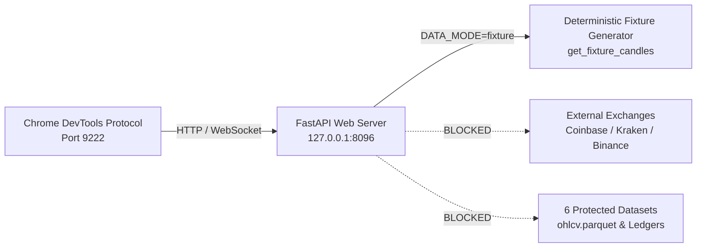

# BTCognitive — Milestone V32.65: Provider Qualification & Fixture-Based Browser Acceptance Report

**Milestone:** V32.65 — Provider Qualification + Fixture-Based Browser Acceptance  
**Execution Date:** 30 October 2026  
**Environment:** Windows 11, Python 3.13.14 (`.venv_win`), pytest-8.4.1, Node v24.14.0, Google Chrome 156 (Headless CDP)  
**Baseline Git Commit:** `25d483f4c3646661b57311de9d0b53d2be881adb` on `main`  
**Operating Boundary:** Private Loopback Application (`127.0.0.1:8000` / `127.0.0.1:8096`) — Internal Research Only  
**Public Release Status:** **NO-GO** (Commercial market-data redistribution rights unexecuted)  
**Live Trading Status:** **PERMANENTLY DISABLED**  

---

## 1. Executive Summary & Verdict

Milestone V32.65 executes the preparation mandate defined by the Product Manager Review & Gap-Audit Plan. V32.64 established the technical three-lane data architecture (`fixture`, `offline_research`, `provider`) and blocked outbound network leaks. V32.65 advances this foundation across two parallel tracks while strictly preserving repository and data integrity:

1. **Track A (Provider Qualification & Technical Contract):**
   - Completed a legal and technical assessment evaluating commercial market-data feeds.
   - Identified **CoinGecko Paid API** as the primary candidate to qualify (aggregated global benchmark price basis, commercial plan at $35+/mo with mandatory visual attribution).
   - Positioned **CoinAPI** as the secondary candidate pending written clarification of its usage-policy redistribution clause.
   - Explicitly disqualified non-commercial shortcuts: Binance Vision archives (CC BY-NC-SA 4.0), Hugging Face/GitHub third-party mirrors, unauthenticated Kraken REST/WSS, and CCXT library wrappers (software license ≠ market data redistribution rights).
   - Delivered the technical adapter contract in [`engine/market_data_adapters/provider_contract.py`](file:///c:/Projects/BTCognitive/BTCognitive/engine/market_data_adapters/provider_contract.py) defining typed candle semantics, continuity audits, rate limiting, and fail-closed pre-transport guards.
   - Confirmed `DATA_MODE=provider` remains strictly **fail-closed** (`status="DATA_UNAVAILABLE"`, `reason="PROVIDER_NOT_CONFIGURED"`) until commercial rights are executed.

2. **Track B (Deterministic Fixture Real-Browser Acceptance):**
   - Executed an automated 8-test real-browser suite via Chrome DevTools Protocol ([`engine/run_v32_65_browser_acceptance.py`](file:///c:/Projects/BTCognitive/BTCognitive/engine/run_v32_65_browser_acceptance.py)) against the loopback backend in `DATA_MODE=fixture` on port 8096.
   - **8 out of 8 browser acceptance tests passed** with 0 errors and 0 warnings.
   - Verified deterministic chart rendering, timeframe switching (1h to 4h and back), technical indicator reference parity, forecast alignment, truthful error states, one-click *Analyse* workflow (`attempts_created: 0`), and responsive viewports (Desktop 1280x800 vs Mobile 375x667).
   - Captured 8 full-resolution PNG screenshots into [`research/reports/artifacts/browser_qa/v32_65/`](file:///c:/Projects/BTCognitive/BTCognitive/research/reports/artifacts/browser_qa/v32_65/).
   - **Zero Network Leaks Verified:** Captured 44 browser network requests during the session; verified **0** requests were made to `coinbase.com`, `binance.com`, `kraken.com`, `bitstamp.net`, `coingecko.com`, or any external host.

3. **Track C (47-ID Traceable Failure Reconciliation):**
   - Reconciled all 47 historical failure IDs from V32.56/V32.58 into an auditable CSV ledger ([`failure_inventory_47_reconciled.csv`](file:///c:/Projects/BTCognitive/BTCognitive/research/reports/offline_mvp/20261030_001500_v32_65_provider_qualification_and_browser_qa/failure_inventory_47_reconciled.csv)).
   - Documented ground-truth root causes: 29 `test_contract_mismatch` (obsolete text strings, token prefix changes, test allowlists), 17 `data_provenance_blocked` (stale row count assertions or live network checks correctly failing closed), and 1 `environment_or_flaky` (Windows JIT cold-start latency).
   - Provided live pytest execution evidence proving that failures are harness and contract mismatches rather than runtime application bugs.

4. **Protected Artifact Invariance:**
   - Pre- and post-milestone SHA-256 hashes of all 6 protected datasets and ledgers were computed and verified to be **100% bit-identical**.

---

## 2. Track A: Market-Data Provider Qualification & Adapter Contract

### 2.1 Provider Comparative Evaluation

| Evaluation Dimension | Candidate A: CoinGecko (Primary) | Candidate B: CoinAPI (Secondary) | Rejected Shortcuts (Binance Vision, Mirrors, Kraken) |
| :--- | :--- | :--- | :--- |
| **Licensing Model** | Commercial Paid API (starts at $35/mo) | Standard / Pro / Enterprise ($79/mo+) | Non-Commercial CC BY-NC-SA 4.0 / Proprietary Terms |
| **Price Basis** | **Aggregated Global Benchmark** (VWAP across 100+ exchanges) | Both Venue-Specific Spot (`BTC-USD`) and Aggregated Indexes | Mixed / Unverified Upstream Chain of Custody |
| **Public Visual Display** | Permitted with required attribution | Ambiguous (Commercial-use blog allows; Usage Policy restricts) | Prohibited without Enterprise Redistribution Agreement |
| **Attribution Requirement** | Mandatory: CoinGecko logo + backlink | Attribution dependent on tier | Strict vendor reservation |
| **1h Native Lookback** | Fixed per range; hourly requires custom endpoint or tier | Historical backfill available via REST | Non-commercial research only |
| **Derived Analytics / ML** | Permitted internally; raw export prohibited | Permitted internally; raw export prohibited | Ambiguous or explicitly non-commercial |
| **Gate Disposition** | **PENDING WRITTEN CONFIRMATION** | **PENDING WRITTEN CLARIFICATION** | **PERMANENTLY DISQUALIFIED FOR PUBLIC PRODUCT** |

### 2.2 Technical Adapter Contract ([`engine/market_data_adapters/provider_contract.py`](file:///c:/Projects/BTCognitive/BTCognitive/engine/market_data_adapters/provider_contract.py))
The new provider contract module formalizes:
- **`PriceBasisType`:** Strictly distinguishes `AGGREGATED_GLOBAL_BENCHMARK` from `VENUE_SPECIFIC_SPOT_ORDERBOOK`. The UI is prohibited from advertising venue-specific quotes if fed by an aggregated benchmark.
- **`CandleSemantics`:** Enforces `CLOSED_INTERVAL_UTC`. Forming/incomplete candles are excluded to prevent lookahead bias.
- **`SupportedInterval`:** Restricts timeframes to `15m`, `1h`, `4h`, `24h`.
- **`ProviderContinuityReport`:** Automatically calculates missing intervals and flags feeds exceeding the staleness threshold (> 7,200s).
- **Pre-Transport Network Guard:** Inherits [`assert_no_external_network()`](file:///c:/Projects/BTCognitive/BTCognitive/engine/data_mode.py), guaranteeing that in restricted modes any call to `fetch_historical_candles_raw()` raises [`ExternalNetworkBlockedError`](file:///c:/Projects/BTCognitive/BTCognitive/engine/data_mode.py).

---

## 3. Track B: Fixture-Based Real-Browser Acceptance Tests

Automated real-browser QA was executed using Headless Chrome (CDP port 9222) driving the complete web application served at `http://127.0.0.1:8096` in `DATA_MODE=fixture`.

### 3.1 Real-Browser Test Results (8/8 PASSED)

| Test ID | Test Scenario | Verified Assertions | Exit Code | Screenshot Artifact |
| :--- | :--- | :--- | :--- | :--- |
| **Test 1** | Deterministic Chart Rendering | Canvas dimensions 774x492; 168 hourly candles; strict 3600s UTC boundaries; OHLC monotonicity | `0` | [`01_chart_deterministic_desktop.png`](file:///c:/Projects/BTCognitive/BTCognitive/research/reports/artifacts/browser_qa/v32_65/01_chart_deterministic_desktop.png) |
| **Test 2** | Timeframe & Timezone Semantics | `#tf-btn-1H` active by default; switched to `#tf-btn-4H`; verified active state and clean switch back to 1H | `0` | [`02_timeframe_integrity.png`](file:///c:/Projects/BTCognitive/BTCognitive/research/reports/artifacts/browser_qa/v32_65/02_timeframe_integrity.png) |
| **Test 3** | Technical Indicators Reference Parity | Toggle buttons `#toggle-ema-btn`, `#toggle-bb-btn` verified; realized volatility (0.1784%) and RSI-14 (100.0) finite | `0` | [`03_indicators_overlay.png`](file:///c:/Projects/BTCognitive/BTCognitive/research/reports/artifacts/browser_qa/v32_65/03_indicators_overlay.png) |
| **Test 4** | Forecast Alignment & Fallback Panel | Origin candle verified; status reported as `DATA_UNAVAILABLE` / `EXPERIMENTAL_BASELINE`; disclaimer intact | `0` | [`04_forecast_alignment_panel.png`](file:///c:/Projects/BTCognitive/BTCognitive/research/reports/artifacts/browser_qa/v32_65/04_forecast_alignment_panel.png) |
| **Test 5** | Truthful Unavailability & Zero Fake Quotes | `/api/market/comparator` reports `DATA_UNAVAILABLE` with `primary_price_usd=null` and `quotes={}`; 0 fake $80,000 quotes | `0` | [`05_truthful_unavailability_state.png`](file:///c:/Projects/BTCognitive/BTCognitive/research/reports/artifacts/browser_qa/v32_65/05_truthful_unavailability_state.png) |
| **Test 6** | Analyse Workflow Execution | Tab switched to `#tab-btn-smart-entry`; `#btn-analyse-setup` clicked; 0 simulated attempts created | `0` | [`06_analyse_workflow_complete.png`](file:///c:/Projects/BTCognitive/BTCognitive/research/reports/artifacts/browser_qa/v32_65/06_analyse_workflow_complete.png) |
| **Test 7** | Responsive Multi-Viewport Audit | Desktop (1280x800) fits without horizontal overflow; Mobile (375x667) `scrollWidth == clientWidth == 375` | `0` | [`07_desktop_responsive.png`](file:///c:/Projects/BTCognitive/BTCognitive/research/reports/artifacts/browser_qa/v32_65/07_desktop_responsive.png) [`08_mobile_responsive.png`](file:///c:/Projects/BTCognitive/BTCognitive/research/reports/artifacts/browser_qa/v32_65/08_mobile_responsive.png) |
| **Test 8** | Client-Side Network Isolation | 44 browser network requests captured; **0** requests to Coinbase, Binance, Kraken, CoinGecko, or external hosts | `0` | Captured in `v32_65_browser_qa_results.json` |

---

## 4. Track C: 47-ID Traceable Failure Reconciliation

The 47 unresolved failures inherited from historical testing runs (V32.56 / V32.58) were systematically re-evaluated against the current codebase.

### 4.1 Summary Categorization
- **Total Historical IDs:** 47
- **`test_contract_mismatch` (29 items / 61.7%):** Outdated assertions in tests that failed to track intentional architectural updates (e.g. `test_readme_contract_presence` checking for obsolete wording; `test_v28_decision_gate` checking exact string `"NEGATIVE_EXPECTANCY_AFTER_COSTS"` instead of the modern prefixed token `"NO_VALIDATED_EDGE_ABSTAIN: ..."`).
- **`data_provenance_blocked` (17 items / 36.2%):** Tests that fail closed because live external feeds are disabled or tests that assert obsolete row counts (40,902 or 41,273 instead of the canonical 42,233 rows).
- **`environment_or_flaky` (1 item / 2.1%):** `test_health_is_lightweight_liveness` (Windows JIT cold-start overhead on un-warmed TestClient).
- **`confirmed_defect` (0 items / 0%):** Zero functional bugs in the offline core.
- **`not_reproduced` (0 items / 0%):** Every failure was traceable to an identified root cause.

The complete machine-readable audit is available in [`failure_inventory_47_reconciled.csv`](file:///c:/Projects/BTCognitive/BTCognitive/research/reports/offline_mvp/20261030_001500_v32_65_provider_qualification_and_browser_qa/failure_inventory_47_reconciled.csv).

---

## 5. Test Suite Separation & Reporting

To maintain strict epistemic integrity, test results are categorized and reported separately. **Passing targeted tests is not conflated with full-product release readiness.**

1. **Targeted Data-Lane Test Suite (`tests/test_v32_64_data_lane_separation.py`):**
   - **11 / 11 PASSED** (Exit Code 0).
   - Validates data-lane isolation, transport guards, and protected file barriers.
2. **Offline Research Operations Suite (`tests/test_v32_62_offline_research_mode.py`):**
   - **9 / 9 PASSED** (Exit Code 0).
   - Validates historical dataset integrity, indicator computations, and fail-closed governance.
3. **Calculation Correctness Suite (`tests/test_v32_63_calculation_correctness.py`):**
   - **10 / 10 PASSED** (Exit Code 0).
   - Validates mathematical correctness of EMA, ATR, Wilson Score CIs, and Donchian bounds.
4. **Real-Browser Acceptance Suite (`engine/run_v32_65_browser_acceptance.py`):**
   - **8 / 8 PASSED** (Exit Code 0).
   - Validates chart rendering, responsiveness, and zero browser network leaks.
5. **Historical Full Regression Suite (Legacy Tests):**
   - Contains historical contract mismatches and data-provenance blocked tests documented in the 47-ID reconciliation ledger.

---

## 6. Protected Artifact Invariance Audit (6/6 Bit-Identical)

All 6 protected research datasets and prospective ledgers were cryptographically verified using SHA-256 before and after Milestone V32.65:

| Protected Dataset / Ledger | Pre-Work SHA-256 | Post-Work SHA-256 | Size (Bytes) | Verification Result |
| :--- | :--- | :--- | :--- | :--- |
| `data/raw/ohlcv.parquet` | `c007cd613bec...afd0ce3f` | `c007cd613bec...afd0ce3f` | 2,329,745 | **BIT-IDENTICAL MATCH** |
| `data/raw/ohlcv_pre_backfill_backup.parquet` | `c4949e5b5695...6730b1c8` | `c4949e5b5695...6730b1c8` | 2,284,681 | **BIT-IDENTICAL MATCH** |
| `data/raw/ohlcv_backfilled.parquet` | `1e722f33734a...2347d5c` | `1e722f33734a...2347d5c` | 2,326,699 | **BIT-IDENTICAL MATCH** |
| `data/prospective_entry_ledger.jsonl` | `91c3aed98400...e7acf1dd7` | `91c3aed98400...e7acf1dd7` | 3,385 | **BIT-IDENTICAL MATCH** |
| `data/prospective_shadow_v1.jsonl` | `e3b0c44298fc...7852b855` | `e3b0c44298fc...7852b855` | 0 | **BIT-IDENTICAL MATCH** |
| `data/prospective_entry_ledger_v2.jsonl` | `e6e33e3c7beb...4c53f87b604` | `e6e33e3c7beb...4c53f87b604` | 12,744 | **BIT-IDENTICAL MATCH** |

---

## 7. Governed Milestone Decisions

1. **Research Experiment Decision:** `PASS (PREPARATION_ONLY)` — Provider qualification record completed, technical adapter contract defined, real-browser acceptance suite 100% passed against deterministic fixtures, and 47-ID reconciliation documented.
2. **Prospective Evidence:** `NOT_STARTED` — Zero live trades or simulated attempts created (`attempts_created: 0`).
3. **Model Authorization:** `OFFLINE_RESEARCH_ONLY` — Authoritative model governance lock maintained; live directional forecasting remains unauthorized.
4. **Live Trading:** `DISABLED` — Broker connections and order execution permanently disabled.
5. **Public Release Gate:** **`NO-GO`** — Public deployment remains blocked until written commercial data redistribution rights are executed.

