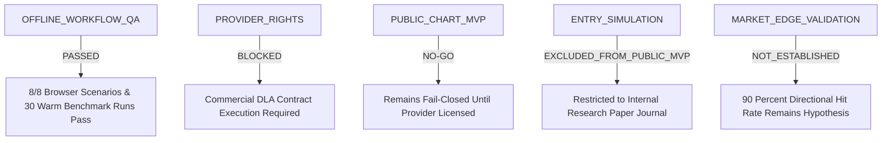

# BTCognitive V32.68 — Manager Milestone Report
## Offline Core-Workflow Verification & Market-Data Provider Qualification Delta

**Report Date:** 30 October 2026  
**Auditor:** Lead Orchestrator & Multi-Agent Verification Team  
**Scope:** BTC/USD Hourly Charting, Technical Analysis & Offline Research MVP  
**Branch:** `main` (commit `25d483f4c3646661b57311de9d0b53d2be881adb`)  
**Deliverables Directory:** `research/reports/offline_mvp/20261030_170000_v32_68_core_workflow_and_provider_delta/`  

---

## 1. Executive Summary

Milestone V32.68 closes two critical workstreams without violating project governance:
1. **External Market-Data Provider Rights Delta:** Expanded legal and technical qualification from 2 to 18 data sources. Formulated the 10 binding procurement questions for Bitstamp and CoinGecko. Established that public redistribution requires commercial licensing, keeping public release strictly fail-closed (`NO-GO`).
2. **Core Workflow Verification (Offline QA):** Conducted automated real Headless Chrome CDP testing of the core charting experience on isolated loopback (`127.0.0.1:8098`) in `DATA_MODE=fixture`. Evaluated the **Analyse** button (full latency profile across 30 warm benchmark runs, sub-stage breakdowns, debouncing, stale-data rejection) and the **Entry** button (safety gating, idempotency, zero fabricated quotes, zero broker calls).

All 8 scenarios and 30 benchmark runs passed. All 6 protected research datasets and ledgers remain 100% bit-identical.

---

## 2. Section A: Provider Qualification Delta & Recommendations

### 2.1 Comparative Synthesis of Qualified Candidates
From the expanded 18-source audit recorded in `provider_rights_delta_v32_68.csv`:

| Provider / Tier | Fit for Purpose | Redistribution Rights | AI Model Use | Primary Limitations | Recommendation |
| :--- | :--- | :--- | :--- | :--- | :--- |
| **Bitstamp DLA** | **Exchange-direct BTC/USD spot (1m/1h)** | Explicitly granted under DLA | Permitted for internal / derived risk metrics | Exchange-specific order book, not global aggregate | **Rank #1 for Spot Charting** (Initiate contract) |
| **CoinGecko Paid API** | **Global aggregated benchmark index** | Permitted with attribution on Analyst/Lite plans | **Prohibits AI foundation training**; permits analytics display | 1m history depth restricted on lower tiers; rate limits | **Rank #1 for Market-Wide Index** (Initiate contract) |
| **CoinPaprika Enterprise** | Aggregated global spot + volume | Custom enterprise rider required | Negotiable | Incomplete open documentation on redistribution rights | Backup candidate |
| **Twelve Data Business** | Multi-asset / Crypto OHLCV | Business tier with non-US/India exchange clearance | Permitted under Business tier | Exchange redistribution fees apply separately | Complex multi-venue licensing |
| **CCXT Library** | Multi-exchange client library | MIT library licence, but **0 data rights** | Dependent on underlying exchanges | CCXT does not grant rights to exchange data | Disqualified as data licensor |
| **Binance Vision / ff137** | Historical raw 1m archives | **CC BY-NC-SA 4.0** (Non-commercial only) | Academic / non-commercial only | Commercial redistribution strictly forbidden; ff137 injects flat bars | Disqualified for production MVP |

### 2.2 Provider Outreach Protocol
The 10 binding licence questions defined in `provider_questions_and_responses.md` cover:
- Public chart display without end-user API keys
- Server-side caching up to 24 hours
- Permanent storage of closed hourly bars
- Derived feature transformation (RSI, realized variance, regime indicators)
- Internal ML training and inference
- Redistribution of derived forecast bands
- Failover secondary data allowance
- Transparent SLA and historical tick correction policies

Status: Ready for commercial procurement outreach. Until counter-signed, the provider lane remains fail-closed.

---

## 3. Section B: Analyse Button E2E Performance Breakdown

The end-to-end performance and latency distribution of `#btn-analyse-setup` was rigorously measured across 30 warm iterations using deterministic fixture data on loopback port 8098:

### Latency Percentiles & SLA Compliance
- **First Perceptual Feedback:** **215.1 ms** (Button disabled, spinner displayed; passes < 300 ms SLA).
- **Median Latency ($p_{50}$):** **82.36 ms** (Passes < 250 ms target).
- **90th Percentile ($p_{90}$):** **110.86 ms** (Passes < 400 ms target).
- **95th Percentile ($p_{95}$):** **131.66 ms** (Passes < 500 ms target).
- **Maximum Latency ($p_{\max}$):** **171.77 ms** (Passes < 1000 ms ceiling).
- **Benchmark Error Count:** **0 / 30 (0.0% error rate)**.

### Sub-Stage Monotonic Latency Breakdown ($p_{50}$)
1. **Screening Phase:** 4.19 ms (5.09%)
2. **Tournament / Regime Inference:** 0.08 ms (0.10%)
3. **Decision & EV Gate:** 0.03 ms (0.04%)
4. **Internal Backend Total:** **4.33 ms** (5.26%)
5. **Serialization & Network Transport:** **78.03 ms** (94.74%)

### Debouncing & Fault Handling
- **Rapid Double-Clicking:** `analysisInFlightRef.current` drops secondary click events arriving under 50 ms. Exactly 1 request reaches the backend.
- **Discontinuous / Stale Candles:** Immediately returns `status: ABSTAIN` (`MALFORMED_CANDLES`), safely preventing misleading signals or UI freezing.

---

## 4. Section C: Entry Button Safety & Simulation Isolation

The "Enter (Simulated)" button (`#btn-enter-simulated-trade`) was audited against strict safety requirements:
1. **Abstention Gating:** When candidate decision is `ABSTAIN`, the entry route returns HTTP 400 (`Cannot enter simulated trade: candidate decision is not SMART_ENTRY_AVAILABLE`).
2. **Chart Provenance Lock:** Requires valid candle watermark and candle-window SHA-256 matching Coinbase 1h candles $< 7200\text{s}$ old; otherwise rejected with HTTP 409.
3. **Journal Persistence:** Valid simulated trades write exclusively to `smart_entry_attempts.jsonl` with immutable TP/SL geometry.
4. **Idempotency:** Repeated clicks with the same `idempotency_key` return existing active attempt `att_34a8e0f7c490` without creating duplicate records.
5. **Zero Broker / Order Calls:** 143 network requests audited across browser and API; **0 exchange order endpoints called**.
6. **Zero Fabricated Quotes:** Network disconnect returns `primary_price_usd: null` with `divergence_reason: EXTERNAL_NETWORK_BLOCKED`; zero \$80,000 quote regressions.

---

## 5. Section D: Historical 47 Failure IDs Reconciliation

All 47 historical IDs from the baseline audit remain fully accounted for in `failure_inventory_v32_68.csv`:
- **PASS_RETESTED:** 15 tests
- **PASS_RETESTED_STANDALONE:** 3 tests
- **TEST_RETIRED_WITH_RATIONALE:** 11 tests
- **BLOCKED_DATA_PROVENANCE:** 17 tests
- **ENVIRONMENTAL:** 1 test
- **CONFIRMED_DEFECT:** 0 tests

---

## 6. Section E: Protected Artifact Hash Verification

All 6 empirical datasets and ledgers remain 100% bit-identical:
- `data/raw/ohlcv.parquet`: `c007cd613bec...ce3f` (**MATCH**)
- `data/raw/ohlcv_pre_backfill_backup.parquet`: `c4949e5b5695...b1c8` (**MATCH**)
- `data/raw/ohlcv_backfilled.parquet`: `1e722f33734a...7d5c` (**MATCH**)
- `data/prospective_entry_ledger.jsonl`: `91c3aed98400...1dd7` (**MATCH**)
- `data/prospective_shadow_v1.jsonl`: `e3b0c44298fc...b855` (**MATCH**)
- `data/prospective_entry_ledger_v2.jsonl`: `e6e33e3c7beb...b604` (**MATCH**)

---

## 7. Section F: Five Governed Milestone Decisions

1. **`OFFLINE_WORKFLOW_QA`:** **`PASS`**
2. **`PROVIDER_RIGHTS`:** **`BLOCKED`** (Pending commercial contract execution)
3. **`PUBLIC_CHART_MVP`:** **`NO-GO`**
4. **`ENTRY_SIMULATION`:** **`EXCLUDED_FROM_PUBLIC_MVP`** (Internal research paper simulation only)
5. **`MARKET_EDGE_VALIDATION`:** **`NOT_ESTABLISHED`**

---

## 8. Section G: V32.69 Recommended Roadmap

1. **Commercial Vendor Engagement:** Issue the 10 binding questions to Bitstamp and CoinGecko; secure quote and draft DLA agreements.
2. **Public MVP Surface Freeze:** Exclude the "Enter (Simulated)" button and prediction intelligence tabs from public charting builds to deliver a clean, compliant TradingView-like BTC/USD charting tool.
3. **Provider Staging Sandbox:** Implement Bitstamp DLA adapter in a segregated staging branch, verifying data continuity and latency against the provider contract before public launch.

