# BTCognitive V32.70 — Analysis Button Deep-Dive Execution Audit

**Audit Date:** 30 October 2026  
**Auditor:** Quantitative Research Engineer & Technical Product Analyst  
**Target:** The "Analyse Setup" Workflow (`#btn-analyse-setup`)  
**Scope:** Complete End-to-End Code Trace from Browser Click to Final Recommendation  

---

## 1. End-to-End Execution Trace

```mermaid
sequenceDiagram
    autonumber
    actor User as User / Browser
    participant App as web/app.js (handleAnalyse)
    participant Client as web_src/api_client.js
    participant Route as api/routes_tournament.py
    participant Tourn as engine/regime_strategy_tournament.py
    participant Regime as MarketRegimeClassifier
    participant Screen as evaluate_7_of_10_screen
    participant Backtest as run_strategy_tournament_backtest
    participant Decision as formulate_smart_entry_decision

    User->>App: Clicks #btn-analyse-setup
    App->>App: Checks debouncing (analysisInFlightRef)
    App->>App: Verifies chart timeframe (1h) & candles (>= 168)
    App->>Client: window.api.analyseMarket(payload)
    Client->>Route: POST /api/tournament/analyse
    Route->>Route: Acquires _analysis_execution_lock
    Route->>Tourn: execute_integrated_analyse_and_tournament()
    
    rect rgb(30, 41, 59)
        Note over Tourn,Regime: Stage 1-4: Analysis & Screening
        Tourn->>Tourn: _validate_hourly_candles() (Causal check)
        Tourn->>Tourn: check_data_freshness_and_gaps()
        Tourn->>Regime: MarketRegimeClassifier.classify(df_closed)
        Regime-->>Tourn: Regime (e.g. VOLATILITY_EXPANSION) + ATR/ADX/BBW
        Tourn->>Screen: Filter strategies & evaluate 7/10 screen
        Screen-->>Tourn: Top 2 Shortlisted Candidates
    end

    rect rgb(30, 41, 59)
        Note over Tourn,Backtest: Stage 5: Tournament Backtest
        Tourn->>Backtest: run_strategy_tournament_backtest()
        Backtest-->>Tourn: Verdict: ABSTAIN (FRESH_EVALUATION_BLOCKED)
    end

    rect rgb(30, 41, 59)
        Note over Tourn,Decision: Stage 6-7: Decision Formulation
        Tourn->>Decision: formulate_smart_entry_decision()
        Decision-->>Tourn: Decision Object (status: ABSTAIN or SMART_ENTRY_AVAILABLE)
    end

    Tourn-->>Route: Unified payload + runtime_timings_ms
    Route-->>Client: HTTP 200 OK
    Client-->>App: JSON Response
    App->>App: Sets analysisData, tournamentData, smartEntryDecision
    App->>User: Renders Results & Enables/Disables #btn-enter-simulated-trade
```



---

## 2. Comprehensive Answers to the 14 Priority Investigation Questions

### Question 1: What happens when the user clicks Analysis?
- The click event on `#btn-analyse-setup` triggers `handleAnalyse()` in `web/app.js` (line 17,366).
- The button is immediately disabled (`disabled=True`), and the UI state transitions to `analysisStage = "checking-data"`, providing visual perceptual feedback within **215 ms**.
- The frontend builds closed hourly candles (`buildClosedHourlyAnalysisCandles`) and dispatches `POST /api/tournament/analyse`.
- Upon receipt of the response, the terminal displays the regime badge, candidate cards, 7/10 screening breakdown, and final decision card.

### Question 2: Which functions and engines execute?
1. `handleAnalyse()` in `web/app.js` (line 17,366).
2. `window.api.analyseMarket()` in `web_src/api_client.js` (line 144).
3. `post_analyse_market()` / `_post_analyse_market()` in `api/routes_tournament.py` (lines 510–598).
4. `execute_integrated_analyse_and_tournament()` in `engine/regime_strategy_tournament.py` (line 1,433).
5. `analyse_current_market()` in `engine/regime_strategy_tournament.py` (line 693).
6. `_validate_hourly_candles()` and `check_data_freshness_and_gaps()` in `engine/regime_strategy_tournament.py`.
7. `MarketRegimeClassifier.classify()` in `engine/regime_strategy_tournament.py` (line 159).
8. `evaluate_7_of_10_screen()` in `engine/regime_strategy_tournament.py` (line 423).
9. `run_strategy_tournament_backtest()` in `engine/regime_strategy_tournament.py` (line 1,116).
10. `formulate_smart_entry_decision()` in `engine/regime_strategy_tournament.py` (line 1,316).

### Question 3: Which models are called?
- **Surprising Discovery:** In the direct Analysis execution path, **NO deep neural networks or complex machine learning models are invoked live on each click**.
- Instead, the classification is **strictly rule-based and econometric**:
  - `MarketRegimeClassifier` uses causal EMA50, EMA200, ADX(14), ATR(14), and Bollinger Bandwidth calculations.
  - The heavy ML models (`tft_model.py`, `models/checkpoints/tft.pt`, `mamba_range`) are **offline research prototypes** and are **NOT** wired into the live analysis click path.
  - The directional GBDT baseline (`directional-gbm-4lag-v1`) is evaluated separately via `/api/research/directional-audit`, not on the primary chart button.

### Question 4: What input data is used?
- Minimum **168 closed hourly candles** ($df_{\text{1h}}$) formatted as JSON: `[{timestamp, open, high, low, close, volume}]`.
- A verified `live_price` (float) representing current spot BTC/USD.
- In `DATA_MODE=fixture`, deterministic fixture candles from `data/raw/ohlcv.parquet` are provided.
- Any open or incomplete candle is causal-filtered using `is_closed == True`.

### Question 5: What indicators and features are calculated?
1. **Exponential Moving Averages:** EMA(50) and EMA(200) on closed prices.
2. **Average True Range (ATR):** Wilder 14-period ATR.
3. **Average Directional Index (ADX):** 14-period ADX measuring trend strength.
4. **Bollinger Bands & Bandwidth (BBW):** 20-period moving average $\pm 2.0$ standard deviations; bandwidth $= (\text{upper} - \text{lower}) / \text{mid}$.
5. **Causal Watermark Hash:** SHA-256 digest of the latest closed candle and the 168-candle window.

### Question 6: How is market direction evaluated?
Market direction is governed deterministically by `MarketRegimeClassifier`:
- **TRENDING_BULLISH:** $\text{Close} > \text{EMA}_{50} > \text{EMA}_{200}$ and $\text{ADX} \ge 22.0$.
- **TRENDING_BEARISH:** $\text{Close} < \text{EMA}_{50} < \text{EMA}_{200}$ and $\text{ADX} \ge 22.0$.
- **RANGE_BOUND:** $\text{ADX} < 20.0$ and compressed BBW.
- **VOLATILITY_EXPANSION:** $\text{ATR}_{14} > 1.2 \times \text{ATR\_SMA}_{50}$, or BBW expanding.

### Question 7: How are entry opportunities identified?
- The engine queries `VersionedStrategyRegistry.get_all_entries()`.
- It filters out strategies in the `Baseline` family, strategies marked `QUARANTINED`, and strategies whose `supported_regimes` do not match the observed regime.
- For compatible strategies, it executes `evaluate_7_of_10_screen()`: requiring at least 7 Take-Profit hits in the most recent 10 completed attempts.
- Up to two candidates are shortlisted (Rank 1: Primary, Rank 2: Challenger).

### Question 8: How are stop-loss and risk levels calculated?
Stop-loss and Take-profit geometries are computed parametrically from ATR(14):
- **Trend Following (`TSMOM_DONCHIAN_24H_168H`):** $\text{Stop Distance} = 1.5 \times \text{ATR}$, $\text{Target Distance} = 2.25 \times \text{ATR}$ (Reward/Risk = $1.50$).
- **Breakout (`ATR_VOLATILITY_BREAKOUT_12H`):** $\text{Stop Distance} = 1.0 \times \text{ATR}$, $\text{Target Distance} = 2.0 \times \text{ATR}$ (Reward/Risk = $2.00$).
- **Mean Reversion (`RANGE_BOLLINGER_REVERSION_20H`):** $\text{Stop Distance} = 1.5 \times \text{ATR}$, $\text{Target Distance} = |\text{BB}_{\text{mid}} - \text{Close}|$.
- Geometries are frozen immutably once formed.

### Question 9: How are conflicting model outputs resolved?
- Sequential candidate ranking: Rank 1 is evaluated first. If Rank 1 qualifies across all gates, Rank 2 is **not evaluated** (`UNTESTED_FALLBACK_NOT_NEEDED`).
- Only if Rank 1 fails qualification gates does the engine evaluate Rank 2.
- If both fail or conflict, the engine defaults to `ABSTAIN`.

### Question 10: How is the final recommendation generated?
- `formulate_smart_entry_decision()` takes the analysis result and tournament result.
- If `tournament_res.get("final_verdict") == "QUALIFIED_WINNER_FOUND"`, it produces `status: "SMART_ENTRY_AVAILABLE"` with complete candidate geometry.
- If no winner qualified, it returns `status: "ABSTAIN"` with an explicit reason string.

### Question 11: What happens when data is missing or stale?
- **Data Gaps:** If hourly intervals are missing, `check_data_freshness_and_gaps` flags `has_candle_gaps=True`, immediately returning `status: "ABSTAIN"` (`GAP_DETECTED`).
- **Data Staleness:** If the latest candle is older than `max_age_hours` (2.0 hours) and `enforce_freshness` is true, it immediately returns `status: "ABSTAIN"` (`MARKET_DATA_STALE`).
- **Malformed OHLC:** If High < Low or Close < 0, `_validate_hourly_candles` rejects the payload with `status: "ABSTAIN"` (`MALFORMED_CANDLES`).

### Question 12: Does the button execute synchronously or asynchronously?
- The backend endpoint (`/api/tournament/analyse`) is an asynchronous FastAPI handler executing synchronously within the thread worker pool under `_analysis_execution_lock`.
- From the browser's perspective, it is a non-blocking asynchronous Promise (`await window.api.analyseMarket(...)`) with a 45-second timeout guard.

### Question 13: Are results reproducible?
- **Yes, 100% deterministic:** For identical candle arrays and live prices, the mathematical calculations, indicator values, regime classification, and watermark hashes produce bit-identical JSON outputs.

### Question 14: Are there any dead code paths or disconnected engines?
- **CRITICAL AUDIT FINDING (Dead Code):**
  - In `engine/regime_strategy_tournament.py`, lines 1162–1204 contain an early `return` statement:
    ```python
    unavailable_reason = "No verified walk-forward manifest matches the registered candidate strategies..."
    return { ... "final_verdict": "ABSTAIN", ... }
    ```
  - As a result, lines 1206–1260 (`candidate_results = [_evaluate_single_candidate_3_arms(...)]`) are **UNREACHABLE DEAD CODE**.
  - **Disconnected Engines:**
    - `models/tft_model.py` (Temporal Fusion Transformer) is not called.
    - `models/meta_labeler.py` is not called.
    - `engine/forecast_engine_15m.py` is not called by the Analysis button (it serves `/api/forecast/latest` instead).
    - `engine/cross_venue_divergence.py` is not called during analysis.

