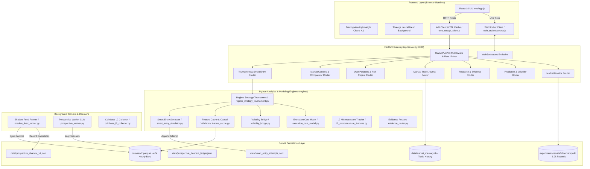

# BTCognitive V32.70 — System Architecture Audit

**Audit Date:** 30 October 2026  
**Milestone:** V32.70  
**Target Codebase:** `C:\Projects\BTCognitive\BTCognitive`  

---

## 1. High-Level Architecture Overview

BTCognitive is designed as an asynchronous, single-process FastAPI backend coupled with a high-performance single-page React frontend. All operations are strictly read-only or append-only, ensuring complete data containment.

---

## 2. Component Audits

### 2.1 Frontend Framework & Components
- **Architecture:** Zero-transpiler vanilla React 18 using `React.createElement` (`h`) directly in `web/app.js` (19,244 lines). 
- **Dependencies:** Loaded via standard CDN script tags in `web/index.html`:
  - `react@18/umd/react.production.min.js`
  - `react-dom@18/umd/react-dom.production.min.js`
  - `lightweight-charts@4.1.3` (TradingView standalone canvas renderer)
  - `three.js/r134` (3D webgl background)
- **Key Modules in `web_src/`:**
  - `api_client.js`: HTTP request client with automatic in-flight deduplication, 500ms TTL caching, exponential backoff on HTTP 429, and client rate limiting (budget capped at 29.5 req/min vs server limit of 60 req/min).
  - `websocket.js`: Resilient WebSocket connection to `/ws` with automatic reconnect and ping/pong keepalive.
  - `formatters.js`: Currency, percentage, basis point, and ISO timestamp formatting.
  - `smart_entry_simulator_view.js` & `manual_trade_journal_view.js`: Specialized views for trade simulation and journaling.
- **Top-Level Navigation Routes:** Hash-based SPA router supporting `#/terminal`, `#/how-it-works`, `#/paper-trading`, `#/position-monitor`, `#/journal`, `#/smart-entry`, `#/research`, `#/arena`, `#/forecast`, and `#/landing`.

### 2.2 Backend Framework & API Structure
- **Framework:** FastAPI 0.115+ running on Starlette with Uvicorn.
- **Entry Point:** `api/server.py` creates `app = FastAPI(...)` with a lifespan context manager.
- **Security Middleware:**
  - `SecurityHeadersMiddleware`: Enforces OWASP ASVS compliance (Content-Security-Policy, X-Frame-Options: DENY, X-Content-Type-Options: nosniff).
  - `RateLimitingMiddleware`: Enforces tiered sliding-window rate limits (60 req/min for anonymous users).
  - `sanitized_exception_handler`: Global exception interceptor preventing internal stack traces from leaking to clients.
- **Router Hierarchy:** 190 endpoints organized across 12 discrete routers:
  1. `market_monitor` (`api/market_monitor_routes.py`): Health, dashboard, readiness diagnostics.
  2. `market` (`api/routes_market.py`): Candle feeds, spot comparator.
  3. `prediction` (`api/routes_prediction.py`): Latest 15m/1h forecasts, explainability (SHAP), memory stats.
  4. `tournament` (`api/routes_tournament.py`): Market analysis, backtests, Smart Entry simulation and monitoring.
  5. `user_positions` (`api/routes_user_positions.py`): Position tracking, partial exits, risk copilot.
  6. `manual_journal` (`api/routes_manual_journal.py`): Trade journal entries and performance evaluation.
  7. `research` (`api/routes_research.py`): 24h scorecards, shadow validation ledgers, directional manifests.
  8. `arena` (`api/routes_arena.py`): Multi-strategy arena allocation, trade markers.
  9. `terminal` (`api/routes_terminal.py`): Consolidated terminal status and diagnostics.
  10. `notifications` (`api/routes_notifications.py`): Alert dispatching (Discord, Webhooks, Telegram).
  11. `genome` (`api/genome_routes.py`): Genetic strategy optimization registry.
  12. `analogs` (`api/routes_analogs.py`): Historical price pattern analog matching.

### 2.3 Database & Storage Architecture
- **Parquet Datasets (`data/raw/*.parquet`):**
  - High-performance, columnar read-only storage.
  - Canonical historical hourly dataset (`data/raw/ohlcv.parquet`) contains 42,233 rows spanning January 2022 to October 2026.
  - Ingress adapters load Parquet into memory via PyArrow with zero mutation.
- **SQLite Databases (WAL Mode):**
  - `experiments/results/observatory.db`: Contains 6,945 persistent longitudinal volatility forecast records.
  - `data/market_memory.db`: Contains historical trade executions and memory performance tables.
  - `data/processed/feature_store.db`: Cached technical and derivatives features.
  - `experiments/genome/genome_registry.db`: Genetic strategy parameters.
- **Append-Only JSONL Ledgers:**
  - `data/smart_entry_attempts.jsonl`: Stores simulated trade proposals, entry prices, locked TP/SL levels, and timestamps.
  - `data/prospective_shadow_v1.jsonl`: Stores forward prospective shadow candidate proposals.
  - `data/prospective_forecast_ledger.jsonl`: Stores forward volatility forecast records prior to outcome maturity.

### 2.4 Python Engine Architecture
- **Orchestration:** `engine/regime_strategy_tournament.py` acts as the primary analytical coordinator, integrating data validation, regime classification, candidate screening, backtesting, and decision formulation into a single execution pass.
- **Causal Invariance Enforcement:** `engine/data_verification.py` and `engine/feature_cache.py` enforce strict point-in-time constraints ($t_{\text{feature}} \le t_{\text{decision}} < t_{\text{maturity}}$). Incomplete/open candles are filtered out before indicator calculation.
- **Cost & Payoff Models:** `engine/execution_cost_model.py` and `engine/payoff_engine.py` model exchange fee schedules (Coinbase 60/87 bps, Binance, Kraken), slippage, and funding drag to calculate net expected value ($EV_{\text{net}}$).

### 2.5 TypeScript Orchestration Status
- **Audit Finding:** **ZERO TypeScript code exists in the repository**.
- All frontend code is standard ECMAScript 2022 (ES6+).
- Node.js scripts (`build_frontend.js`, `tests_frontend.js`) perform syntax checks using `node --check` and test execution using pure vanilla JavaScript.

### 2.6 Background Workers & Collectors
1. **`ShadowFeedRunner` (`engine/shadow_feed_runner.py`):**
   - Polls closed candles from Coinbase REST API, validates continuity, evaluates active shadow candidates, and writes operational status to `data/prospective_shadow_status.json`.
   - Single-instance process lock enforced via `data/.prospective_shadow_runner.lock`.
2. **`ProspectiveWorker` (`engine/prospective_worker.py`):**
   - Hourly background daemon (or scheduled CLI) that commits prospective forecasts for 24h and 168h realized variance targets into `data/prospective_forecast_ledger.jsonl`.
   - Resolves past forecasts strictly after the forward window elapses.
3. **`CoinbaseL2Collector` (`engine/coinbase_l2_collector.py`):**
   - Real-time WebSocket listener connecting to Coinbase Level-2 order book updates (`wss://ws-feed.exchange.coinbase.com`). Reconstructs order book depth, Order Book Imbalance (OBI), and Order Flow Imbalance (OFI).

### 2.7 Model Training Infrastructure
- **Pipelines:**
  - `training/retrain_pipeline.py`: Orchestrates periodic model retraining with walk-forward purged cross-validation.
  - `training/train_mamba_range.py`: Mamba state-space model trainer for price range prediction.
  - `training/train_tft.py`: Temporal Fusion Transformer trainer for multi-horizon quantile forecasting.
  - `training/foundation_adaptation.py`: Adapts pre-trained time-series foundation models (Chronos-2) to BTC micro-structure.

### 2.8 Model Inference Infrastructure
- **Inference Service (`engine/inference_service.py`):**
  - Thread-safe model loader using Joblib and PyTorch.
  - Verifies artifact SHA-256 hashes against freeze metadata before running predictions.
- **Feature Cache (`engine/feature_cache.py`):**
  - Maintains precomputed rolling feature windows (500 bars) to guarantee sub-10ms inference latencies.

### 2.9 Communication Between Components
- **Client-to-Server:** Asynchronous HTTP/1.1 REST using JSON payloads.
- **Real-Time Data:** Persistent WebSocket connection (`/ws`) broadcasting tick updates and order-book snapshots.
- **Process Isolation:** Multi-process concurrency protected by cross-platform file locks (`.lock`) and thread mutexes (`threading.Lock`).

