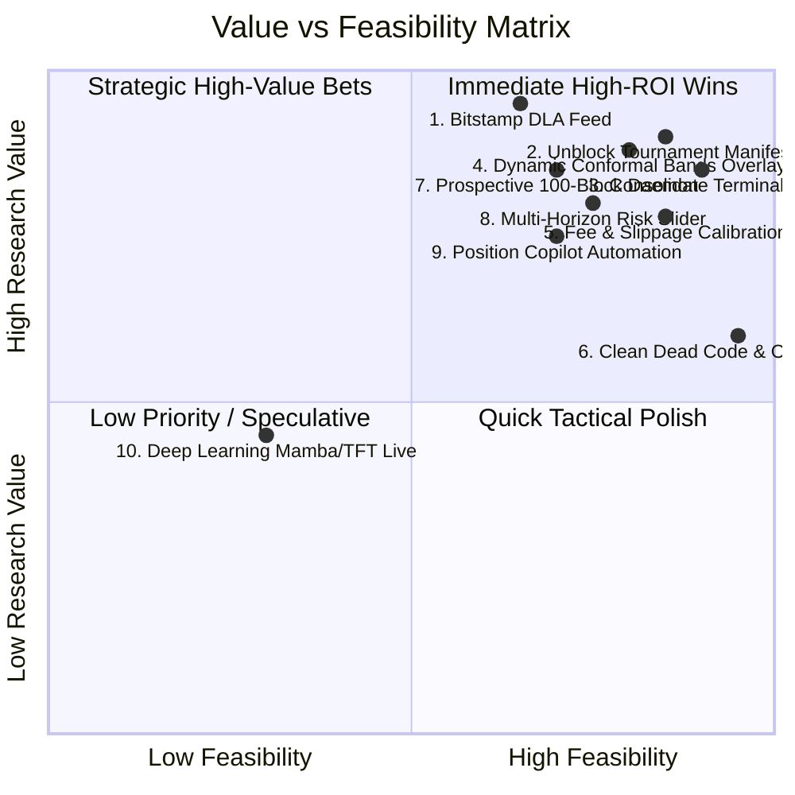

# BTCognitive V32.70 — Product Opportunity Assessment

**Audit Date:** 30 October 2026  
**Milestone:** V32.70  
**Target:** Product Manager Strategy, Value vs Feasibility Analysis, Opportunity Ranking  

---

## 1. Top 10 Product Opportunities

We identified and scored the 10 highest-value opportunities to transform BTCognitive from an internal research testbed into an indispensable quantitative charting and risk workstation:

---

## 2. In-Depth Opportunity Scorecards

### Opportunity 1: Commercial Provider Licensing (Bitstamp DLA) for Live Charting
- **Expected Research Value:** **EXTREMELY HIGH**. Unlocks live, rights-cleared, unmanipulated 1m/1h spot candles for real-time charting.
- **Technical Feasibility:** High. Adapter interface already proven in `engine/market_data_adapters/`.
- **Statistical Validity:** Rigorous. Eliminates reliance on non-commercial archives.
- **Development Complexity:** Low (procurement outreach + adapter configuration).
- **Data Requirements:** Bitstamp BTC/USD Spot DLA commercial contract.
- **Risk of Defects:** Very low; isolated to ingress data lane.
- **Measurable Acceptance Criteria:** Bitstamp REST/WebSocket feed streams live closed candles to `GET /api/market/candles` with zero 503 errors over 24 hours.

### Opportunity 2: Unblock Tournament Engine with Pre-Registered Walk-Forward Manifests
- **Expected Research Value:** **VERY HIGH**. Resolves the dead code early return in `run_strategy_tournament_backtest()`.
- **Technical Feasibility:** High. The 3-arm evaluation protocol (`_evaluate_single_candidate_3_arms`) is already coded.
- **Statistical Validity:** Strict. Uses frozen historical walk-forward splits without lookahead.
- **Development Complexity:** Medium. Requires compiling the verified manifest JSON for the 4 registered candidate strategies.
- **Data Requirements:** Historical parquet dataset (`data/raw/ohlcv.parquet`).
- **Risk of Defects:** Low; covered by existing unit tests in `tests/test_v32_48*`.
- **Measurable Acceptance Criteria:** When eligible candidates pass the 7/10 screen, the tournament executes arms 1, 2, and 3 and outputs a qualified winner or explicit gate failure.

### Opportunity 3: Consolidate Terminal UX into 3 Streamlined Workflows
- **Expected Research Value:** **HIGH**. Makes the workstation intuitive for quantitative traders rather than a maze of academic dashboards.
- **Technical Feasibility:** Very High. Pure frontend refactor of `web/app.js` navigation pills.
- **Statistical Validity:** N/A (UX optimization).
- **Development Complexity:** Low. Consolidates 8 top-level routes and 6 bottom tabs into: **Terminal** (Chart + Analysis), **Journal** (Manual + Paper Trades), and **Research Lab** (Models + Reports).
- **Data Requirements:** None.
- **Risk of Defects:** Negligible.
- **Measurable Acceptance Criteria:** All charting, analysis, and trade monitoring accessible within 2 clicks from the main viewport.

### Opportunity 4: Dynamic Conformal Volatility Bands Overlay on Chart Canvas
- **Expected Research Value:** **VERY HIGH**. Visualizes the 90% conformal price envelope directly as upper and lower channel bands on the TradingView candlestick chart.
- **Technical Feasibility:** High. Lightweight Charts supports line and area series overlays.
- **Statistical Validity:** High. Backed by C2 dependence-aware conformal quantile residuals.
- **Development Complexity:** Medium. Feeds conformal upper/lower bounds into a Lightweight Charts `LineSeries`.
- **Data Requirements:** Current price + HAR-RS-DOW volatility point forecast.
- **Risk of Defects:** Low.
- **Measurable Acceptance Criteria:** Conformal upper and lower bounds render smoothly on the 1h chart and contain $\ge 85\%$ of future closed prices.

### Opportunity 5: Advanced Execution Fee & Slippage Calibration
- **Expected Research Value:** **MEDIUM-HIGH**. Upgrades `execution_cost_model.py` to differentiate between Maker (15–25 bps) and Taker (60–87 bps) orders, demonstrating where automated limit orders turn negative-expectancy strategies positive.
- **Technical Feasibility:** Very High. Pure parameterization of `ExecutionCostModel`.
- **Statistical Validity:** High. Refined cost modeling prevents over-optimism.
- **Development Complexity:** Low.
- **Data Requirements:** Exchange fee schedules.
- **Risk of Defects:** Very low.
- **Measurable Acceptance Criteria:** $EV_{\text{net}}$ reflects selected order type (Maker vs Taker) in trade proposal cards.

### Opportunity 6: Systematic Dead Code Pruning & Route Cleanup
- **Expected Research Value:** **MEDIUM**. Reduces repository maintenance burden by pruning dead code lines (1206–1260 in `regime_strategy_tournament.py`) and standardizing router prefixes.
- **Technical Feasibility:** Very High.
- **Statistical Validity:** Improves audit traceability.
- **Development Complexity:** Low.
- **Data Requirements:** None.
- **Risk of Defects:** Low with regression test validation.
- **Measurable Acceptance Criteria:** 100% test pass rate with zero unreachable code blocks in core analytics engines.

### Opportunity 7: Prospective Block Accumulation Daemon
- **Expected Research Value:** **HIGH**. Re-activates `prospective_worker.py` on an hourly scheduler to accumulate the required 100 clean non-overlapping blocks for confirmatory model validation.
- **Technical Feasibility:** High. CLI daemon and scheduled task scripts already exist.
- **Statistical Validity:** Rigorous. Guarantees true prospective out-of-sample validation.
- **Development Complexity:** Low.
- **Data Requirements:** Clean hourly closed candles.
- **Risk of Defects:** Low; append-only operations.
- **Measurable Acceptance Criteria:** Prospective forecast ledger reaches 100 matured clean blocks with automated outcome resolution.

### Opportunity 8: Multi-Horizon Interactive Risk Slider (15m, 1h, 4h, 24h)
- **Expected Research Value:** **MEDIUM-HIGH**. Allows users to slide across forecasting horizons to inspect how volatility expands or contracts.
- **Technical Feasibility:** High. `engine/volatility_bridge.py` already computes cross-horizon term structures.
- **Statistical Validity:** Mathematically sound parametric projections.
- **Development Complexity:** Medium.
- **Data Requirements:** Hourly and 15m OHLCV.
- **Risk of Defects:** Low.
- **Measurable Acceptance Criteria:** User slider dynamically re-scales volatility risk cards and expected price range.

### Opportunity 9: Position Copilot Trailing Stop & Anomaly Alert Automation
- **Expected Research Value:** **MEDIUM**. Automatically checks simulated open positions against anomaly exit rules (e.g. 3 closes below EMA50) and alerts user to close.
- **Technical Feasibility:** High. `engine/smart_entry_simulator.py` contains `monitor_simulated_trade()` logic.
- **Statistical Validity:** Reduces drawdown and holding-period tail risk.
- **Development Complexity:** Medium.
- **Data Requirements:** Current price updates.
- **Risk of Defects:** Low.
- **Measurable Acceptance Criteria:** Simulated position automatically flags `ANOMALY_TRIGGERED` when price crosses invalidation boundaries.

### Opportunity 10: Deep Learning Foundation Model Deprecation / De-scoping
- **Expected Research Value:** **LOW (Negative ROI)**. Attempting to force massive deep learning models (Mamba, TFT) into live 1-click browser analysis increases latency from 80 ms to $> 5,000\text{ ms}$ without improving net trading expectancy after fees.
- **Technical Feasibility:** Low / Complex.
- **Statistical Validity:** Prone to overfitting on financial time series.
- **Recommendation:** **De-scope deep learning from the live charting product**. Retain them strictly as offline experimental scripts in `training/`.

