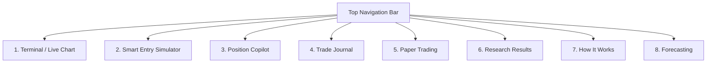

# BTCognitive V32.70 — UI / UX & Workflow Audit

**Audit Date:** 30 October 2026  
**Milestone:** V32.70  
**Target:** Web Interface, User Flows, Navigation, Visual Telemetry & Component Architecture  

---

## 1. Audit of Major Screens & Views

The frontend application (`web/app.js`, 19,244 LOC) comprises 8 primary views accessible via the top navigation bar:

### 1.1 Terminal & Chart View (`#/terminal` or `/`)
- **Visual Components:**
  - **Header Telemetry:** BTC/USD live spot price, 24h price change, Coinbase WebSocket status pill, and Market Regime Badge.
  - **Main Canvas:** TradingView Lightweight Charts (v4.1.3) rendering interactive candlesticks, volume histogram, and EMA50/200 overlays.
  - **Right Sidebar:** Order Book Depth ladder (10 levels), Order Book Imbalance (OBI) gauge, and the **Analyse Setup** control panel.
  - **Bottom Panel Tabs:** Future-Price Forecasting, Historical Analogs, Paper Portfolio, Signal Quality, and SHAP Explainability.
- **Evaluation:** Outstanding visual polish. Dark glassmorphism theme (`#0F172A`), fluid CSS animations, and instant canvas rendering.
- **UX Issue:** The bottom tabs contain dense quantitative metrics (Brier score, ECE, SHAP values) that overwhelm a trader looking for actionable market context.

### 1.2 Smart Entry Simulator View (`#/smart-entry`)
- **Visual Components:**
  - `#btn-analyse-setup`: Triggers the 1-click analysis and screening workflow.
  - `#btn-enter-simulated-trade`: Submits paper trade attempts when proposal is `SMART_ENTRY_AVAILABLE`.
  - Proposal Card: Renders entry price, target Take-Profit, Stop-Loss, Reward/Risk ratio, and Anomaly Exit rules.
- **Evaluation:** Clean, debounced interaction (median response **82.36 ms**).
- **UX Issue:** Because the live tournament engine intentionally executes an epistemic abstention gate, the user almost always sees an "ABSTAIN" card. The card explains *why* (e.g. `No verified walk-forward manifest matches`), but this can feel like a broken feature to an unbriefed user.

### 1.3 Position Copilot View (`#/position-monitor`)
- **Visual Components:**
  - Active simulated positions table with entry timestamp, side (LONG/SHORT), entry price, current price, unrealized PnL (USD and %), and locked TP/SL.
  - Interactive Action Buttons: `Partial Exit (50%)` and `Emergency Close`.
- **Evaluation:** High usability. Real-time PnL recalculation functions reliably.
- **UX Issue:** The header could more prominently emphasize that positions are **paper simulation only** to prevent any misunderstanding regarding live capital.

### 1.4 Manual Trade Journal View (`#/journal`)
- **Visual Components:**
  - Trade Entry Form: Date, instrument, side, entry price, exit price, size, strategy tag, and post-trade emotional/technical notes.
  - Historical Journal Table: Displays past trades, win rate, profit factor, and average R-multiple.
- **Evaluation:** Fully functional, backed by SQLite (`market_memory.db`). Great tool for discretionary quantitative traders.

### 1.5 Research Results View (`#/research`)
- **Visual Components:**
  - Sub-tabs for Tournaments, Paper Trading, Reports, Models, Analogs, and Provenance.
- **Evaluation:** Powerful academic workstation for quantitative researchers.
- **UX Issue:** Severe information density. Sub-tabs frequently overlap in scope (e.g. `Reports` vs `Provenance` vs `Models`).

---

## 2. Identified UX Weaknesses & Concrete Recommendations

| Screen / Component | Observed Weakness / Friction | Root Cause in Code | Recommended PM Remediation |
| :--- | :--- | :--- | :--- |
| **Analyse Workflow** | User sees constant `ABSTAIN` badge with verbose academic explanations. | Live tournament engine enforces epistemic gate until 100 clean blocks accumulate. | Reframe UI copy: Display "Macro Regime Filter: Neutral / No Clear Edge" with an educational tooltip explaining that high-conviction setups occur rarely. |
| **Order Book Depth** | L2 depth ladder shows empty/stale state when offline or disconnected. | Component lacks fallback explanatory banner when WebSocket is unconfigured. | Surface a clean badge: `"L2 Microstructure: Offline / Research Replay Mode"`. |
| **Navigation Density** | 8 top-level navigation items and 6 bottom-panel tabs create cognitive overload. | Accumulated features from 32 iterative development cycles without consolidation. | **Consolidate to 3 Core Tabs:** 1. **Terminal** (Chart + Analysis + Copilot) 2. **Journal** (Manual + Paper Trades) 3. **Research Lab** (Models + Reports) |
| **Timeframe Flexibility** | Changing chart timeframe to 15m or 4h disables Analysis button. | Analysis engine strictly enforces 1h causal candle arrays. | Automatically lock or auto-switch timeframe to 1h when clicking "Analyse Setup", with a polite notification toast. |

