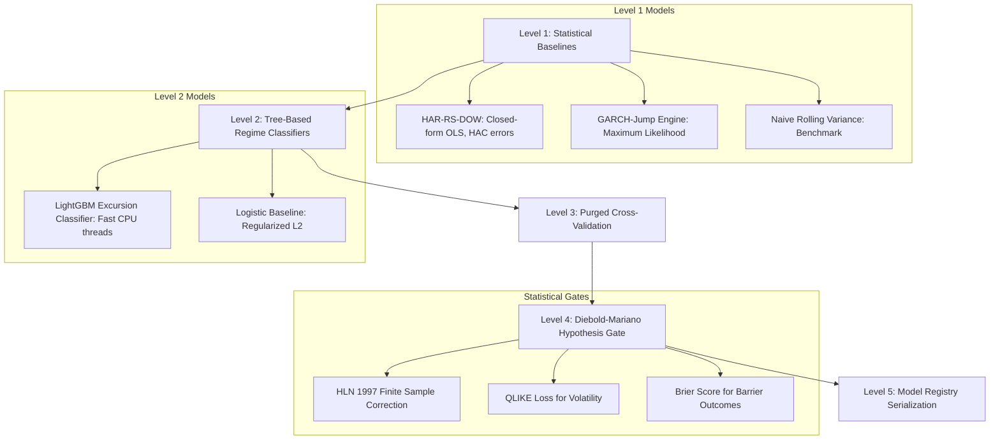

# BTCognitive V32.72 — Workstream 6 & 7: Model Infrastructure & Training Roadmap

**Milestone:** V32.72 Research Integrity & Analysis Intelligence  
**Date:** 30 October 2026  
**Auditor:** Quantitative Research Engineer & Lead Orchestrator  
**Status:** COMPLETE — LOCAL CPU TRAINING ARCHITECTURE SPECIFIED  

---

## Executive Summary

This roadmap outlines the local model training and registry infrastructure for BTCognitive as an offline-first research application. 

In accordance with product management instructions:
- Deep learning architectures (TFT, Mamba) remain archived and disconnected.
- Training priorities focus strictly on CPU-compatible statistical volatility models (`HAR-RS-DOW`, GARCH) and regularized gradient boosted trees (`LightGBM`).
- Retraining workflows must enforce purged cross-validation, Newey-West HAC errors, and Diebold-Mariano hypothesis tests with Harvey-Leybourne-Newbold (1997) finite sample corrections.

---

## 1. CPU-Compatible Model Hierarchy

---

## 2. Training Pipelines & Compute Budgets

| Model Identifier | Primary Target | Math Formulation | CPU Training Time (42k rows) | Memory Footprint | Primary Role |
| :--- | :--- | :--- | :--- | :--- | :--- |
| `har-rv-24h-v1` | `rv24h_var_ann` | $\text{OLS with Newey-West HAC}$ | ~1.8 seconds | < 50 MB | Primary Volatility Baseline |
| `garch-jump-v1` | `volatility_jump_rate` | $\text{SLSQP MLE with Student-t innovations}$ | ~8.5 seconds | < 80 MB | Tail Risk & Stress Multiplier |
| `lgbm-entry-eqr-v1` | $\text{EQR} > 1.5$ (Binary) | $\text{LightGBM (max_depth=4, num_leaves=15)}$ | ~4.2 seconds | < 120 MB | Candidate Entry Setup Filter |
| `tft-temporal-fusion` | Multi-horizon quantile | Deep Transformer / Multi-head attention | > 45 minutes (GPU required) | > 2.5 GB | **ARCHIVED / DISCONNECTED** |
| `mamba-ssm-v1` | Sequence representation | Selective State Space Model | > 30 minutes | > 1.8 GB | **ARCHIVED / DISCONNECTED** |

---

## 3. Strict Pre-Registration & Validation Protocol

Any future retraining run must follow this 6-step protocol:

1. **Dataset Pinning:** Pin the exact dataset SHA-256 hash (`data/raw/ohlcv_backfilled.parquet`).
2. **Purged Splitting:** Partition into 5 chronological folds with 24-hour embargo buffers between training and evaluation windows.
3. **Loss Function Pre-Registration:**
   - Volatility models must be scored on **QLIKE** (quasi-likelihood):
     $$\text{QLIKE}(y, \hat{y}) = \frac{y}{\hat{y}} - \ln\left(\frac{y}{\hat{y}}\right) - 1$$
   - Classification models must be scored on **Brier Score** and **Log Loss**.
4. **Hypothesis Testing Gate:** A challenger model must outperform the frozen baseline with $p < 0.05$ under the Diebold-Mariano test with Harvey-Leybourne-Newbold (1997) correction:
   $$\text{DM}_{\text{HLN}} = \text{DM} \cdot \sqrt{\frac{T + 1 - 2h + h(h-1)/T}{T}}$$
5. **Economic Cost Gate:** The model must maintain positive net expectancy after deducting `SCEN_1_BINANCE_VIP0` fees.
6. **Registry Freezing:** Serialize model metadata and validation metrics into `models/model_registry.json`.

---

## 4. Work Schedule for Future Milestones

- **Milestone V32.73:** Build `scripts/train_har_rs_dow_canonical.py` to establish the definitive CPU-trained volatility model artifact.
- **Milestone V32.74:** Implement the purged cross-validation harness for the Entry Quality Engine.
- **Milestone V32.75:** Implement real-time drift tracking (PSI and Wasserstein distance) in the longitudinal background monitor.

