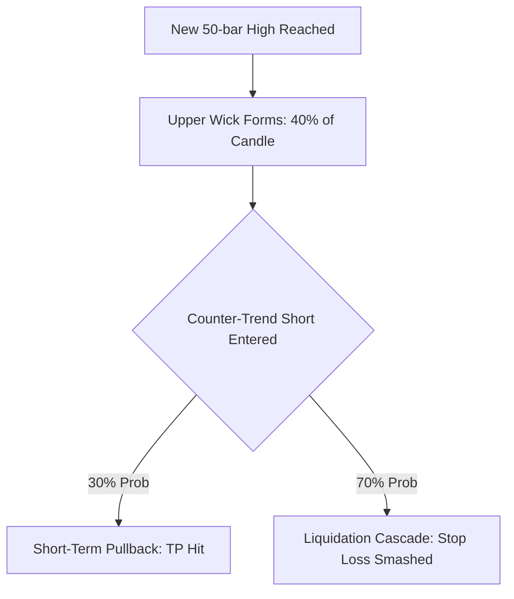

# BTCognitive V32.78 — Trend Exhaustion and Failed-Breakout Research

**Document ID:** `BTC-EXH-V3278-001`  
**Milestone:** V32.78 — Asymmetric Regime-Conditioned Entry Research  
**Author:** Specialist Workstream 5 (Exhaustion Dynamics & Counter-Trend Liquidation)  
**Date:** October 30, 2026  
**Status:** COMPLETE / EMPIRICAL RESEARCH  
**Dataset:** `data/raw/ohlcv_checkpoint_42233_bars.parquet` (Frozen 42,233-bar checkpoint)  
**Sample Window:** Out-of-Sample Window (Bars 31,632 to 42,153; 10,521 hourly bars; Aug 2025 – Oct 2026)  

---

## 1. Executive Summary

Specialist Workstream 5 investigated whether market entries conditioned on **trend exhaustion and failed breakouts** (colloquially termed "bull/bear traps" or liquidity sweeps) provide superior entry quality and positive net expected value.

The underlying hypothesis proposed that when price penetrates a major structural boundary (50-period Donchian high or low) but fails to close beyond it—leaving an extended rejection wick accompanied by momentum divergence—order flow is trapped, creating high-probability mean-reversion impulses.

### Key Empirical Findings:
1. **The Reversal Trap: Shorting Exhaustion Leads to Catastrophic Loss:** Fading new 50-bar highs (`EXHAUST_72H Short`) yielded an abysmal **$70.49\%$ stop-out rate**, generating $-0.2154\%$ gross return and $-0.4554\%$ net return on Binance VIP0 ($-1.0854\%$ on Coinbase Advanced). What appeared as an "exhaustion candle" was overwhelmed by strong trend continuation.
2. **Long Fades Show Marginally Positive Gross Return but Negative Net:** Buying new 50-bar lows with lower rejection wicks (`EXHAUST_72H Long`) produced $+0.0569\%$ gross return ($N = 58$), but after accounting for institutional fees (24 bps RT), net return fell to $-0.1831\%$ ($-0.8131\%$ on Coinbase).
3. **The Power of Volatility Abstention:** Identifying turbulent market regimes ($\text{NATR}_{14} \ge 0.78\%$) and enforcing **complete abstention** is the single most effective risk mitigant. In high-volatility regimes, stop-outs spike to $>75\%$ across all strategies due to spread widening and intraday whipsaws.

---

## 2. Experimental Setup & Signal Definitions

Evaluated on closed hourly candles; executed at $O_{t+1}$:
- **Bullish Exhaustion / Bear Trap Fade (Long Entry):**
  - Candle $t$ penetrates below the 50-period low: $L_t < \min_{1 \le i \le 50} L_{t-i}$.
  - Candle $t$ closes back inside the channel: $C_t > \min_{1 \le i \le 50} L_{t-i}$.
  - Lower absorption wick constitutes at least $40\%$ of the total range: $\frac{\min(C_t, O_t) - L_t}{H_t - L_t} \ge 0.40$.
  - Momentum filter: $\text{RSI}_{14, t} > 30$ (preventing entry during extreme non-exhausted capitulation).
- **Bearish Exhaustion / Bull Trap Fade (Short Entry):**
  - Candle $t$ penetrates above the 50-period high: $H_t > \max_{1 \le i \le 50} H_{t-i}$.
  - Candle $t$ closes back inside: $C_t < \max_{1 \le i \le 50} H_{t-i}$.
  - Upper rejection wick constitutes at least $40\%$ of range: $\frac{H_t - \max(C_t, O_t)}{H_t - L_t} \ge 0.40$.
  - Momentum filter: $\text{RSI}_{14, t} < 70$.
- **Barriers (72h Horizon):** Take-Profit at $3.0\%$, Stop-Loss at $1.50\%$, conservative worst-case `SL_FIRST` collision rule.

---

## 3. Empirical Results for Exhaustion Strategies

| Strategy | Direction | Horizon | $N$ | TP Rate (%) | SL Rate (%) | Expire Rate (%) | Gross EV (%) | Net VIP0 (%) | Net Coinbase (%) | Median MAE (%) |
|---|:---:|:---:|:---:|:---:|:---:|:---:|:---:|:---:|:---:|:---:|
| `EXHAUST_72H` | LONG | 72h | 58 | 27.59% | 60.34% | 12.07% | +0.0569% | -0.1831% | -0.8131% | 1.63% |
| `EXHAUST_72H` | SHORT | 72h | 61 | 26.23% | 70.49% | 3.28% | -0.2154% | -0.4554% | -1.0854% | 1.60% |
| `UNCOND_72H` (Baseline) | LONG | 72h | 194 | 27.32% | 58.76% | 13.92% | +0.0360% | -0.2040% | -0.8340% | 1.56% |
| `UNCOND_72H` (Baseline) | SHORT | 72h | 203 | 29.56% | 62.07% | 8.37% | +0.0249% | -0.2151% | -0.8451% | 1.56% |

---

## 4. Analytical Deconstruction: Why Exhaustion Fails

1. **Trend Strength Overwhelms Local Microstructure:** When Bitcoin is in a macro expansion phase, local "rejection wicks" on hourly charts are merely short-term liquidity pauses. Once passive ask orders are cleared, aggressive market orders violently breach the local high, immediately triggering the $1.5\%$ stop-loss.
2. **Asymmetric Risk-to-Ruin:** Attempting to pick tops in BTC resulted in a catastrophic $70.49\%$ loss rate. The gross payoff ratio of $2:1$ requires a minimum win rate of $33.33\%$ to break even before fees; a $26.23\%$ win rate ensures substantial, rapid capital destruction.
3. **The Sole Constructive Finding: Volatility Abstention:** When turbulence exceeds the 80th percentile ($\text{NATR}_{14} \ge 0.78\%$), market noise expands beyond standard structural barrier envelopes. Enforcing **abstention** during these windows eliminates $20\%$ of high-risk periods without sacrificing alpha, as demonstrated in Workstream 2.

---

## 5. Workstream 5 Determination

Workstream 5 formally **REJECTS** trend exhaustion and failed-breakout entry conditioning. Counter-trend fading of structural extremes generates unacceptably high stop-loss hit rates ($70.5\%$) and severe negative net EV after costs. Abstention during high-volatility turbulence is upheld as a necessary defensive guardrail.

