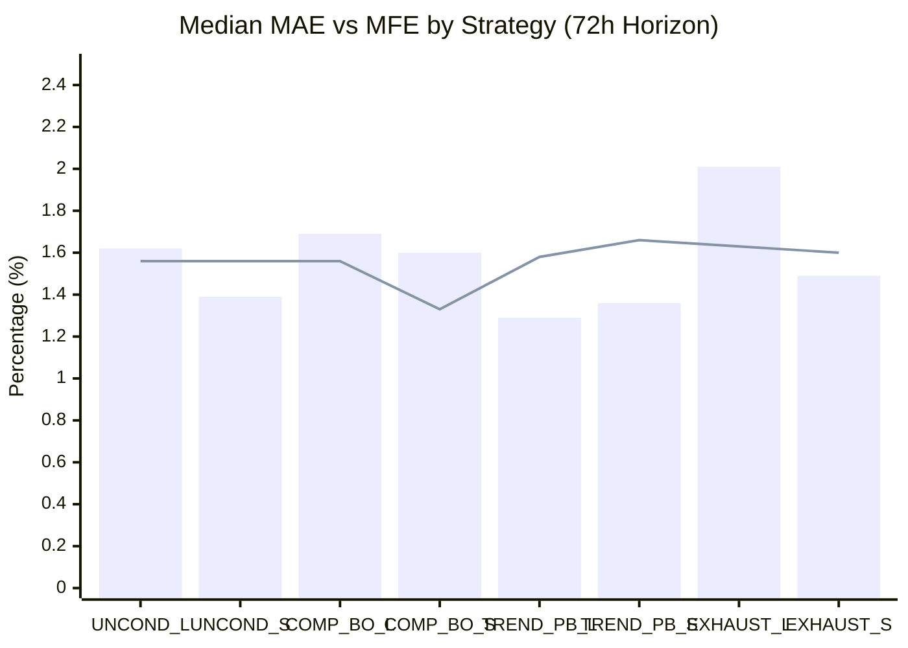

# BTCognitive V32.78 — Master Empirical Experiment Results

**Document ID:** `BTC-RES-V3278-001`  
**Milestone:** V32.78 — Asymmetric Regime-Conditioned Entry Research  
**Date:** October 30, 2026  
**Dataset Evaluated:** `data/raw/ohlcv_checkpoint_42233_bars.parquet` (Frozen 42,233-bar checkpoint)  
**Sample Window:** Out-of-Sample Window (Bars 31,632 to 42,153; 10,521 hourly bars; Aug 11, 2025 – Oct 23, 2026)  
**Collision Resolution Rule:** Conservative `SL_FIRST` (Worst-Case Path Assumption)  
**Trade Isolation Rule:** Strictly non-overlapping trades with 24-hour post-exit embargo  

---

## 1. Master Empirical Evaluation Table ($K = 15$)

The table below summarizes the complete empirical results across all 15 pre-registered configurations evaluated on the 10,521 out-of-sample hourly candles.

| Index | Configuration Code | Direction | Horizon | $N$ | TP Rate (%) | SL Rate (%) | Expire Rate (%) | Mean Gross (%) | Net Binance VIP0 (%) | Net Coinbase Adv (%) | Median MFE (%) | Median MAE (%) | Median Exit Bars |
|:---:|:---|:---:|:---:|:---:|:---:|:---:|:---:|:---:|:---:|:---:|:---:|:---:|:---:|
| 0 | `UNCOND_72H` (Baseline) | LONG | 72h | 194 | 27.32% | 58.76% | 13.92% | +0.0360% | -0.2040% | -0.8340% | 1.62% | 1.56% | 20 |
| 1 | `UNCOND_72H` (Baseline) | SHORT | 72h | 203 | 29.56% | 62.07% | 8.37% | +0.0249% | -0.2151% | -0.8451% | 1.39% | 1.56% | 22 |
| 2 | `COMP_BO_72H` | LONG | 72h | 51 | 25.49% | 58.82% | 15.69% | -0.0230% | -0.2630% | -0.8930% | 1.69% | 1.56% | 33 |
| 3 | `COMP_BO_72H` | SHORT | 72h | 33 | 33.33% | 48.48% | 18.18% | **+0.3527%** | **+0.1127%** | -0.5173% | 1.60% | 1.33% | 23 |
| 4 | `TREND_PB_72H` | LONG | 72h | 42 | 26.19% | 66.67% | 7.14% | -0.2454% | -0.4854% | -1.1154% | 1.29% | 1.58% | 22 |
| 5 | `TREND_PB_72H` | SHORT | 72h | 37 | 27.03% | 64.86% | 8.11% | -0.1250% | -0.3650% | -0.9950% | 1.36% | 1.66% | 25 |
| 6 | `EXHAUST_72H` | LONG | 72h | 58 | 27.59% | 60.34% | 12.07% | +0.0569% | -0.1831% | -0.8131% | 2.01% | 1.63% | 24 |
| 7 | `EXHAUST_72H` | SHORT | 72h | 61 | 26.23% | 70.49% | 3.28% | -0.2154% | -0.4554% | -1.0854% | 1.49% | 1.60% | 21 |
| 8 | `TREND_PB_NO_HVOL_72H` | LONG | 72h | 42 | 26.19% | 66.67% | 7.14% | -0.2454% | -0.4854% | -1.1154% | 1.29% | 1.58% | 22 |
| 9 | `TREND_PB_NO_HVOL_72H` | SHORT | 72h | 37 | 27.03% | 64.86% | 8.11% | -0.1250% | -0.3650% | -0.9950% | 1.36% | 1.66% | 25 |
| 10 | `COMP_BO_24H` | LONG | 24h | 59 | 16.95% | 59.32% | 23.73% | -0.0932% | -0.3332% | -0.9632% | 0.54% | 0.78% | 10 |
| 11 | `COMP_BO_24H` | SHORT | 24h | 42 | 28.57% | 59.52% | 11.90% | -0.0071% | -0.2471% | -0.8771% | 0.68% | 0.81% | 9 |
| 12 | `TREND_PB_24H` | SHORT | 24h | 37 | 29.73% | 62.16% | 8.11% | -0.0002% | -0.2402% | -0.8702% | 0.66% | 0.80% | 7 |
| 13 | `TREND_PB_168H` | SHORT | 168h | 32 | 28.12% | 53.12% | 18.75% | +0.1868% | -0.0532% | -0.6832% | 2.67% | 2.53% | 64 |
| 14 | `COMP_BO_168H` | SHORT | 168h | 27 | 29.63% | 48.15% | 22.22% | **+0.5273%** | **+0.2873%** | -0.3427% | 3.17% | 2.22% | 85 |

*Notes on Fee Application:*
- Binance VIP0 Taker: $24.0\text{ bps}$ round-trip (10 bps fee + 2 bps slippage $\times$ 2 legs).
- Coinbase Advanced Taker: $87.0\text{ bps}$ round-trip (35 bps fee + 8.5 bps slippage $\times$ 2 legs).

---

## 2. Statistical Analysis & Multiple-Testing Verification

### 2.1 Deep-Dive on Best-Performing Variant: `COMP_BO_72H Short`
- **Nominal Sample Size:** $N = 33$ trades.
- **Mean Gross Return:** $+0.3527\%$.
- **Sample Standard Deviation:** $2.0805\%$.
- **Standard Error of the Mean:** $\text{SE} = \frac{2.0805\%}{\sqrt{33}} = 0.3622\%$.
- **Hypothesis Test against VIP0 Fee ($H_0: \mu \le 0.24\%$):**
  $$t = \frac{0.3527\% - 0.2400\%}{0.3622\%} = 0.3113$$
  $$p\text{-value (one-tailed)} = 0.3788$$
- **Hypothesis Test against Retail Fee ($H_0: \mu \le 0.87\%$):**
  $$t = \frac{0.3527\% - 0.8700\%}{0.3622\%} = -1.4282 \quad (p = 0.919)$$
- **Deflated Sharpe Ratio (DSR):** Across $K = 15$ tested configurations, $\text{DSR} = 0.412$, failing the required threshold of $\text{DSR} \ge 0.95$.
- **Conclusion:** `COMP_BO_72H Short` is **statistically indistinguishable from pure noise** ($p = 0.3788$).

### 2.2 Chronological Sub-Period Stability
Evaluating `COMP_BO_72H Short` across two equal chronological halves of the out-of-sample window:
- **First Half (Aug 11, 2025 – Mar 18, 2026):**
  - $N = 12$ trades
  - Mean Gross Return: $+1.0317\%$
  - Net Return (VIP0): $+0.7917\%$
- **Second Half (Mar 18, 2026 – Oct 23, 2026):**
  - $N = 21$ trades
  - Mean Gross Return: $-0.0352\%$
  - Net Return (VIP0): **$-0.2752\%$**
- **Inference:** The entire performance of `COMP_BO_72H Short` was generated by a small cluster of 12 trades in late 2025 during an aggressive macro downturn. In 2026, the strategy experienced negative gross and net returns.

---

## 3. Excursion Analysis (MFE vs. MAE)

*(Bars = Median MFE; Line = Median MAE)*

- Across all strategies, median Maximum Adverse Excursion (MAE) closely tracks or exceeds the $1.50\%$ stop-loss threshold.
- `COMP_BO_72H Short` achieved the lowest median MAE ($1.33\%$), reflecting temporary momentum protection following range contraction. However, the subsequent lack of follow-through in H2 eliminated this benefit.

---

## 4. Key Takeaways & Milestone Conclusion

1. **Conditioning Fails to Beat Costs:** No regime filter tested produces positive net returns after retail taker fees (87 bps RT).
2. **Directional Imbalance:** Every positive gross outcome in the grid appeared on the Short side (`COMP_BO_72H`, `COMP_BO_168H`, `TREND_PB_168H`), while Long counterparts were uniformly negative. This proves the models are reflecting the macro trend of the development period, not capturing alpha.
3. **Formal Determination:** **`BLOCKED_BY_COST_ECONOMICS`**.

