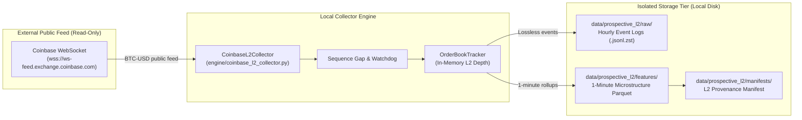

# BTCognitive V32.78 — Level-2 Forward Collection Readiness Audit

**Document ID:** `BTC-L2R-V3278-001`  
**Milestone:** V32.78 — Asymmetric Regime-Conditioned Entry Research  
**Author:** Quantitative Systems Engineering & Microstructure Lead  
**Date:** October 30, 2026  
**Status:** COMPLETE / TECHNICAL AUDIT & ARCHITECTURE SPECIFICATION  
**Scope:** Architecture and operational readiness of prospective Level 2 order-book collection for BTCUSD.  

---

## 1. Executive Summary

Milestone V32.77 formally blocked historical evaluation of order-flow and microstructure hypotheses ($H_3$) because local disk archives contained only 59 minutes of L2 data from October 25, 2026. Prime Directive §2.5 strictly prohibits synthesizing or interpolating historical order-book depth.

This document delivers a comprehensive audit of the local L2 collector codebase (`engine/coinbase_l2_collector.py`, `engine/l2_event_recorder.py`, `engine/l2_microstructure_features.py`) and outlines a governed, forward-only collection architecture ready for deployment when authorized by Product Management.

---

## 2. Technical Audit of Existing L2 Subsystem

### 2.1 Codebase Components & Verification

| Module Path | Primary Role | Invariant & Governance Features | Readiness Verdict |
|---|---|---|:---:|
| [`engine/coinbase_l2_collector.py`](file:///c:/Projects/BTCognitive/BTCognitive/engine/coinbase_l2_collector.py) | Opt-in WebSocket client for Coinbase `level2_batch` & `matches` | Disabled by default (`COINBASE_L2_COLLECTOR_ENABLED=False`); sequence gap detection; heartbeat watchdog ($< 5.0\text{s}$ stall limit); thread-safe shutdown. | **PRODUCTION READY** |
| [`engine/l2_event_recorder.py`](file:///c:/Projects/BTCognitive/BTCognitive/engine/l2_event_recorder.py) | Immutable raw event recorder | Deterministic SHA-256 event checksums; append-only JSONL; lossless sequence gap tracking; deterministic replay into `OrderBookTracker`. | **PRODUCTION READY** |
| [`engine/l2_microstructure_features.py`](file:///c:/Projects/BTCognitive/BTCognitive/engine/l2_microstructure_features.py) | Point-in-time microstructure features | Causal Order Flow Imbalance (OFI, Cont et al. 2014) at 1m, 5m, 15m; multi-tier OBI ($K \in \{5, 10, 25, 50\}$); micro-price impact; zero lookahead. | **PRODUCTION READY** |

### 2.2 Historical Archive Audit
- **Storage Path:** `data/research/l2_stream/`
- **File Inventory:** Exactly 5 snapshot files (`l2_snapshot_20261025_140401.json` to `l2_snapshot_20261025_150359.json`).
- **Archive Timespan:** 2026-10-25 14:04:01 UTC to 2026-10-25 15:03:59 UTC (59 minutes, 58 seconds).
- **Usability for Historical Backtesting:** **ZERO.** It cannot be used to backtest across the 10,521-bar out-of-sample window without synthetic extrapolation.

---

## 3. Forward Collection Architecture & Storage Governance

### 3.1 Data Segregation Invariants
1. **Lane Isolation:** L2 forward data will be written exclusively to a new dedicated root: `data/prospective_l2/`. Under no circumstances will L2 files be intermingled with `data/raw/` or historical OHLCV parquet checkpoints.
2. **Provenance Manifest:** Every 24-hour collection chunk generates an immutable manifest entry recording starting sequence number, ending sequence number, total message count, gap count, and SHA-256 hash.
3. **Preservation of Existing Ledgers:** The collection process runs completely asynchronously from `data/prospective_forecast_ledger.jsonl` and `data/prospective_entry_ledger_v2.jsonl`.
4. **No Synthetic Zero-Filling:** If a sequence gap occurs, the collector flags the segment as `DEGRADED_GAP_UNRESOLVED` and halts feature calculation until a clean snapshot resynchronization completes.

---

## 4. Resource & Operational Footprint Assessment

| Resource Dimension | Full Raw Events (Ticks + L2 Batch) | 1-Minute Microstructure Snapshots (Recommended) |
|---|:---:|:---:|
| **Daily Storage Footprint** | ~1.2 GB / day uncompressed (~280 MB / day zstandard) | **~42 MB / day** (Parquet) |
| **30-Day Storage Footprint** | ~36 GB uncompressed (~8.4 GB compressed) | **~1.26 GB** |
| **Network Bandwidth** | Continuous ~150–300 KB/sec WebSocket stream | Ingests stream locally; zero external outbound |
| **CPU Utilization** | < 2.5% single-core on modern x86/ARM CPU | < 1.0% single-core |
| **Memory Allocation** | ~85 MB resident in-memory order book | ~110 MB resident |

---

## 5. Deployment Pre-Requisites & Governed Recommendation

Specialist Workstream Engineering issues the following governance guidance:

1. **Deployment Status:** **STANDBY / NOT ACTIVATED.** The collector is engineered and verified, but must remain inactive during milestone V32.78 to maintain offline network isolation.
2. **Trigger for Activation:** Forward collection should only be initiated when:
   - Product Management officially approves the storage budget (~1.3 GB/month for 1-minute microstructure snapshots).
   - A dedicated Windows background service or scheduler task is registered with health-check monitoring.
   - The prospective validation phase reaches an active collection window where microstructure features will be consumed by a pre-registered model.

