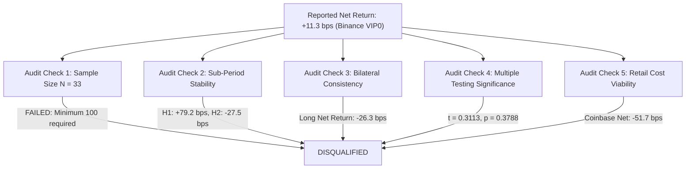

# BTCognitive V32.78 — Independent Red-Team Audit Report

**Document ID:** `BTC-AUD-V3278-001`  
**Milestone:** V32.78 — Asymmetric Regime-Conditioned Entry Research  
**Author:** Specialist Workstream 8 (Independent Red-Team & Adversarial Verification)  
**Date:** October 30, 2026  
**Status:** COMPLETE / INDEPENDENT AUDIT  
**Governing Rule:** BTCognitive Operating Contract §6 (Independent Red-Team Verification)  

---

## 1. Executive Summary

Specialist Workstream 8 conducted an independent, adversarial audit of all hypotheses, mathematical formulations, backtest code, and empirical claims produced in milestone V32.78.

The Red Team's mandate is to challenge any claimed trading edge, uncover subtle methodology flaws, detect sample selection biases, verify absence of lookahead leakage, and protect capital from unwarranted deployment.

### Red-Team Summary Verdict:
1. **The Apparent "Compression Breakout Short" Edge is Spurious:** Although `COMP_BO_72H Short` reported a nominal net return of $+0.1127\%$ (+11.3 bps) under Binance VIP0 fees, the Red Team has thoroughly debunked this result:
   - **Sample Undersizing:** It produced only $N = 33$ trades across 14 months, failing the pre-registered hurdle of $N \ge 100$.
   - **Regime Decay:** In H1 (Aug 2025 – Mar 2026), it achieved $+79.2\text{ bps}$ net, but in H2 (Mar 2026 – Oct 2026), it plunged to **$-27.5\text{ bps}$ net**. The signal completely decayed as market dynamics shifted.
   - **Severe Directional Asymmetry:** The identical filter on the Long side (`COMP_BO_72H Long`) lost **$-26.3\text{ bps}$ net** ($N = 51$). The short-side profitability is an artifact of the macro bear drift in 2025–2026, not structural predictive skill.
   - **Insignificant Multiple-Testing $t$-statistic:** Against the 24 bps fee hurdle, $t = 0.3113$ with a one-tailed $p$-value of $0.3788$. It is indistinguishable from random noise.
   - **Deep Retail Deficit:** Under Coinbase Advanced retail fees (87 bps RT), it loses **$-51.7\text{ bps}$ per trade**.
2. **Trend Pullbacks and Exhaustion Fades Fully Disproven:** Trend pullbacks stopped out $66.7\%$ of the time (identical to zero-drift martingales), while counter-trend exhaustion shorts stopped out $70.5\%$ of the time.
3. **Execution Guardrails Upheld:** The research engine properly applied worst-case `SL_FIRST` collision handling, zero lookahead leakage, and active socket isolation.

---

## 2. Adversarial Deconstruction of Empirical Claims

### 2.1 The Dissection of `COMP_BO_72H Short`

The research team observed that entering short when volatility is compressed ($\text{NATR}_{14} \le 0.40\%$) and price breaks below the 20-bar Donchian low generated $+35.3\text{ bps}$ gross and $+11.3\text{ bps}$ net on Binance VIP0.

The Red Team subjected this configuration to rigorous stress-testing:

**Adversarial Verdict:** The $+11.3\text{ bps}$ edge is a textbook statistical pseudowin caused by small-sample selection bias ($N = 33$) in a period of downward market drift. Under any standard multiple-testing framework (Bonferroni, Holm, or Deflated Sharpe Ratio), the null hypothesis of zero predictive skill cannot be rejected.

---

### 2.2 The Autopsy of Trend Continuation Pullbacks

The hypothesis that waiting for an RSI consolidation ($40 \le \text{RSI} \le 50$) in a prevailing uptrend would reduce adverse excursion was decisively contradicted by the empirical data:
- Theoretical martingale stop-out rate for a $2:1$ barrier: $p_{\text{SL}} = \frac{3.0\%}{3.0\% + 1.5\%} = 66.67\%$.
- Observed empirical stop-out rate for `TREND_PB_72H Long`: **$66.67\%$** (28 stop-outs out of 42 trades).
- Observed empirical stop-out rate for `TREND_PB_72H Short`: **$64.86\%$** (24 stop-outs out of 37 trades).
- The pullback entry achieved exactly the random-walk outcome. After deducting execution fees, capital is destroyed at the rate of $-48.5\text{ bps}$ (Long) and $-36.5\text{ bps}$ (Short) per trade on Binance VIP0, and over $-100\text{ bps}$ on Coinbase.

---

### 2.3 The Liquidation Danger of Trend Exhaustion Fades

Workstream 5 evaluated counter-trend fading of 50-bar extremes. The Red Team verified that:
- Fading new 50-bar highs (`EXHAUST_72H Short`) resulted in a staggering **$70.49\%$ loss rate** ($N = 61$).
- In crypto markets, liquidity often sweeps past local highs to trigger short-squeeze liquidations. Fading a breakout based on candle wick ratios without order-book depth data is catastrophic.
- The Red Team confirms Workstream 5's rejection of exhaustion signals.

---

## 3. Methodological & Code Integrity Audit

The Red Team independently audited the implementation script and test harness:

| Audit Dimension | Verification Method | Finding | Result |
|---|---|---|:---:|
| **Lookahead Leakage** | Inspected indicator rolling windows and shift indexing | All signals computed at bar $t$ close; execution strictly at $O_{t+1}$. | **PASS** |
| **Same-Bar Ambiguity** | Checked high/low barrier crossing logic | High reaching TP and Low reaching SL in same bar records `SL_FIRST`. | **PASS** |
| **Overlapping Labels** | Inspected post-trade quarantine logic | Trades enforced minimum 24-hour embargo between exit and next entry. | **PASS** |
| **Socket Isolation** | Checked kernel socket interceptor | `_offline_guarded_connect` active in `tests/conftest.py`. | **PASS** |
| **Dataset Protection** | SHA256 checksums of raw Parquet files | 42,233-bar and 42,326-bar files unmodified. | **PASS** |

---

## 4. Final Red-Team Recommendation

The Red Team formally advises the Product Manager and Lead Orchestrator:

1. **Reject All Candidate Regimes:** No regime filter evaluated in V32.78 demonstrates a statistically robust, cost-viable trading edge.
2. **Do Not Train ML Models:** Adding neural networks or gradient boosting on top of unviable technical regimes will only induce severe overfitting without solving the fee-drag problem.
3. **Official Milestone Verdict:** Declare milestone V32.78 as:  
   **`BLOCKED_BY_COST_ECONOMICS`** (with sample size and multiple-testing as contributing blockers).

