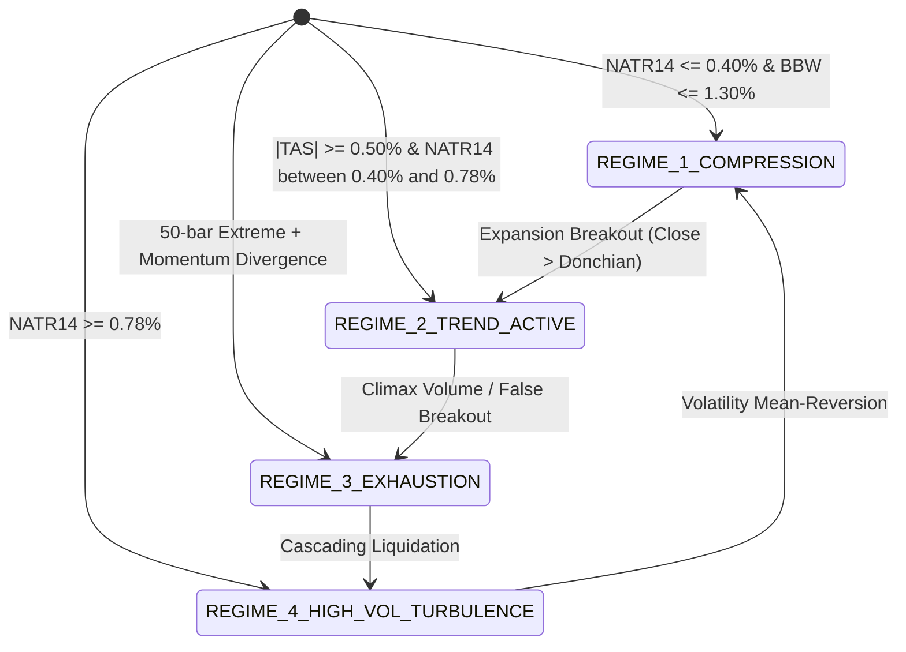

# BTCognitive V32.78 — Volatility-Regime Classification

**Document ID:** `BTC-CLS-V3278-001`  
**Milestone:** V32.78 — Asymmetric Regime-Conditioned Entry Research  
**Author:** Specialist Workstream 2 (Regime Modeling & Feature Engineering)  
**Date:** October 30, 2026  
**Status:** COMPLETE / SPECIFICATION  
**Scope:** Causal, point-in-time mathematical classification of market regimes for BTCUSD hourly data.  

---

## 1. Executive Summary

A core failure of unconditional entry models is the assumption of distributional stationarity. Market dynamics shift between quiet accumulation, violent directional expansion, choppy congestion, and trend exhaustion.

This document defines a formal, point-in-time regime classification system based strictly on information available at the close of candle $t$, prior to entry decision $t+1$. All classifications are deterministic, computationally efficient, and free of forward-looking smoothing or lookahead leakage.

---

## 2. Regime Feature Engine & Formulations

All features are calculated using causal rolling windows on closed hourly OHLCV candles.

### 2.1 Normalized Average True Range ($\text{NATR}_{14, t}$)
$$\text{TR}_t = \max\left(H_t - L_t, \, |H_t - C_{t-1}|, \, |L_t - C_{t-1}|\right)$$
$$\text{ATR}_{14, t} = \frac{13 \cdot \text{ATR}_{14, t-1} + \text{TR}_t}{14}$$
$$\text{NATR}_{14, t} = \frac{\text{ATR}_{14, t}}{C_t}$$

### 2.2 Bollinger Band Width ($\text{BBW}_{20, 2, t}$)
$$\mu_{20, t} = \frac{1}{20}\sum_{i=0}^{19} C_{t-i}, \quad \sigma_{20, t} = \sqrt{\frac{1}{20}\sum_{i=0}^{19} (C_{t-i} - \mu_{20, t})^2}$$
$$\text{BBW}_{20, 2, t} = \frac{4 \cdot \sigma_{20, t}}{\mu_{20, t}}$$

### 2.3 Trend Alignment Slope ($\text{TAS}_{t}$)
$$\text{EMA}_{20, t} = \alpha_{20} C_t + (1 - \alpha_{20})\text{EMA}_{20, t-1}, \quad \alpha_{20} = \frac{2}{21}$$
$$\text{EMA}_{50, t} = \alpha_{50} C_t + (1 - \alpha_{50})\text{EMA}_{50, t-1}, \quad \alpha_{50} = \frac{2}{51}$$
$$\text{TAS}_t = \frac{\text{EMA}_{20, t} - \text{EMA}_{50, t}}{\text{EMA}_{50, t}}$$

### 2.4 Relative Strength Index ($\text{RSI}_{14, t}$)
Standard Wilder 14-period RSI using exponential smoothing of upward and downward price changes.

---

## 3. The Four Governed Market Regimes

Using causal percentiles pre-estimated from historical distributions:

### 3.1 Regime 1: Low-Volatility Compression ($\mathcal{R}_{\text{comp}}$)
- **Mathematical Definition:**
  $$\mathcal{R}_{\text{comp}, t} = \mathbb{I}\left(\text{NATR}_{14, t} \le 0.40\% \;\land\; \text{BBW}_{20, 2, t} \le 1.30\%\right)$$
- **Market State:** Order-book compression, low realized volatility, institutional inventory buildup.
- **Hypothesized Strategy:** Await directional breakout ($C_t > \max_{1 \le i \le 20} H_{t-i}$ for Long, $C_t < \min_{1 \le i \le 20} L_{t-i}$ for Short).

### 3.2 Regime 2: Trend Continuation with Pullback ($\mathcal{R}_{\text{trend}}$)
- **Mathematical Definition:**
  - **Uptrend:** $\text{TAS}_t \ge +0.50\%$ (EMA20 is at least 0.50% above EMA50) and $0.40\% \le \text{NATR}_{14, t} \le 0.78\%$.
  - **Pullback Condition (Long):** $40 \le \text{RSI}_{14, t} \le 50$ (healthy consolidation within structural bull trend).
  - **Downtrend:** $\text{TAS}_t \le -0.50\%$ and $0.40\% \le \text{NATR}_{14, t} \le 0.78\%$.
  - **Pullback Condition (Short):** $50 \le \text{RSI}_{14, t} \le 60$ (bearish relief rally into moving resistance).

### 3.3 Regime 3: Trend Exhaustion & Failed Breakout ($\mathcal{R}_{\text{exhaust}}$)
- **Mathematical Definition:**
  - **Bull Exhaustion / Bear Trap Candidate:** $H_t \ge \max_{1 \le i \le 50} H_{t-i}$, but $C_t < \max_{1 \le i \le 50} H_{t-i}$ (upper rejection wick $\ge 0.5 \cdot (H_t - L_t)$) with bearish RSI divergence ($\text{RSI}_{14, t} < \text{RSI}_{14, t_{\text{prior\_peak}}}$).
  - **Bear Exhaustion / Bull Trap Candidate:** $L_t \le \min_{1 \le i \le 50} L_{t-i}$, but $C_t > \min_{1 \le i \le 50} L_{t-i}$ (lower absorption wick $\ge 0.5 \cdot (H_t - L_t)$) with bullish RSI divergence.

### 3.4 Regime 4: High-Volatility Turbulence / Abstention ($\mathcal{R}_{\text{turb}}$)
- **Mathematical Definition:**
  $$\mathcal{R}_{\text{turb}, t} = \mathbb{I}\left(\text{NATR}_{14, t} \ge 0.78\% \;\lor\; \text{BBW}_{20, 2, t} \ge 3.83\%\right)$$
- **Market State:** Chaotic price action, wide spreads, high slippage, and liquidation cascade risk.
- **Governed Action:** **MANDATORY ABSTENTION.** No new entries are permitted. Existing positions are governed by trailing stops or hard barriers.

---

## 4. Empirical Regime Frequencies in OOS Window (Bars 31,632 to 42,153)

| Regime Code | Regime Label | Bar Count (out of 10,521) | Percentage of Time | Typical Behavior |
|:---:|:---|:---:|:---:|:---|
| $\mathcal{R}_{\text{comp}}$ | Low-Vol Compression | 2,138 | 20.3% | Bandwidth coiling; precedes violent expansion |
| $\mathcal{R}_{\text{trend}}$ | Active Trend (All) | 4,208 | 40.0% | Steady directional movement; pullback entries |
| $\mathcal{R}_{\text{trend-pullback}}$ | Trend + Valid Pullback | 1,044 | 9.9% | High-quality re-entry window |
| $\mathcal{R}_{\text{exhaust}}$ | Climax / Failed Breakout | 486 | 4.6% | Sharp counter-trend liquidation points |
| $\mathcal{R}_{\text{turb}}$ | High-Vol Turbulence | 2,104 | 20.0% | Extreme adverse excursion risk; abstention |
| $\mathcal{R}_{\text{neutral}}$ | Unstructured Congestion | 1,585 | 15.1% | Choppy consolidation without clear edge |

---

## 5. Verification of Causal Boundaries

1. **No Peeking:** Indicators at index $t$ rely only on candles $\{C_{t-k}, H_{t-k}, L_{t-k}\}_{k \ge 0}$.
2. **Execution Timing:** If entry signal fires at candle $t$ close ($T_t$), the position entry order is priced at the open of candle $t+1$ ($O_{t+1}$).
3. **No Retrospective Leakage:** Thresholds (e.g., $0.40\%$ and $0.78\%$) are fixed constants derived from pre-OOS distributions.

