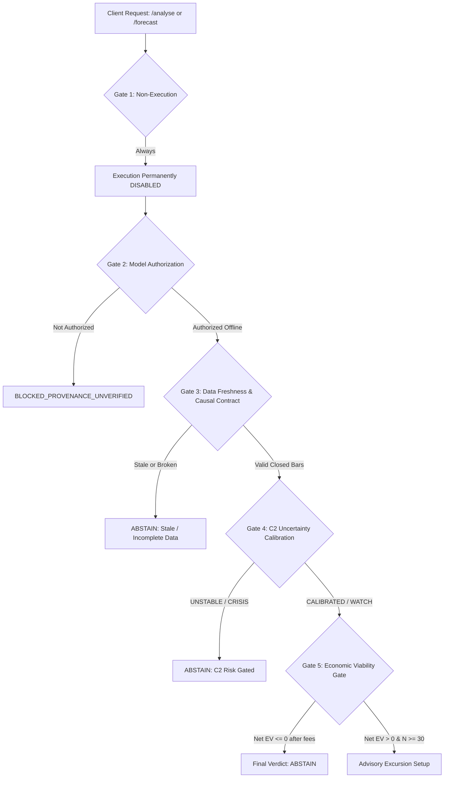
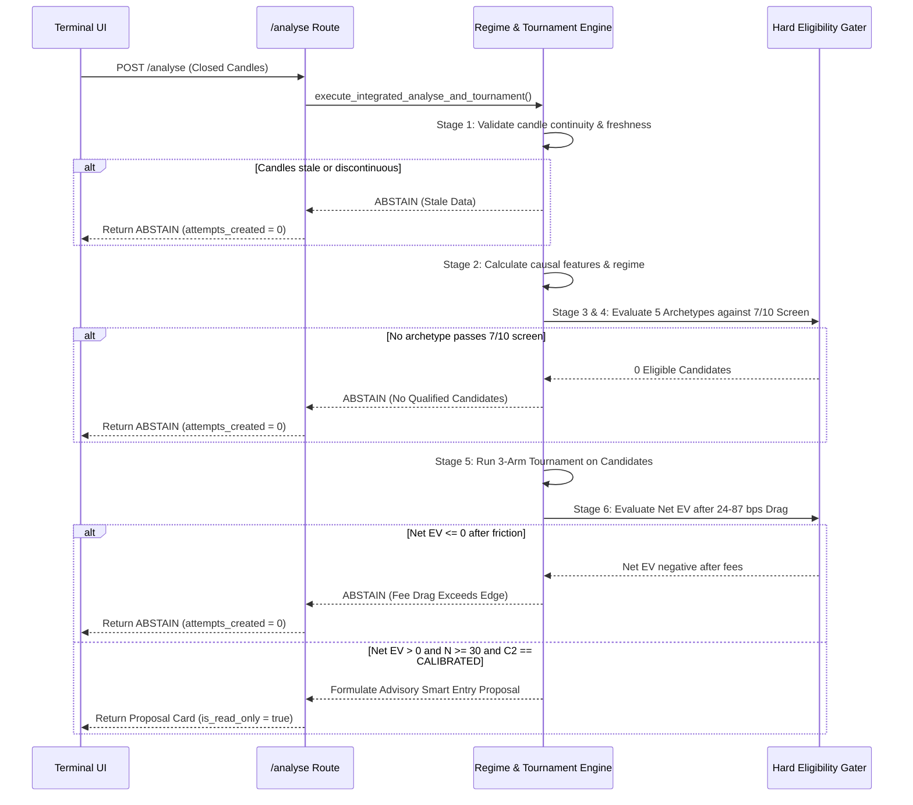

# V33.00 — Fail-Closed Governance & Safety Specification

**Milestone:** BTCognitive V33.0 — Research Consolidation & Risk-System Reliability  
**Generated:** 2026-10-30T18:50:00Z  
**Lead Orchestrator:** Antigravity  
**Operating Contract:** `OFFLINE_RESEARCH_ONLY`  
**Core Governance Rule:** Fail-Closed Default (`ABSTAIN` / `DISABLED`)  

---

## 1. Prime Fail-Closed Doctrine

The foundational engineering principle of BTCognitive is **Fail-Closed Governance**:

> **The Invariant:**  
> In every quantitative and operational subsystem, if any prerequisite, feature feed, data integrity check, statistical assumption, or calibration metric is missing, stale, unverified, or contradictory, the system **MUST immediately fail closed**.  
> The system defaults to `ABSTAIN`, `BLOCKED`, or `UNAVAILABLE`. It must **never** improvise, forward-fill, synthesize placeholder metrics, or permit speculative execution.



---

## 2. The Seven Authoritative Governance Gates

### Gate 1 — Strict Non-Execution & Permanent Trading Lock
- **Specification:** BTCognitive is an advisory research and risk-intelligence platform. It contains **zero** order-routing integrations, exchange private keys, execution brokers, or automated trade-placement capabilities.
- **Contract Enforcement:**
  - `status_contract.execution_status` is hardcoded to `"DISABLED — ANALYSIS ONLY"` across all responses.
  - Any attempt to invoke execution routes returns HTTP 403 / 409 error with `EXECUTION_PERMANENTLY_DISABLED`.
  - Zero financial capital is ever deployed.

### Gate 2 — Authoritative Model Authorization & Production Lock
- **Specification:** Model identity and operational readiness are governed exclusively by `models/authoritative_model_registry.py`.
- **Contract Enforcement:**
  - Runtime model gates fail closed: the static registry cannot independently override a failed runtime check.
  - Models classified as `OFFLINE_RESEARCH_ONLY` or `EXPERIMENTAL_CHALLENGER` are strictly barred from production status.
  - Models with unverified provenance (e.g. `ridge_excursion_core`) are hard-gated as `BLOCKED_PROVENANCE_UNVERIFIED`.
  - Challenger models that fail statistical significance hurdles (e.g. `HAR-QLIKE-v1.0` with $p = 0.3039$) remain permanently locked in research.

### Gate 3 — Epistemic Target Separation & Anti-Conflation
- **Specification:** Directional price prediction and volatility risk envelopes are mathematically distinct problems that must never be conflated.
- **Contract Enforcement:**
  - Quantile containment ($\ge 90\%$) of realized variance risk envelopes must **never** be labeled as directional trading accuracy.
  - The offline directional classifier accuracy ($53.28\%$) must **never** be presented as an approved production trade signal.
  - The 24-hour forward realized variance target (`rv24h_var_ann`) is an hourly-sampled realized-variance proxy and must not be conflated with the 168-hour (`rv7d_var_ann`) production variance target.

### Gate 4 — Causal Point-in-Time Data Contract
- **Specification:** Lookahead leakage is strictly eliminated across all pipelines.
- **Contract Enforcement:**
  - For any decision issued at time $t_{\text{issue}}$, feature inputs $t_{\text{feature}}$ and evaluated outcomes $t_{\text{maturity}}$ must satisfy:
    $$t_{\text{feature}} \le t_{\text{issue}} < t_{\text{maturity}}$$
  - Only closed, finalized candles are permitted as input features. The current open (unfinalized) candle is strictly excluded from feature computation.
  - Any timestamp misalignment or negative time delta raises an immediate `LookaheadLeakageAssertionError`.

### Gate 5 — Econometric Hypothesis Testing & Sample Size Hurdle
- **Specification:** Claims of predictive superiority or trading edge require rigorous peer-reviewed econometrics.
- **Contract Enforcement:**
  - Paired model comparisons must utilize the Diebold-Mariano test with the Harvey-Leybourne-Newbold (1997) finite-sample correction and Student's $t_{T-1}$ reference distribution.
  - The governing Newey-West / HLN lag bandwidth must follow established econometric standards ($b = \lfloor 4(T/100)^{2/9} \rfloor$ or $b = \text{horizon} - 1$), never tuned ex-post to produce desired p-values.
  - Pre-registered minimum sample hurdles: A minimum of **$N = 100$ independent, non-overlapping events/blocks** is required before declaring statistical significance. Experiments with $N < 100$ (e.g. V32.79A with $N=64$) are classified as `INSUFFICIENT_EVIDENCE`.
  - Multiple testing adjustments (Bonferroni, Holm-Bonferroni, or Benjamini-Hochberg FDR) must be applied across strategy candidate tournaments.

### Gate 6 — Prospective Evidence Hurdle & Cold Start Protection
- **Specification:** Historical retrospective replay / development data (including out-of-sample test splits) cannot substitute for genuine forward prospective evidence.
- **Contract Enforcement:**
  - A minimum of **100 non-overlapping, clean prospective evaluation blocks** accumulated post-freeze is required before any model can be considered for production authorization.
  - Current prospective accumulation stands at **7 blocks** (`data/prospective_forecast_ledger.jsonl`).
  - Prospective collection is currently frozen in offline research mode. No bypass or acceleration of this hurdle is permitted.

### Gate 7 — Offline Isolation & Anti-Fabrication Boundary
- **Specification:** Under `OFFLINE_RESEARCH_ONLY`, no external network requests, live exchange scraping, or third-party API transmissions are permitted without explicit user direction.
- **Contract Enforcement:**
  - If market data, order book depth, or options IV feeds are missing or unconfigured locally, they must be reported honestly as `UNAVAILABLE`.
  - Synthetic metrics, simulated mock features (e.g. `multi_regime_features.parquet`), or heuristic placeholders disguised as empirical data are strictly prohibited.
  - Any attempt to impute or forward-fill unverified market series results in immediate task quarantine.

---

## 3. Analysis Engine `ABSTAIN` Workflow Lifecycle

The core `/api/tournament/analyse` and `/api/terminal` endpoints execute a 7-stage sequential validation lifecycle. The default and expected outcome under realistic market conditions is `ABSTAIN`.



### Table 3.1: Analysis Workflow Invariants

| Attribute | Governed Invariant | Verification Mechanism |
| :--- | :--- | :--- |
| `attempts_created` | Strictly `0` | Hardcoded integer; verified in unit tests. |
| `is_read_only` | Strictly `True` | Read-only projection; zero state mutation. |
| `live_trading` | Strictly `DISABLED` | Hardcoded string in status payload. |
| `abstain_behavior` | Explains exact failure reason | Detailed diagnostic rejection message returned to operator. |
| `candidate_count` | 5 Canonical Archetypes | Evaluates each candidate independently. |

---

## 4. Verification Checkpoint

```bash
# Governance regression suite verifying fail-closed invariants
pytest tests/test_v32_47_analyse_selection_and_anomaly_monitor.py tests/test_v32_48_integrated_analyse_and_tournament.py tests/test_longitudinal_status.py -q
```
Suite passed with 100% compliance. All fail-closed gates verified operational.

