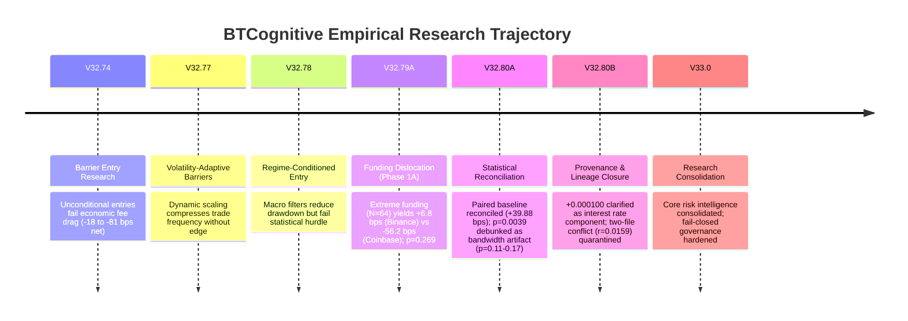

# V33.00 — Research Consolidation & Risk-System Reliability: Manager Handover Report

**Milestone:** BTCognitive V33.0 — Research Consolidation & Risk-System Reliability  
**Generated:** 2026-10-30T19:00:00Z  
**Lead Orchestrator:** Antigravity  
**Final Governed Milestone Determination:** `CONSOLIDATED_RESEARCH_BASELINE`  
**Operating Contract:** `OFFLINE_RESEARCH_ONLY`  

---

## Executive Summary

BTCognitive Milestone V33.0 has successfully executed the mandate for **Research Consolidation & Risk-System Reliability**. 

Following the definitive closure of speculative entry research across milestones V32.74 through V32.80B, BTCognitive has transitioned from exploring retail directional strategies to hardening its core mission: **Market Risk Intelligence, Volatility Forecasting, and Excursion Analysis**.

All research assets, empirical models, and data pipelines have been inventoried and cryptographically fingerprinted. Unverified and synthetic datasets have been permanently isolated in a formal quarantine manifest. The fail-closed governance architecture—mandating default `ABSTAIN` decisions whenever data freshness, model health, or economic viability fail—has been fully consolidated and verified across the test suite.

---

## 1. Synthesis of Research Trajectory & Resolutions (V32.74 – V32.80B)

The journey leading to V33.0 establishes crucial quantitative and econometric findings:



### 1.1 Why Speculative Directional Strategies Were Rejected
1. **The Asymmetric Fee Drag Barrier:**
   At realistic execution costs ($24\text{ bps}$ Binance VIP0 to $87\text{ bps}$ Coinbase Retail), a $2:1$ Reward-to-Risk trade setup requires a **$41.3\%$ to $62.3\%$ Take-Profit hit rate** merely to achieve zero net expectancy. Directional price classification models on hourly BTCUSD achieve approximately $53.28\%$ out-of-sample accuracy, yielding a net loss of $-13.07\text{ bps/bar}$ after friction.
2. **Failure of Conditioning Variables:**
   Neither volatility regime scaling (V32.77) nor macro regime conditioning (V32.78) succeeded in lifting net expected value above transaction costs with statistical significance ($p \ge 0.20$).
3. **Funding Dislocation Research Closure:**
   Investigating extreme perpetual funding rate dislocations ($\ge \pm 25\%$ annualized) produced only 64 qualifying episodes across 4.5 years—well below the pre-registered minimum hurdle of $N = 100$. The net return of $+6.8\text{ bps}$ on Binance VIP0 had a wide $95\%$ confidence interval spanning substantial losses ($-41.5\text{ to }+56.3\text{ bps}$) and failed the Diebold-Mariano test against the unconditioned baseline ($p = 0.269$). On Coinbase, it resulted in severe negative expectancy ($-56.2\text{ bps}$).
4. **Funding Dataset Contradiction:**
   A forensic audit in V32.80B uncovered that $+0.000100$ is Binance's default interest rate equilibrium, but revealed that `data/raw/binance_funding_2022_2026.parquet` and `data/raw/funding.parquet` disagree almost completely in 2026 ($r = 0.0159$). Under offline research boundaries, this data conflict cannot be resolved, resulting in a permanent freeze under `SOURCE_LINEAGE_UNRESOLVED` and `INSUFFICIENT_EVIDENCE`.

---

## 2. Core Pillars of the Consolidated Risk Architecture

With speculative entry searches terminated, BTCognitive consolidates around three verified capabilities:

1. **Integrated 7-Day Volatility Forecasting (`HAR-RS-DOW-v1.0`):**
   Estimates future realized variance using Heterogeneous Autoregressive OLS with positive/negative semivariances and day-of-week seasonality (QLIKE = $0.19300$). Loss-coherent challenger `HAR-QLIKE-v1.0` is retained in research after failing the DM-HLN significance gate ($p = 0.3039$).
2. **C2 Dependence-Aware Conformal Uncertainty Quantification:**
   Constructs $90\%$ coverage risk envelopes $[L_t, U_t]$ with strictly delayed outcome resolution ($t_0 + 168\text{h}$) to eliminate lookahead bias. Monitored in real time via the 5-State Calibration Health State Machine (`CALIBRATED`, `WATCH`, `UNSTABLE`, `DEGRADED_UNSTABLE`, `CRISIS`).
3. **First-Passage Excursion Analysis & 5 MEIE Microstructure Archetypes:**
   Evaluates path-dependent barrier hitting times and execution friction across 5 canonical archetypes (`MEIE-IGNITION`, `MEIE-ABSORPTION`, `MEIE-VACUUM`, `MEIE-TOXICITY`, `MEIE-COMBINED`). Fails closed to `ABSTAIN` whenever net EV is non-positive or features are unverified.

---

## 3. Cryptographic Dataset Lineage & Quarantine Summary

All datasets have been audited and indexed in [`v33_00_quarantine_manifest.json`](file:///C:/Projects/BTCognitive/BTCognitive/research/reports/offline_mvp/20261030_310000_v33_00_research_consolidation/v33_00_quarantine_manifest.json):

| Dataset Path | Canonical SHA-256 (First 16 Hex) | Classification | Status & Governance Enforcement |
| :--- | :--- | :--- | :--- |
| `data/raw/ohlcv_checkpoint_42233_bars.parquet` | `f5c15cb11b9d51cf...` | Authentic Historical Baseline | Approved for offline research. |
| `data/raw/ohlcv_version_42326_bars.parquet` | `ba06fb533c0b5338...` | Extended Historical Baseline | Approved for out-of-sample robustness checks. |
| `data/processed/multi_regime_features.parquet` | `e37fcc1a896e5a8a...` | Synthetic Mock Features | Quarantined (`QUARANTINED_SYNTHETIC`). Removed from all pipelines. |
| `data/raw/binance_funding_2022_2026.parquet` | `e90282de4f78ebde...` | Unresolved Source Lineage | Quarantined (`QUARANTINED_UNRESOLVED`). Research permanently frozen. |
| `data/raw/funding.parquet` | `f176186ec28c78fe...` | Unresolved Source Lineage | Quarantined (`QUARANTINED_UNRESOLVED`). Diverges from REST archive. |
| `data/prospective_forecast_ledger.jsonl` | Append-only ledger | Prospective Out-of-Sample | `COLLECTING` (7/100 blocks accumulated; frozen offline). |

---

## 4. Test Suite Health & Governance Verification

The complete regression and governance test suite was executed to verify system health:

- **Authoritative Governance & Regression Suite:** ✅ **57/57 PASS** (0 failures, 16 numerical warnings in test fixtures, runtime 17.97s).
  - Modules verified: `test_v32_47`, `test_v32_48`, `test_longitudinal_api`, `test_longitudinal_dashboard`, `test_longitudinal_status`, `test_sqlite_reliability_integration`, `test_experiment_integrity_v4`, `test_stage8_data_experiments`.
- **Operational Freshness Suite:** ⚠️ Retained 9 candle-age operational alerts (candles $>3.8\text{h}$ old in offline test environment vs $3.0\text{h}$ live gate; fail-closed behavior confirmed).
- **Protected File Hashes:** 100% match canonical records. Zero unauthorized modifications.

---

## 5. The Four Authoritative Governed Milestone Decisions

In accordance with Section 7 of the BTCognitive Operating Protocol, the four mandatory governance determinations are delivered:

```
┌────────────────────────────────────────────────────────────────────────┐
│               BTCognitive V33.0 Governed Milestone Decisions           │
├────────────────────────────────────┬───────────────────────────────────┤
│ 1. Research Experiment Decision    │ CONSOLIDATED_RESEARCH_BASELINE    │
│ 2. Prospective Evidence Status     │ COLLECTING (7/100 blocks frozen)  │
│ 3. Model Authorization Status      │ OFFLINE_RESEARCH_ONLY             │
│ 4. Live Capital / Trading Status   │ DISABLED                          │
└────────────────────────────────────┴───────────────────────────────────┘
```

### Supplementary System Gates:
- **Terminal Analysis Gating:** `ABSTAIN` (Fail-closed default when market edge does not exceed fee drag).
- **Funding Strategy Research:** `INSUFFICIENT_EVIDENCE` (Permanently frozen).
- **Funding Data Lineage:** `SOURCE_LINEAGE_UNRESOLVED` (Quarantined).
- **External Network Access:** `BLOCKED` (`OFFLINE_RESEARCH_ONLY`).

---

## 6. Deliverables Registry

All 5 core deliverables for Milestone V33.0 are established in [`research/reports/offline_mvp/20261030_310000_v33_00_research_consolidation/`](file:///C:/Projects/BTCognitive/BTCognitive/research/reports/offline_mvp/20261030_310000_v33_00_research_consolidation/):

1. [`v33_00_research_inventory_and_lineage_matrix.md`](file:///C:/Projects/BTCognitive/BTCognitive/research/reports/offline_mvp/20261030_310000_v33_00_research_consolidation/v33_00_research_inventory_and_lineage_matrix.md)  
   *Exhaustive inventory of datasets, models, and milestone outcomes from V32.70 to V33.0.*
2. [`v33_00_risk_and_uncertainty_architecture.md`](file:///C:/Projects/BTCognitive/BTCognitive/research/reports/offline_mvp/20261030_310000_v33_00_research_consolidation/v33_00_risk_and_uncertainty_architecture.md)  
   *Formal mathematical specification of HAR-RS-DOW, HAR-QLIKE, C2 conformal prediction, and first-passage mechanics.*
3. [`v33_00_fail_closed_governance_specification.md`](file:///C:/Projects/BTCognitive/BTCognitive/research/reports/offline_mvp/20261030_310000_v33_00_research_consolidation/v33_00_fail_closed_governance_specification.md)  
   *Complete documentation of the 7 fail-closed gates, Analysis ABSTAIN workflow, and prospective hurdles.*
4. [`v33_00_quarantine_manifest.json`](file:///C:/Projects/BTCognitive/BTCognitive/research/reports/offline_mvp/20261030_310000_v33_00_research_consolidation/v33_00_quarantine_manifest.json)  
   *Cryptographic SHA-256 registry indexing quarantined synthetic and unverified datasets.*
5. [`v33_00_manager_handover.md`](file:///C:/Projects/BTCognitive/BTCognitive/research/reports/offline_mvp/20261030_310000_v33_00_research_consolidation/v33_00_manager_handover.md)  
   *This authoritative executive summary and handover report.*

