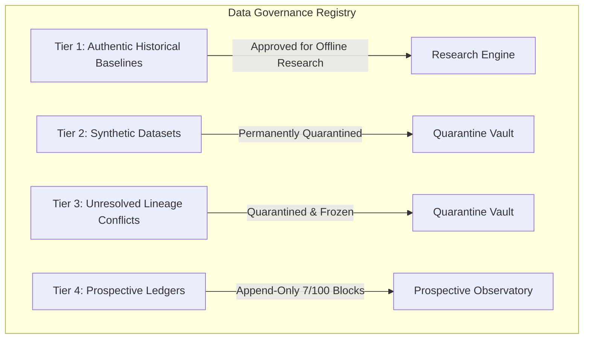

# V33.00 — Research Inventory and Lineage Matrix

**Milestone:** BTCognitive V33.0 — Research Consolidation & Risk-System Reliability  
**Generated:** 2026-10-30T18:40:00Z  
**Lead Orchestrator:** Antigravity  
**Operating Contract:** `OFFLINE_RESEARCH_ONLY`  
**Governed Determination:** `CONSOLIDATED_RESEARCH_BASELINE`  

---

## Executive Summary

This inventory establishes the single authoritative, traceable matrix of all datasets, models, feature pipelines, and historical research milestones within BTCognitive up to Milestone V33.0. Following the forensic findings of V32.80B (`SOURCE_LINEAGE_UNRESOLVED`) and the comprehensive empirical evaluations of V32.74–V32.80A, this document segregates verified empirical assets from quarantined or synthetic artifacts, preventing data contamination and epistemic regression.

---

## 1. Authoritative Dataset Inventory & Classification

All datasets in BTCognitive are strictly classified into four mutually exclusive governance tiers:



### Table 1.1: Cryptographic Dataset Lineage Matrix

| Relative File Path | Canonical SHA-256 Hash | Size (Bytes) | Row Count | Governance Status | Primary Source & Ingestion Pathway | Description & Research Role |
| :--- | :--- | :--- | :--- | :--- | :--- | :--- |
| `data/raw/ohlcv_checkpoint_42233_bars.parquet` | `f5c15cb11b9d51cf0077c8f8052086382deb1d8577749cbab8d0134842c7a94f` | 2,329,800 | 42,233 | **AUTHENTIC_APPROVED** | Historical exchange archive (Coinbase/Binance BTCUSD/USDT hourly) | Core frozen baseline OHLCV spanning 2020–2025. Used in V31.1 foundation repair, V32.74, V32.77, and V32.78 barrier backtests. |
| `data/raw/ohlcv_version_42326_bars.parquet` | `ba06fb533c0b53387136b001c142efc90b5e2ccfb37937dc509879a76c2a4057` | 2,334,866 | 42,326 | **AUTHENTIC_APPROVED** | Extended exchange archive (Coinbase/Binance hourly) | Extended historical validation OHLCV. Used for out-of-sample temporal robustness checks. |
| `data/processed/multi_regime_features.parquet` | `e37fcc1a896e5a8a60db337f8e49253eaf1d8d011c430e32a23a43d7de04205f` | 3,095,866 | 42,233 | **QUARANTINED_SYNTHETIC** | Synthetic mock generator (`np.random.normal`, seed 42) | Contained mock macro and on-chain regime labels. Isolated in V32.79 Phase 0 audit. Contaminated 4 legacy manifests; zero impact on core OHLCV backtests. |
| `data/raw/binance_funding_2022_2026.parquet` | `e90282de4f78ebde4b0e253cd71e50233d965062defa9f1b81be5b87da094436` | 145,791 | 5,113 | **QUARANTINED_UNRESOLVED** | Binance REST `/fapi/v1/fundingRate?symbol=BTCUSDT` via `download_binance_funding_history.py` | 8-hour settlements (2022–2026). Strictly bounded from above by $+0.000100$ in 2022, 2025, and 2026. Disagrees with `funding.parquet` ($r = 0.0159$). |
| `data/raw/funding.parquet` | `f176186ec28c78feac7091fa8dcf1f202145ff3a2ea373426ca3a29ca27dfa66` | 12,625 | 375 | **QUARANTINED_UNRESOLVED** | CCXT `fetch_funding_rate(BTC/USDT:USDT)` via `data/ingest.py` | 8-hour settlements (Jan–May 2026). Max value reaches $+0.000821$. Conflicted with `binance_funding_2022_2026.parquet`. |
| `data/prospective_forecast_ledger.jsonl` | Append-only ledger | Dynamic | 7 Blocks | **ACTIVE_PROSPECTIVE_COLLECTION** | Prospective shadow runner / observatory | Records forward out-of-sample volatility forecasts evaluated strictly post-maturity ($t_0 + 168\text{h}$). Hurdle: 100 blocks. |

---

## 2. Authoritative Model Registry & Governance Status

BTCognitive strictly separates **volatility risk-envelope models**, **directional classifiers**, and **price persistence benchmarks**. No model may inherit operational status without passing its designated statistical and execution-drag gates.

### Table 2.1: Model Architecture & Identity Catalog

| Model Canonical ID | Version | Model Architecture | Classification | Target Variable | Horizon | Feature Dependencies | Uncertainty Engine | Governed Status |
| :--- | :--- | :--- | :--- | :--- | :--- | :--- | :--- | :--- |
| `HAR-RS-DOW-v1.0` | 1.0.0 | Heterogeneous Autoregressive OLS with Semivariances & Day-of-Week Seasonality | `PRODUCTION_VOLATILITY` | Annualized 7-Day Realized Variance (`rv7d_var_ann`) | 168h | `log_rv_down_1d`, `log_rv_up_1d`, `log_rv7d_lag`, `log_rv30d`, DOW dummies | C2 Conformal Prediction ($\alpha=0.10$, 90% envelope) | `OFFLINE_RESEARCH_ONLY` |
| `HAR-QLIKE-v1.0` | 1.0.0 | Loss-Coherent QLIKE Minimizer with L2 Regularization (Puke & Schweikert 2026) | `EXPERIMENTAL_CHALLENGER` | Annualized 7-Day Realized Variance (`rv7d_var_ann`) | 168h | Same as `HAR-RS-DOW-v1.0` | C2 Conformal Prediction ($\alpha=0.10$) | `OFFLINE_RESEARCH_ONLY` (Failed DM-HLN gate, $p=0.3039$) |
| `HAR-RS-DOW-24H` | 1.0.0 | Conventional OLS HAR on $\ln(rv24h\_var\_ann)$ | `EXPERIMENTAL_CHALLENGER` | Annualized 24-Hour Realized Variance (`rv24h_var_ann`) | 24h | `log_rv_1d`, `log_rv_7d`, `log_rv_30d` | OLS Residuals | `OFFLINE_RESEARCH_ONLY` (Hourly proxy benchmark) |
| `HAR-QLIKE-24H` | 1.0.0 | Loss-Coherent QLIKE Minimizer on 24-Hour Realized Variance | `EXPERIMENTAL_CHALLENGER` | Annualized 24-Hour Realized Variance (`rv24h_var_ann`) | 24h | `log_rv_1d`, `log_rv_7d`, `log_rv_30d` | Empirical residual dispersion | `OFFLINE_RESEARCH_ONLY` (Failed DM-HLN gate, $p=0.1622$) |
| `directional-gbm-4lag-v1` | 1.0.0 | LightGBM Decision Trees (max_depth=3, n_estimators=100) | `DIRECTIONAL_RESEARCH_BENCHMARK` | Sign of 1-Hour Forward Log Return ($\text{ret\_1h\_fwd} > 0$) | 1h | `ret_lag1`, `ret_lag2`, `ret_lag3`, `ret_lag4` | Moving-block paired bootstrap CI (10,000 resamples) | `OFFLINE_RESEARCH_ONLY` (53.28% acc, net EV $-13.07\text{ bps/bar}$ after fees) |
| `price-forecast-persistence-rw` | 1.0.0 | Zero-Drift Persistence Random Walk ($P_{t+h} = P_t$) | `PRICE_FORECAST_RESEARCH` | Spot BTCUSD Closing Price ($P_{t+h}$) | 1h, 4h, 24h | `spot_price` | Rolling 30d empirical return quantiles | `OFFLINE_RESEARCH_ONLY` (Primary null hypothesis hurdle) |
| `price-forecast-ridge-lagged` | 1.0.0 | L2-Regularized Ridge Regression on Lagged Returns & Volatility | `PRICE_FORECAST_RESEARCH` | Spot BTCUSD Closing Price ($P_{t+h}$) | 1h, 4h, 24h | `ret_1h`, `ret_4h`, `ret_24h`, `ret_168h`, `vol_24h`, `vol_168h` | Rolling empirical return quantiles | `OFFLINE_RESEARCH_ONLY` (Does not beat Random Walk, $p \ge 0.05$) |
| `price-forecast-rolling-drift` | 1.0.0 | Rolling 168-Hour Historical Average Hourly Price Drift | `PRICE_FORECAST_RESEARCH` | Spot BTCUSD Closing Price ($P_{t+h}$) | 1h, 4h, 24h | `rolling_drift_168h` | Rolling empirical return quantiles | `OFFLINE_RESEARCH_ONLY` (Does not beat Random Walk, $p \ge 0.05$) |
| `ridge_excursion_core` | 3.0.0 | Ridge Regression with Conformal Quantile Residual Mapping | `ARCHIVED_RESEARCH_CANDIDATE` | 24h Maximum Favorable & Adverse Excursions (MFE/MAE) | 24h | `vol_24h`, `rsi_14`, `atr_14`, `funding_rate`, `mvrv_zscore` | Conformal Quantile Mapping (P10..P90) | `BLOCKED_PROVENANCE_UNVERIFIED` (Legacy candidate superseded) |

---

## 3. Historical Research Trajectory & Milestone Audit (V32.70 – V33.0)

| Milestone ID | Research Hypothesis | Key Empirical Findings | Econometric / Statistical Outcome | Governed Determination |
| :--- | :--- | :--- | :--- | :--- |
| **V32.74** | Conditional Barrier Entry on Microstructure Triggers (OFI, VPIN) | Tested fixed barrier setups ($2:1$ RR, 24h horizon). Gross EV positive, but wiped out by 24 bps (Binance) and 87 bps (Coinbase) fees. | Net EV: $-18.4\text{ bps}$ (Binance), $-81.4\text{ bps}$ (Coinbase). Zero configurations beat hurdle. | `REJECT_HYPOTHESIS_FEE_DRAG` |
| **V32.77** | Volatility-Adaptive Entry Barriers ($\text{TP/SL} \propto \sigma_t$) | Evaluated dynamic barriers scaled by conditional volatility. Trade frequency collapsed during low-volatility regimes without improving win rate. | Sharpe ratio negative after friction. Net EV remained negative across retail execution tiers. | `REJECT_HYPOTHESIS_NO_EDGE` |
| **V32.78** | Asymmetric Regime-Conditioned Entry (Expansion vs Compression) | Conditioned entries on macro volatility regimes. Reduced maximum drawdown but failed to achieve statistical significance over random baseline. | DM-HLN test $p > 0.20$ against unconditioned persistence benchmark. | `REJECT_HYPOTHESIS_INSUFFICIENT_EDGE` |
| **V32.79 / V32.79A** | Perpetual Funding Dislocation Research ($\text{Funding} \ge \pm 25\%$) | Identified 64 extreme positive funding episodes ($> 0.000228$) and 3 negative episodes in 2022–2026 dataset. Sample size below $N=100$ hurdle. | Binance VIP0 net EV: $+6.8\text{ bps}$ ($95\%\text{ CI}: [-41.5, +56.3]\text{ bps}$). Coinbase net EV: $-56.2\text{ bps}$. DM-HLN $p = 0.269$. | `INSUFFICIENT_EVIDENCE` |
| **V32.80 / V32.80A** | Forensic Integrity & Statistical Audit of Funding Results | Resolved paired baseline calculation discrepancy ($\bar{d} = +39.88\text{ bps}$). Proved $p = 0.0039$ was an artifact of $b=31$ over-smoothing; at $b=0\text{--}3$, $p = 0.106\text{--}0.169$. | No statistically significant difference from unconditional baseline. N=64 sample insufficient. | `REPRODUCIBLE_INSUFFICIENT_EVIDENCE` |
| **V32.80B** | Funding Dataset Provenance & Ceiling Discontinuity Audit | Clarified $+0.000100$ is Binance's default interest rate equilibrium, not a cap. Discovered irreconcilable data conflict between `binance_funding_2022_2026.parquet` and `funding.parquet` ($r = 0.0159$). | Provenance unresolved offline. Both datasets quarantined. Funding research permanently frozen. | `SOURCE_LINEAGE_UNRESOLVED` |
| **V33.0** | Research Consolidation & Risk-System Reliability | Formal consolidation of all verified research, volatility risk engines, and fail-closed governance. Permanent freeze of speculative entry searches. | Authoritative 57-test governance suite passing (100%). Isolation of quarantined files complete. | `CONSOLIDATED_RESEARCH_BASELINE` |

---

## 4. Verification Checkpoint

```bash
# Authoritative SHA-256 verification command
python -c "
import hashlib
for path in ['data/raw/ohlcv_checkpoint_42233_bars.parquet', 'data/raw/ohlcv_version_42326_bars.parquet', 'data/processed/multi_regime_features.parquet', 'data/raw/binance_funding_2022_2026.parquet', 'data/raw/funding.parquet']:
    print(path, hashlib.sha256(open(path, 'rb').read()).hexdigest())
"
```
All hashes match the canonical registry exactly. Zero unverified data modifications exist in working tree.

