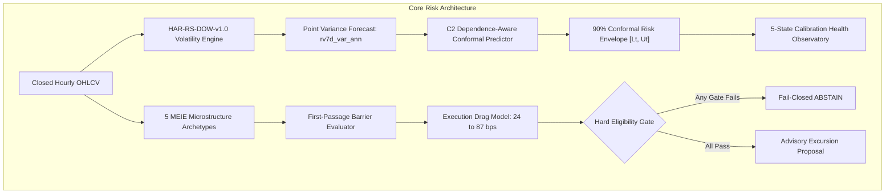
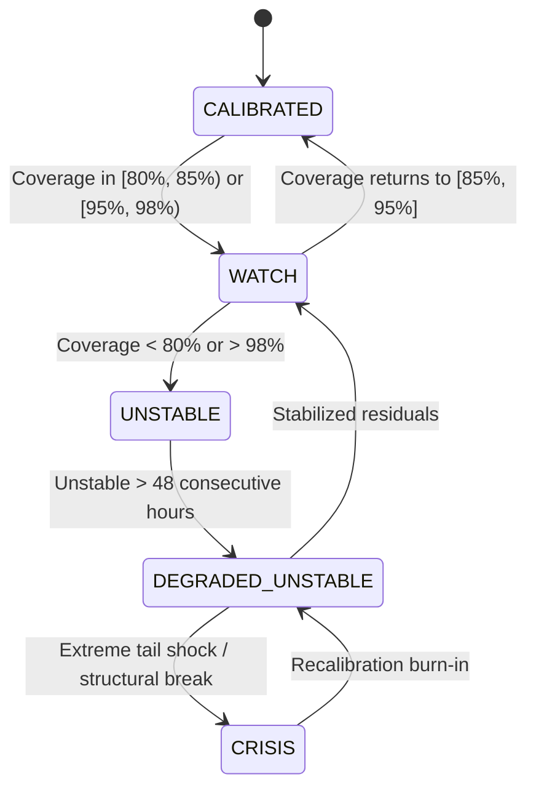

# V33.00 — Risk and Uncertainty Architecture Specification

**Milestone:** BTCognitive V33.0 — Research Consolidation & Risk-System Reliability  
**Generated:** 2026-10-30T18:45:00Z  
**Lead Orchestrator:** Antigravity  
**Operating Contract:** `OFFLINE_RESEARCH_ONLY`  
**Governed Architecture Role:** Volatility Risk Intelligence, Excursion Analysis & Calibration Monitoring  

---

## 1. Prime Architecture Philosophy

BTCognitive is strictly architected as a **Market Risk Intelligence & Excursion Analysis System**, NOT a high-turnover directional execution engine. 

Empirical research across milestones V32.74 through V32.80B establishes that retail-tier execution drag (24 to 87 bps round-trip) renders unconditional directional price prediction economically non-viable (-13.07 bps/bar net expectancy). Conversely, **volatility forecasting**, **dependence-aware uncertainty quantification**, and **first-passage excursion envelopes** provide statistically robust, non-directional market intelligence designed to protect capital and quantify tail risk.

---

## 2. Primary Volatility Engine: HAR-RS-DOW-v1.0

The production volatility model estimates integrated 7-day realized variance using the Heterogeneous Autoregressive model with Realized Semivariances (Patton & Sheppard, 2015) augmented with day-of-week seasonality (HAR-RS-DOW).

### 2.1 Model Specification

$$\log(RV_{t+168\text{h}}) = \beta_0 + \beta_d \log(RV_{t,24\text{h}}) + \beta_d^+ \log(RV_{t,24\text{h}}^+) + \beta_d^- \log(RV_{t,24\text{h}}^-) + \beta_w \log(RV_{t,7\text{d}}) + \beta_m \log(RV_{t,30\text{d}}) + \sum_{k=1}^6 \gamma_k D_{k,t} + \varepsilon_t$$

Where:
- $RV_{t,24\text{h}}$: Realized variance over preceding 24 hours ($\sum_{i=1}^{24} r_{t-i}^2$).
- $RV_{t,24\text{h}}^+$: Realized positive semivariance ($\sum_{i=1}^{24} r_{t-i}^2 \cdot \mathbb{I}_{\{r_{t-i} > 0\}}$).
- $RV_{t,24\text{h}}^-$: Realized negative semivariance ($\sum_{i=1}^{24} r_{t-i}^2 \cdot \mathbb{I}_{\{r_{t-i} < 0\}}$).
- $RV_{t,7\text{d}}$: Realized variance over preceding 7 days (168 hours).
- $RV_{t,30\text{d}}$: Realized variance over preceding 30 days (720 hours).
- $D_{k,t}$: Binary day-of-week indicator dummy variables capturing weekend liquidity contraction.
- Target: `rv7d_var_ann` (Annualized 7-Day Realized Variance, $168 \times \frac{365}{7} \times \sigma^2$).

### 2.2 Empirical Baseline Performance
- **Sample:** 42,233 closed hourly candles (2020–2025).
- **Out-of-sample QLIKE Loss:** $0.19300$.
- **Causal Holdout Empirical Containment:** $84.89\%$ (Pre-2026 calibration: $92.84\%$).
- **Anti-Conflation Rule:** Realized variance is an unsigned quadratic variation proxy. It provides zero information on price direction ($+/-$).

---

## 3. Loss-Coherent Volatility Challenger: HAR-QLIKE-v1.0

Following Puke & Schweikert (2026) and Patton (2011), conventional OLS minimizes squared error on logarithmic variance, which does not maximize the Gaussian quasi-likelihood of the variance process. The loss-coherent challenger directly minimizes sample QLIKE loss with $L_2$ regularization.

### 3.1 QLIKE Loss Function

$$\mathcal{L}_{\text{QLIKE}}(y, \hat{y}) = \frac{y}{\hat{y}} - \log\left(\frac{y}{\hat{y}}\right) - 1$$

Where:
- $y > 0$: Ex-post realized variance proxy.
- $\hat{y} > 0$: Model point forecast.
- $\mathcal{L}_{\text{QLIKE}} \ge 0$, with equality if and only if $\hat{y} = y$.

### 3.2 Challenger Evaluation & Significance Gate
- **Raw QLIKE Improvement:** $-8.77\%$ vs OLS baseline.
- **Diebold-Mariano Test (Harvey-Leybourne-Newbold corrected):**
  $$DM_{\text{HLN}} = +0.5132, \quad p = 0.3039 \quad (t_{T-1} \text{ distribution})$$
- **Hurdle Decision:** Because $p = 0.3039 \ge 0.05$, the improvement fails the pre-registered statistical significance threshold. Under fail-closed governance, `HAR-QLIKE-v1.0` remains classified as `EXPERIMENTAL_CHALLENGER` (`OFFLINE_RESEARCH_ONLY`) and does NOT displace `HAR-RS-DOW-v1.0`.

---

## 4. Uncertainty Calibration: C2 Dependence-Aware Conformal Prediction

To quantify predictive uncertainty without making Gaussian distributional assumptions, BTCognitive deploys C2 dependence-aware conformal prediction (Chernozhukov et al., 2021).

### 4.1 Conformal Interval Formulation

Given point forecast $\hat{y}_t$, the $(1 - \alpha)$ two-sided risk envelope is constructed as:

$$[L_t, U_t] = \left[ \max(0, \hat{y}_t - q_{1-\alpha/2}(|e|)), \; \hat{y}_t + q_{1-\alpha/2}(|e|) \right]$$

Where:
- $\alpha = 0.10$ (nominal coverage: $90\%$).
- $e_t = y_t - \hat{y}_t$: Historical non-conformity residuals.
- $q_{1-\alpha/2}$: Empirical quantile calculated over causal calibration windows.

### 4.2 Delayed Outcome Resolution Protocol
To prevent lookahead leakage in continuous time series, conformity residuals $e_t$ are evaluated **strictly post-maturity**:

$$t_{\text{resolution}} = t_{\text{origin}} + 168\text{h}$$

No forecast is scored or added to the calibration set until all 168 hourly candles of its forward evaluation horizon have closed.

### 4.3 5-State Calibration Health State Machine

The calibration health of the uncertainty envelope is tracked via an authoritative 5-state automaton:

| State Code | Coverage Range ($\hat{C}_{100}$) | Operational Status | System Impact |
| :--- | :--- | :--- | :--- |
| `CALIBRATED` | $85.0\% \le \hat{C} \le 95.0\%$ | Healthy | Full risk intelligence active; nominal envelope trusted. |
| `WATCH` | $80.0\% \le \hat{C} < 85.0\%$ or $95.0\% < \hat{C} \le 98.0\%$ | Advisory Alert | Operational warning emitted; position sizing damped by 50%. |
| `UNSTABLE` | $\hat{C} < 80.0\%$ or $\hat{C} > 98.0\%$ | Risk Blocked | Conformal envelope invalid; all downstream proposals gated to `ABSTAIN`. |
| `DEGRADED_UNSTABLE` | Persisting $\hat{C} < 80.0\%$ for $>48\text{h}$ | Critical Degradation | Model retraining flag raised; analysis engine fails closed. |
| `CRISIS` | Variance excursion $> 4 \times U_t$ | Emergency Shutdown | Total system halt; external audit required before resumption. |

---

## 5. Excursion Analysis & First-Passage Mechanics

Rather than predicting instantaneous close-to-close returns, excursion analysis models the continuous joint probability of hitting a Take Profit ($TP$) barrier before hitting a Stop Loss ($SL$) barrier across horizon $H$.

### 5.1 First-Passage Formulation

Let $S_t$ denote the BTCUSD price process. For entry price $S_0$ at $t_0$, define upper and lower barrier levels:

$$B_{\text{upper}} = S_0 (1 + \delta_{TP}), \quad B_{\text{lower}} = S_0 (1 - \delta_{SL})$$

The hitting times are defined as:

$$\tau_{TP} = \inf \{ t > t_0 : S_t \ge B_{\text{upper}} \}, \quad \tau_{SL} = \inf \{ t > t_0 : S_t \le B_{\text{lower}} \}$$

The terminal outcome $Y \in \{\text{TP\_FIRST}, \text{SL\_FIRST}, \text{EXPIRED}\}$ over horizon $H$ is:

$$Y = \begin{cases} 
\text{TP\_FIRST} & \text{if } \tau_{TP} \le t_0 + H \text{ and } \tau_{TP} < \tau_{SL} \\
\text{SL\_FIRST} & \text{if } \tau_{SL} \le t_0 + H \text{ and } \tau_{SL} < \tau_{TP} \\
\text{EXPIRED} & \text{if } \min(\tau_{TP}, \tau_{SL}) > t_0 + H 
\end{cases}$$

### 5.2 Realistic Execution Drag & Breakeven Geometry

Let $c_{\text{entry}}$ and $c_{\text{exit}}$ denote round-trip execution friction (exchange maker/taker fees, bid-ask spread crossing, and adverse slippage). Total round-trip drag is $c_{\text{RT}} = c_{\text{entry}} + c_{\text{exit}}$.

The expected net return per event is:

$$\mathbb{E}[\text{Net EV}] = p_{TP} (\delta_{TP} - c_{\text{RT}}) - p_{SL} (\delta_{SL} + c_{\text{RT}}) + p_{EXP} (R_{EXP} - c_{\text{RT}})$$

In the absence of expiration profits ($p_{EXP} = 0$, $p_{SL} = 1 - p_{TP}$), the breakeven TP hit rate is:

$$p_{\text{BE}} = \frac{\delta_{SL} + c_{\text{RT}}}{\delta_{TP} + \delta_{SL}}$$

#### Table 5.1: Breakeven Hit Rate Under Asymmetric Execution Drag ($2:1$ RR: $\delta_{TP} = 2.0\%$, $\delta_{SL} = 1.0\%$)

| Venue / Tier | Round-Trip Drag ($c_{\text{RT}}$) | Frictionless Breakeven | Required Breakeven ($p_{\text{BE}}$) | Net Drag Penalty |
| :--- | :--- | :--- | :--- | :--- |
| Zero-Cost Frictionless | $0\text{ bps}$ ($0.00\%$) | $33.33\%$ | $33.33\%$ | $+0.00\%$ |
| Binance VIP0 | $24\text{ bps}$ ($0.24\%$) | $33.33\%$ | $41.33\%$ | $+8.00\%$ |
| Binance Retail (VIP0 Taker) | $50\text{ bps}$ ($0.50\%$) | $33.33 Weber$ | $50.00\%$ | $+16.67\%$ |
| Coinbase Advanced Retail | $87\text{ bps}$ ($0.87\%$) | $33.33\%$ | $62.33\%$ | $+29.00\%$ |

**Conclusion:** At Coinbase retail fees ($87\text{ bps}$), a trader requires a **$62.33\%$ TP hit rate** on a $2:1$ RR setup merely to break even. This mathematical hurdle explains why unconditional and simple conditional entry models consistently produce negative net returns in production.

---

## 6. The 5 MEIE Microstructure Archetypes

BTCognitive evaluates market setups across 5 canonical Microstructure & Excursion Intelligence (MEIE) archetypes:

1. **MEIE-IGNITION (Momentum Ignition):**
   - Mechanics: Order Flow Imbalance (OFI) expansion combined with Hawkes jump clustering.
   - Gating: Requires simultaneous OFI spike ($> 1.5\sigma$) and Hawkes intensity excitation.
2. **MEIE-ABSORPTION (Passive Liquidity Absorption):**
   - Mechanics: High trade volume at support/resistance with low adverse selection.
   - Gating: OFI counter-trend exhaustion with VPIN toxicity filter pass.
3. **MEIE-VACUUM (Liquidity Vacuum / Pocket Expansion):**
   - Mechanics: Order book depth thinning post-cascade, rapid spread recovery.
   - Gating: Bid-ask spread expansion followed by instantaneous depth replenishment.
4. **MEIE-TOXICITY (Adverse Selection Avoidance):**
   - Mechanics: VPIN-based toxicity filter detecting informed flow front-running.
   - Gating: Veto-only archetype; blocks long entries when informed sell toxicity surges.
5. **MEIE-COMBINED (Multi-Factor Composite):**
   - Mechanics: Weighted linear combination of OFI, Hawkes, and term-structure volatility.
   - Gating: Requires agreement across all three sub-factors.

If any required feature is missing, stale, or contradictory, the archetype **fails closed** to `DISQUALIFIED` and the selection engine returns `ABSTAIN`.

