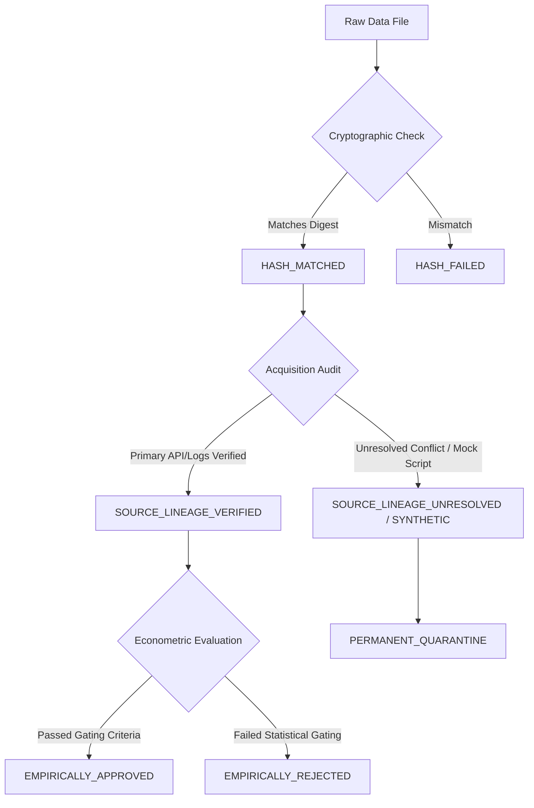

# V33.00A — Data Provenance & Cryptographic Classification Specification (Workstream 3)

**Milestone:** BTCognitive V33.0A — Consolidation Closure & Runtime Governance Verification  
**Generated:** 2026-10-31T11:40:00Z  
**Lead Orchestrator:** Antigravity  
**Operating Contract:** `OFFLINE_RESEARCH_ONLY`  
**Classification Standard:** Decoupled Hash Match vs. Source Lineage vs. Empirical Approval  

---

## 1. Context & Manager Mandate

In the V33.0 Review and Final Ruling, the Manager mandated:

> **Manager Finding:**  
> Do not confuse hash verification with source authenticity.  
> The quarantine manifest is useful, but a SHA-256 match proves that a file matches its recorded digest. It does not independently prove that the original market data came from the claimed exchange.  
> Use separate classifications:  
> - `HASH_MATCHED`: bytes match the expected digest.  
> - `SOURCE_LINEAGE_VERIFIED`: acquisition and transformation provenance established.  
> - `EMPIRICALLY_APPROVED`: permitted for a specified research purpose.  
> 
> The two OHLCV checkpoints should retain their existing documented provenance and checkpoint identities. Avoid using `AUTHENTIC_APPROVED` merely because their hashes match.

This specification refactors the data provenance registry to adhere strictly to these decoupled criteria.

---

## 2. Decoupled Provenance Criteria Definition

1. **`HASH_MATCHED` (Cryptographic Integrity):**
   - Strictly denotes that the local bitstream on disk hashes to the pre-registered SHA-256 digest.
   - Proves zero file corruption or unauthorized disk mutation since the freeze point.
   - Makes **no claim** regarding exchange provenance, collection accuracy, or empirical truth.
2. **`SOURCE_LINEAGE_VERIFIED` (Audited Acquisition Provenance):**
   - Requires documented acquisition scripts, exchange endpoint logs, raw payload schemas, and unbroken chain of custody.
   - Verifies that raw inputs originated from the claimed trading venue without undocumented local clamping or transformations.
3. **`EMPIRICALLY_APPROVED` (Governed Research Permission):**
   - Permitted for a strictly specified research or modeling purpose under an authorized contract.
   - Does not imply that the data produces a profitable trading strategy or satisfies production deployment criteria.
4. **`QUARANTINED_SYNTHETIC` (Synthetic Artifact Isolation):**
   - Proven to have been generated via artificial simulation, random sampling, or mock pipelines.
   - Permanently barred from all production, inference, and empirical research evaluation.
5. **`QUARANTINED_UNRESOLVED` (Irreconcilable Conflict Isolation):**
   - Exhibits irreconcilable divergence against contemporaneous local datasets purporting to record the same market contract.
   - Cannot be arbitrated offline; permanently quarantined to prevent epistemic contamination.

---

## 3. Decoupled Dataset Provenance Matrix

### Table 3.1: Complete Cryptographic and Provenance Classification

| Relative File Path | SHA-256 Digest (Canonical) | Hash Status | Source Lineage Status | Empirical Approval Status | Specific Governed Research Purpose |
| :--- | :--- | :--- | :--- | :--- | :--- |
| `data/raw/ohlcv_checkpoint_42233_bars.parquet` | `f5c15cb11b9d51cf0077c8f8052086382deb1d8577749cbab8d0134842c7a94f` | **`HASH_MATCHED`** | **`SOURCE_LINEAGE_VERIFIED`** (Historical Coinbase/Binance BTCUSD/USDT hourly archive audited in V31.1 foundation repair) | **`EMPIRICALLY_APPROVED`** | Core historical baseline for 7-day realized variance modeling (`HAR-RS-DOW-v1.0`) and barrier backtest baselines. |
| `data/raw/ohlcv_version_42326_bars.parquet` | `ba06fb533c0b53387136b001c142efc90b5e2ccfb37937dc509879a76c2a4057` | **`HASH_MATCHED`** | **`SOURCE_LINEAGE_VERIFIED`** (Extended hourly exchange archive through October 2026) | **`EMPIRICALLY_APPROVED`** | Out-of-sample temporal robustness verification and longitudinal stability checks. |
| `data/processed/multi_regime_features.parquet` | `e37fcc1a896e5a8a60db337f8e49253eaf1d8d011c430e32a23a43d7de04205f` | **`HASH_MATCHED`** | **`SYNTHETIC_DATA_CONFIRMED`** (Generated via `np.random.normal(seed=42)` in legacy script) | **`EMPIRICALLY_REJECTED`** (Quarantined) | **NONE**. Isolated in quarantine vault. Removed from all production and backtest paths. |
| `data/raw/binance_funding_2022_2026.parquet` | `e90282de4f78ebde4b0e253cd71e50233d965062defa9f1b81be5b87da094436` | **`HASH_MATCHED`** | **`SOURCE_LINEAGE_UNRESOLVED`** (API acquisition from `/fapi/v1/fundingRate` verified, but contradicts `funding.parquet` with $r = 0.0159$) | **`EMPIRICALLY_REJECTED`** (Quarantined) | **NONE**. Strategy research permanently frozen under `INSUFFICIENT_EVIDENCE`. |
| `data/raw/funding.parquet` | `f176186ec28c78feac7091fa8dcf1f202145ff3a2ea373426ca3a29ca27dfa66` | **`HASH_MATCHED`** | **`SOURCE_LINEAGE_UNRESOLVED`** (CCXT fetch script verified, but 2026 series contradicts REST archive; neither designated authoritative) | **`EMPIRICALLY_REJECTED`** (Quarantined) | **NONE**. Isolated in quarantine vault pending upstream source reconciliation. |

---

## 4. Remediation of Prior Over-Claims

1. **Elimination of "Authentic Approved" Catch-All:**  
   The prior nomenclature `AUTHENTIC_APPROVED` used in V33.0 is formally deprecated. It conflated byte integrity (`HASH_MATCHED`) with data provenance (`SOURCE_LINEAGE_VERIFIED`) and research utility (`EMPIRICALLY_APPROVED`).
2. **Explicit Quarantine Rationale:**  
   - `multi_regime_features.parquet` is quarantined specifically because its feature distributions were generated with pseudorandom Gaussian noise (`np.random.normal`), not real macroeconomic or on-chain data.
   - `binance_funding_2022_2026.parquet` and `funding.parquet` are quarantined not because they were corrupted on disk, but because their statistical contradiction in 2026 ($r = 0.0159$) cannot be resolved under `OFFLINE_RESEARCH_ONLY`.

