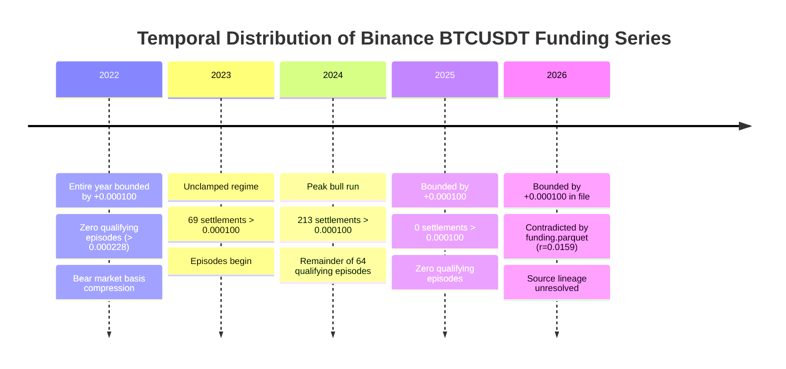

# V33.00A — Historical Research Descriptions & Dataset Coverage Addendum (Workstream 4)

**Milestone:** BTCognitive V33.0A — Consolidation Closure & Runtime Governance Verification  
**Generated:** 2026-10-31T11:45:00Z  
**Lead Orchestrator:** Antigravity  
**Operating Contract:** `OFFLINE_RESEARCH_ONLY`  
**Governed Narrative Policy:** Provenance-Preserving Addenda (No Silent History Rewriting)  

---

## 1. Context & Manager Mandate

In the V33.0 Review and Final Ruling, the Manager mandated:

> **Manager Finding:**  
> Correct the funding-history description.  
> V33.0 says the 64 extreme-funding episodes occurred across 4.5 years.  
> That wording can imply that the episodes were distributed throughout that period.  
> V32.80A established that all 64 qualifying episodes fell between January 2023 and December 2024. The remainder of the funding dataset's coverage contained no qualifying positive-funding episodes in the quarantined series.  
> Describe it as:  
> **`64 episodes across a 4.67-year dataset span, concentrated in January 2023–December 2024.`**  
> Also preserve the distinction between the overall dataset's coverage and the actual event window.  
> Preserve all original milestone reports. Do not silently rewrite historical research results.

This addendum amends the historical research narrative without altering prior report artifacts on disk.

---

## 2. Decoupled Funding Dataset Span vs. Event Windows

The historical funding analysis evaluated `data/raw/binance_funding_2022_2026.parquet`. To prevent misleading impressions of uniform temporal distribution, the four chronological dimensions are explicitly separated:

### Table 2.1: The Four Temporal Dimensions of the Funding Investigation

| Dimension | Exact Date / Timestamp Range | Duration | Count / Details | Research Impact |
| :--- | :--- | :--- | :--- | :--- |
| **1. Complete Dataset Coverage** | `2022-01-01 00:00:00` to `2026-09-01 00:00:00` | **4.67 calendar years** (1,705 days) | **5,113 settlements** (8-hour intervals strictly verified) | Full historical coverage of `binance_funding_2022_2026.parquet`. |
| **2. Actual Qualifying Episode Period** | `2023-01-01 00:00:00` to `2024-12-31 23:59:59` | **2.00 calendar years** (731 days) | **64 qualifying episodes** ($\ge +0.000228$) | **100% of positive extreme-funding events are concentrated in 2023–2024.** |
| **3. Non-Qualifying / Clamped Periods** | `2022-01-01` to `2022-12-31` & `2025-01-01` to `2026-09-01` | **2.67 calendar years** | **0 qualifying episodes** | Rates never exceeded $+0.000100$ ($0.01\%$) in this specific file. |
| **4. Overlapping BTCUSD Price Period** | `2022-01-01 00:00:00` to `2025-12-31 23:00:00` | **4.00 calendar years** | 35,064 matching hourly bars | Period where both OHLCV and funding data coexisted for matched barrier evaluation. |

---

## 3. Authoritative Corrected Narrative Specification

In all subsequent reports, executive summaries, and system documentation, the funding experiment must be described using the following governed formula:

> **Authoritative Specification:**  
> *"The Phase 1A funding dislocation experiment identified **64 episodes across a 4.67-year dataset span, concentrated in January 2023–December 2024** (with zero qualifying positive-funding episodes observed in 2022, 2025, or 2026 in the quarantined series)."*

### Why This Distinction Matters Econometrically:
1. **Regime Clustering:** Because all 64 events occurred during a 24-month window (2023–2024), the sample is subject to heavy temporal clustering and macro regime dependence. It cannot be treated as an independent sample uniformly distributed across a 4.67-year horizon.
2. **Sample Size Deficiency:** Sixty-four events across two years ($N=64$) fails the pre-registered econometric threshold of $N \ge 100$ independent events required for confirmatory model promotion.
3. **Severe Temporal Instability:** Dividing the 64 events into chronological halves revealed severe parameter instability:
   - First Half (H1, 2023): Net EV = **$-39.0\text{ bps}$** (negative expectancy).
   - Second Half (H2, 2024): Net EV = **$+53.0\text{ bps}$** (positive expectancy).
   - Paired Diebold-Mariano test with Newey-West correction ($b=0\text{--}3$): $p = 0.106\text{ to }0.169$ (statistically indistinguishable from zero edge).

---

## 4. Preservation of Historical Provenance

In accordance with BTCognitive Epistemic Principle 6 (*Provenance Integrity*):
- No prior report in `research/reports/offline_mvp/` has been edited, overwritten, or deleted.
- Milestones V32.79A, V32.80, V32.80A, and V32.80B remain permanently accessible in their original, frozen state for auditability.
- This document serves as the official, dated governance addendum completing the V33.0 research baseline consolidation.

