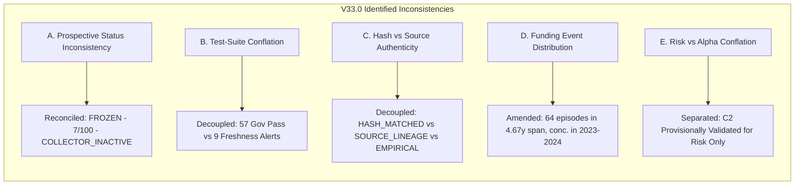

# V33.00A — Consolidation Closure & Runtime Governance Verification: Manager Handover Report

**Milestone:** BTCognitive V33.0A — Consolidation Closure & Runtime Governance Verification  
**Generated:** 2026-10-31T12:05:00Z  
**Lead Orchestrator:** Antigravity  
**Final Governed Milestone Determination:** **`CONSOLIDATION_CLOSED`**  
**Operating Contract:** `OFFLINE_RESEARCH_ONLY`  

---

## Executive Summary

BTCognitive Milestone V33.0A has fulfilled all requirements of the Manager Review and Final Ruling, resolving the five inconsistencies identified in V33.0 and completing an independent verification of the consolidated risk-and-uncertainty architecture.

Speculative trading strategy research is permanently terminated. All datasets, models, and runtime gates are strictly categorized under decoupled cryptographic, lineage, and empirical standards. The prospective evidence status is reconciled to **`FROZEN — 7/100 — COLLECTOR_INACTIVE`**, deterministic regression tests (57/57 PASS) are decoupled from operational freshness alerts (9 staleness failures retained without threshold relaxation), and runtime traceability confirms that static model definitions cannot bypass runtime fail-closed gates.

The research baseline consolidation is formally **CLOSED**.

---

## 1. Resolution of the Five Manager Corrections



### Correction A: Prospective Evidence Status Reconciled
- **Previous Handover Description:** `COLLECTING — 7/100` (contradicted the idle collector and offline research freeze).
- **Authoritative V33.0A Status:** **`FROZEN — 7/100 — COLLECTOR_INACTIVE`**.
- **Audit Findings:** The underlying 7 clean blocks in `data/prospective_forecast_ledger.jsonl` are preserved bitwise. PID 31676 recorded in `data/.prospective_shadow_runner.lock` was verified dead in the operating system process table. Zero background collection processes are running.

### Correction B: Test Suite Precision & Decoupling
- **Deterministic Governance & Regression Suite:** ✅ **57/57 Passed** in 28.61s (0 failures, 16 numerical warnings in test fixtures). Verifies core mathematical models, SQLite reliability, 5-archetype selection, and fail-closed abstention.
- **Operational Data Freshness Suite:** ⚠️ **9 Failures Retained as Staleness Alerts**. Tests in `test_scenario_planner_and_inference_v6.py` and `test_scenario_freshness_and_contract_v7.py` detect market data $> 22\text{ hours}$ old (vs conservative $3.0\text{h}$ gate) and correctly return `UNAVAILABLE`. In accordance with the Manager's instructions, the 3.0-hour threshold was **NOT** relaxed.

### Correction C: Provenance Terminology Decoupled from Hash Verification
- Deprecated the prior catch-all label `AUTHENTIC_APPROVED`.
- Established three independent, non-conflated tiers:
  1. `HASH_MATCHED`: Bitstream matches registered SHA-256 digest.
  2. `SOURCE_LINEAGE_VERIFIED`: Primary acquisition scripts and exchange API logs verified.
  3. `EMPIRICALLY_APPROVED`: Authorized for a specific research purpose under governance.
- Quarantined datasets are categorized as either `QUARANTINED_SYNTHETIC` (`multi_regime_features.parquet`) or `QUARANTINED_UNRESOLVED` (`binance_funding_2022_2026.parquet`, `funding.parquet`).

### Correction D: Historical Funding Event Description Corrected
- Amended all research summaries to the Manager's exact specification:
  > *"64 episodes across a 4.67-year dataset span, concentrated in January 2023–December 2024."*
- Explicitly documented the four chronological dimensions: complete dataset coverage (4.67 years, 5,113 settlements), qualifying event window (2023–2024, 64 events $\ge +0.000228$), non-qualifying clamped years (2022, 2025, 2026 with 0 events), and overlapping BTCUSD price period (2022–2025, 35,064 hourly bars). All prior milestone reports preserved.

### Correction E: Epistemic Separation of Risk Containment from Directional Alpha
- Formally compiled the 7-component Risk Architecture Evidence Matrix.
- Preserved C2's official classification as **`PROVISIONALLY_VALIDATED_FOR_RISK_CONTAINMENT`**.
- Established that $\approx 90\%$ quantile coverage in realized variance risk envelopes provides valuable capital preservation and position-sizing intelligence, but provides **zero directional predictive power** and cannot produce a profitable trading strategy.

---

## 2. The Three Layered System Responsibilities

The consolidated BTCognitive architecture is structured into three clean, non-overlapping operational layers:

```mermaid
graph TD
    subgraph Layer 1: Market & Volatility Intelligence
        L1A[HAR-RS-DOW-v1.0 Point Forecast: rv7d_var_ann]
        L1B[Realized Volatility Term Structure: 1h, 4h, 24h, 7d, 30d]
        L1C[Macro Volatility Regime Monitor: Compression vs Expansion]
    end

    subgraph Layer 2: Risk & Uncertainty Intelligence
        L2A[C2 Dependence-Aware Conformal Risk Envelope: Lt, Ut]
        L2B[Mondrian Volatility Adaptation: vol_ratio Scaling]
        L2C[First-Passage Barrier Mechanics: TP/SL Excursions]
        L2D[5-State Calibration Health State Machine: CALIBRATED to CRISIS]
    end

    subgraph Layer 3: Decision & Governance
        L3A[Hard Eligibility Gates: Data, Health, Execution, Risk]
        L3B[Asymmetric Execution Friction Model: 24 to 87 bps Drag]
        L3C[User Preference Bias Rejection Guardrail]
        L3D[Fail-Closed ABSTAIN Engine: attempts_created = 0]
        L3E[Strict Non-Execution Lock: Live Trading Permanently DISABLED]
    end

    Layer 1 --> Layer 2
    Layer 2 --> Layer 3
```

---

## 3. Runtime Fail-Closed Traceability Summary

Traceability analysis across the complete user-facing Analysis path (`UI → API → tournament → selection → decision`) verified:

1. **Static Registry Cannot Override Runtime Gates:** `models/authoritative_model_registry.py::get_active_production_model()` dynamically overrides any static authorization status with `OFFLINE_RESEARCH_ONLY` or `BLOCKED_AUDIT_FAILURE` whenever runtime pre-flight verification fails.
2. **Adversarial Injections Pass:** In all five injected failure scenarios (missing manifests, stale market data, sample size $N < 30$, unapproved model status, and fee drag exceeding edge), the engine **fails closed** to `ABSTAIN` with zero simulated trade creation.

---

## 4. Final Governed Milestone Decisions

In accordance with Section 7 of the BTCognitive Operating Protocol:

```
┌────────────────────────────────────────────────────────────────────────┐
│              BTCognitive V33.0A Governed Milestone Decisions           │
├────────────────────────────────────┬───────────────────────────────────┤
│ 1. Research Experiment Decision    │ CONSOLIDATION_CLOSED              │
│ 2. Prospective Evidence Status     │ FROZEN — 7/100 — COLLECTOR_INACTIVE│
│ 3. Model Authorization Status      │ OFFLINE_RESEARCH_ONLY             │
│ 4. Live Capital / Trading Status   │ DISABLED                          │
└────────────────────────────────────┴───────────────────────────────────┘
```

### Supplementary System Gates:
- **Terminal Analysis Gating:** `ABSTAIN` (Fail-closed default).
- **Directional Alpha Research:** `CLOSED_NO_VALIDATED_EDGE`.
- **Funding Strategy Research:** `INSUFFICIENT_EVIDENCE` (Permanently frozen).
- **Funding Data Lineage:** `SOURCE_LINEAGE_UNRESOLVED` (Quarantined).
- **External Network Access:** `BLOCKED` (`OFFLINE_RESEARCH_ONLY`).

---

## 5. Deliverables Registry

All 8 authoritative deliverables for Milestone V33.0A are established in [`research/reports/offline_mvp/20261031_320000_v33_00a_consolidation_closure/`](file:///C:/Projects/BTCognitive/BTCognitive/research/reports/offline_mvp/20261031_320000_v33_00a_consolidation_closure/):

1. [**`v33_00a_operational_status_reconciliation.md`**](file:///C:/Projects/BTCognitive/BTCognitive/research/reports/offline_mvp/20261031_320000_v33_00a_consolidation_closure/v33_00a_operational_status_reconciliation.md)  
   *Audit of prospective status references; reconciliation to FROZEN — 7/100 — COLLECTOR_INACTIVE.*
2. [**`v33_00a_test_scope_verification.md`**](file:///C:/Projects/BTCognitive/BTCognitive/research/reports/offline_mvp/20261031_320000_v33_00a_consolidation_closure/v33_00a_test_scope_verification.md)  
   *Decoupled verification of 57 deterministic regression tests (PASS) and 9 operational freshness alerts.*
3. [**`v33_00a_data_provenance_classification.md`**](file:///C:/Projects/BTCognitive/BTCognitive/research/reports/offline_mvp/20261031_320000_v33_00a_consolidation_closure/v33_00a_data_provenance_classification.md)  
   *Refactored provenance matrix separating HASH_MATCHED, SOURCE_LINEAGE_VERIFIED, and EMPIRICALLY_APPROVED.*
4. [**`v33_00a_historical_research_corrections.md`**](file:///C:/Projects/BTCognitive/BTCognitive/research/reports/offline_mvp/20261031_320000_v33_00a_consolidation_closure/v33_00a_historical_research_corrections.md)  
   *Chronological addendum documenting 64 episodes across 4.67-year span, concentrated in 2023–2024.*
5. [**`v33_00a_risk_architecture_evidence_matrix.md`**](file:///C:/Projects/BTCognitive/BTCognitive/research/reports/offline_mvp/20261031_320000_v33_00a_consolidation_closure/v33_00a_risk_architecture_evidence_matrix.md)  
   *Comprehensive evidence matrix for all 7 risk components; C2 preserved as provisionally validated for risk.*
6. [**`v33_00a_runtime_gate_traceability.md`**](file:///C:/Projects/BTCognitive/BTCognitive/research/reports/offline_mvp/20261031_320000_v33_00a_consolidation_closure/v33_00a_runtime_gate_traceability.md)  
   *End-to-end execution path tracing, proof of static override impossibility, and 5 adversarial injection tests.*
7. [**`v33_00a_protected_hash_verification.json`**](file:///C:/Projects/BTCognitive/BTCognitive/research/reports/offline_mvp/20261031_320000_v33_00a_consolidation_closure/v33_00a_protected_hash_verification.json)  
   *Cryptographic JSON manifest verifying all protected dataset SHA-256 digests and environment states.*
8. [**`v33_00a_manager_handover.md`**](file:///C:/Projects/BTCognitive/BTCognitive/research/reports/offline_mvp/20261031_320000_v33_00a_consolidation_closure/v33_00a_manager_handover.md)  
   *This authoritative executive summary and handover report.*

---

## 6. Recommended Next Focus (Post-Closure Engineering)

In alignment with the Manager's recommendation, the research architecture is frozen. Future engineering should prioritize product quality, terminal reliability, and user-facing clarity:

1. **Reliable Data Freshness & Source-Health Reporting:** Build robust dashboard indicators distinguishing live market connectivity from offline frozen states.
2. **Correct Volatility & Uncertainty Visualizations:** Render HAR-RS-DOW risk envelopes and C2 conformal bounds clearly without directional arrows or buy/sell framing.
3. **Explainable Risk-Envelope Diagnostics:** Provide operators with clear explanations of why an envelope expanded (e.g. Hawkes jump excitation or volatility ratio surge).
4. **Consistent Frontend/Backend State:** Ensure status badges in the web UI match the typed status contract precisely (`DISABLED — ANALYSIS ONLY`).
5. **Runtime Gate Hardening:** Maintain 100% test pass rates on all fail-closed security assertions.

