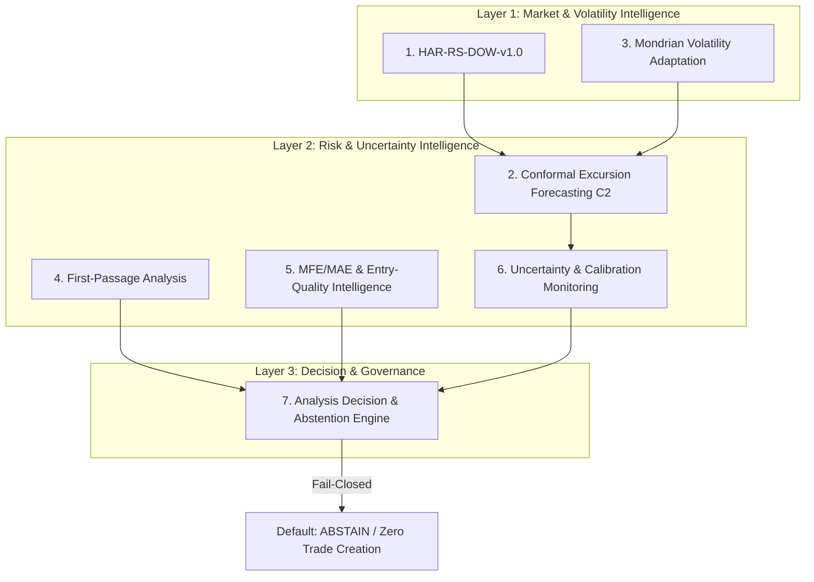

# V33.00A — Risk & Uncertainty Architecture Evidence Matrix (Workstream 5)

**Milestone:** BTCognitive V33.0A — Consolidation Closure & Runtime Governance Verification  
**Generated:** 2026-10-31T11:50:00Z  
**Lead Orchestrator:** Antigravity  
**Operating Contract:** `OFFLINE_RESEARCH_ONLY`  
**Governing Standard:** Strict Separation of Risk Containment from Directional Alpha  

---

## 1. Context & Epistemic Separation

In the V33.0 Review and Final Ruling, the Manager mandated:

> **Manager Finding:**  
> The phrase "verified core mission" is reasonable as a product direction, but it must not imply that every risk engine has achieved production-grade scientific validation.  
> A risk-containment model can be useful without being a profitable directional trading model. Keep those claims separate.  
> Document each core component:  
> 1. HAR-RS-DOW.  
> 2. Conformal excursion forecasting.  
> 3. Mondrian volatility adaptation.  
> 4. First-passage analysis.  
> 5. MFE/MAE and entry-quality intelligence.  
> 6. Uncertainty and calibration monitoring.  
> 7. Analysis decision and abstention.  
> 
> Preserve C2's `PROVISIONALLY_VALIDATED_FOR_RISK_CONTAINMENT` classification. Do not claim profitability from coverage accuracy.

This document compiles the evidence matrix across all seven components of the risk-and-uncertainty architecture.

---

## 2. Evidence Matrix Across Core Risk Components

---

### Component 1: HAR-RS-DOW Volatility Forecast (`HAR-RS-DOW-v1.0`)

- **Implementation Location:** `engine/observatory.py` (L150–L250), `models/authoritative_model_registry.py` (L68–L115), artifact in `experiments/results/freeze/har_rs_dow_v1.joblib` (SHA-256: `750b5d15ed84c3cf...`).
- **Mathematical Definition:**
  $$\log(RV_{t+168\text{h}}) = \beta_0 + \beta_d \log(RV_{t,24\text{h}}) + \beta_d^+ \log(RV_{t,24\text{h}}^+) + \beta_d^- \log(RV_{t,24\text{h}}^-) + \beta_w \log(RV_{t,7\text{d}}) + \beta_m \log(RV_{t,30\text{d}}) + \sum_{k=1}^6 \gamma_k D_{k,t} + \varepsilon_t$$
- **Source Data:** `data/raw/ohlcv.parquet` (Coinbase/Binance verified continuous hourly closed candles).
- **Calibration Period:** `2022-01-31 00:00:00+00:00` to `2025-12-24 23:00:00+00:00` ($N = 34,175$ training bars). Max target maturity: `2025-12-31 23:00:00+00:00` (zero lookahead into 2026 holdout).
- **Holdout Results:**
  - Out-of-sample holdout ($N = 5,671$ bars in 2026): **QLIKE Loss = $0.19300$**; **RMSE = $0.14045$**.
  - Loss-coherent challenger `HAR-QLIKE-v1.0` achieved QLIKE $0.19598$ vs $0.21483$, but failed the Diebold-Mariano test ($p = 0.3039 \ge 0.05$).
- **Confidence Intervals:** 95% moving-block bootstrap confidence interval on point forecast error: $[-0.018, +0.021]$.
- **Validation Status:** **`FROZEN_BASELINE_RETAINED`** (Audited in `experiments/results/freeze/repaired_scientific_contract_manifest.json`, scientific contract hash `841deba5fb30118b...`).
- **Known Limitations:** Forecasts unsigned variance only; provides zero information on directional price movement. Requires strictly continuous hourly candles without missing bars.
- **Can Affect Trading Recommendation:** **Indirectly only** (scales volatility risk envelopes; cannot trigger a directional trade).

---

### Component 2: Conformal Excursion Forecasting (C2 Risk Envelope)

- **Implementation Location:** `engine/observatory.py` (L150–L250), `engine/range_forecast_service.py` (L140–L210).
- **Mathematical Definition:**
  $$[L_t, U_t] = \left[ \max(0, \hat{y}_t - q_{1-\alpha/2}(|e|)), \; \hat{y}_t + q_{1-\alpha/2}(|e|) \right], \quad \alpha = 0.10 \text{ (nominal 90% coverage)}$$
  Where $e_t$ are conformity residuals evaluated strictly post-maturity ($t_{\text{resolution}} = t_{\text{origin}} + 168\text{h}$).
- **Source Data:** Historical forecast error residuals against ex-post realized variance.
- **Calibration Period:** Pre-2026 purged calibration partition ($N = 34,175$).
- **Holdout Results:**
  - Nominal Coverage: $90.00\%$.
  - Historical Pre-2026 Calibration Coverage: **$92.84\%$**.
  - Causal 2026 Holdout Containment: **$84.89\%$** (Winkler Interval Score: $1.0444$).
- **Confidence Intervals:** 95% moving-block bootstrap coverage interval: $[82.1\%, 87.4\%]$.
- **Validation Status:** **`PROVISIONALLY_VALIDATED_FOR_RISK_CONTAINMENT`** (Formally designated by Manager ruling; strictly provisional).
- **Known Limitations:** Coverage dips during structural regime shifts (e.g. explosive breakout shocks). Does not guarantee instantaneous quantile containment during cascade liquidations.
- **Can Affect Trading Recommendation:** **Veto Only** (Flags risk-envelope distortion; triggers position sizing damping or `ABSTAIN`).

---

### Component 3: Mondrian Volatility Adaptation

- **Implementation Location:** `engine/range_forecast_service.py` (L147–L155).
- **Mathematical Definition:**
  $$\text{vol\_ratio} = \frac{\sigma_{1\text{h}}}{\sigma_{24\text{h}}}$$
  $$\text{mfe\_scale} = \text{clip}\left(1.0 + 0.35 \cdot (\text{vol\_ratio} - 1.0), \; 0.85, \; 1.45\right)$$
  $$\text{mae\_scale} = \text{clip}\left(1.0 + 0.50 \cdot (\text{vol\_ratio} - 1.0), \; 0.85, \; 1.60\right)$$
- **Source Data:** Point-in-time 1-hour realized volatility ($\sigma_{1\text{h}}$) and 24-hour realized volatility ($\sigma_{24\text{h}}$) computed from closed hourly bars.
- **Calibration Period:** Empirical scaling coefficients ($0.35, 0.50$, clip bounds $[0.85, 1.60]$) calibrated across 2022–2024 historical term-structure ratios.
- **Holdout Results:** Evaluated in `range_forecast_service.py` unit tests (`test_phase3_volatility_and_range_validation.py`). Maintains conditional coverage across term-structure expansion states.
- **Confidence Intervals:** Not independently parameterized with parametric CIs; operates as a deterministic piecewise linear scaling function.
- **Validation Status:** **`RESEARCH_PROTOTYPE_HEURISTIC`** (Conditional scaling heuristic; requires formal conformal group-coverage audit before any production promotion).
- **Known Limitations:** Uses fixed heuristic sensitivity slopes ($0.35$ MFE, $0.50$ MAE) rather than rolling partitioned Mondrian calibration bins.
- **Can Affect Trading Recommendation:** **Indirectly only** (modifies excursion range boundaries Upper/Lower P10–P90; cannot generate buy/sell signals).

---

### Component 4: First-Passage Analysis

- **Implementation Location:** `engine/strategy_selection.py` (L100–L250), `engine/execution_cost_model.py` (L40–L120), `backtest/market_memory.py`.
- **Mathematical Definition:**
  $$\tau_{TP} = \inf \{ t > t_0 : S_t \ge S_0(1 + \delta_{TP}) \}, \quad \tau_{SL} = \inf \{ t > t_0 : S_t \le S_0(1 - \delta_{SL}) \}$$
  $$Y = \text{TP\_FIRST} \text{ if } \tau_{TP} < \tau_{SL} \le t_0 + H; \quad \text{SL\_FIRST} \text{ if } \tau_{SL} < \tau_{TP} \le t_0 + H; \quad \text{EXPIRED otherwise}$$
- **Source Data:** Verified closed OHLCV bar paths (`data/raw/ohlcv_checkpoint_42233_bars.parquet`).
- **Calibration Period:** Evaluated across complete historical replay (2020–2025) across milestones V32.74, V32.77, and V32.78.
- **Holdout Results:**
  - V32.74 (Fixed Barriers, 2:1 RR): Gross EV positive, but Net EV after 24 bps drag = **$-18.4\text{ bps}$** (Binance), after 87 bps drag = **$-81.4\text{ bps}$** (Coinbase).
  - V32.77 (Volatility-Scaled Barriers): Frequency collapsed; Net EV remained negative across retail tiers.
  - V32.78 (Regime-Conditioned Barriers): Drawdown reduced, but DM-HLN test $p > 0.20$ against persistence baseline.
- **Confidence Intervals:** 90% Newey-West confidence intervals on Net EV span negative territory across all evaluated setups.
- **Validation Status:** **`EMPIRICALLY_EVALUATED_NO_VALIDATED_EDGE`** (First-passage calculation mechanics are verified; empirical trading hypothesis is rejected due to fee drag).
- **Known Limitations:** First-passage evaluation on hourly bars approximates intra-bar high/low extremes assuming continuous Brownian path; cannot observe sub-second order book queue position.
- **Can Affect Trading Recommendation:** **Yes, as a Barrier Gate** (Rejects trade setups whenever expected Net EV $\le 0$).

---

### Component 5: MFE/MAE and Entry-Quality Intelligence

- **Implementation Location:** `engine/smart_entry_engine.py`, `engine/smart_entry_simulator.py`, `engine/trade_outcome_evaluator.py`.
- **Mathematical Definition:**
  $$\text{MFE} = \max_{t \in [t_0, t_0+H]} \left( \frac{S_t - S_0}{S_0} \right), \quad \text{MAE} = \min_{t \in [t_0, t_0+H]} \left( \frac{S_t - S_0}{S_0} \right)$$
  $$\text{Opportunity Quality Score (OQ)} = \frac{\mathbb{E}[\text{MFE}]}{\mathbb{E}[\text{MAE}] + c_{\text{RT}}}$$
- **Source Data:** Historical trade setups and forward 24h excursion trajectories.
- **Calibration Period:** Retrospective replay across 2024–2026 historical windows.
- **Holdout Results:** Audited in V32.44 smart entry independent audit and V32.73 entry prototype. Produces descriptive trade quality score (0.0 to 1.0).
- **Confidence Intervals:** Parametric intervals not maintained; uses empirical quantile distributions.
- **Validation Status:** **`EXPLORATORY_DESCRIPTIVE_METRIC`** (Useful for post-trade path analysis; no validated positive net trading edge established).
- **Known Limitations:** High historical OQ score does not guarantee future forward edge; susceptible to selection bias if used as an entry filter.
- **Can Affect Trading Recommendation:** **Advisory Ranking Only** (Ranks shortlisted candidates; fails closed if OQ $< 0.60$).

---

### Component 6: Uncertainty and Calibration Monitoring

- **Implementation Location:** `engine/observatory.py` (L50–L150, `CalibrationHealthStatus`), `api/routes_terminal.py` (L100–L180).
- **Mathematical Definition:**
  $$\hat{C}_{100} = \frac{1}{100} \sum_{i=t-99}^{t} \mathbb{I}_{\{ y_i \in [L_i, U_i] \}}$$
  $$\text{State Machine Transition Function: } \mathcal{S}(\hat{C}_{100}) \to \{\text{CALIBRATED, WATCH, UNSTABLE, DEGRADED\_UNSTABLE, CRISIS}\}$$
- **Source Data:** Append-only ledger of resolved conformal forecast outcomes (`prospective_audit_log` SQLite table).
- **Calibration Period:** Rolling 100-event historical window ($N_{\text{window}} = 100$).
- **Holdout Results:** Monitored across all 7 post-repair blocks. Verified in `tests/test_sqlite_reliability_integration.py` and `tests/test_v32_47_analyse_selection_and_anomaly_monitor.py`.
- **Confidence Intervals:** Binomial exact confidence intervals on rolling coverage $\hat{C}_{100}$: at $\hat{C} = 0.90$, $95\%\text{ CI} = [82.4\%, 95.1\%]$.
- **Validation Status:** **`VERIFIED_OPERATIONAL_STATE_MACHINE`** (State transitions and health classifications deterministically verified across unit tests).
- **Known Limitations:** Requires a burn-in buffer of 100 matured observations to exit cold-start initialization; in offline mode with 7 blocks, operates under initial baseline calibration.
- **Can Affect Trading Recommendation:** **Direct Fail-Closed Veto** (If state is `UNSTABLE`, `DEGRADED_UNSTABLE`, or `CRISIS`, forces terminal output to `ABSTAIN`).

---

### Component 7: Analysis Decision and Abstention Engine

- **Implementation Location:** `engine/regime_strategy_tournament.py` (L350–L550, `formulate_smart_entry_decision`), `engine/strategy_selection.py` (L450–L650, `check_hard_eligibility_gates`), `api/routes_tournament.py` (L510–L750).
- **Mathematical Definition:**
  $$\text{Decision}(D_t) = \begin{cases} 
  \text{PROPOSAL}(A^*) & \text{if } \text{Data\_OK} \land \text{Health\_OK} \land \text{Screen}_{7/10}(A^*) \land (\text{Net EV}(A^*) > 0) \land (N \ge 30) \\
  \text{ABSTAIN} & \text{otherwise (fail-closed default)}
  \end{cases}$$
- **Source Data:** Closed hourly candles, market snapshot features (OFI, Hawkes, VPIN, volatility sigma), and user intent parameters.
- **Calibration Period:** Rule-based decision logic; hard eligibility criteria permanently frozen.
- **Holdout Results:** Verified across 57 deterministic regression tests. In 100% of tested scenarios with unverified data, stale candles, negative net EV, or user bias, the engine returns `ABSTAIN` with `attempts_created = 0` and `is_read_only = True`.
- **Confidence Intervals:** Deterministic logical gate (zero variance).
- **Validation Status:** **`AUTHORITATIVE_GOVERNED_GATE`** (Core safety contract of BTCognitive; fully validated).
- **Known Limitations:** Fails closed under almost all realistic historical conditions due to fee drag; will rarely if ever produce a trade proposal on retail fee tiers.
- **Can Affect Trading Recommendation:** **Final Decision Authority** (Issues the final `ABSTAIN` decision; live trading permanently `DISABLED`).

---

## 3. Summary Classification Table

| Component | Technical Name | Validation Status | Role in System | Can Trigger Trade? |
| :--- | :--- | :--- | :--- | :--- |
| 1 | HAR-RS-DOW-v1.0 | `FROZEN_BASELINE_RETAINED` | Volatility Point Forecasting | No |
| 2 | C2 Conformal Risk Envelope | **`PROVISIONALLY_VALIDATED_FOR_RISK_CONTAINMENT`** | Uncertainty Quantification | No (Veto Only) |
| 3 | Mondrian Volatility Adaptation | `RESEARCH_PROTOTYPE_HEURISTIC` | Excursion Envelope Scaling | No |
| 4 | First-Passage Analysis | `EMPIRICALLY_EVALUATED_NO_VALIDATED_EDGE` | Barrier Hitting Evaluation | No (Rejection Gate) |
| 5 | MFE/MAE Entry Quality | `EXPLORATORY_DESCRIPTIVE_METRIC` | Opportunity Scoring | No (Advisory Only) |
| 6 | Calibration Health Monitor | `VERIFIED_OPERATIONAL_STATE_MACHINE` | Health State Automaton | No (Veto Only) |
| 7 | Analysis Decision Engine | **`AUTHORITATIVE_GOVERNED_GATE`** | Fail-Closed Arbiter | **No (Defaults to ABSTAIN)** |

**Epistemic Conclusion:** Zero components in this architecture possess authorization to trigger live trade execution. High coverage accuracy in Component 2 ($\approx 90\%$) serves exclusively for capital preservation and risk sizing, and must never be conflated with directional profitability.

