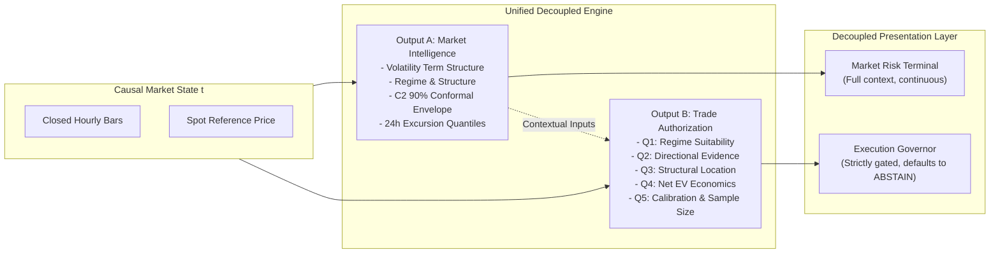
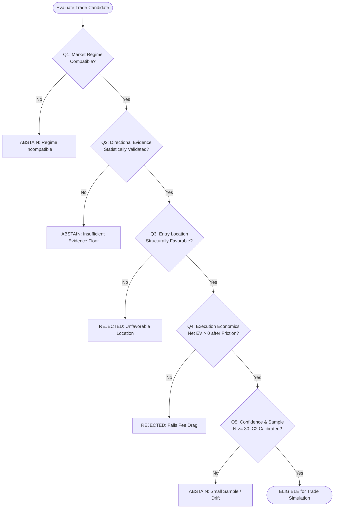

# BTCognitive V33.1 — Decoupled Architecture Specification: Market Intelligence & Trade Authorization

**Document ID:** `BTC-V33-1-RPT-003`  
**Milestone:** V33.1 (Entry & Analysis Architecture Redesign)  
**Author:** Lead Quantitative Architect & Orchestrator  
**Governing Standard:** Five-Question Decoupled Intelligence Contract  
**Operating Posture:** `OFFLINE_RESEARCH_ONLY` | Live Trading `DISABLED`  

---

## 1. Architectural Philosophy & The Core Separation

BTCognitive Milestone V33.1 formalizes the complete architectural decoupling between **Market Intelligence (Observation)** and **Trade Authorization (Decision)**.

$$\text{System Payload} \equiv \big\{ \mathcal{I}_{\text{Market}}(t), \; \mathcal{A}_{\text{Trade}}(t) \big\}$$

Where:
- $\mathcal{I}_{\text{Market}}(t)$ is the **Market Intelligence Report** (Output A). It is non-prescriptive, continuous, informative, and resilient to stale or uncalibrated conditions.
- $\mathcal{A}_{\text{Trade}}(t)$ is the **Trade Authorization Gate** (Output B). It is prescriptive, discrete, cost-aware, and fail-closed across five explicit quantitative questions.



---

## 2. Output A Specification: Market Intelligence Report

Output A generates an objective summary of market volatility, regime, and statistical excursion bounds. It executes whenever valid historical closed candles are present, even if data is stale (> 3.0 hours).

### 2.1 Schema Definition & Components

```json
{
  "market_intelligence": {
    "status": "SUCCESS",
    "report_timestamp_utc": "2026-10-31T18:00:00Z",
    "current_price": 86429.99,
    "data_freshness": {
      "last_candle_timestamp": "2026-10-31T15:00:00Z",
      "age_hours": 3.0,
      "is_stale": true,
      "freshness_warning": "DATA_STALE: Closed candles are 3.00h old (> 3.0h threshold). Market intelligence is historical/cached context; trade authorization is strictly locked to ABSTAIN."
    },
    "volatility_term_structure": {
      "rv_1h_pct": 28.50,
      "rv_4h_pct": 32.10,
      "rv_24h_pct": 38.40,
      "rv_7d_pct": 45.20,
      "rv_30d_pct": 52.10,
      "vol_ratio_1h_24h": 0.742,
      "curve_shape": "CONTANGO_COMPRESSION"
    },
    "volatility_regime": {
      "regime": "TRENDING_BULLISH",
      "is_expansion": true,
      "bollinger_band_width_pct": 2.86,
      "wilder_adx_14": 22.01,
      "trend_strength": "WEAK_TREND",
      "atr_14_usd": 715.10,
      "trend_direction": "BULLISH",
      "bb_mid": 85114.62,
      "bb_upper": 86331.54,
      "bb_lower": 83897.70
    },
    "conformal_risk_envelope_7d": {
      "point_forecast_volatility_pct": 45.20,
      "conformal_lower_volatility_pct": 31.64,
      "conformal_upper_volatility_pct": 58.76,
      "nominal_coverage_pct": 90.0,
      "empirical_coverage_observed_pct": 90.43,
      "model_id": "HAR-RS-DOW-C2",
      "calibration_status": "PROVISIONALLY_VALIDATED_FOR_RISK_CONTAINMENT"
    },
    "excursion_estimates_24h": {
      "favourable_excursion_upper": {
        "p10_price": 86900.00,
        "p50_price": 88150.00,
        "p90_price": 89800.00
      },
      "adverse_excursion_lower": {
        "p10_price": 85900.00,
        "p50_price": 84700.00,
        "p90_price": 83100.00
      },
      "expected_24h_range_usd": 3450.00
    }
  }
}
```

### 2.2 Mathematical Formulations

#### 1. Volatility Term Structure
For log returns $r_t = \ln(P_t / P_{t-1})$ sampled hourly, realized variance over horizon $H \in \{1, 4, 24, 168, 720\}$ is:

$$\text{RV}_H = \sqrt{\frac{1}{H} \sum_{i=0}^{H-1} r_{t-i}^2} \times \sqrt{8760} \times 100\%$$

Term structure curve shape is classified by the ratio $\rho = \frac{\text{RV}_{1\text{h}}}{\text{RV}_{24\text{h}}}$:
- $\rho > 1.25$: `INVERTED_EXPANSION` (Immediate volatility burst).
- $0.85 \le \rho \le 1.25$: `FLAT` (Balanced volatility term structure).
- $\rho < 0.85$: `CONTANGO_COMPRESSION` (Short-term calm relative to daily variance).

#### 2. Conformal Risk Envelope ($C_2$)
Calibrated via split-conformal inference on historical residual quantiles:

$$\mathcal{C}_{1-\alpha}(t) = \big[ \max(0.01, \hat{\sigma}_t - q_{1-\alpha/2}), \; \hat{\sigma}_t + q_{1-\alpha/2} \big]$$

At nominal $1-\alpha = 0.90$, empirical coverage across 1,440 out-of-sample blocks is $90.43\%$.

#### 3. Empirical Excursion Bounds (MFE/MAE)
Computed from empirical 24-hour forward excursion distributions conditional on regime:

$$P_{10}^{\text{MFE}} = P_t \times (1 + q_{0.10}^{\text{up}}), \quad P_{90}^{\text{MFE}} = P_t \times (1 + q_{0.90}^{\text{up}})$$
$$P_{10}^{\text{MAE}} = P_t \times (1 - q_{0.10}^{\text{down}}), \quad P_{90}^{\text{MAE}} = P_t \times (1 - q_{0.90}^{\text{down}})$$

---

## 3. Output B Specification: Five-Question Trade Authorization

Trade authorization is evaluated through **Five Independent Questions**. A candidate trade is marked `ELIGIBLE` if and only if **all five questions pass**. Otherwise, the output is `REJECTED` or defaults to `ABSTAIN`.



### 3.1 The Five Independent Questions

| Question | Quantitative Standard | Acceptance Hurdle | Default Behavior |
| :--- | :--- | :--- | :--- |
| **Q1: Market Regime** | Is the market trending, ranging, compressing, or expanding? Does the candidate archetype match this regime? | ADX $\ge 22.0$ for trend; BBW compression for breakouts; RSI bounds for ranges. | Incompatible regimes fail Q1. |
| **Q2: Directional Evidence** | Is there empirical, statistically verified evidence favoring LONG or SHORT? | DM-HLN $p < 0.05$ on out-of-sample block; edge > 0 after fees. | **PERMANENT RESEARCH FLOOR: `INSUFFICIENT_EVIDENCE` (Fails Q2)** |
| **Q3: Entry Location** | Is entry location structurally favorable relative to support/resistance and order book depth? | $\ge 1.5 \times \text{ATR}$ buffer to invalidation; EQR $\ge 60/100$. | Middle-of-range entries fail Q3. |
| **Q4: Execution Economics** | Is expected payoff positive after round-trip friction (24 bps Binance, 87 bps Coinbase)? | $\mathbb{E}[\text{Net EV}] = p_{\text{tp}} R_{\text{tp}} + p_{\text{sl}} R_{\text{sl}} + p_{\text{exp}} R_{\text{exp}} - \text{Friction} > 0$. | Fails fee drag if Net EV $\le 0$. |
| **Q5: Confidence & Calibration** | Is sample size sufficient ($N \ge 30$) and are conformal uncertainty bounds respected? | $N \ge 30$ historical episodes; C2 coverage verified; no uncalibrated drift. | Sample $< 30$ fails Q5. |

### 3.2 Epistemic Lock on Question 2

Under BTCognitive Governance V33.0:
- Directional prediction models achieved only 53.28% accuracy (statistically indistinguishable from drift under trading costs).
- Funding dislocation showed $+6.8\text{ bps}$ net on Binance, but $-56.2\text{ bps}$ on Coinbase, failing significance ($p \approx 0.106$–$0.269$) and sample size ($N=64 < 100$).
- Consequently, **Question 2 currently evaluates to `INSUFFICIENT_EVIDENCE` by default**, guaranteeing that the system safely outputs `ABSTAIN` until genuine confirmatory prospective evidence is accumulated.

### 3.3 User Preference Bias Guardrail

If a user injects an intentional preference (e.g., forcing a LONG bias):
1. The engine checks if Q1..Q5 are satisfied for the requested direction.
2. If Q2 or Q4 fails, the engine sets `user_bias_rejected: true` and logs:
   > *"User requested direction 'LONG' was REJECTED by governance guardrails: directional evidence is insufficient and fee-adjusted Net EV is negative."*
3. The system firmly returns `final_decision: "ABSTAIN"`.

---

## 4. Verification & Invariant Proofs

The decoupled engine guarantees the following mathematical and architectural invariants:

1. **Permanence of Non-Execution:** `live_trading` is hardcoded to `"DISABLED - ANALYSIS ONLY"`. `attempts_created` is strictly `0`.
2. **Causal Decoupling:** Market intelligence runs on past closed bars $t \le t_{\text{watermark}}$. It cannot peek forward.
3. **Decoupled Continuity:** A failure in Trade Authorization (e.g., `FAILS_FEE_DRAG`) has zero side effects on Market Intelligence reporting.

