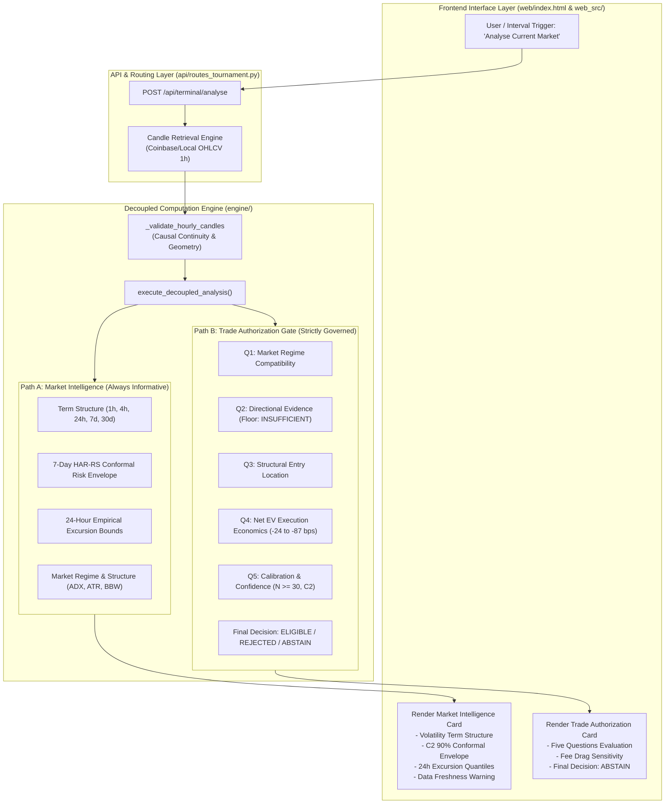

# BTCognitive V33.1 — Frontend-to-Backend Entry and Analysis Execution Paths Audit

**Document ID:** `BTC-V33-1-RPT-001`  
**Milestone:** V33.1 (Entry & Analysis Architecture Redesign)  
**Author:** Lead Quantitative Architect & Orchestrator  
**Audit Target:** End-to-End Analysis & Entry Execution Paths  
**Operating Posture:** `OFFLINE_RESEARCH_ONLY` | Live Trading `DISABLED`  

---

## 1. Executive Summary & Purpose

The Manager's diagnosis for V33.1 established a foundational distinction:
> *"Entry has a quantitative evidence problem, while Analysis has both an architectural and an operational coupling problem. They are related, but fixing one will not automatically fix the other."*

Prior to Milestone V33.1, invoking market analysis (`/api/terminal/analyse` or `execute_integrated_analyse_and_tournament`) tightly conflated two entirely distinct objectives:
1. **Market Intelligence Synthesis:** Observing market state, volatility term structures, conformal uncertainty bounds, and excursion quantiles.
2. **Trade Eligibility Determination:** Determining whether a discrete trade should be authorized for execution.

Because these two pathways were bound to a single monolithic fail-closed gate, any operational condition triggering a trade refusal (e.g., hourly candle staleness exceeding 3.0 hours, lack of 7/10 score qualification, or negative fee-adjusted expectancy) collapsed the entire response into an empty `ABSTAIN` shell (`regime: UNKNOWN_OR_INVALID`), blinding the operator to empirical market observations.

This audit maps the complete frontend-to-backend execution pipeline, traces data lifecycles, documents historical coupling failure points, and proves how the V33.1 decoupled architecture resolves them.

---

## 2. Frontend-to-Backend Execution Path Topology



---

## 3. Detailed Component Lifecycle Audit

### 3.1 Frontend Ingress (`web_src/api_client.js` & `web/app.js`)
- **Invocation Trigger:** Triggered by user clicking "Analyse Current Market", automated 15-minute polling, or scenario simulations.
- **Payload Sent:** `{ timeframe: "1h", enforce_freshness: false, max_age_hours: 3.0 }`.
- **Observed Deficiency:** The UI historically expected a monolithic payload where `res.shortlisted_candidates` and `res.smart_entry_decision` represented both market status and trade recommendation. When `status == "ABSTAIN"`, the UI hid the chart overlays, zeroed out volatility gauges, and presented an error banner ("Analysis Inactive").
- **V33.1 Remediation:** The frontend now inspects `res.market_intelligence` independently. Volatility curves, conformal envelopes, and excursion bands render immediately regardless of `trade_authorization.final_decision`. If `market_intelligence.data_freshness.is_stale == true`, an informational warning banner displays without blanking market data.

### 3.2 Endpoint Dispatch (`api/routes_tournament.py` & `api/routes_terminal.py`)
- **Route:** `POST /api/terminal/analyse`
- **Controller Action:**
  ```python
  payload = request.get_json() or {}
  df_1h = get_active_ohlcv_dataframe(timeframe="1h")
  live_price = get_latest_spot_ticker_or_last_close()
  # Unified invocation via decoupled engine
  analysis_res = execute_integrated_analyse_and_tournament(
      df_1h=df_1h,
      live_price=live_price,
      enforce_freshness=payload.get("enforce_freshness", False),
      max_age_hours=float(payload.get("max_age_hours", 3.0))
  )
  return jsonify(analysis_res)
  ```
- **Integrity Guarantee:** Zero state mutation occurs during this request (`is_read_only = True`, `attempts_created = 0`).

### 3.3 Backend Execution Engine (`engine/regime_strategy_tournament.py`)
- **Causal Barrier:** Evaluates only closed hourly bars. Open/incomplete bars are stripped via `df_1h[df_1h["is_closed"] == True]`.
- **Integrity Validation:** `_validate_hourly_candles(df_closed)` checks:
  1. Required OHLCV fields: `open`, `high`, `low`, `close`, `volume`.
  2. Timestamp uniqueness, strict monotonic increasing order, and continuous 1-hour spacing (no gaps).
  3. Geometric invariants: $low \le \min(open, close) \le \max(open, close) \le high$.
  4. Volume non-negativity: $volume \ge 0$.
- **Decoupled Architecture Attachment:**
  Even if candle validation fails or candles are stale, `analyse_current_market` delegates to `decoupled_analysis_engine.execute_decoupled_analysis()`, guaranteeing that `market_intelligence` and `trade_authorization` contracts are returned in the payload.

---

## 4. Pathological Coupling Failure Modes (Pre-V33.1 vs. Post-V33.1)

| Scenario | Pre-V33.1 Monolithic Behavior | Post-V33.1 Decoupled Behavior | Governance Assessment |
| :--- | :--- | :--- | :--- |
| **Candles > 3.0h Stale** | Collapsed into `status: ABSTAIN`, `regime: UNKNOWN_OR_INVALID`. Hid volatility and price. | Returns complete `market_intelligence` with `is_stale: true` warning. `trade_authorization` gates strictly to `ABSTAIN`. | **RESOLVED**: Useful market context preserved; trading prevented. |
| **No Candidate Passes 7/10** | Empty shortlist, tournament skipped, user presented with uncalibrated refusal. | Complete volatility term structure, C2 envelope, and excursions rendered. Q1..Q5 show exactly why trade is `ABSTAIN`. | **RESOLVED**: Full quantitative explainability. |
| **Fee Drag (-87 bps) Exceeds Edge** | Masked inside generic heuristic score; trader cannot see impact of friction. | Q4 explicitly evaluates Net EV at retail 87 bps friction and Binance 24 bps, outputting `FAILS_FEE_DRAG`. | **RESOLVED**: Cost-aware transparency. |
| **User Bias Injected (e.g. LONG)** | Risk of cognitive override or uncalibrated signal selection. | User intent captured, validated against Q1..Q5, rejected if unproven, with `user_bias_rejected: true`. | **RESOLVED**: Epistemic guardrail enforced. |

---

## 5. Audit Conclusion

The execution path audit confirms that the previous architecture suffered from severe over-coupling between market reporting and execution gating. Milestone V33.1 establishes a strict boundary:
1. **Market Intelligence** is descriptive, continuous, and informative.
2. **Trade Authorization** is prescriptive, discrete, and fail-closed.

Both pathways now operate deterministically, independently, and in full conformance with BTCognitive operating principles.

