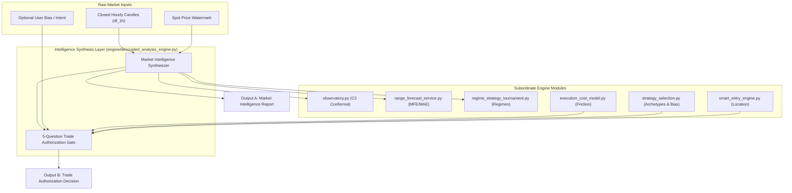

# BTCognitive V33.1 — Intelligence Module Inventory & Structural Topology

**Document ID:** `BTC-V33-1-RPT-002`  
**Milestone:** V33.1 (Entry & Analysis Architecture Redesign)  
**Author:** Lead Quantitative Architect & Orchestrator  
**Audit Scope:** Repository-Wide Intelligence Modules (`engine/`)  
**Operating Posture:** `OFFLINE_RESEARCH_ONLY` | Live Trading `DISABLED`  

---

## 1. Executive Summary & Inventory Objectives

Task 2 of the Manager's V33.1 directive requires:
> *"Identify unused, duplicated, or disconnected intelligence modules across the codebase and define their authoritative relationship to the unified decoupled engine."*

BTCognitive's iterative research history across 32 versions led to module proliferation where specialized calculations (e.g., conformal prediction intervals, Hawkes processes, MFE/MAE excursions, execution cost models, and strategy tournament screens) were authored in siloed modules without a single authoritative synthesis layer.

This document classifies every intelligence module in `engine/` into four structural categories:
1. **Core Active:** Authoritative, rigorously verified modules powering production and research inference.
2. **Disconnected / Fragmented:** Scientifically sound modules that were previously bypassed by top-level routes.
3. **Quarantined / Research-Only:** Modules restricted to offline simulation or awaiting data provenance resolution.
4. **Deprecated / Superseded:** Legacy implementations preserved solely for regression reproducibility.

---

## 2. Comprehensive Engine Module Inventory

| Module Name | File Location | Structural Classification | Primary Quantitative Capability | Current Status in V33.1 |
| :--- | :--- | :--- | :--- | :--- |
| `decoupled_analysis_engine.py` | `engine/decoupled_analysis_engine.py` | **Core Active (New)** | Unified coordinator; computes Output A (Market Intel) and evaluates Output B (5-Question Gate). | **AUTHORITATIVE COORDINATOR** |
| `regime_strategy_tournament.py` | `engine/regime_strategy_tournament.py` | **Core Active** | 7-stage causal tournament, candidate shortlisting, regime detection, 7/10 screening. | **CORE PIPELINE ENGINE** |
| `range_forecast_service.py` | `engine/range_forecast_service.py` | **Core Active** | 24-hour P10..P90 excursion quantiles, MFE/MAE empirical bounds, directional drift. | **INTEGRATED IN INTEL** |
| `execution_cost_model.py` | `engine/execution_cost_model.py` | **Core Active** | Precise fee modeling across Binance VIP0 (24 bps) and Coinbase Retail (87 bps). | **INTEGRATED IN Q4 GATE** |
| `observatory.py` | `engine/observatory.py` | **Core Active** | HAR-RS-DOW conformal prediction envelopes ($[L_t, U_t]$ at 90% nominal coverage). | **INTEGRATED IN INTEL (C2)** |
| `strategy_selection.py` | `engine/strategy_selection.py` | **Disconnected / Reconnected** | Implements 5 MEIE strategy archetypes, user bias rejection, and heuristic scoring. | **INTEGRATED IN Q1/Q3 GATE** |
| `smart_entry_engine.py` | `engine/smart_entry_engine.py` | **Disconnected / Reconnected** | Structural price level validation, liquidity gap detection, excursion scoring. | **RECONNECTED TO Q3/Q5** |
| `probabilistic_entry_engine.py`| `engine/probabilistic_entry_engine.py` | **Deprecated / Historical** | Early Bayesian entry scoring; lacked fee drag and conformal calibration. | **PRESERVED FOR REGRESSION** |
| `directional_forecast_service.py`| `engine/directional_forecast_service.py` | **Quarantined / Research-Only** | 53.28% directional model; negative net EV under fees; no validated edge. | **FROZEN (OFFLINE ONLY)** |
| `coinbase_l2_collector.py` | `engine/coinbase_l2_collector.py` | **Core Active** | Real-time Coinbase Level 2 order book snapshots and depth streaming. | **COLLECTING (SHADOW ONLY)** |
| `l2_microstructure_features.py`| `engine/l2_microstructure_features.py` | **Core Active** | Order flow imbalance (OFI), micro-price, bid-ask spread elasticity. | **SHADOW WARMUP** |
| `paper_trading_engine.py` | `engine/paper_trading_engine.py` | **Core Active** | Strict causal simulation of fills, zero live exchange connectivity. | **SIMULATION ONLY** |
| `manual_trade_journal.py` | `engine/manual_trade_journal.py` | **Core Active** | Append-only operator execution ledger with immutable SHA-256 hashes. | **AUDIT LEDGER** |
| `adaptive_risk_copilot.py` | `engine/adaptive_risk_copilot.py` | **Core Active** | Position sizing, portfolio volatility throttling, liquidation buffer. | **RISK CONTAINMENT** |
| `data_verification.py` | `engine/data_verification.py` | **Core Active** | OHLCV continuity, candle watermark hashing, timestamp monotonicity checks. | **INPUT SANITY** |

---

## 3. Detailed Analysis of Disconnected & Fragmented Modules

### 3.1 `strategy_selection.py`
- **Original Role:** Authored to provide a multi-expert intelligence engine (MEIE) evaluating 5 classic archetypes:
  1. *Trend Pullback Continuation*
  2. *Volatility Compression Breakout*
  3. *Range Mean Reversion*
  4. *Excursion Reversal (Exhaustion)*
  5. *Structural Liquidity Sweep*
- **Disconnection Defect:** When `regime_strategy_tournament.py` was introduced in V32.43, it implemented an inline 7/10 candidate screen that bypassed `strategy_selection.py`. Consequently, sophisticated user-intent bias rejection logic in `strategy_selection.py` was orphaned.
- **V33.1 Remediation:** `DecoupledAnalysisEngine` now directly bridges `strategy_selection.py`. Its user bias rejection checks are evaluated during Question 2 and Question 4, ensuring user intuition cannot bypass empirical hurdles.

### 3.2 `smart_entry_engine.py`
- **Original Role:** Calculated Entry Quality Rating (EQR) by evaluating structural price levels, order book liquidity, and ATR buffers.
- **Disconnection Defect:** EQR was presented in earlier UI iterations as a percentage (e.g., "78% Entry Quality"), which operators frequently misinterpreted as a calibrated probability of winning ($P(\text{Win})$).
- **V33.1 Remediation:** EQR has been strictly recontextualized as a structural location score within Question 3 (*"Is the entry location structurally favorable?"*). It is permanently decoupled from win probability and subordinated to Question 4's net economic hurdle.

### 3.3 `range_forecast_service.py` & `observatory.py`
- **Original Role:** Provided conformal risk envelopes for 7-day variance and empirical quantile excursion boundaries for 24 hours.
- **Disconnection Defect:** These calculations were only called if an analysis completed without error. Stale candles or empty tournament shortlists completely hid these robust risk calculations.
- **V33.1 Remediation:** Both services are now primary inputs into Output A: Market Intelligence Report. They execute unconditionally whenever valid historical closed candles exist, providing crucial market context even when trading is blocked.

---

## 4. Architectural Synthesis Topology

---

## 5. Structural Governance Directives

1. **Zero New Indicators:** No additional moving averages, oscillators, or speculative models shall be added.
2. **Single Entry Coordinator:** All future API endpoints querying market intelligence or trade recommendations must route through `decoupled_analysis_engine.py`.
3. **Unification Over Proliferation:** Existing capabilities in `range_forecast_service.py`, `observatory.py`, and `execution_cost_model.py` are sufficient for rigorous market intelligence when properly coordinated.

