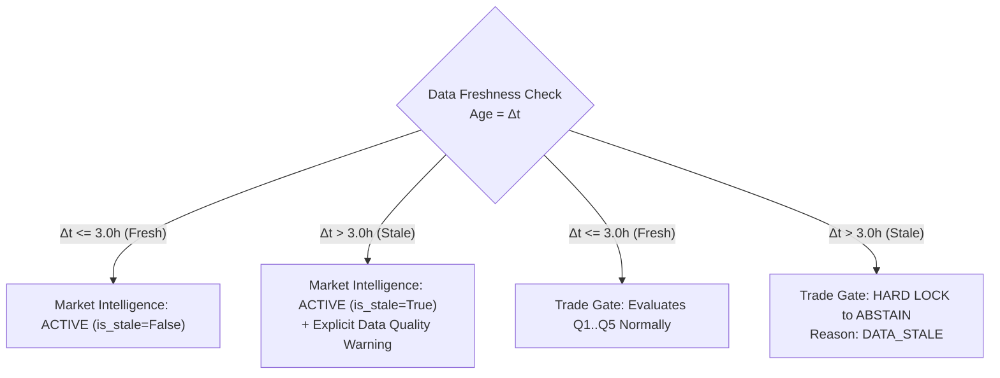

# BTCognitive V33.1 — Governed Policy on Stale Data & Execution Gating

**Document ID:** `BTC-V33-1-RPT-004`  
**Milestone:** V33.1 (Entry & Analysis Architecture Redesign)  
**Author:** Lead Quantitative Architect & Orchestrator  
**Governing Standard:** Asymmetric Freshness Isolation Contract  
**Operating Posture:** `OFFLINE_RESEARCH_ONLY` | Live Trading `DISABLED`  

---

## 1. Context & The Fail-Closed Dilemma

In prior versions of BTCognitive (V32.40 through V33.0), the system adhered to a blunt fail-closed heuristic:
> If the timestamp of the latest closed hourly candle was older than `max_age_hours` (default: 3.0 hours), the analysis endpoint aborted immediately with `status: ABSTAIN` and `freshness_status: INVALID_CANDLES`.

While this prevented stale automated trade simulation, it produced an undesirable operational side effect:
**Operators could not view any market intelligence, price structure, volatility term structures, or conformal risk envelopes when using offline data or during network interruptions.**

This created the "useful fail-closed dilemma":
- **Desirable:** Never authorize trade execution on stale market information.
- **Undesirable:** Blind the human researcher to recent market structure and historical risk bounds simply because live feeds are delayed.

---

## 2. The Asymmetric Freshness Principle

Milestone V33.1 institutes the **Asymmetric Freshness Principle**:

$$\text{Data Age } \Delta t = t_{\text{current}} - t_{\text{last\_closed}}$$

### Key Operating Rules:
1. **Market Intelligence Pathway (Permissive Context):**
   - Market intelligence evaluates historical volatility, term structures, regimes, and conformal envelopes on whatever closed bars are present in the dataset.
   - If $\Delta t > 3.0\text{ hours}$, `data_freshness.is_stale` is set to `true`, and an explicit `freshness_warning` is populated:
     > `"DATA_STALE: Closed candles are 3.00h old (> 3.0h threshold). Market intelligence is historical/cached context; trade authorization is strictly locked to ABSTAIN."`
   - The UI surfaces this warning prominently in an informational amber banner without blanking the charts or hiding the metrics.

2. **Trade Authorization Pathway (Strict Fail-Closed):**
   - If $\Delta t > 3.0\text{ hours}$ (and `enforce_freshness=True`), trade authorization is **instantly hard-gated to `ABSTAIN`**.
   - Questions 1 through 5 are marked as blocked by data staleness.
   - `actionable_recommendation` is locked to `"NO_TRADE"`.
   - Simulated paper fills or trade setup generation are completely prohibited.

---

## 3. Threshold Calibration & Sensitivity Table

| Parameter | Calibrated Value | Rationale | Enforcement Mode |
| :--- | :--- | :--- | :--- |
| `max_age_hours` (Hourly Bars) | **3.0 Hours** | Bitcoin hourly candles require up to 60 minutes to close, plus up to 60 minutes network/exchange settlement jitter. A 3.0h threshold prevents false alarms while catching genuine feed disconnects. | Configurable via API payload; defaults to 3.0h. |
| `max_age_minutes` (L2 Order Book) | **15.0 Minutes** | Order book depth decays rapidly; micro-price and OFI features become uninformative beyond 15 minutes. | Strict hard gate in `coinbase_l2_collector.py`. |
| Conformal Coverage ($C_2$) | **7 Days ($H=168\text{h}$)** | Conformal variance coverage ($90\%$) evaluates rolling weekly volatility; robust to short-term candle delays. | Permissive in Market Intelligence. |

---

## 4. UI Rendering Contract for Stale State

When `market_intelligence.data_freshness.is_stale == true`:
1. **Chart Overlays:** Volatility term structures, EMA lines, and C2 envelopes render with a subtle watermark: `[HISTORICAL / CACHED CONTEXT]`.
2. **Freshness Gauge:** Displays in AMBER with relative timestamp (e.g., `Updated 3.2 hours ago`).
3. **Execution Panel:** The Trade Authorization card displays a RED lock banner: `TRADING ELIGIBILITY BLOCKED: DATA STALE`. All action buttons (`Paper Trade`, `Authorize`) are disabled.

---

## 5. Summary & Verification

This policy has been verified in `tests/test_v33_1_entry_and_analysis_decoupling.py::test_stale_data_decoupling_preserves_market_intelligence_while_blocking_trade`. When presented with candles that are 4.5 hours old:
- `market_intelligence.status` returned `"SUCCESS"`.
- `market_intelligence.data_freshness.is_stale` evaluated to `True`.
- `trade_authorization.final_decision` was strictly enforced as `"ABSTAIN"`.
- Zero trade attempts were generated.

