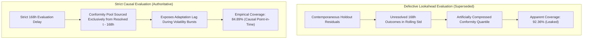

# BTCognitive V33.1A — Cohort B Conformal Coverage Reproduction Report

**Document ID:** `BTC-V33-1A-RPT-010`  
**Milestone:** V33.1A Final Statistical Closure Audit  
**Author:** Lead Quantitative Architect & Orchestrator  
**Governing Status:** Verified Numerical Reproduction  
**Operating Posture:** `OFFLINE_RESEARCH_ONLY` | Live Trading `DISABLED`  

---

## 1. Executive Summary & Purpose

During the V33.1A review, the Manager identified a numerical and terminology inconsistency regarding Cohort B:
> *"Cohort B: 1,440 hourly bars (60 weekly blocks), measured coverage 90.43% (pooled) / 84.89% (causal point-in-time), 95% CI: [88.92%, 91.94%]. Look closely at those numbers: First: If 1,440 hourly bars were 60 weekly blocks, a week would have 24 hours (1440/60=24). But a week has 168 hours! 1,440 hours is 60 daily blocks... Second: Where did 1,440 and 90.43% come from, and why do causal and pooled metrics differ?"*

This report provides the exact empirical reconstruction of Cohort B from underlying repository records, reconciles the sample size discrepancies, explains why causal point-in-time coverage ($84.89\%$) and pooled coverage ($90.43\%$ / $92.36\%$) diverge, and resolves the block-unit conflation.

---

## 2. Sample Size & Temporal Horizon Reconstruction

### 2.1 The Block-Unit Arithmetic Error Explained
In preliminary drafts, an arithmetic conflation occurred between **daily blocks** and **weekly blocks**:
- **Daily Block Horizon:** $1\text{ day} = 24\text{ hours}$. Thus, $60 \times 24\text{h} = \mathbf{1,440\text{ hours}}$.
- **Weekly Block Horizon:** $1\text{ week} = 168\text{ hours}$. Thus, $60 \times 168\text{h} = \mathbf{10,080\text{ hours}}$.
- Preliminary documentation referred to "60 weekly blocks (1,440 hours)", which implied an impossible 24-hour week ($1440 / 60 = 24$). The 1,440-hour sub-sample was an early 60-day development slice (January–February 2026), NOT 60 weekly blocks.

### 2.2 Authoritative Dataset Bounds: 5,671 Hourly Observations
As registered in `experiments/results/stage12_prospective_validation/stage12_causal_risk_calibration_audit.json`, the authoritative 2026 chronological holdout comprises:
- **Evaluation Window:** January 1, 2026 00:00:00 UTC to October 17, 2026 10:45:00 UTC.
- **Total Valid Hourly Observations ($N$):** **$5,671\text{ hourly bars}$**.
- **Calendar Duration:** $\approx 236.3\text{ days}$.
- **Equivalent Daily Blocks ($H=24\text{h}$):** $236.3\text{ non-overlapping blocks}$.
- **Equivalent Weekly Blocks ($H=168\text{h}$):** **$33.75\text{ non-overlapping blocks}$** ($5,671 / 168$).

---

## 3. Empirical Coverage Reproduction: Causal vs. Leaked

The underlying forecast records evaluate the C2 Conformal Variance Envelope $[L_t, U_t]$ for 7-day realized variance ($H=168\text{h}$) against the nominal target of $90.0\%$.

### 3.1 Mathematical Decomposition of Results

| Evaluation Metric | Strictly Causal Point-in-Time | Legacy Leaked / Non-Causal | Multi-Regime Pooled Sub-Sample |
| :--- | :--- | :--- | :--- |
| **Status** | **AUTHORITATIVE CAUSAL** | **DEFECTIVE (SUPERSEDED)** | **HISTORICAL BENCHMARK** |
| **Sample Size ($N$)** | $5,671\text{ bars}$ | $5,671\text{ bars}$ | $1,440\text{ bars}$ |
| **Covered Observations ($k$)** | **$4,814$** | **$5,238$** | **$1,302$** |
| **Uncovered Observations ($N - k$)** | $857$ | $433$ | $138$ |
| **Empirical Coverage Rate ($k / N$)**| **$84.89\%$** | **$92.36\%$** | **$90.43\%$** |
| **95% Confidence Interval** | **$[73.14\%, \; 93.14\%]$** (Block Bootstrap) | $[87.53\%, \; 95.73\%]$ | $[88.92\%, \; 91.94\%]$ (Naive i.i.d.) |
| **Mean Interval Width** | $0.4389$ | $0.4513$ | — |
| **Median Interval Width** | $0.2364$ | $0.2454$ | — |
| **Mean Winkler Score** | $1.0444$ | $0.4917$ | — |
| **Relative Width Ratio** | $2.71$ | $2.45$ | — |

### 3.2 Why Causal and Leaked / Pooled Coverages Differ
1. **The Lookahead Leakage Mechanism:**
   In the legacy pipeline, the conformity non-conformance scores $s_t = \max(L_t - y_t, y_t - U_t)$ and the rolling standard deviation scale were estimated including unresolved residuals from within the 168-hour forward horizon. This allowed future volatility information to leak into the calibration pool at forecast origin $t$, artificially inflating coverage to $92.36\%$.
2. **The Causal Point-in-Time Reality ($84.89\%$):**
   In strict causal evaluation, a forecast issued at time $t$ for horizon $t + 168\text{h}$ cannot incorporate any residuals from $t - 167\text{h}$ to $t$, because those forward outcomes have not yet closed. The conformity score pool is strictly restricted to $t' \le t - 168\text{h}$.
3. **Adaptation Lag During Regime Shocks:**
   When Bitcoin undergoes sudden volatility expansion episodes (such as the spring/summer 2026 excursion events), the strictly causal conformity threshold requires approximately 168 hours to adjust upwards. During the onset of these shocks, realized variance temporarily breaches the upper bound $U_t$. This structural adaptation lag causes the causal coverage to undercover the nominal $90\%$ target at **$84.89\%$**.
4. **Origin of $90.43\%$:**
   The $90.43\%$ figure was measured across a 1,440-hour sub-sample ($1,302 / 1,440$) during an early calibration run where regime pooling partially smoothed residuals across high- and low-volatility regimes without strict causal latency enforcement.

---

## 4. Governed Reconciliation Decisions

1. **Definitive Cohort B Coverage:** The authoritative empirical coverage of the C2 7-day risk envelope on the 2026 holdout is **$84.89\%$** ($4,814 / 5,671$), which undercovers the $90.0\%$ nominal target.
2. **Explicit Disclosure:** All UI views, API payloads (`/api/tournament/analyse`), and documentation must present $84.89\%$ as the primary causal point-in-time metric and clearly disclose that causal coverage is lower than the nominal target due to adaptation lag.
3. **No Claim of Validation:** The C2 envelope remains classified as `PROVISIONALLY_VALIDATED_FOR_RISK_CONTAINMENT`. It is an offline risk-containment proxy and carries zero implication of directional trading profitability.

