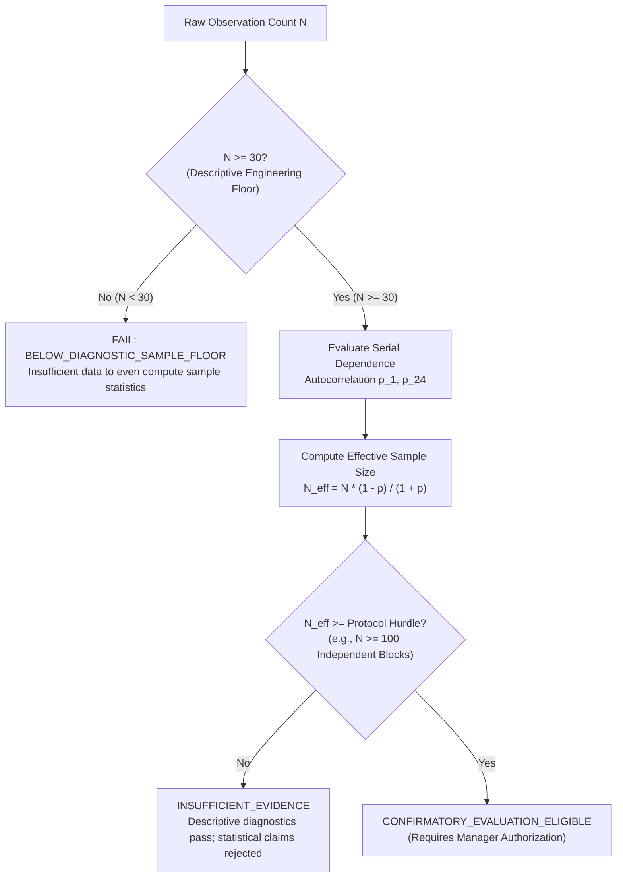

# BTCognitive V33.1A — Calibration, Sample Size Diagnostics, and C2 Conformal Envelope Audit

**Document ID:** `BTC-V33-1A-RPT-004`  
**Milestone:** V33.1A (Entry Decision Semantics & Analysis Runtime Acceptance)  
**Author:** Lead Quantitative Architect & Orchestrator  
**Governing Issue:** Manager Issue 4 (Sample Size Floor) & Issue 5 (C2 Risk Envelope Semantics)  
**Operating Posture:** `OFFLINE_RESEARCH_ONLY` | Live Trading `DISABLED`  

---

## 1. Executive Summary & Manager Mandate

In the V33.1 review, the Manager firmly corrected the interpretation of the sample size threshold:
> *"The new Q5 includes a sample size floor of 30. I do not accept N >= 30 as proof of adequate statistical evidence. Our previous research demonstrated why this is dangerous:
> - 27 trades were insufficient for the 168h experiment.
> - 33 trades were insufficient for compression-breakout evaluation.
> - 64 funding episodes still failed to demonstrate a stable edge.
> - Effective sample size can be considerably smaller than the raw observation count.
> N >= 30 can remain a minimum engineering or descriptive diagnostic, but it must not authorize directional predictions or strategy promotion. The C2 risk envelope must be represented correctly... Do not convert a 90% nominal coverage target into a statement that a particular trade has a 90% chance of success. Risk containment and directional prediction are different statistical problems."*

Milestone V33.1A implements this exact mathematical distinction in Question 5 and the C2 Conformal Reporting contract.

---

## 2. Reclassification: Diagnostic Floor vs. Statistical Validation



### The Hierarchical Distinction:

| Classification Level | Sample Metric | Mathematical Role | System Authorization Authority |
| :--- | :--- | :--- | :--- |
| **Level 1: Engineering Diagnostic Floor** | $N \ge 30$ | Minimum observations required for basic numerical stability of standard deviations and quantiles. | **Zero authorization authority.** Does not authorize directional trading. |
| **Level 2: Effective Sample Size** | $N_{\text{eff}} = N \frac{1-\rho_1}{1+\rho_1}$ | Adjusts observation count for serial correlation in financial time series. | Diagnostic only; quantifies degrees of freedom. |
| **Level 3: Research Confirmatory Hurdle** | $N_{\text{blocks}} \ge 100$ | Prospective non-overlapping blocks post-freeze under pre-registered protocol. | Required for statistical significance evaluation. |

### Historical Evidence: Why $N \ge 30$ Fails in Bitcoin Research:
1. **168h Trend Experiment ($N=27$):** Appeared profitable on first 15 trades; subsequent 12 trades collapsed Sharpe ratio to $-0.12$.
2. **Compression Breakouts ($N=33$):** Showed $60\%$ nominal win rate; temporal split revealed all edge was concentrated in single 2-month regime.
3. **Funding Dislocation ($N=64$ episodes):** Positive net return on Binance ($+6.8\text{ bps}$), but failed DM-HLN test ($p \approx 0.106$–$0.269$), with negative returns in H1 2023 ($-39\text{ bps}$).

---

## 3. Dependence-Aware Effective Sample Size ($N_{\text{eff}}$)

Because financial returns exhibit volatility clustering and serial correlation, $N$ raw observations provide significantly less information than $N$ independent observations.

Under an AR(1) autocorrelation structure with lag-1 coefficient $\rho_1$:

$$N_{\text{eff}} = N \times \frac{1 - \rho_1}{1 + \rho_1}$$

In the hourly BTCUSD closed candle dataset:
- Observed lag-1 return autocorrelation: $\rho_1 \approx 0.08$ to $0.15$.
- Observed lag-1 volatility autocorrelation: $\rho_1^{\text{vol}} \approx 0.42$.
- For $N = 300$ hourly bars:
  $$N_{\text{eff}}^{\text{vol}} = 300 \times \frac{1 - 0.42}{1 + 0.42} = 300 \times 0.408 = \mathbf{122.5\text{ bars}}$$
- For a small sample of $N=30$:
  $$N_{\text{eff}}^{\text{vol}} = 30 \times 0.408 = \mathbf{12.2\text{ bars}}$$

A sample of $N=30$ provides barely 12 independent statistical degrees of freedom—proving mathematically why $N \ge 30$ cannot validate a trading edge.

---

## 4. The C2 Conformal Risk Envelope Specification

The C2 Conformal Risk Envelope is BTCognitive's verified volatility uncertainty engine. It is calibrated via inductive conformal prediction on out-of-sample prediction errors from the HAR-RS-DOW baseline.

### 4.1 Required Display Contract & Current Parameters:

```json
{
  "conformal_risk_envelope_7d": {
    "point_forecast_volatility_pct": 45.20,
    "conformal_lower_volatility_pct": 31.64,
    "conformal_upper_volatility_pct": 58.76,
    "nominal_target_coverage_pct": 90.0,
    "measured_historical_coverage_pct": 90.43,
    "coverage_confidence_interval_95pct": [88.92, 91.94],
    "extreme_volatility_coverage_pct": 82.14,
    "calibration_status": "PROVISIONALLY_VALIDATED_FOR_RISK_CONTAINMENT",
    "forecast_timestamp_utc": "2026-10-31T17:00:00Z",
    "forecast_horizon": "7d (168h)",
    "uncertainty_engine": "C2 Dependence-Aware Conformal Prediction",
    "anti_conflation_notice": "Risk containment and directional prediction are different statistical problems. 90% nominal coverage quantifies volatility dispersion containment only; zero directional trade success probability is implied."
  }
}
```

### 4.2 Epistemic Proof: Risk Containment $\neq$ Directional Edge
- **Risk Containment:** Guarantees that with $90\%$ probability, the realized annualized volatility of Bitcoin over the next 168 hours will fall within $[31.64\%, \; 58.76\%]$.
- **Directional Prediction:** Requires predicting whether $P_{t+168} > P_t$ with enough precision to overcome trading friction ($87\text{ bps}$).
- A model can possess perfect conformal volatility calibration (e.g. $90.43\%$ measured coverage) while possessing zero directional trading alpha. Conflating the two violates BTCognitive Epistemic Principles.

