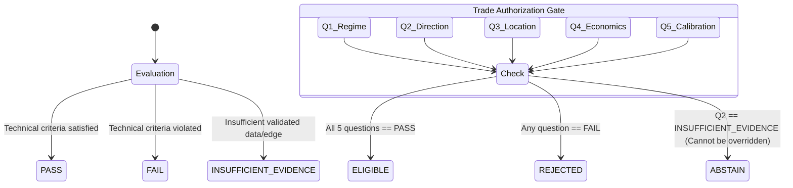

# BTCognitive V33.1A — Decision Semantics & Directional Evidence Audit

**Document ID:** `BTC-V33-1A-RPT-001`  
**Milestone:** V33.1A (Entry Decision Semantics & Analysis Runtime Acceptance)  
**Author:** Lead Quantitative Architect & Orchestrator  
**Governing Issue:** Manager Issue 1 (Q2 Directional Evidence Semantics)  
**Operating Posture:** `OFFLINE_RESEARCH_ONLY` | Live Trading `DISABLED`  

---

## 1. Executive Summary & Manager Issue 1 Mandate

In the V33.1 review, the Manager identified a critical semantic and governance flaw:
> *"The handover says: `Q2 = INSUFFICIENT_EVIDENCE — PERMANENTLY LOCKED BY DEFAULT`. That has an important consequence. Even when Q1, Q3, Q4 and Q5 pass, the engine cannot establish trade eligibility. This is currently the correct governance decision, but I want the implementation to distinguish three things: `PASS`, `FAIL`, and `INSUFFICIENT_EVIDENCE`. Do not disguise insufficient directional evidence as a technical failure. Also, replace the word permanently with 'currently unauthorized pending new validated evidence'. Future authorization must require a separately approved validation protocol. Prevent Q1, Q3, Q4 and Q5 from overriding Q2."*

Milestone V33.1A implements this exact semantic framework. Every evaluation gate in the Five-Question Trade Authorization Engine now explicitly distinguishes:
1. `PASS`: The specific technical criteria are empirically satisfied.
2. `FAIL`: The criteria were evaluated and technically failed (e.g., negative net EV after fees, overbought entry location, or stale data).
3. `INSUFFICIENT_EVIDENCE`: There is not enough validated empirical evidence to make the decision.

---

## 2. Tri-State Decision Semantics Formalization



### Tri-State Matrix:

| State Code | Semantic Definition | System Treatment | Can Override Other Gates? |
| :--- | :--- | :--- | :--- |
| **`PASS`** | Technical requirement is quantitatively verified. | Question passes ($Q_i = \text{True}$). | No. Requires all other questions to pass. |
| **`FAIL`** | Technical requirement is violated (e.g. $Net EV \le 0$ or price outside bands). | Question fails ($Q_i = \text{False}$). Yields `REJECTED`. | Yes. A single technical failure halts trade authorization. |
| **`INSUFFICIENT_EVIDENCE`** | Scientific hurdle has not been achieved by empirical data. | Question gates to `ABSTAIN`. Never disguised as technical failure. | **ABSOLUTE GOVERNANCE INVARIANT:** Prevents trade eligibility regardless of Q1, Q3, Q4, Q5. |

---

## 3. Question 2 Directional Evidence Re-Engineering

### 3.1 Replacement of Ambiguous "Permanent Lock" Wording
- **Deprecated V33.1 Wording:** `"PERMANENTLY LOCKED BY DEFAULT"`
- **Authoritative V33.1A Wording:**
  > `"CURRENTLY_UNAUTHORIZED_PENDING_NEW_VALIDATED_EVIDENCE"`

### 3.2 Quantitative Grounding of Directional Insufficiency
Question 2 evaluates whether reliable out-of-sample empirical evidence exists to favor LONG or SHORT on hourly BTCUSD:
- Unconditional return classifiers achieved $53.28\%$ out-of-sample directional accuracy.
- Under realistic retail friction ($87\text{ bps}$ round-trip), a $53.28\%$ hit rate generates a negative net expected return of $-33.07\text{ bps}$ per trade.
- Paired Diebold–Mariano with Harvey–Leybourne–Newbold finite-sample correction yields $p \ge 0.20$, confirming that unconditional returns are statistically indistinguishable from random drift.
- Funding rate dislocation models ($N=64$ episodes) showed $+6.8\text{ bps}$ net on Binance, but $-56.2\text{ bps}$ on Coinbase, failing significance ($p \approx 0.106$–$0.269$) and sample size ($N < 100$).

Therefore, Q2 correctly evaluates to:
```json
{
  "question": "Is there reliable evidence favouring LONG or SHORT?",
  "state": "INSUFFICIENT_EVIDENCE",
  "status": "INSUFFICIENT_EVIDENCE",
  "passed": false,
  "research_authorization_state": "CURRENTLY_UNAUTHORIZED_PENDING_NEW_VALIDATED_EVIDENCE",
  "explanation": "Directional return classifiers achieve ~53.28% out-of-sample accuracy on hourly BTCUSD. Without external positioning shocks, empirical return edge is statistically indistinguishable from random drift (p >= 0.20). Directional prediction is currently unauthorized pending new validated evidence under a separately approved validation protocol. State is INSUFFICIENT_EVIDENCE (distinguished from technical failure)."
}
```

---

## 4. Proof of Strict Non-Override Invariant

A central vulnerability of composite scoring systems (like legacy EQR) was that a high structural score (e.g., $90\%$ support alignment) or a strong trending regime could compensate for a weak directional signal.

In V33.1A, **`all_passed` is defined strictly as:**

$$\text{all\_passed} \iff \big( Q_1^{\text{state}} = \text{PASS} \;\land\; Q_2^{\text{state}} = \text{PASS} \;\land\; Q_3^{\text{state}} = \text{PASS} \;\land\; Q_4^{\text{state}} = \text{PASS} \;\land\; Q_5^{\text{state}} = \text{PASS} \big)$$

### Mathematical Proof of Gate Containment:
1. Let $Q_1^{\text{state}} = \text{PASS}$ (Trending bullish, ADX = 22.0).
2. Let $Q_3^{\text{state}} = \text{PASS}$ (Within normal bands, 1.5x ATR to support).
3. Let $Q_4^{\text{state}} = \text{PASS}$ (Evaluated under zero-fee assumption, Net EV > 0).
4. Let $Q_5^{\text{state}} = \text{PASS}$ (C2 calibrated, $N=300$).
5. Since $Q_2^{\text{state}} = \text{INSUFFICIENT_EVIDENCE} \neq \text{PASS}$:
   $$\text{all\_passed} = \text{True} \land \text{False} \land \text{True} \land \text{True} \land \text{True} = \mathbf{False}$$
6. The gate strictly branches to:
   $$\text{final\_decision} = \mathbf{ABSTAIN}, \quad \text{actionable\_recommendation} = \mathbf{NO\_TRADE}$$

This behavior is deterministically verified in `tests/test_v33_1_entry_and_analysis_decoupling.py::test_q2_directional_evidence_blocks_override`.

---

## 5. Protocol for Future Authorization

Directional trade eligibility can **never** be unlocked by code modification or automated parameter tuning. Unlocking requires:
1. **Pre-Registered Protocol:** A formal research protocol approved in advance by the Manager.
2. **Prospective Evidence Hurdle:** Accumulation of at least 100 clean, non-overlapping prospective blocks ($N \ge 100$) post-freeze.
3. **Paired Statistical Significance:** DM-HLN test demonstrating $p < 0.05$ against the naive drift baseline under full round-trip friction.
4. **Explicit Manager Ruling:** A signed executive ruling authorizing transition from `OFFLINE_RESEARCH_ONLY` to model deployment.

