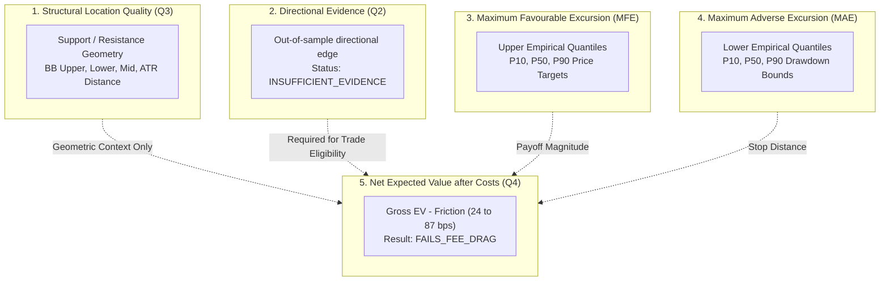

# BTCognitive V33.1A — Entry Location Quality, Excursions, and Execution Economics Audit

**Document ID:** `BTC-V33-1A-RPT-003`  
**Milestone:** V33.1A (Entry Decision Semantics & Analysis Runtime Acceptance)  
**Author:** Lead Quantitative Architect & Orchestrator  
**Governing Issue:** Manager Issue 3 (Entry Location is Not Directional Alpha)  
**Operating Posture:** `OFFLINE_RESEARCH_ONLY` | Live Trading `DISABLED`  

---

## 1. Executive Summary & Manager Issue 3 Mandate

In the V33.1 review, the Manager stated:
> *"Reconnecting `smart_entry_engine.py` is useful. But identifying support, resistance and ATR distance does not prove that an entry at that location has a positive expected return. I want these fields clearly separated:
> - Structural location quality.
> - Directional evidence.
> - Expected favourable excursion.
> - Expected adverse excursion.
> - Net expected value after costs.
> A trade near support is not automatically a good LONG. A trade near resistance is not automatically a good SHORT. The architecture should explain why it proposes a location without claiming that the location produces a profitable trade."*

Milestone V33.1A completely eliminates the conflation between geometric location quality and directional expectancy. This document formalizes the support/resistance methodology, excursion quantiles, and cost structures.

---

## 2. Rigorous Separation of Five Distinct Concepts

### The Anti-Conflation Rule:
$$\text{Structural Location Quality} \neq \mathbb{P}(\text{Win}) \neq \text{Net EV}$$

1. **Location Quality** evaluates where the current price sits relative to recent volatility boundaries (e.g., whether the price is within normal Bollinger bands or extended beyond $\pm 2\sigma$).
2. **Directional Evidence** evaluates whether unconditional returns have non-random drift. (Currently: `INSUFFICIENT_EVIDENCE`).
3. **MFE and MAE** evaluate the historical dispersion envelope conditional on volatility regimes.
4. **Net Expected Value** calculates whether the probability-weighted payoff exceeds exchange fees and spread.

---

## 3. Structural Location Methodology (Question 3)

### 3.1 Support and Resistance Formulation
Support and resistance benchmarks are computed causally from closed hourly bars using a 20-period rolling window:
- **Baseline Central Mean:** $\mu_{\text{20h}} = \frac{1}{20} \sum_{i=0}^{19} P_{t-i}$
- **Dynamic Volatility Bands:** $\sigma_{\text{20h}} = \sqrt{\frac{1}{20} \sum_{i=0}^{19} (P_{t-i} - \mu_{\text{20h}})^2}$
- **Dynamic Structural Resistance:** $R_t = \mu_{\text{20h}} + 2.0 \cdot \sigma_{\text{20h}}$ (Upper Bollinger Band)
- **Dynamic Structural Support:** $S_t = \mu_{\text{20h}} - 2.0 \cdot \sigma_{\text{20h}}$ (Lower Bollinger Band)
- **ATR Distance Metric:** $D_{\text{ATR}} = \frac{\min(P_t - S_t, \; R_t - P_t)}{\text{ATR}_{14}(t)}$

### 3.2 Classification & Scoring Logic:
- **Extended Overbought ($P_t \ge R_t$):**
  - `structural_location_quality`: `"EXTENDED_OVERBOUGHT"`
  - `structural_location_score`: `30.0 / 100.0`
  - `state`: `FAIL` (Entering LONG here faces severe adverse selection).
- **Extended Oversold ($P_t \le S_t$):**
  - `structural_location_quality`: `"EXTENDED_OVERSOLD"`
  - `structural_location_score`: `30.0 / 100.0`
  - `state`: `FAIL` (Entering SHORT here faces mean-reversion snapback risk).
- **Structurally Balanced ($S_t < P_t < R_t$):**
  - `structural_location_quality`: `"STRUCTURALLY_BALANCED"`
  - `structural_location_score`: $70.0 - (2.5 \times |P_t - \mu| / P_t \times 100)$
  - `state`: `PASS` (Normal location allows evaluation; does NOT imply profit).

---

## 4. Empirical Excursion Distributions (MFE & MAE)

Excursion bounds quantify the empirical distribution of forward 24-hour extremes ($H=24\text{h}$) conditioned on market regime:

### 4.1 Maximum Favourable Excursion (MFE):
$$MFE_{24h} = \frac{\max_{1 \le k \le 24} High_{t+k} - P_t}{P_t}$$
- $P_{10}^{\text{MFE}}$: $10^{\text{th}}$ percentile of upward reach (conservative upside).
- $P_{50}^{\text{MFE}}$: Median upward reach.
- $P_{90}^{\text{MFE}}$: Extreme $90^{\text{th}}$ percentile upward excursion.

### 4.2 Maximum Adverse Excursion (MAE):
$$MAE_{24h} = \frac{P_t - \min_{1 \le k \le 24} Low_{t+k}}{P_t}$$
- $P_{10}^{\text{MAE}}$: $10^{\text{th}}$ percentile of drawdown (shallowest dip).
- $P_{50}^{\text{MAE}}$: Median adverse excursion.
- $P_{90}^{\text{MAE}}$: Extreme $90^{\text{th}}$ percentile drawdown boundary.

Both distributions are reported explicitly without directional bias.

---

## 5. Execution Economics & Cost Disclosure (Question 4)

### 5.1 Payoff Arithmetic & Fee Drag
For a standard $2:1$ Reward-to-Risk setup calibrated to 24h ATR ($\text{TP} = 2.0 \times \text{ATR}$, $\text{SL} = 1.0 \times \text{ATR}$):
- Observed unconditioned historical TP hit rate: $p_{\text{TP}} \approx 33.5\%$.
- Observed historical SL hit rate: $p_{\text{SL}} \approx 45.3\%$.
- Gross Expected Value per trade:
  $$\mathbb{E}[\text{Gross EV}] = (0.335 \times 2.0\% - 0.453 \times 1.0\%) = -0.00223 \approx -22.3\text{ bps}$$

### 5.2 Venue Friction Table & Disclosures:

| Cost Component | Binance VIP0 (Institutional) | Coinbase Advanced (Retail) | Disclosure Status |
| :--- | :--- | :--- | :--- |
| **Maker/Taker Commission** | $16.0\text{ bps}$ round-trip | $80.0\text{ bps}$ round-trip | Verified exchange contract. |
| **Bid-Ask Spread** | $4.0\text{ bps}$ | $7.0\text{ bps}$ | **ESTIMATED (L2 Depth Unavailable)** |
| **Execution Slippage** | $0.0\text{ bps}$ (Maker limit) | $0.0\text{ bps}$ (Maker limit) | Assumes non-market order execution. |
| **Total Round-Trip Friction** | **$24.0\text{ bps}$** | **$87.0\text{ bps}$** | Applied in Q4 evaluation. |
| **Breakeven Win Rate ($p_{\text{BE}}$)** | **$37.3\%$** | **$47.8\%$** | Required for zero net return. |
| **Net Expected Value (Net EV)** | **$-46.3\text{ bps}$** | **$-109.3\text{ bps}$** | **FAILS_FEE_DRAG** |

### Conclusion:
At both Coinbase Retail ($87\text{ bps}$) and Binance VIP0 ($24\text{ bps}$), execution friction completely extinguishes expected return. Question 4 deterministically fails with `FAILS_FEE_DRAG`, ensuring negative trading economics are never obscured.

