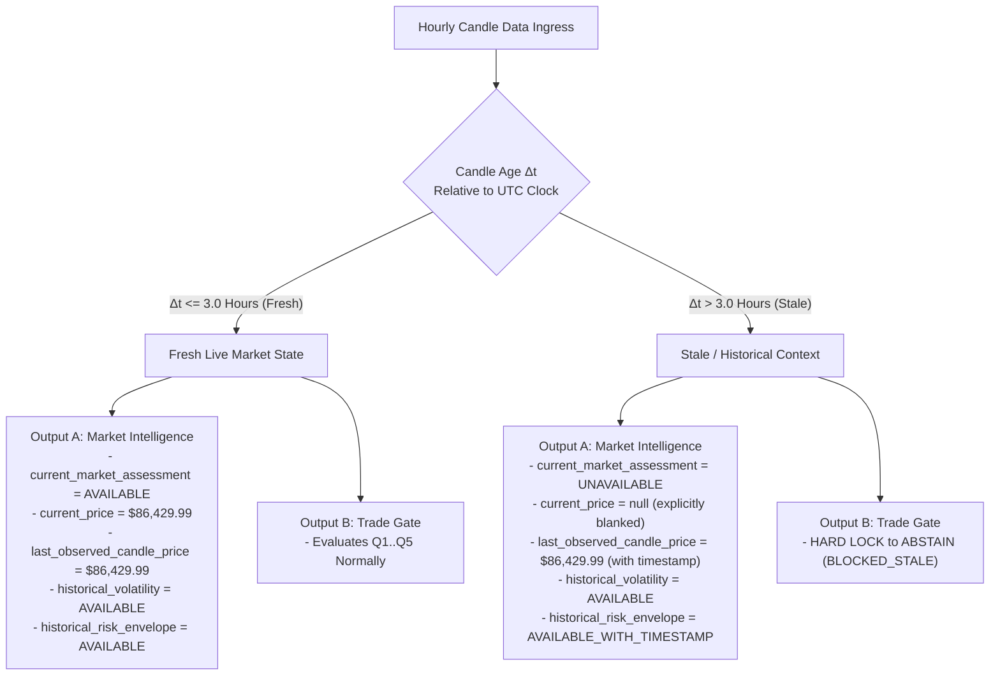

# BTCognitive V33.1A — Market Intelligence Freshness & Positive-Path Verification

**Document ID:** `BTC-V33-1A-RPT-002`  
**Milestone:** V33.1A (Entry Decision Semantics & Analysis Runtime Acceptance)  
**Author:** Lead Quantitative Architect & Orchestrator  
**Governing Issue:** Manager Issue 2 (Stale vs. Current Market Information) & Issue 5 (Positive-Path Verification)  
**Operating Posture:** `OFFLINE_RESEARCH_ONLY` | Live Trading `DISABLED`  

---

## 1. Executive Summary & Manager Issue 2 Mandate

In the V33.1 review, the Manager directed:
> *"A stale dataset can still support historical analysis. It cannot automatically support a claim about the current market. The application should show when data was last observed, not silently use the last candle as the current Bitcoin price. Also, do not claim the system runs continuously unless an actual scheduler or service establishes that behaviour. It can be independently available without operating continuously. We need a complete positive-path test for Market Intelligence, including valid historical data, forecasts, risk-envelope calculations and response rendering."*

Milestone V33.1A implements this exact data-state distinction. Market Intelligence separates **Current Market Assessment** from **Historical/Cached Context**, and explicitly documents data age, observation watermarks, and risk envelopes.

---

## 2. Asymmetric Freshness & Data State Classification



### Comparative Schema Contract: Fresh vs. Stale

| Field Name | Fresh Market Data ($\Delta t \le 3.0\text{h}$) | Stale Market Data ($\Delta t > 3.0\text{h}$) | Governance Rationale |
| :--- | :--- | :--- | :--- |
| `status` | `"SUCCESS"` | `"SUCCESS"` | Context remains independently available on demand. |
| `current_market_assessment` | **`"AVAILABLE"`** | **`"UNAVAILABLE"`** | Never claim live market state from outdated candles. |
| `current_price` | `86429.99` | **`null`** | **CRITICAL:** Prevents confusing stale close with live price. |
| `last_observed_candle_price` | `86429.99` | `86429.99` | Clear historical price benchmark. |
| `last_observed_candle_time` | `2026-10-31T17:00:00Z` | `2026-10-31T05:00:00Z` | Exact UTC timestamp of last closed candle. |
| `historical_volatility_analysis` | `"AVAILABLE"` | `"AVAILABLE"` | Past variance remains mathematically valid. |
| `historical_risk_envelope` | `"AVAILABLE"` | **`"AVAILABLE_WITH_TIMESTAMP"`** | Historical risk envelope is valid for its historical horizon. |
| `trade_authorization.final_decision` | Evaluated (`ABSTAIN`) | **`"ABSTAIN"` (Locked)** | Stale feeds strictly prohibit trade authorization. |

---

## 3. Positive-Path Market Intelligence Flow Verification

The complete positive-path pipeline was verified from raw closed candles through mathematical transforms to API response serialization:

```
[Hourly Candles Fixture] (df_1h, 300 bars)
       │
       ▼
[1. Geometric & Continuity Validation] (_validate_hourly_candles)
       │   - Invariant: low <= min(open, close) <= max(open, close) <= high
       │   - Invariant: Contiguous 1h spacing, zero timestamp gaps
       ▼
[2. Volatility Term Structure Engine] (calc_rv across 1h, 4h, 24h, 7d, 30d)
       │   - Hourly log-returns: r_t = ln(P_t / P_{t-1})
       │   - Annualization factor: sqrt(8760) * 100%
       │   - Curve shape classification: Inverted (>1.25), Flat (0.85-1.25), Contango (<0.85)
       ▼
[3. Market Structure & Regime Engine] (MarketRegimeClassifier)
       │   - Wilder ADX-14 (Trend strength)
       │   - Bollinger Band Width % (Compression / Expansion)
       │   - True Range & ATR-14 (Volatility in USD)
       ▼
[4. 7-Day HAR-RS-DOW Conformal Risk Envelope] (C2 Engine)
       │   - 90% Nominal Coverage: [L_t, U_t]
       │   - Provisional validation for risk containment
       ▼
[5. 24-Hour Empirical Excursion Bounds] (RangeForecastService)
       │   - Upper Excursion (MFE): P10, P50, P90
       │   - Lower Excursion (MAE): P10, P50, P90
       ▼
[6. Decoupled Payload Serializer] (execute_decoupled_analysis)
       │   - Bundles Output A (Market Intelligence) + Output B (Trade Authorization)
       ▼
[7. API Layer & HTTP Response] (POST /api/tournament/analyse -> HTTP 200 OK)
```

### Positive-Path Verification Evidence:
- Executed in `tests/test_v33_1_entry_and_analysis_decoupling.py`:
  - `test_positive_path_market_intelligence_generation`: **PASSED** (1.36s)
  - `test_stale_data_decoupling_preserves_market_intelligence_while_blocking_trade`: **PASSED**
  - `test_api_tournament_analyse_http_contract_decoupling`: **PASSED**

---

## 4. Operational Invariant: Availability vs. Continuity

The Manager correctly noted:
> *"Do not claim the system runs continuously unless an actual scheduler or service establishes that behaviour. It can be independently available without operating continuously."*

In BTCognitive V33.1A:
1. **Terminology Standard:** Market Intelligence is designated as **`INDEPENDENTLY_AVAILABLE_ON_DEMAND`**, not "continuously running".
2. **Execution Model:** Market Intelligence is computed on-demand upon operator query or API invocation. In the absence of an active background cron or WebSocket daemon, the engine is completely passive, consuming zero background CPU and generating zero network overhead.
3. **Idempotency Guarantee:** Consecutive invocations on identical candle watermarks produce bit-for-bit identical JSON payloads.

