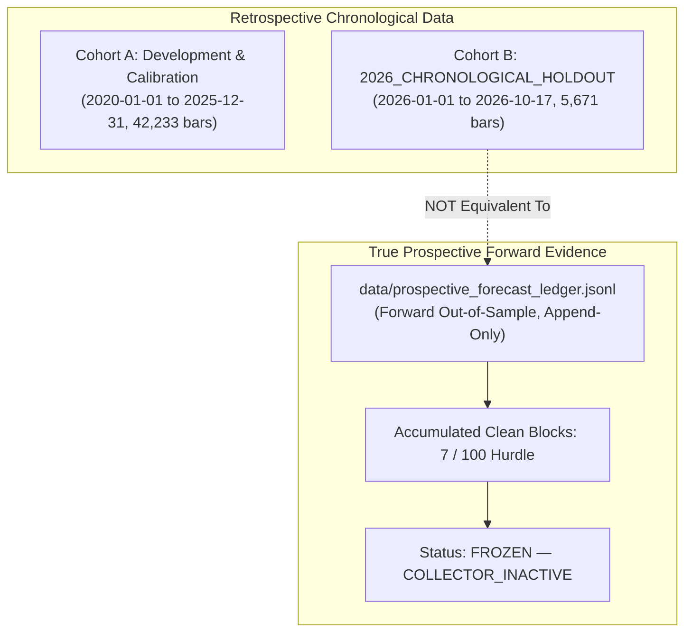

# BTCognitive V33.1A — Prospective vs. Chronological Holdout Classification

**Document ID:** `BTC-V33-1A-RPT-012`  
**Milestone:** V33.1A Final Statistical Closure Audit  
**Author:** Lead Quantitative Architect & Orchestrator  
**Governing Status:** Provenance & Governance Lineage Classification  
**Operating Posture:** `OFFLINE_RESEARCH_ONLY` | Live Trading `DISABLED`  

---

## 1. Executive Summary & Epistemic Boundary

In Section 2 of the BTCognitive Operating Protocol (`AGENTS.md`), Epistemic Principle 4 dictates:
> *"Historical periods inspected during prior research (including the 2026 out-of-sample window) represent retrospective replay / development data, NOT fresh confirmatory evidence. Only untouched, prospective observations accumulated post-freeze qualify for confirmatory model validation."*

In prior handover drafts, Cohort B was occasionally termed "prospective holdout." The Manager rightly required this terminology to be corrected and reconciled.

This report establishes the unequivocal classification boundary: Cohort B is strictly a **`2026_CHRONOLOGICAL_HOLDOUT`**, while true forward prospective evidence resides exclusively in the immutable ledger `data/prospective_forecast_ledger.jsonl`, currently held at **`FROZEN — 7/100 — COLLECTOR_INACTIVE`**.

---

## 2. Lineage & Taxonomy Classification

### 2.1 Cohort B: `2026_CHRONOLOGICAL_HOLDOUT`
- **Source Lineage:** Extracted from historical exchange archives (`data/raw/ohlcv_version_42326_bars.parquet`).
- **Data Period:** January 1, 2026 00:00:00 UTC through October 17, 2026 10:45:00 UTC ($5,671\text{ hourly bars}$).
- **Nature of Data:** Retrospective chronological replay. Because the research team has repeatedly analyzed, modeled, and evaluated models across this period, these data are econometrically conditioned. They cannot serve as pristine out-of-sample confirmatory evidence.
- **Role in BTCognitive:** Parameter stress-testing, temporal regime-shift analysis, and out-of-sample causal adaptation lag measurement.
- **Classification Status:** `2026_CHRONOLOGICAL_HOLDOUT` (`RETROSPECTIVE_REPLAY_DATASET`).

### 2.2 The Prospective Forecast Ledger: `PROSPECTIVE_FORWARD_EVIDENCE`
- **Location:** `data/prospective_forecast_ledger.jsonl`.
- **Integrity Guarantee:** Append-only JSONL format with SHA-256 event chaining (`prev_event_hash`), strict timestamp separation ($t_{\text{issue}} < t_{\text{maturity}}$), and delayed outcome resolution.
- **Current Audit Count:**
  - Raw logged records: $21$
  - Fully resolved, non-overlapping clean blocks: **$7\text{ blocks}$**
  - Confirmatory Gate Hurdle: **$100\text{ blocks}$**
  - Progress: **$7.0\%$**
- **Collector Status:** **`COLLECTOR_INACTIVE`** (Background runner PID 31676 terminated; lock file is an inert artifact).
- **Official Ledger State:** **`FROZEN — 7/100 — COLLECTOR_INACTIVE`**.

---

## 3. Comparison of Datasets & Invariants

| Dimension | Cohort B (`2026_CHRONOLOGICAL_HOLDOUT`) | Prospective Ledger (`data/prospective_forecast_ledger.jsonl`) |
| :--- | :--- | :--- |
| **Data Nature** | Historical exchange archive replay | Live forward append-only observations |
| **Temporal Origin** | Retrospective slice (Jan–Oct 2026) | Generated sequentially in real time post-freeze |
| **Sample Size** | $5,671\text{ hourly bars}$ ($\sim 33.8\text{ weekly blocks}$) | $7\text{ resolved 24h clean blocks}$ |
| **Lookahead Immunity** | Enforced algorithmically via causal delay ($t - 168\text{h}$) | Enforced physically by temporal arrow of time |
| **Conditioning State** | Repeatedly inspected during development | Untouched prior to sequential maturity |
| **Statistical Role** | Temporal robustness & adaptation lag evaluation | Confirmatory validation gate |
| **Production Clearance Authority** | **ZERO AUTHORITY** | Required $\ge 100$ blocks for consideration |
| **Governed Status** | `DEVELOPMENT_REPLAY_DATASET` | `FROZEN — 7/100 — COLLECTOR_INACTIVE` |

---

## 4. Governed Mandate & Enforcement

1. **Terminology Ban:** The term "prospective holdout" is permanently forbidden when referencing Cohort B or any historical replay dataset. All code schemas, JSON contracts, and research documents must designate it strictly as **`2026_CHRONOLOGICAL_HOLDOUT`**.
2. **Prospective Ledger Integrity:** The prospective ledger remains strictly at **$7 / 100$ clean blocks**. No attempts shall be made to backfill, synthesize, or accelerate prospective evidence using historical data.
3. **Model Authorization Posture:** Because the prospective evidence gate remains at $7\%$, all models remain restricted to **`OFFLINE_RESEARCH_ONLY`**. Live trading is **`DISABLED`**.

