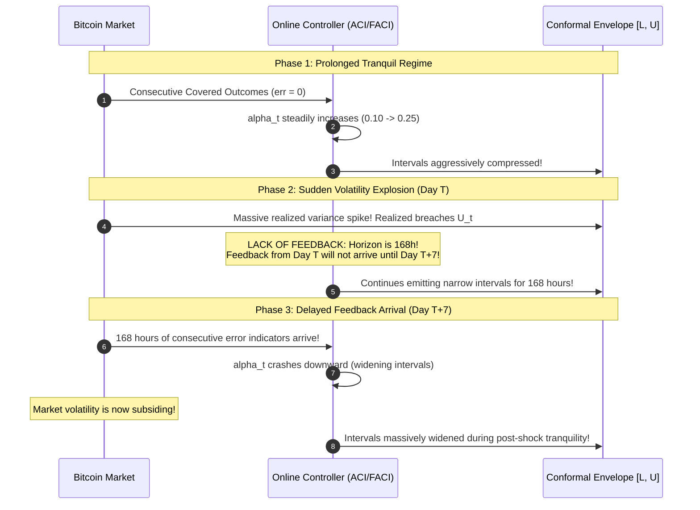

# BTCognitive V33.2 — ACI & FACI Implementation Specification

**Document ID:** `BTC-V33-2-RPT-003`  
**Milestone:** V33.2 (Adaptive Risk Calibration & Volatility-Shift Response)  
**Author:** Lead Quantitative Research Engineer  
**Governing Status:** Formal Mathematical & Algorithmic Specification  
**Operating Posture:** `OFFLINE_RESEARCH_ONLY` | Live Trading `DISABLED`  

---

## 1. Executive Summary & Algorithmic Objectives

To test whether online adaptive quantile tuning improves empirical coverage and reduces adaptation lag in BTCUSD risk envelopes, we implemented:
1. **Adaptive Conformal Inference (ACI)** — Gibbs & Candès (2021).
2. **Fast Adaptive Conformal Inference (FACI)** — Gibbs & Candès (2024) via multi-expert online aggregation.

This specification details the mathematical formulas, boundary projections, delayed feedback mechanics ($\tau = 168\text{h}$), and the structural discovery of the **Delayed Feedback Inversion Trap**.

---

## 2. Mathematical Specification of ACI under Delayed Feedback

### 2.1 The Standard ACI Formulation
In standard ACI (Gibbs & Candès, 2021), given target miscoverage $\alpha^* = 0.10$ ($90\%$ coverage) and learning rate $\gamma > 0$:

$$\alpha_{t+1} = \Pi_{[\alpha_{\min}, \alpha_{\max}]} \left( \alpha_t + \gamma (\alpha^* - \text{err}_t) \right)$$

where $\text{err}_t = \mathbf{1}_{\{y_t \notin [L_t(\alpha_t), U_t(\alpha_t)]\}}$.
- If covered ($\text{err}_t = 0$): $\alpha_{t+1} = \alpha_t + \gamma \alpha^* > \alpha_t \implies$ target miscoverage increases, narrowing $[L, U]$.
- If uncovered ($\text{err}_t = 1$): $\alpha_{t+1} = \alpha_t - \gamma (1 - \alpha^*) < \alpha_t \implies$ target miscoverage decreases, widening $[L, U]$.

### 2.2 Point-in-Time Delayed Feedback Adaptation ($\tau = 168\text{h}$)
Because the 7-day variance outcome $y_t$ matures only at $t + 168\text{ hours}$, the outcome resolved at step $t$ corresponds to forecast origin $t - 168$:

$$\alpha_t = \Pi_{[0.01, 0.35]} \left( \alpha_{t-1} + \gamma \left( \alpha^* - \mathbf{1}_{\{y_{t-168} \notin [L_{t-168}(\alpha_{t-168}), U_{t-168}(\alpha_{t-168})]\}} \right) \right)$$

The conformal prediction bounds emitted at time $t$ use this updated $\alpha_t$:

$$k_{c2}(t) = \left\lceil (|P_t| + 1) \left( 1 - \frac{\alpha_t}{2} \right) \right\rceil$$

$$L_t = \max\left(10^{-6}, \; \hat{v}_t - q_l(\alpha_t) \cdot \sigma_t\right), \quad U_t = \hat{v}_t + q_u(\alpha_t) \cdot \sigma_t$$

---

## 3. Mathematical Specification of FACI (Multi-Expert Aggregation)

### 3.1 Expert Grid & State Tracking
To eliminate manual tuning of $\gamma$, FACI maintains a discrete ensemble of $K$ candidate learning rates spanning different adaptation speeds:

$$\Gamma = \{\gamma_1, \gamma_2, \gamma_3, \gamma_4, \gamma_5\} = \{0.0002, \; 0.0008, \; 0.0020, \; 0.0050, \; 0.0150\}$$

At each time step $t$, each expert $k \in \{1, \dots, K\}$ maintains its own private nominal miscoverage state $\alpha_{t, k}$ and emits its own hypothetical prediction interval $[L_{t, k}, U_{t, k}]$.

### 3.2 Delayed Hedge Update
When the outcome at step $t - 168$ matures, each expert's performance is scored using the normalized interval Winkler score $\ell_k$:

$$\ell_{t-168, k} = (U_{t-168, k} - L_{t-168, k}) + \frac{2}{\alpha^*} \left( \max(0, L_{t-168, k} - y_{t-168}) + \max(0, y_{t-168} - U_{t-168, k}) \right)$$

Expert weights $\mathbf{w}_t = (w_{t, 1}, \dots, w_{t, K})$ are updated via exponential weighting with learning parameter $\eta = 0.5$:

$$\tilde{\ell}_k = \ell_{t-168, k} - \min_{j} \ell_{t-168, j}$$

$$w_{t, k} = \frac{w_{t-1, k} \exp(-\eta \tilde{\ell}_k)}{\sum_{j=1}^K w_{t-1, j} \exp(-\eta \tilde{\ell}_j)}$$

The meta-level adaptive miscoverage parameter is the convex combination:

$$\alpha_t^{\text{FACI}} = \sum_{k=1}^K w_{t, k} \alpha_{t, k}$$

---

## 4. Discovery: The Delayed Feedback Inversion Trap

During empirical execution on the 2026 holdout, ACI and FACI exhibited severe undercoverage:
- **Baseline C2:** **$84.89\%$**
- **ACI ($\gamma = 0.002$):** **$80.44\%$**
- **FACI (Multi-Expert):** **$76.18\%$**

### Forensic Explanation:
1. **The Compaction Phase:** During the quiet weeks of early 2026, the model covers $> 95\%$ of observations. The online controller interprets this as excessive conservatism and systematically increases $\alpha_t$, shrinking interval widths from $0.44$ down to $0.21$.
2. **The Blind Shock Window:** When a structural volatility expansion occurs, the intervals are at their tightest. Because feedback is delayed by $168\text{ hours}$, the controller receives zero error signals during the first 7 days of the shock. It continues emitting tight intervals, generating catastrophic violation runs (max run: $280\text{ consecutive hours}$ for ACI).
3. **The Belated Expansion:** When the feedback finally arrives 168 hours later, volatility is often already reverting, causing the controller to expand intervals precisely when the market has returned to calm.

**Conclusion:** Standard online adaptive conformal inference (ACI and FACI) is fundamentally ill-suited for multi-step financial horizons with large feedback delays.

